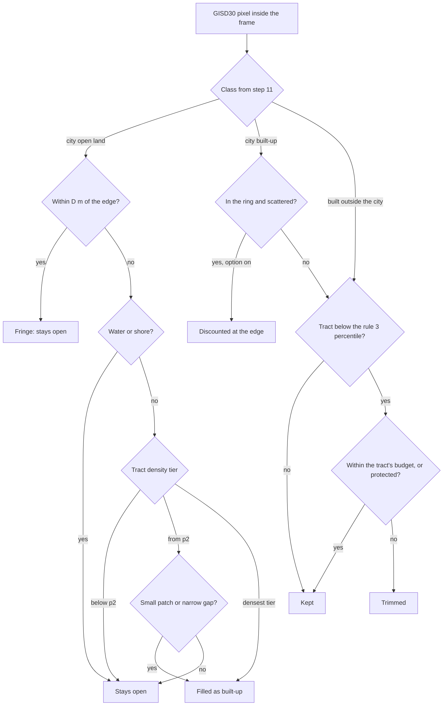

# Three rules on the Angel classes: what they do, how they interact, and what comes next

Exploratory. No number in this document is a project figure.

## 1. The problem

The city footprint comes from GISD30 (Zhang et al. 2022): impervious surface at 30 m, derived from Landsat. The Angel / Atlas of Urban Expansion rule then turns each built pixel into urban, suburban or rural. Open land within 100 m of urban or suburban built-up becomes fringe, and enclosed open patches become captured open space.

Looking at the maps against Landsat and present-day imagery, the classification is wrong in two opposite ways.

**Under-detection in the centre.** In the consolidated city, GISD30 marks only part of the pixels as built-up. Tree-lined streets, courtyards, small plots and roofs that read like soil all show as holes. This is worst in 1990, the census year we most need right. The result is a centre full of scattered "open" pixels that are obviously city. That makes built-up density too high, and growth since 1990 looks faster than it was.

**Over-detection on the outskirts.** Outside the city, and on its arid or irrigated edges, GISD30 marks as built-up land that has never been urbanized: farm plots, bare soil, dry riverbeds, greenhouses. The visual review flagged it in several cities:
- Salta's horticultural belt;
- the vineyards of Maipú and Guaymallén in Mendoza;
- the lower Chubut valley in Rawson–Trelew;
- the farm belts of San Juan and Neuquén.

Census tracts there hold a few dozen dwellings and show square kilometres of "built-up". This is worst in 2020.

**Both errors bias growth.** The centre is missing in 1990 and the outskirts are inflated in 2020, so GISD30 alone exaggerates 1990–2020 expansion. Whatever corrects this must hold across cities and across years. A rule that fixes one image but treats another differently would create growth where there was none.

## 2. The three rules

Every rule works on two things:
- the pixel classes of step 11: city built-up, city open land (fringe or captured), built-up outside the city;
- the census tract the pixel falls in.

Every density threshold is a **percentile of the city's own tracts in that census**, in steps of 5. It's computed over the tracts with at least 10 % of their area in the city. That makes the rules relative: the same setting means "the densest quarter of tracts" in Salta and in Rosario.

### Rule 1 · Edge ring

Open land within **D metres** of the city's outer limit stays fringe and is never filled (D from 0 to 500 m, in steps of 50).

Optionally, the ring also **discounts scattered built-up**: built pixels inside the ring with less than x % of built-up within 150 m stop counting as built. These are the isolated pixels on the city edge that are usually fields or bare soil.

```
 outside   | ring (≤ D m)          | interior
 . . . . . | o o o o o # o o o # # | # # # o # # # #
 . . . . . | o o # o o o o o # # # | # o # # # # o #
           |  ^ open: stays fringe |   ^ open inside: rule 2 decides
           |      ^ lone built: discounted if the option is on
```

D also decides what counts as **interior**, and so what rule 2 can work on. With a narrow ring, interior open land stays connected to the fringe and forms large patches. With a wider ring, the interior breaks into smaller patches that rule 2 can fill.

### Rule 2 · Fill open land inside

Only in dense tracts, open land beyond the ring becomes built-up when it's one of these:
- a **small patch**: open pixels that touch by a side, grouped, up to a chosen size (0.5, 1, 2, 5 or 20 ha);
- a **narrow gap**: closing the built-up (dilate, then erode) with a window of r metres covers it, with r from 30 to 240 m.

Three density tiers, each a percentile:

| Tract density | What fills |
|---|---|
| below p₂ | nothing |
| from p₂ | patches up to the base size, and narrow gaps |
| from a higher percentile | larger patches |
| from the highest percentile | **all** open land inside, any size |

Two things never fill, whatever the tier:
- water and its shore (JRC Global Surface Water plus OpenStreetMap);
- the edge ring.

```
 before                      after (dense tract)
 # # # # # # # # # #         # # # # # # # # # #
 # o # # # # o o # #         # f # # # # f f # #     f = filled: small patch / narrow gap
 # # # # o o o o o #         # # # # o o o o o #     o = large patch (a park): stays open
 # # # # o o o o o #         # # # # o o o o o #
 # # o # o o o o o #         # # f # o o o o o #
```

### Rule 3 · Trim built-up in near-empty tracts

Only in tracts **below a density percentile**, plus tracts with no city land at all, each tract can keep at most a budget of built-up:

- **Dwelling cap (the main option):** at most **dwellings × k pixels**. One pixel is 900 m². A house with its plot and its share of street takes less than a pixel in an urban neighbourhood, and one to three in a semi-rural one. Dwellings come from the census (all dwellings, occupied or not), so no persons-per-household figure is assumed.
- **Percentile floor (alternative):** a tract whose persons per km² built-up fall below the city's percentile p keeps only persons ÷ floor km².

Within the budget, the tract keeps first the pixels with the most built-up around them, so compact clusters survive and scattered pixels go. Pixels with at least 80 % built-up within 150 m are never trimmed. They're usually industry, institutions or a new subdivision not yet occupied when the census counted. The cap can also apply to built-up outside the city.

```
 tract: 12 dwellings, k = 1  ->  budget 12 pixels
 # # # . . x . . x . . .       # = kept (solid cluster, highest share first)
 # # # # . . . x . . x .       x = trimmed (scattered, low share)
 # # # . . . x . . . . .
```

The dwelling cap only binds where it should. A dense tract has far more dwellings than built pixels, so it never reaches the cap.

## 3. How the rules interact



- **Rule 1 shapes rule 2.** Patch sizes are measured beyond the ring, so changing D changes which patches are "small". The same patch threshold fills more with a wider ring.
- **Rule 1 runs before rule 3.** Pixels discounted at the edge no longer count against the tract's budget. With both on, a sparse edge tract loses its scattered pixels to rule 1 first, and rule 3 trims only what is still over the cap.
- **Rules 2 and 3 work on opposite ends of the density distribution.** Rule 2 adds in dense tracts, rule 3 removes in sparse ones. If rule 3's percentile is set above rule 2's, a tract can be both filled and trimmed. Keep rule 3's percentile at or below rule 2's.
- **Filled pixels don't count against the cap.** Rule 3 budgets the built-up GISD30 saw, not what rule 2 added. In practice the two don't meet, because dense tracts never reach the cap.
- **Water is open under every rule.** No setting fills a river or its shore.

Applied together, the rules shift the result from built-up land to **urbanized land**:
- built-up;
- plus the open land inside the city that works as city;
- minus spurious built-up in near-empty tracts.

That definition sits between the GISD30 built footprint and Angel's urban extent, which takes in all the fringe and all captured open space. Densities become persons per km² of urbanized land, and should be labelled that way.

## 4. What the first tests show

Six cities (Salta, Gran Rosario, Santa Rosa – Toay, Gran Mendoza, Corrientes, Formosa), four years and five combinations. Maps and tables are in [combinaciones/REPORTE.md](combinaciones/REPORTE.md), made by `scripts/19_combinaciones.R`.

- **Filling adds little,** a few km² per city. The missed pixels in old centres form connected webs rather than separate holes, so the patch rule alone misses them. The gap rule and the "all open land in the densest tracts" tier exist because of that.
- **Trimming mostly hits 2020.** In 1990 little is trimmed; in 2020 whole low-density belts are. Every combination lowers 1990–2020 growth compared with GISD30 as is, except Formosa, where they are about equal.
- **The dwelling cap without protection removes solid blocks** with few dwellings. The ≥ 80 % protection keeps them.
- **The cap reaches what the percentile floor cannot:** scattered built-up outside the city, which is the arid-farmland problem.

## 5. Why this needs care

- **Relative thresholds keep the share of affected tracts constant across censuses.** The densest quarter is always a quarter. That's what makes them portable across cities. But growth computed with relative rules partly reflects the rules, not the city. Every candidate rule set should be checked on the 1990–2020 growth it produces, not only on how a single year looks.
- **The images differ across years** (Landsat 5 in 1990, Landsat 8 in 2020, different seasons and sensors). A correction tuned on 2020 may over-correct 1990 or the reverse.
- **Cities differ.** Arid oases (Mendoza, San Juan, Salta), humid river cities (Corrientes, Resistencia) and the pampas (Santa Rosa, Rosario) fail in different ways. A rule set has to be judged on all of them, not on the city where it was designed.
- **No rule here is measured truth.** Each is an assumption about what the satellite missed, and its limits have to be stated wherever a corrected figure is used.

## 6. Next steps (until next week)

Goal: **one rule set that holds across agglomerations** and reflects what is on the ground, with its limits stated.

1. **An independent reference: building footprints from OpenStreetMap** (Geofabrik extracts, an approved source). Per pixel or per tract:
   - pixels GISD30 calls built with no OSM building nearby are candidates for over-detection, the cases rule 3 should trim;
   - pixels GISD30 calls open but sitting among dense OSM buildings are candidates for under-detection, the cases rule 2 should fill.

   Caveats:
   - OSM completeness varies by city and by neighbourhood, so it has to be checked before it is trusted;
   - it only describes today, so it can calibrate 2020, not 1990.
2. **Calibrate on 2020, check on all years.** Fit the parameters (ring width, patch size, gap, cap per dwelling, percentiles) where OSM is complete. Then check that the same parameters give plausible maps and growth in 1990–2010.
3. **Fix the parameters across cities,** or at most by city type, and report per agglomeration:
   - agreement with OSM;
   - how much each rule adds or removes;
   - how growth changes.
4. **Write the method into BITACORA and REGLAS_DE_ANALISIS** once agreed with Pedro. Only then can any corrected figure become a canonical one.

## Files

| What | Where |
|---|---|
| Interior patch sizes, ring widths, gaps up to 240 m | `scripts/18_parches.R` → `outputs/parches/<slug>/` |
| Distance to the edge, built-up share within 150 m, water mask | `scripts/16_reglas.R` → `outputs/reglas/<slug>/` |
| Five combinations, six cities, maps and tables | `scripts/19_combinaciones.R` → `pruebas/combinaciones/` |
| Tract tables (persons, households, dwellings) | `scripts/09_censos_radios.R`, `scripts/11_radios_ciudad.R` |
