# Rule combinations on the Angel classes: six cities, four years

Exploratory. No number here is a project figure. Generated by `scripts/19_combinaciones.R`; do not edit by hand.
Bariloche is not one of the 31 agglomerations in the pipeline (no EPH outline, no tract table), so it is not here.

## The combinations

All keep open land within 200 m of the city edge as fringe (rule 1).

|  | Rule 2 · fill interior open land | Rule 3 · trim built-up |
|---|---|---|
| A | no | no |
| B | patches <= 2 ha in tracts with urbanized density >= p25 | tracts below p10 of persons per km2 built keep persons / p10 km2 |
| C | B + narrow gaps <= 60 m in the same tracts | as B |
| D | density >= p50: patches <= 5 ha; p25-p50: <= 1 ha; below p25: none; + gaps <= 60 m from p25 | each tract keeps at most dwellings x 1 pixel (900 m2) |
| E | as D | each tract keeps at most dwellings x 2 pixels (1,800 m2) |

- Percentiles are per city and year (type 7), over tracts with at least 10 % of their area in the city.
- Trimming keeps the pixels with the most built-up within 150 m first, so solid clusters survive and scattered pixels go.
- B and C never trim pixels with >= 80 % built-up around them. D and E have no such protection: the cap is the cap, and it also applies to built-up outside the city (yellow).
- Water and its shore are never filled. The interior class and the gaps come from steps 16 and 18.

## Across cities

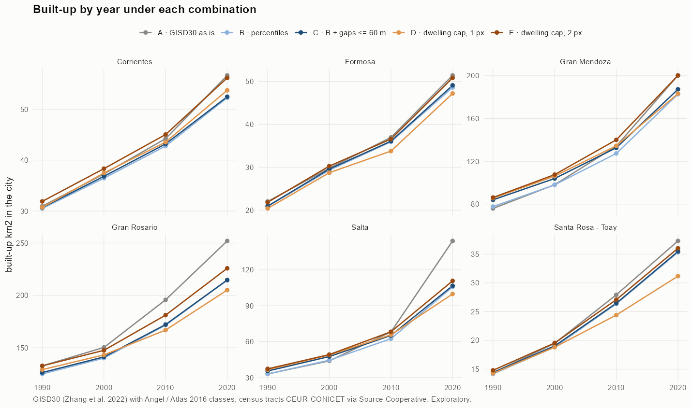

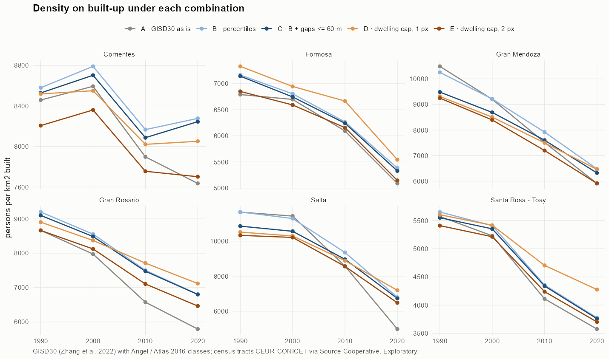

Annual growth of city built-up 1990-2020 (%):

| City | A | B | C | D | E |
|---|---|---|---|---|---|
| Salta | 5.03 | 3.95 | 3.74 | 3.40 | 3.70 |
| Gran Rosario | 2.16 | 1.82 | 1.78 | 1.56 | 1.79 |
| Santa Rosa - Toay | 3.23 | 3.09 | 3.04 | 2.64 | 3.01 |
| Gran Mendoza | 3.29 | 2.89 | 2.71 | 2.57 | 2.85 |
| Corrientes | 2.04 | 1.81 | 1.80 | 1.88 | 1.90 |
| Formosa | 2.87 | 2.86 | 2.88 | 2.83 | 2.86 |

## What the combinations imply

Read with the growth table and the maps below; every figure is in the tables.

1. **Filling (rule 2) is small everywhere.** It adds at most a few km2 per city. Gaps <= 60 m add about as much as the patch rule: the missed pixels form connected webs, not separate holes. Mendoza gains the most (the detail map shows its tree-lined blocks turning teal).
2. **Trimming (rule 3) grows with the year, so the rules flatten growth.** In 1990 little is trimmed; in 2020 whole low-density belts go orange (Salta, Rosario, Mendoza). Every combination gives a lower 1990-2020 growth rate than GISD30 as is, except Formosa, where they are about equal. The rules correct the recent over-detection more than the 1990 under-detection.
3. **The dwelling cap without protection (D, E) also trims solid blocks.** In the Salta 2020 detail a compact block is removed whole: a tract with few dwellings but a real built mass (industry, institutions, a new subdivision not yet occupied in 2022). B and C keep such pixels through the >= 80 % rule. A cap needs that protection, or a cluster-size one.
4. **The cap does what the percentile cannot outside the city.** D and E trim scattered built-up outside the city (orange outside the perimeter in Salta's south), which B and C never touch. That is the arid-farmland problem.
5. **k matters more than the type of rule.** In 2020 the 1-pixel cap (D) trims as much as the p10 floor or more in every city but Corrientes; in 1990 it trims less. The 2-pixel cap (E) always trims less than D, and in Mendoza 2020 its filling and trimming cancel out. Corrientes and Formosa move little under any combination.
6. **Caveats.** Dwellings come from the census nearest the image year (1991 for 1990, 2022 for 2020). A tract trimmed in 2020 may have been built after 2022's count or be non-residential. Dwellings include unoccupied ones.

## Salta

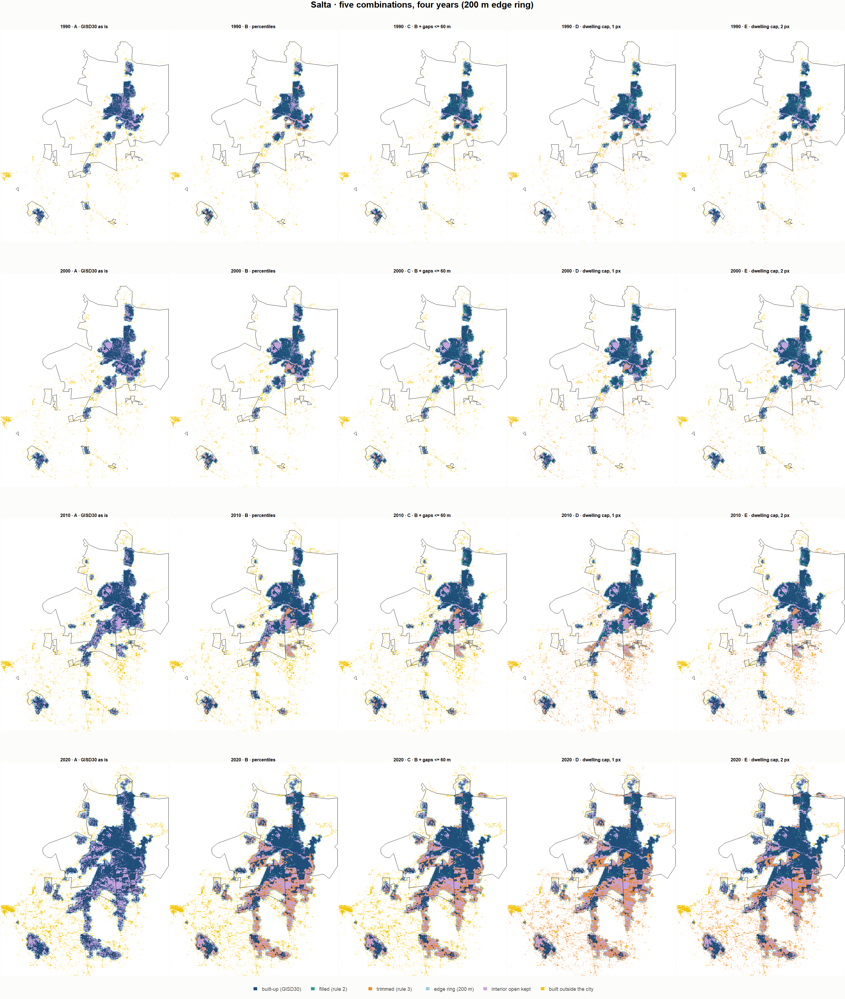

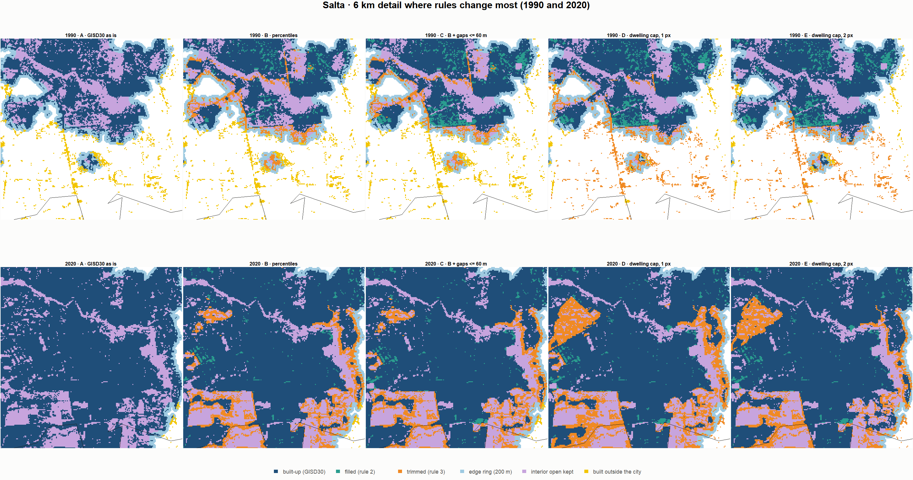

**1990** · 385,124 persons in 301 city tracts · p10 7,598 persons per km2 built · p25 / p50 urbanized density 5,731 / 8,561

|  | GISD30 km2 | + filled | - trimmed | = built-up km2 | trimmed outside | edge ring | interior open | persons / km2 built | tracts filled | tracts trimmed |
|---|---|---|---|---|---|---|---|---|---|---|
| A | 33.0 | 0.0 | 0.0 | 33.0 | 0.0 | 11.9 | 12.5 | 11,653 | 0 | 0 |
| B | 33.0 | 2.3 | 2.3 | 33.0 | 0.0 | 11.9 | 10.2 | 11,662 | 183 | 33 |
| C | 33.0 | 4.7 | 2.3 | 35.5 | 0.0 | 11.9 | 7.8 | 10,854 | 196 | 33 |
| D | 33.0 | 4.7 | 1.2 | 36.6 | 6.2 | 11.9 | 7.8 | 10,514 | 196 | 39 |
| E | 33.0 | 4.7 | 0.5 | 37.3 | 3.7 | 11.9 | 7.8 | 10,329 | 196 | 18 |

**2000** · 502,515 persons in 422 city tracts · p10 6,625 persons per km2 built · p25 / p50 urbanized density 5,648 / 8,197

|  | GISD30 km2 | + filled | - trimmed | = built-up km2 | trimmed outside | edge ring | interior open | persons / km2 built | tracts filled | tracts trimmed |
|---|---|---|---|---|---|---|---|---|---|---|
| A | 44.0 | 0.0 | 0.0 | 44.0 | 0.0 | 14.6 | 19.1 | 11,430 | 0 | 0 |
| B | 44.0 | 2.8 | 2.2 | 44.5 | 0.0 | 14.6 | 16.4 | 11,290 | 260 | 45 |
| C | 44.0 | 5.9 | 2.2 | 47.6 | 0.0 | 14.6 | 13.3 | 10,561 | 272 | 45 |
| D | 44.0 | 5.9 | 1.0 | 48.8 | 7.9 | 14.6 | 13.3 | 10,293 | 272 | 32 |
| E | 44.0 | 5.9 | 0.6 | 49.2 | 4.8 | 14.6 | 13.3 | 10,210 | 272 | 20 |

**2010** · 584,186 persons in 494 city tracts · p10 5,176 persons per km2 built · p25 / p50 urbanized density 5,236 / 7,966

|  | GISD30 km2 | + filled | - trimmed | = built-up km2 | trimmed outside | edge ring | interior open | persons / km2 built | tracts filled | tracts trimmed |
|---|---|---|---|---|---|---|---|---|---|---|
| A | 68.1 | 0.0 | 0.0 | 68.1 | 0.0 | 21.9 | 26.9 | 8,574 | 0 | 0 |
| B | 68.1 | 2.8 | 8.4 | 62.5 | 0.0 | 21.9 | 24.1 | 9,351 | 283 | 51 |
| C | 68.1 | 5.5 | 8.4 | 65.2 | 0.0 | 21.9 | 21.4 | 8,963 | 301 | 51 |
| D | 68.1 | 5.5 | 7.9 | 65.7 | 23.4 | 21.9 | 21.4 | 8,886 | 301 | 59 |
| E | 68.1 | 5.5 | 5.3 | 68.3 | 18.6 | 21.9 | 21.4 | 8,557 | 301 | 25 |

**2020** · 718,248 persons in 744 city tracts · p10 3,077 persons per km2 built · p25 / p50 urbanized density 4,470 / 7,540

|  | GISD30 km2 | + filled | - trimmed | = built-up km2 | trimmed outside | edge ring | interior open | persons / km2 built | tracts filled | tracts trimmed |
|---|---|---|---|---|---|---|---|---|---|---|
| A | 144.2 | 0.0 | 0.0 | 144.2 | 0.0 | 40.2 | 65.6 | 4,982 | 0 | 0 |
| B | 144.2 | 2.2 | 40.7 | 105.7 | 0.0 | 40.2 | 63.3 | 6,794 | 306 | 81 |
| C | 144.2 | 3.2 | 40.7 | 106.7 | 0.0 | 40.2 | 62.3 | 6,730 | 326 | 81 |
| D | 144.2 | 3.2 | 47.6 | 99.8 | 31.0 | 40.2 | 62.3 | 7,194 | 326 | 117 |
| E | 144.2 | 3.2 | 36.6 | 110.8 | 26.4 | 40.2 | 62.3 | 6,482 | 326 | 47 |

## Gran Rosario

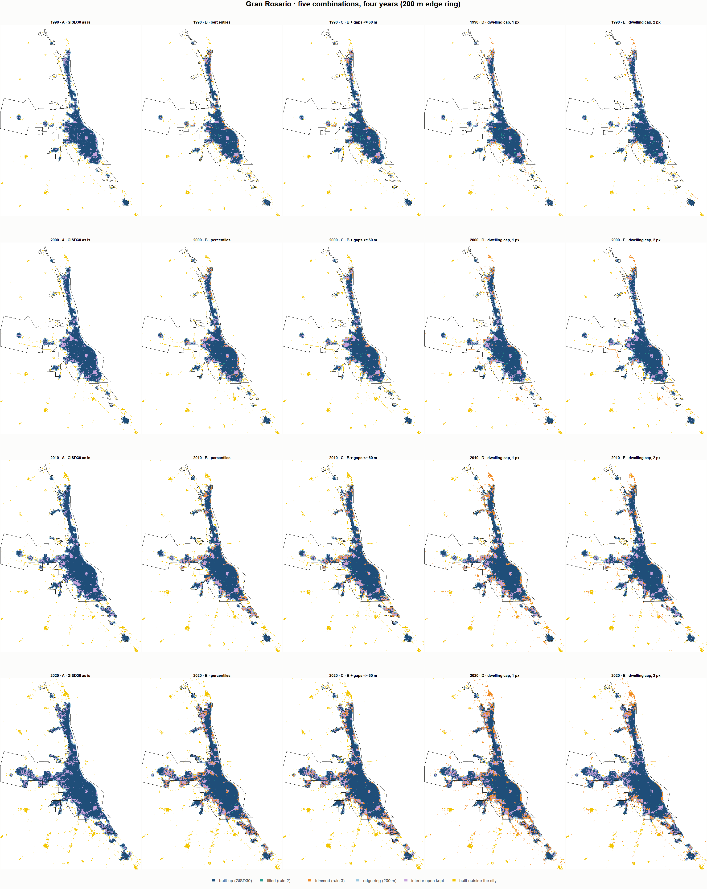

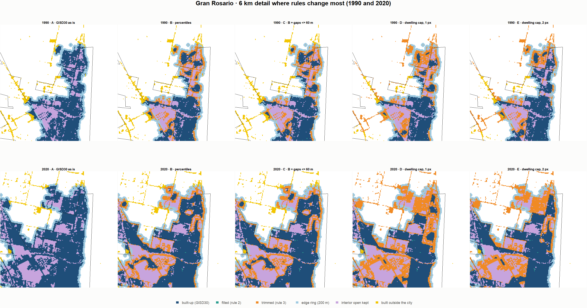

**1990** · 1,149,402 persons in 1,082 city tracts · p10 5,128 persons per km2 built · p25 / p50 urbanized density 6,155 / 9,553

|  | GISD30 km2 | + filled | - trimmed | = built-up km2 | trimmed outside | edge ring | interior open | persons / km2 built | tracts filled | tracts trimmed |
|---|---|---|---|---|---|---|---|---|---|---|
| A | 132.6 | 0.0 | 0.0 | 132.6 | 0.0 | 26.3 | 24.9 | 8,665 | 0 | 0 |
| B | 132.6 | 1.9 | 9.6 | 124.9 | 0.0 | 26.3 | 23.0 | 9,199 | 352 | 107 |
| C | 132.6 | 3.2 | 9.6 | 126.3 | 0.0 | 26.3 | 21.6 | 9,100 | 374 | 107 |
| D | 132.6 | 3.3 | 6.8 | 129.1 | 6.2 | 26.3 | 21.6 | 8,903 | 374 | 80 |
| E | 132.6 | 3.3 | 3.2 | 132.7 | 3.6 | 26.3 | 21.6 | 8,662 | 374 | 29 |

**2000** · 1,198,489 persons in 1,125 city tracts · p10 4,931 persons per km2 built · p25 / p50 urbanized density 6,030 / 9,042

|  | GISD30 km2 | + filled | - trimmed | = built-up km2 | trimmed outside | edge ring | interior open | persons / km2 built | tracts filled | tracts trimmed |
|---|---|---|---|---|---|---|---|---|---|---|
| A | 150.3 | 0.0 | 0.0 | 150.3 | 0.0 | 28.2 | 30.6 | 7,975 | 0 | 0 |
| B | 150.3 | 1.5 | 11.7 | 140.1 | 0.0 | 28.2 | 29.1 | 8,555 | 247 | 103 |
| C | 150.3 | 2.6 | 11.7 | 141.2 | 0.0 | 28.2 | 28.0 | 8,485 | 274 | 103 |
| D | 150.3 | 2.6 | 9.7 | 143.2 | 9.3 | 28.2 | 28.0 | 8,371 | 274 | 77 |
| E | 150.3 | 2.6 | 5.4 | 147.5 | 6.6 | 28.2 | 28.0 | 8,124 | 274 | 36 |

**2010** · 1,286,822 persons in 1,379 city tracts · p10 3,824 persons per km2 built · p25 / p50 urbanized density 5,726 / 9,136

|  | GISD30 km2 | + filled | - trimmed | = built-up km2 | trimmed outside | edge ring | interior open | persons / km2 built | tracts filled | tracts trimmed |
|---|---|---|---|---|---|---|---|---|---|---|
| A | 195.7 | 0.0 | 0.0 | 195.7 | 0.0 | 38.1 | 38.7 | 6,574 | 0 | 0 |
| B | 195.7 | 0.7 | 24.9 | 171.5 | 0.0 | 38.1 | 37.9 | 7,501 | 178 | 139 |
| C | 195.7 | 1.3 | 24.9 | 172.1 | 0.0 | 38.1 | 37.3 | 7,476 | 196 | 139 |
| D | 195.7 | 1.3 | 30.2 | 166.9 | 18.2 | 38.1 | 37.4 | 7,712 | 196 | 175 |
| E | 195.7 | 1.3 | 15.9 | 181.1 | 12.4 | 38.1 | 37.4 | 7,104 | 196 | 74 |

**2020** · 1,459,847 persons in 2,104 city tracts · p10 2,924 persons per km2 built · p25 / p50 urbanized density 5,269 / 8,824

|  | GISD30 km2 | + filled | - trimmed | = built-up km2 | trimmed outside | edge ring | interior open | persons / km2 built | tracts filled | tracts trimmed |
|---|---|---|---|---|---|---|---|---|---|---|
| A | 252.0 | 0.0 | 0.0 | 252.0 | 0.0 | 43.5 | 60.2 | 5,793 | 0 | 0 |
| B | 252.0 | 0.8 | 38.3 | 214.5 | 0.0 | 43.5 | 59.4 | 6,805 | 210 | 217 |
| C | 252.0 | 1.0 | 38.3 | 214.7 | 0.0 | 43.5 | 59.2 | 6,799 | 219 | 217 |
| D | 252.0 | 1.0 | 47.9 | 205.1 | 23.7 | 43.5 | 59.2 | 7,118 | 219 | 267 |
| E | 252.0 | 1.0 | 27.1 | 225.9 | 17.9 | 43.5 | 59.2 | 6,463 | 219 | 117 |

## Santa Rosa - Toay

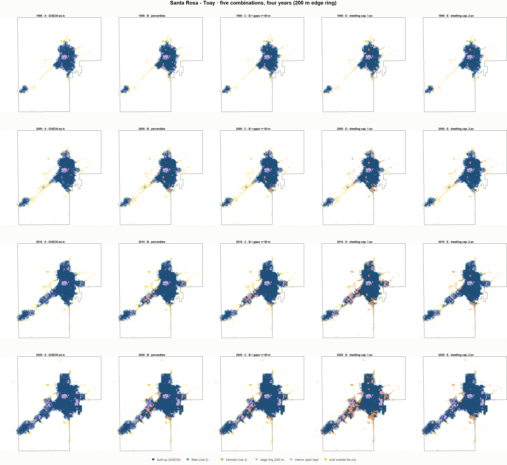

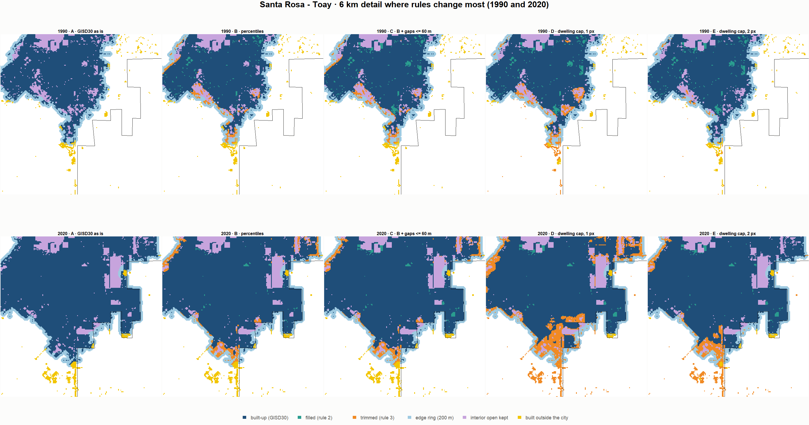

**1990** · 80,053 persons in 95 city tracts · p10 3,401 persons per km2 built · p25 / p50 urbanized density 3,011 / 4,734

|  | GISD30 km2 | + filled | - trimmed | = built-up km2 | trimmed outside | edge ring | interior open | persons / km2 built | tracts filled | tracts trimmed |
|---|---|---|---|---|---|---|---|---|---|---|
| A | 14.4 | 0.0 | 0.0 | 14.4 | 0.0 | 4.0 | 2.8 | 5,573 | 0 | 0 |
| B | 14.4 | 0.4 | 0.6 | 14.2 | 0.0 | 4.0 | 2.4 | 5,653 | 50 | 10 |
| C | 14.4 | 0.7 | 0.6 | 14.4 | 0.0 | 4.0 | 2.2 | 5,551 | 51 | 10 |
| D | 14.4 | 0.7 | 0.7 | 14.3 | 0.8 | 4.0 | 2.2 | 5,604 | 51 | 18 |
| E | 14.4 | 0.7 | 0.2 | 14.8 | 0.3 | 4.0 | 2.2 | 5,410 | 51 | 8 |

**2000** · 101,922 persons in 137 city tracts · p10 3,261 persons per km2 built · p25 / p50 urbanized density 3,253 / 4,575

|  | GISD30 km2 | + filled | - trimmed | = built-up km2 | trimmed outside | edge ring | interior open | persons / km2 built | tracts filled | tracts trimmed |
|---|---|---|---|---|---|---|---|---|---|---|
| A | 19.5 | 0.0 | 0.0 | 19.5 | 0.0 | 4.9 | 3.3 | 5,230 | 0 | 0 |
| B | 19.5 | 0.3 | 0.9 | 18.8 | 0.0 | 4.9 | 3.0 | 5,410 | 44 | 16 |
| C | 19.5 | 0.5 | 0.9 | 19.0 | 0.0 | 4.9 | 2.8 | 5,354 | 46 | 16 |
| D | 19.5 | 0.5 | 1.1 | 18.8 | 1.2 | 4.9 | 2.8 | 5,417 | 46 | 22 |
| E | 19.5 | 0.5 | 0.4 | 19.5 | 0.7 | 4.9 | 2.8 | 5,214 | 46 | 8 |

**2010** · 114,814 persons in 168 city tracts · p10 2,068 persons per km2 built · p25 / p50 urbanized density 2,827 / 4,218

|  | GISD30 km2 | + filled | - trimmed | = built-up km2 | trimmed outside | edge ring | interior open | persons / km2 built | tracts filled | tracts trimmed |
|---|---|---|---|---|---|---|---|---|---|---|
| A | 27.9 | 0.0 | 0.0 | 27.9 | 0.0 | 7.0 | 4.3 | 4,110 | 0 | 0 |
| B | 27.9 | 0.2 | 1.8 | 26.4 | 0.0 | 7.0 | 4.1 | 4,357 | 32 | 16 |
| C | 27.9 | 0.3 | 1.8 | 26.5 | 0.0 | 7.0 | 4.0 | 4,338 | 36 | 16 |
| D | 27.9 | 0.4 | 3.9 | 24.4 | 2.0 | 7.0 | 3.9 | 4,704 | 36 | 41 |
| E | 27.9 | 0.4 | 1.2 | 27.1 | 1.3 | 7.0 | 3.9 | 4,238 | 36 | 10 |

**2020** · 133,318 persons in 222 city tracts · p10 1,758 persons per km2 built · p25 / p50 urbanized density 2,436 / 4,180

|  | GISD30 km2 | + filled | - trimmed | = built-up km2 | trimmed outside | edge ring | interior open | persons / km2 built | tracts filled | tracts trimmed |
|---|---|---|---|---|---|---|---|---|---|---|
| A | 37.3 | 0.0 | 0.0 | 37.3 | 0.0 | 7.4 | 6.8 | 3,574 | 0 | 0 |
| B | 37.3 | 0.3 | 2.2 | 35.3 | 0.0 | 7.4 | 6.6 | 3,774 | 47 | 25 |
| C | 37.3 | 0.4 | 2.2 | 35.5 | 0.0 | 7.4 | 6.4 | 3,759 | 52 | 25 |
| D | 37.3 | 0.4 | 6.5 | 31.2 | 2.3 | 7.4 | 6.4 | 4,276 | 52 | 56 |
| E | 37.3 | 0.4 | 1.7 | 36.0 | 1.8 | 7.4 | 6.4 | 3,701 | 52 | 12 |

## Gran Mendoza

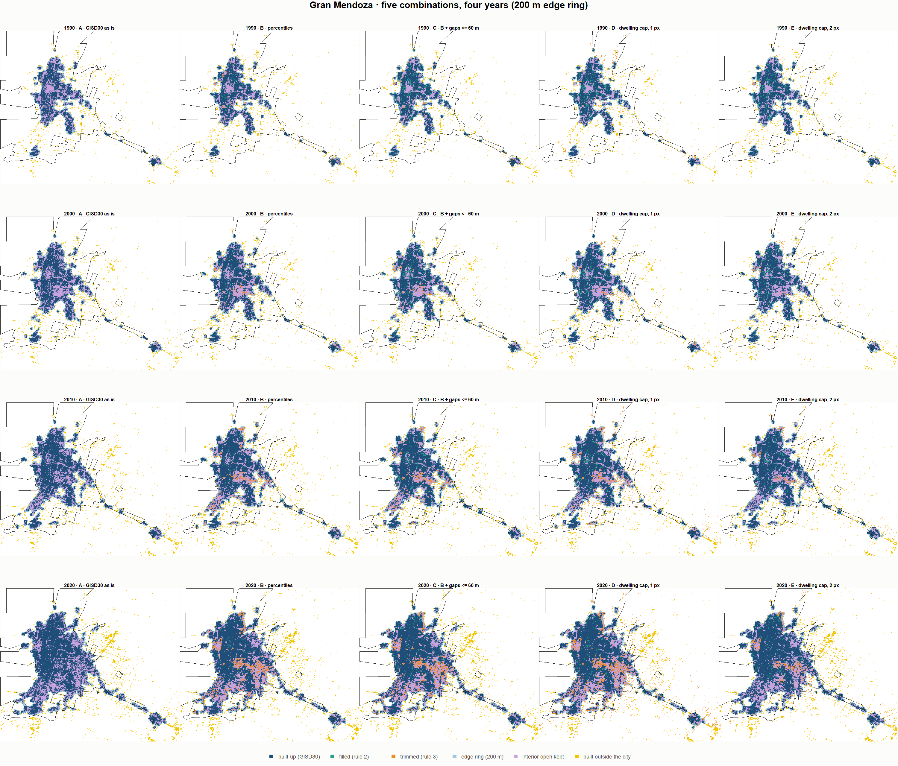

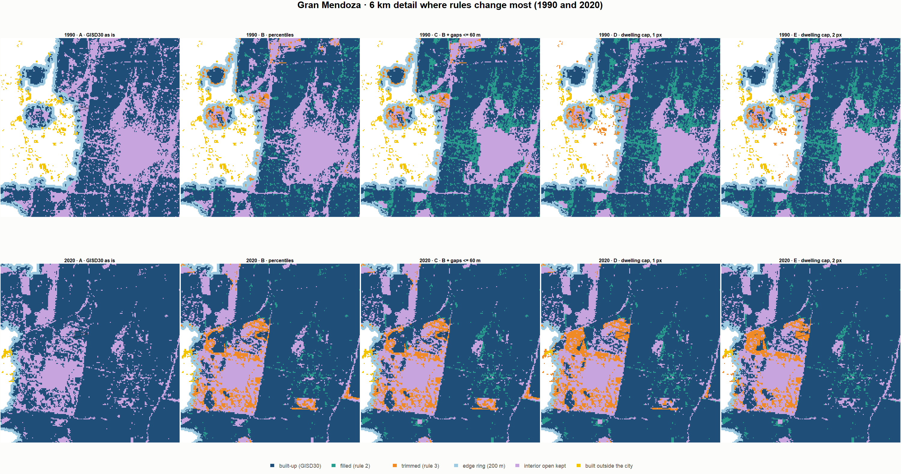

**1990** · 796,411 persons in 755 city tracts · p10 6,158 persons per km2 built · p25 / p50 urbanized density 4,760 / 7,078

|  | GISD30 km2 | + filled | - trimmed | = built-up km2 | trimmed outside | edge ring | interior open | persons / km2 built | tracts filled | tracts trimmed |
|---|---|---|---|---|---|---|---|---|---|---|
| A | 75.9 | 0.0 | 0.0 | 75.9 | 0.0 | 24.7 | 39.5 | 10,489 | 0 | 0 |
| B | 75.9 | 4.3 | 2.5 | 77.7 | 0.0 | 24.7 | 35.2 | 10,256 | 452 | 69 |
| C | 75.9 | 10.6 | 2.5 | 84.0 | 0.0 | 24.7 | 28.9 | 9,484 | 492 | 69 |
| D | 75.9 | 10.6 | 1.0 | 85.5 | 4.1 | 24.7 | 28.8 | 9,312 | 492 | 54 |
| E | 75.9 | 10.6 | 0.4 | 86.1 | 1.1 | 24.7 | 28.8 | 9,247 | 492 | 15 |

**2000** · 902,816 persons in 921 city tracts · p10 5,605 persons per km2 built · p25 / p50 urbanized density 4,719 / 6,842

|  | GISD30 km2 | + filled | - trimmed | = built-up km2 | trimmed outside | edge ring | interior open | persons / km2 built | tracts filled | tracts trimmed |
|---|---|---|---|---|---|---|---|---|---|---|
| A | 98.1 | 0.0 | 0.0 | 98.1 | 0.0 | 27.6 | 50.5 | 9,202 | 0 | 0 |
| B | 98.1 | 4.3 | 4.5 | 98.0 | 0.0 | 27.6 | 46.2 | 9,213 | 543 | 88 |
| C | 98.1 | 10.3 | 4.5 | 103.9 | 0.0 | 27.6 | 40.2 | 8,688 | 604 | 88 |
| D | 98.1 | 10.3 | 2.2 | 106.2 | 4.4 | 27.6 | 40.2 | 8,504 | 604 | 57 |
| E | 98.1 | 10.3 | 0.8 | 107.6 | 1.3 | 27.6 | 40.2 | 8,393 | 604 | 14 |

**2010** · 1,008,397 persons in 1,074 city tracts · p10 4,295 persons per km2 built · p25 / p50 urbanized density 4,373 / 6,877

|  | GISD30 km2 | + filled | - trimmed | = built-up km2 | trimmed outside | edge ring | interior open | persons / km2 built | tracts filled | tracts trimmed |
|---|---|---|---|---|---|---|---|---|---|---|
| A | 134.2 | 0.0 | 0.0 | 134.2 | 0.0 | 35.2 | 56.6 | 7,514 | 0 | 0 |
| B | 134.2 | 3.5 | 10.4 | 127.3 | 0.0 | 35.2 | 53.1 | 7,919 | 564 | 102 |
| C | 134.2 | 8.8 | 10.4 | 132.7 | 0.0 | 35.2 | 47.8 | 7,601 | 623 | 102 |
| D | 134.2 | 8.9 | 8.6 | 134.5 | 7.5 | 35.2 | 47.7 | 7,499 | 623 | 110 |
| E | 134.2 | 8.9 | 3.0 | 140.1 | 2.3 | 35.2 | 47.7 | 7,199 | 623 | 25 |

**2020** · 1,184,290 persons in 1,392 city tracts · p10 3,279 persons per km2 built · p25 / p50 urbanized density 3,842 / 6,611

|  | GISD30 km2 | + filled | - trimmed | = built-up km2 | trimmed outside | edge ring | interior open | persons / km2 built | tracts filled | tracts trimmed |
|---|---|---|---|---|---|---|---|---|---|---|
| A | 200.3 | 0.0 | 0.0 | 200.3 | 0.0 | 39.8 | 88.5 | 5,912 | 0 | 0 |
| B | 200.3 | 3.7 | 21.3 | 182.8 | 0.0 | 39.8 | 84.8 | 6,480 | 599 | 135 |
| C | 200.3 | 8.3 | 21.3 | 187.3 | 0.0 | 39.8 | 80.2 | 6,322 | 651 | 135 |
| D | 200.3 | 8.3 | 25.4 | 183.2 | 14.0 | 39.8 | 80.2 | 6,463 | 651 | 217 |
| E | 200.3 | 8.3 | 8.3 | 200.3 | 3.5 | 39.8 | 80.2 | 5,913 | 651 | 46 |

## Corrientes

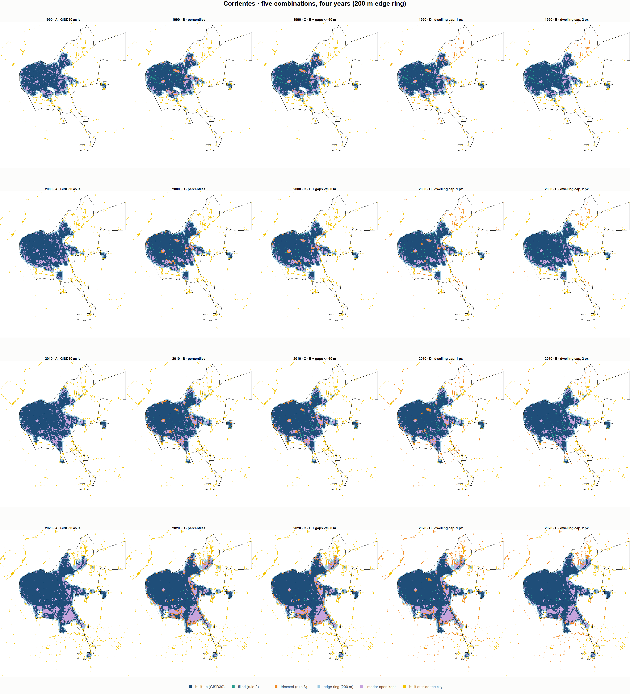

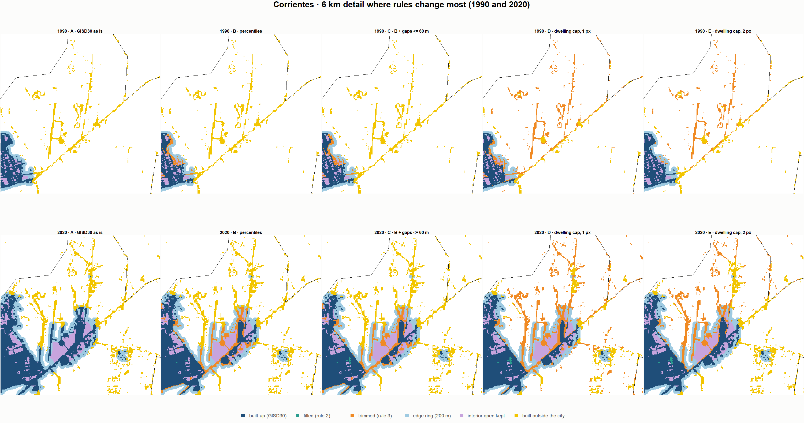

**1990** · 261,716 persons in 242 city tracts · p10 4,669 persons per km2 built · p25 / p50 urbanized density 5,341 / 8,256

|  | GISD30 km2 | + filled | - trimmed | = built-up km2 | trimmed outside | edge ring | interior open | persons / km2 built | tracts filled | tracts trimmed |
|---|---|---|---|---|---|---|---|---|---|---|
| A | 30.9 | 0.0 | 0.0 | 30.9 | 0.0 | 6.5 | 5.8 | 8,458 | 0 | 0 |
| B | 30.9 | 0.8 | 1.2 | 30.5 | 0.0 | 6.5 | 5.0 | 8,579 | 107 | 24 |
| C | 30.9 | 0.9 | 1.2 | 30.7 | 0.0 | 6.5 | 4.8 | 8,528 | 111 | 24 |
| D | 30.9 | 1.0 | 1.2 | 30.7 | 1.8 | 6.5 | 4.8 | 8,519 | 111 | 33 |
| E | 30.9 | 1.0 | 0.0 | 31.9 | 0.8 | 6.5 | 4.8 | 8,206 | 111 | 7 |

**2000** · 320,367 persons in 293 city tracts · p10 5,596 persons per km2 built · p25 / p50 urbanized density 5,402 / 8,303

|  | GISD30 km2 | + filled | - trimmed | = built-up km2 | trimmed outside | edge ring | interior open | persons / km2 built | tracts filled | tracts trimmed |
|---|---|---|---|---|---|---|---|---|---|---|
| A | 37.3 | 0.0 | 0.0 | 37.3 | 0.0 | 6.6 | 6.6 | 8,594 | 0 | 0 |
| B | 37.3 | 0.6 | 1.5 | 36.4 | 0.0 | 6.6 | 5.9 | 8,791 | 115 | 25 |
| C | 37.3 | 1.0 | 1.5 | 36.8 | 0.0 | 6.6 | 5.5 | 8,703 | 121 | 25 |
| D | 37.3 | 1.1 | 0.9 | 37.5 | 1.8 | 6.6 | 5.5 | 8,550 | 121 | 25 |
| E | 37.3 | 1.1 | 0.0 | 38.3 | 0.9 | 6.6 | 5.5 | 8,360 | 121 | 6 |

**2010** · 349,168 persons in 310 city tracts · p10 5,190 persons per km2 built · p25 / p50 urbanized density 5,654 / 8,261

|  | GISD30 km2 | + filled | - trimmed | = built-up km2 | trimmed outside | edge ring | interior open | persons / km2 built | tracts filled | tracts trimmed |
|---|---|---|---|---|---|---|---|---|---|---|
| A | 44.2 | 0.0 | 0.0 | 44.2 | 0.0 | 7.1 | 7.3 | 7,898 | 0 | 0 |
| B | 44.2 | 0.5 | 2.0 | 42.8 | 0.0 | 7.1 | 6.8 | 8,166 | 79 | 27 |
| C | 44.2 | 0.9 | 2.0 | 43.2 | 0.0 | 7.1 | 6.4 | 8,087 | 86 | 27 |
| D | 44.2 | 0.9 | 1.6 | 43.5 | 3.1 | 7.1 | 6.4 | 8,021 | 86 | 40 |
| E | 44.2 | 0.9 | 0.1 | 45.0 | 1.8 | 7.1 | 6.4 | 7,756 | 86 | 8 |

**2020** · 432,455 persons in 456 city tracts · p10 4,784 persons per km2 built · p25 / p50 urbanized density 6,089 / 8,830

|  | GISD30 km2 | + filled | - trimmed | = built-up km2 | trimmed outside | edge ring | interior open | persons / km2 built | tracts filled | tracts trimmed |
|---|---|---|---|---|---|---|---|---|---|---|
| A | 56.6 | 0.0 | 0.0 | 56.6 | 0.0 | 10.6 | 12.2 | 7,636 | 0 | 0 |
| B | 56.6 | 0.4 | 4.8 | 52.2 | 0.0 | 10.6 | 11.8 | 8,277 | 81 | 45 |
| C | 56.6 | 0.6 | 4.8 | 52.5 | 0.0 | 10.6 | 11.6 | 8,245 | 86 | 45 |
| D | 56.6 | 0.6 | 3.5 | 53.7 | 5.3 | 10.6 | 11.6 | 8,051 | 86 | 46 |
| E | 56.6 | 0.6 | 1.1 | 56.2 | 3.6 | 10.6 | 11.6 | 7,702 | 86 | 14 |

## Formosa

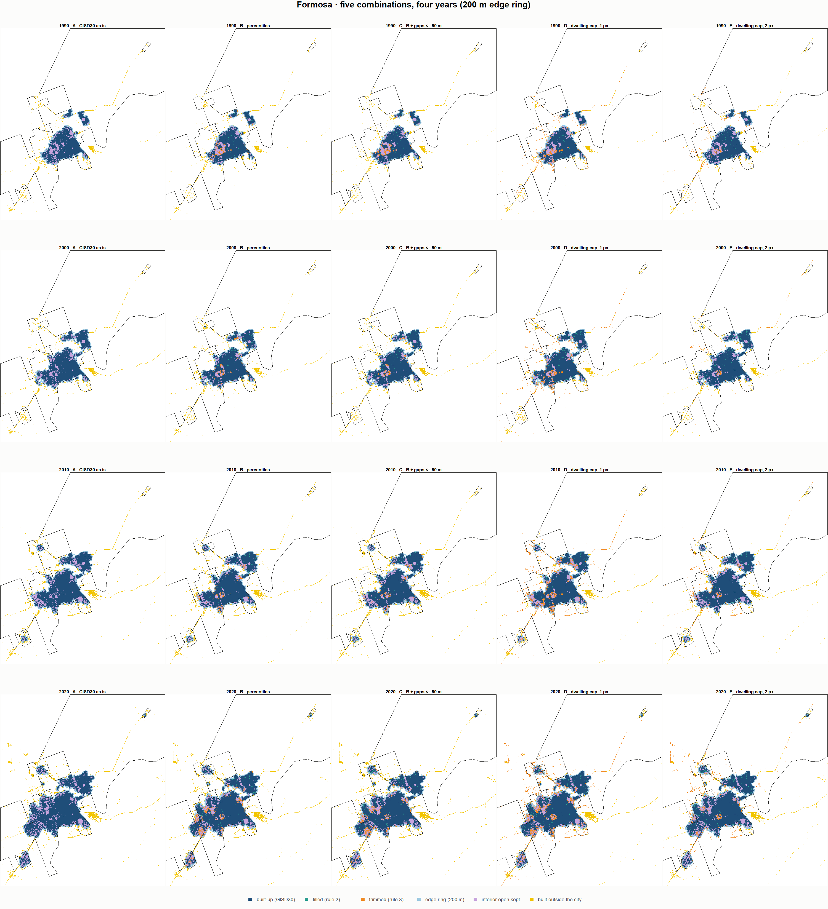

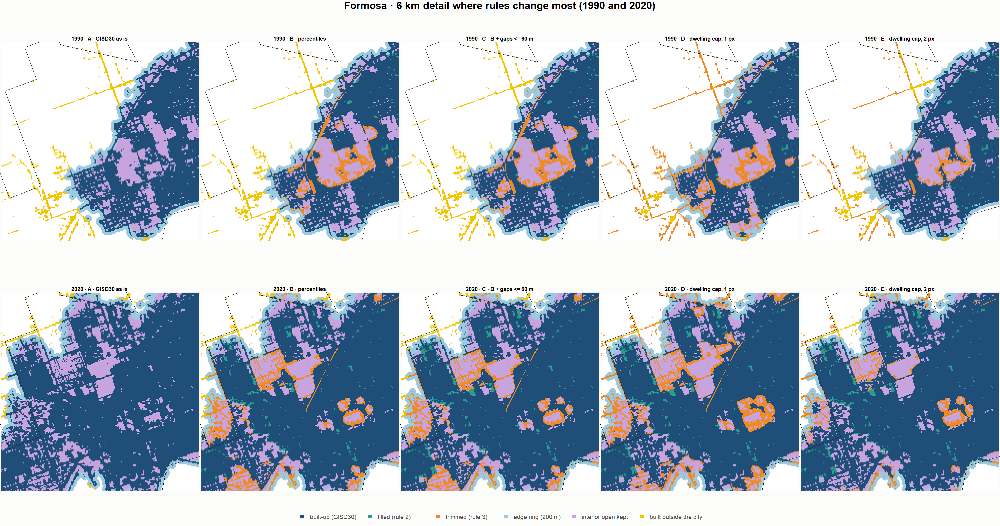

**1990** · 149,533 persons in 135 city tracts · p10 3,756 persons per km2 built · p25 / p50 urbanized density 4,374 / 6,259

|  | GISD30 km2 | + filled | - trimmed | = built-up km2 | trimmed outside | edge ring | interior open | persons / km2 built | tracts filled | tracts trimmed |
|---|---|---|---|---|---|---|---|---|---|---|
| A | 22.0 | 0.0 | 0.0 | 22.0 | 0.0 | 5.5 | 5.0 | 6,792 | 0 | 0 |
| B | 22.0 | 0.3 | 1.5 | 20.9 | 0.0 | 5.5 | 4.6 | 7,166 | 58 | 13 |
| C | 22.0 | 0.4 | 1.5 | 20.9 | 0.0 | 5.5 | 4.6 | 7,144 | 62 | 13 |
| D | 22.0 | 0.4 | 2.0 | 20.4 | 2.6 | 5.5 | 4.6 | 7,332 | 62 | 37 |
| E | 22.0 | 0.4 | 0.6 | 21.8 | 1.3 | 5.5 | 4.6 | 6,852 | 62 | 11 |

**2000** · 199,484 persons in 196 city tracts · p10 3,378 persons per km2 built · p25 / p50 urbanized density 3,863 / 5,755

|  | GISD30 km2 | + filled | - trimmed | = built-up km2 | trimmed outside | edge ring | interior open | persons / km2 built | tracts filled | tracts trimmed |
|---|---|---|---|---|---|---|---|---|---|---|
| A | 29.8 | 0.0 | 0.0 | 29.8 | 0.0 | 7.7 | 5.2 | 6,698 | 0 | 0 |
| B | 29.8 | 0.6 | 1.1 | 29.3 | 0.0 | 7.7 | 4.6 | 6,806 | 78 | 19 |
| C | 29.8 | 0.8 | 1.1 | 29.6 | 0.0 | 7.7 | 4.4 | 6,746 | 86 | 19 |
| D | 29.8 | 0.8 | 1.9 | 28.7 | 2.2 | 7.7 | 4.4 | 6,946 | 86 | 44 |
| E | 29.8 | 0.8 | 0.4 | 30.3 | 0.8 | 7.7 | 4.4 | 6,592 | 86 | 12 |

**2010** · 225,094 persons in 239 city tracts · p10 3,321 persons per km2 built · p25 / p50 urbanized density 3,882 / 6,109

|  | GISD30 km2 | + filled | - trimmed | = built-up km2 | trimmed outside | edge ring | interior open | persons / km2 built | tracts filled | tracts trimmed |
|---|---|---|---|---|---|---|---|---|---|---|
| A | 36.9 | 0.0 | 0.0 | 36.9 | 0.0 | 8.7 | 7.6 | 6,093 | 0 | 0 |
| B | 36.9 | 0.6 | 1.6 | 35.9 | 0.0 | 8.7 | 7.0 | 6,267 | 85 | 23 |
| C | 36.9 | 0.8 | 1.6 | 36.1 | 0.0 | 8.7 | 6.9 | 6,242 | 90 | 23 |
| D | 36.9 | 0.7 | 3.9 | 33.8 | 3.9 | 8.7 | 6.9 | 6,667 | 90 | 50 |
| E | 36.9 | 0.7 | 1.1 | 36.6 | 2.1 | 8.7 | 6.9 | 6,157 | 90 | 20 |

**2020** · 261,548 persons in 324 city tracts · p10 2,344 persons per km2 built · p25 / p50 urbanized density 2,910 / 5,192

|  | GISD30 km2 | + filled | - trimmed | = built-up km2 | trimmed outside | edge ring | interior open | persons / km2 built | tracts filled | tracts trimmed |
|---|---|---|---|---|---|---|---|---|---|---|
| A | 51.4 | 0.0 | 0.0 | 51.4 | 0.0 | 11.2 | 11.9 | 5,090 | 0 | 0 |
| B | 51.4 | 1.1 | 3.9 | 48.6 | 0.0 | 11.2 | 10.9 | 5,384 | 121 | 39 |
| C | 51.4 | 1.5 | 3.9 | 49.1 | 0.0 | 11.2 | 10.4 | 5,330 | 126 | 39 |
| D | 51.4 | 1.5 | 5.8 | 47.2 | 5.4 | 11.2 | 10.4 | 5,544 | 126 | 59 |
| E | 51.4 | 1.5 | 2.1 | 50.8 | 3.7 | 11.2 | 10.4 | 5,147 | 126 | 25 |

