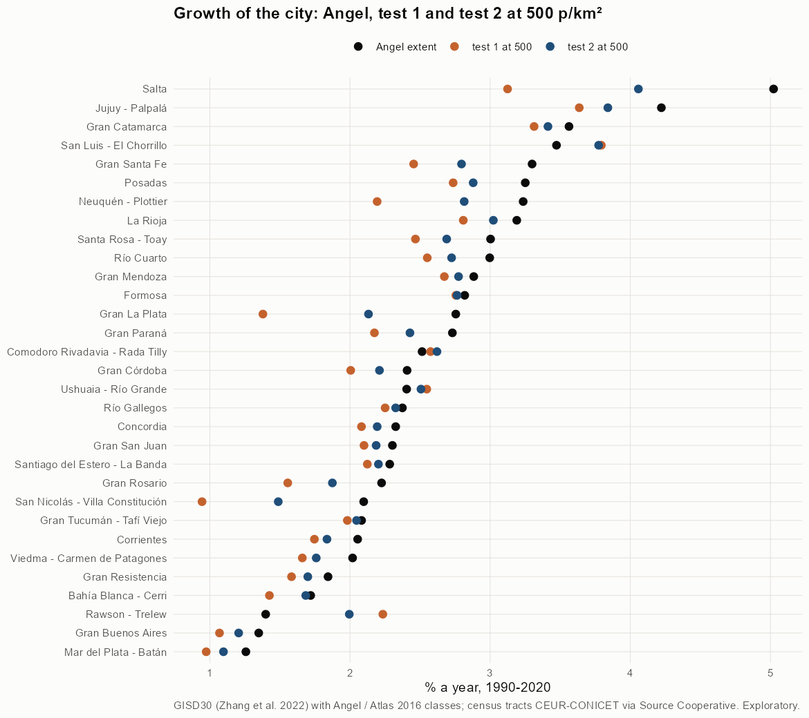

# Tests 1 and 2 side by side, all agglomerations

Exploratory. None of these numbers are project figures (they are not in `CIFRAS_CANONICAS.json`). Generated by `Rpipe/scripts/14_prueba_comparada.R` from step 11. Run of 2026-11-09. Both tests and how they differ: [METODOS.md](../METODOS.md).

## Method

- **Same cut, same fringe.** At a cut T both tests keep the fringe and captured land of tracts with density on urbanized land ≥ T, and drop the rest.
- **The one difference** is built-up land in tracts below the cut: test 1 drops it, test 2 keeps it. Test 2 − test 1 = that land.
- **Cuts**: 300, 500, 1,000, 2,000, 3,000, 3,250, 3,500, 3,750, 4,000, 4,500, 5,000 persons/km². Maps at 500, 3,000, 3,500, 4,000.

## All agglomerations at 500 p/km²

| Agglomeration | Angel 2020 km² | Test 1 2020 km² | Test 2 2020 km² | % of built-up in sparse tracts 1990 | % in sparse tracts 2020 | Growth Angel %/yr | Growth test 1 %/yr | Growth test 2 %/yr |
|---|---|---|---|---|---|---|---|---|
| [Bahía Blanca - Cerri](bahia_blanca/REPORTE.md) | 151.8 | 104.5 | 129.6 | 17.2 | 23.4 | 1.72 | 1.42 | 1.68 |
| [Comodoro Rivadavia - Rada Tilly](comodoro_rivadavia/REPORTE.md) | 84.0 | 65.2 | 73.7 | 14.7 | 15.3 | 2.51 | 2.58 | 2.62 |
| [Concordia](concordia/REPORTE.md) | 43.8 | 39.8 | 41.4 | 0.8 | 5.0 | 2.33 | 2.08 | 2.19 |
| [Corrientes](corrientes/REPORTE.md) | 79.4 | 71.8 | 73.8 | 0.0 | 3.4 | 2.05 | 1.75 | 1.84 |
| [Formosa](formosa/REPORTE.md) | 74.3 | 64.9 | 68.2 | 6.5 | 6.6 | 2.82 | 2.76 | 2.76 |
| [Gran Buenos Aires](buenos_aires/REPORTE.md) | 2,541.8 | 2,216.5 | 2,365.4 | 3.1 | 7.7 | 1.35 | 1.07 | 1.21 |
| [Gran Catamarca](catamarca/REPORTE.md) | 76.8 | 69.1 | 71.8 | 1.4 | 5.0 | 3.56 | 3.31 | 3.41 |
| [Gran Córdoba](cordoba/REPORTE.md) | 426.4 | 352.2 | 384.3 | 3.6 | 10.6 | 2.41 | 2.00 | 2.21 |
| [Gran La Plata](la_plata/REPORTE.md) | 383.9 | 235.7 | 306.3 | 5.5 | 28.8 | 2.75 | 1.38 | 2.13 |
| [Gran Mendoza](mendoza/REPORTE.md) | 328.6 | 305.2 | 315.3 | 0.5 | 5.0 | 2.88 | 2.67 | 2.77 |
| [Gran Paraná](parana/REPORTE.md) | 93.7 | 78.0 | 84.5 | 0.8 | 10.2 | 2.73 | 2.17 | 2.43 |
| [Gran Resistencia](resistencia/REPORTE.md) | 122.9 | 105.1 | 111.1 | 3.0 | 7.1 | 1.84 | 1.58 | 1.70 |
| [Gran Rosario](rosario/REPORTE.md) | 355.7 | 276.1 | 310.1 | 2.9 | 13.5 | 2.23 | 1.56 | 1.87 |
| [Gran San Juan](san_juan/REPORTE.md) | 212.8 | 192.3 | 200.0 | 2.3 | 5.9 | 2.30 | 2.10 | 2.19 |
| [Gran Santa Fe](santa_fe/REPORTE.md) | 174.2 | 133.9 | 148.5 | 0.5 | 13.3 | 3.30 | 2.45 | 2.80 |
| [Gran Tucumán - Tafí Viejo](tucuman/REPORTE.md) | 206.4 | 187.9 | 194.3 | 2.1 | 4.2 | 2.08 | 1.98 | 2.05 |
| [Jujuy - Palpalá](jujuy/REPORTE.md) | 81.4 | 67.8 | 71.9 | 0.1 | 8.2 | 4.22 | 3.64 | 3.84 |
| [La Rioja](la_rioja/REPORTE.md) | 75.1 | 65.4 | 70.2 | 1.2 | 8.8 | 3.19 | 2.81 | 3.02 |
| [Mar del Plata - Batán](mar_del_plata/REPORTE.md) | 174.4 | 147.9 | 160.4 | 5.5 | 9.3 | 1.26 | 0.97 | 1.10 |
| [Neuquén - Plottier](neuquen/REPORTE.md) | 241.1 | 119.7 | 171.2 | 20.7 | 35.1 | 3.24 | 2.19 | 2.81 |
| [Posadas](posadas/REPORTE.md) | 105.6 | 89.5 | 94.1 | 1.5 | 6.1 | 3.25 | 2.74 | 2.88 |
| [Rawson - Trelew](rawson/REPORTE.md) | 231.0 | 43.6 | 140.8 | 78.3 | 73.6 | 1.40 | 2.23 | 1.99 |
| [Río Cuarto](rio_cuarto/REPORTE.md) | 57.9 | 50.9 | 53.5 | 0.0 | 7.9 | 3.00 | 2.55 | 2.72 |
| [Río Gallegos](rio_gallegos/REPORTE.md) | 32.2 | 29.4 | 30.5 | 2.0 | 4.8 | 2.37 | 2.25 | 2.33 |
| [Salta](salta/REPORTE.md) | 249.9 | 135.6 | 181.1 | 3.1 | 31.5 | 5.02 | 3.12 | 4.06 |
| [San Luis - El Chorrillo](san_luis/REPORTE.md) | 64.0 | 58.6 | 61.9 | 9.7 | 7.8 | 3.47 | 3.79 | 3.77 |
| [San Nicolás - Villa Constitución](san_nicolas/REPORTE.md) | 73.6 | 50.4 | 59.5 | 0.7 | 19.0 | 2.10 | 0.94 | 1.49 |
| [Santa Rosa - Toay](santa_rosa/REPORTE.md) | 51.5 | 42.8 | 45.9 | 0.7 | 8.3 | 3.00 | 2.47 | 2.69 |
| [Santiago del Estero - La Banda](santiago_del_estero/REPORTE.md) | 138.2 | 125.0 | 130.2 | 2.4 | 5.3 | 2.28 | 2.12 | 2.20 |
| [Ushuaia - Río Grande](ushuaia/REPORTE.md) | 38.9 | 34.5 | 36.7 | 11.4 | 9.4 | 2.40 | 2.55 | 2.51 |
| [Viedma - Carmen de Patagones](viedma/REPORTE.md) | 26.0 | 22.7 | 23.4 | 0.5 | 4.0 | 2.02 | 1.66 | 1.76 |

## Maps by agglomeration

Each link opens the full map. All maps of an agglomeration share one frame: its 2020 city plus 3 km. Each map has the four years as panels.

| Agglomeration | 500 p/km² | 3,000 p/km² | 3,500 p/km² | 4,000 p/km² |
|---|---|---|---|---|
| [Bahía Blanca - Cerri](bahia_blanca/REPORTE.md) | [map](bahia_blanca/img/comparado_500.png) | [map](bahia_blanca/img/comparado_3000.png) | [map](bahia_blanca/img/comparado_3500.png) | [map](bahia_blanca/img/comparado_4000.png) |
| [Comodoro Rivadavia - Rada Tilly](comodoro_rivadavia/REPORTE.md) | [map](comodoro_rivadavia/img/comparado_500.png) | [map](comodoro_rivadavia/img/comparado_3000.png) | [map](comodoro_rivadavia/img/comparado_3500.png) | [map](comodoro_rivadavia/img/comparado_4000.png) |
| [Concordia](concordia/REPORTE.md) | [map](concordia/img/comparado_500.png) | [map](concordia/img/comparado_3000.png) | [map](concordia/img/comparado_3500.png) | [map](concordia/img/comparado_4000.png) |
| [Corrientes](corrientes/REPORTE.md) | [map](corrientes/img/comparado_500.png) | [map](corrientes/img/comparado_3000.png) | [map](corrientes/img/comparado_3500.png) | [map](corrientes/img/comparado_4000.png) |
| [Formosa](formosa/REPORTE.md) | [map](formosa/img/comparado_500.png) | [map](formosa/img/comparado_3000.png) | [map](formosa/img/comparado_3500.png) | [map](formosa/img/comparado_4000.png) |
| [Gran Buenos Aires](buenos_aires/REPORTE.md) | [map](buenos_aires/img/comparado_500.png) | [map](buenos_aires/img/comparado_3000.png) | [map](buenos_aires/img/comparado_3500.png) | [map](buenos_aires/img/comparado_4000.png) |
| [Gran Catamarca](catamarca/REPORTE.md) | [map](catamarca/img/comparado_500.png) | [map](catamarca/img/comparado_3000.png) | [map](catamarca/img/comparado_3500.png) | [map](catamarca/img/comparado_4000.png) |
| [Gran Córdoba](cordoba/REPORTE.md) | [map](cordoba/img/comparado_500.png) | [map](cordoba/img/comparado_3000.png) | [map](cordoba/img/comparado_3500.png) | [map](cordoba/img/comparado_4000.png) |
| [Gran La Plata](la_plata/REPORTE.md) | [map](la_plata/img/comparado_500.png) | [map](la_plata/img/comparado_3000.png) | [map](la_plata/img/comparado_3500.png) | [map](la_plata/img/comparado_4000.png) |
| [Gran Mendoza](mendoza/REPORTE.md) | [map](mendoza/img/comparado_500.png) | [map](mendoza/img/comparado_3000.png) | [map](mendoza/img/comparado_3500.png) | [map](mendoza/img/comparado_4000.png) |
| [Gran Paraná](parana/REPORTE.md) | [map](parana/img/comparado_500.png) | [map](parana/img/comparado_3000.png) | [map](parana/img/comparado_3500.png) | [map](parana/img/comparado_4000.png) |
| [Gran Resistencia](resistencia/REPORTE.md) | [map](resistencia/img/comparado_500.png) | [map](resistencia/img/comparado_3000.png) | [map](resistencia/img/comparado_3500.png) | [map](resistencia/img/comparado_4000.png) |
| [Gran Rosario](rosario/REPORTE.md) | [map](rosario/img/comparado_500.png) | [map](rosario/img/comparado_3000.png) | [map](rosario/img/comparado_3500.png) | [map](rosario/img/comparado_4000.png) |
| [Gran San Juan](san_juan/REPORTE.md) | [map](san_juan/img/comparado_500.png) | [map](san_juan/img/comparado_3000.png) | [map](san_juan/img/comparado_3500.png) | [map](san_juan/img/comparado_4000.png) |
| [Gran Santa Fe](santa_fe/REPORTE.md) | [map](santa_fe/img/comparado_500.png) | [map](santa_fe/img/comparado_3000.png) | [map](santa_fe/img/comparado_3500.png) | [map](santa_fe/img/comparado_4000.png) |
| [Gran Tucumán - Tafí Viejo](tucuman/REPORTE.md) | [map](tucuman/img/comparado_500.png) | [map](tucuman/img/comparado_3000.png) | [map](tucuman/img/comparado_3500.png) | [map](tucuman/img/comparado_4000.png) |
| [Jujuy - Palpalá](jujuy/REPORTE.md) | [map](jujuy/img/comparado_500.png) | [map](jujuy/img/comparado_3000.png) | [map](jujuy/img/comparado_3500.png) | [map](jujuy/img/comparado_4000.png) |
| [La Rioja](la_rioja/REPORTE.md) | [map](la_rioja/img/comparado_500.png) | [map](la_rioja/img/comparado_3000.png) | [map](la_rioja/img/comparado_3500.png) | [map](la_rioja/img/comparado_4000.png) |
| [Mar del Plata - Batán](mar_del_plata/REPORTE.md) | [map](mar_del_plata/img/comparado_500.png) | [map](mar_del_plata/img/comparado_3000.png) | [map](mar_del_plata/img/comparado_3500.png) | [map](mar_del_plata/img/comparado_4000.png) |
| [Neuquén - Plottier](neuquen/REPORTE.md) | [map](neuquen/img/comparado_500.png) | [map](neuquen/img/comparado_3000.png) | [map](neuquen/img/comparado_3500.png) | [map](neuquen/img/comparado_4000.png) |
| [Posadas](posadas/REPORTE.md) | [map](posadas/img/comparado_500.png) | [map](posadas/img/comparado_3000.png) | [map](posadas/img/comparado_3500.png) | [map](posadas/img/comparado_4000.png) |
| [Rawson - Trelew](rawson/REPORTE.md) | [map](rawson/img/comparado_500.png) | [map](rawson/img/comparado_3000.png) | [map](rawson/img/comparado_3500.png) | [map](rawson/img/comparado_4000.png) |
| [Río Cuarto](rio_cuarto/REPORTE.md) | [map](rio_cuarto/img/comparado_500.png) | [map](rio_cuarto/img/comparado_3000.png) | [map](rio_cuarto/img/comparado_3500.png) | [map](rio_cuarto/img/comparado_4000.png) |
| [Río Gallegos](rio_gallegos/REPORTE.md) | [map](rio_gallegos/img/comparado_500.png) | [map](rio_gallegos/img/comparado_3000.png) | [map](rio_gallegos/img/comparado_3500.png) | [map](rio_gallegos/img/comparado_4000.png) |
| [Salta](salta/REPORTE.md) | [map](salta/img/comparado_500.png) | [map](salta/img/comparado_3000.png) | [map](salta/img/comparado_3500.png) | [map](salta/img/comparado_4000.png) |
| [San Luis - El Chorrillo](san_luis/REPORTE.md) | [map](san_luis/img/comparado_500.png) | [map](san_luis/img/comparado_3000.png) | [map](san_luis/img/comparado_3500.png) | [map](san_luis/img/comparado_4000.png) |
| [San Nicolás - Villa Constitución](san_nicolas/REPORTE.md) | [map](san_nicolas/img/comparado_500.png) | [map](san_nicolas/img/comparado_3000.png) | [map](san_nicolas/img/comparado_3500.png) | [map](san_nicolas/img/comparado_4000.png) |
| [Santa Rosa - Toay](santa_rosa/REPORTE.md) | [map](santa_rosa/img/comparado_500.png) | [map](santa_rosa/img/comparado_3000.png) | [map](santa_rosa/img/comparado_3500.png) | [map](santa_rosa/img/comparado_4000.png) |
| [Santiago del Estero - La Banda](santiago_del_estero/REPORTE.md) | [map](santiago_del_estero/img/comparado_500.png) | [map](santiago_del_estero/img/comparado_3000.png) | [map](santiago_del_estero/img/comparado_3500.png) | [map](santiago_del_estero/img/comparado_4000.png) |
| [Ushuaia - Río Grande](ushuaia/REPORTE.md) | [map](ushuaia/img/comparado_500.png) | [map](ushuaia/img/comparado_3000.png) | [map](ushuaia/img/comparado_3500.png) | [map](ushuaia/img/comparado_4000.png) |
| [Viedma - Carmen de Patagones](viedma/REPORTE.md) | [map](viedma/img/comparado_500.png) | [map](viedma/img/comparado_3000.png) | [map](viedma/img/comparado_3500.png) | [map](viedma/img/comparado_4000.png) |

