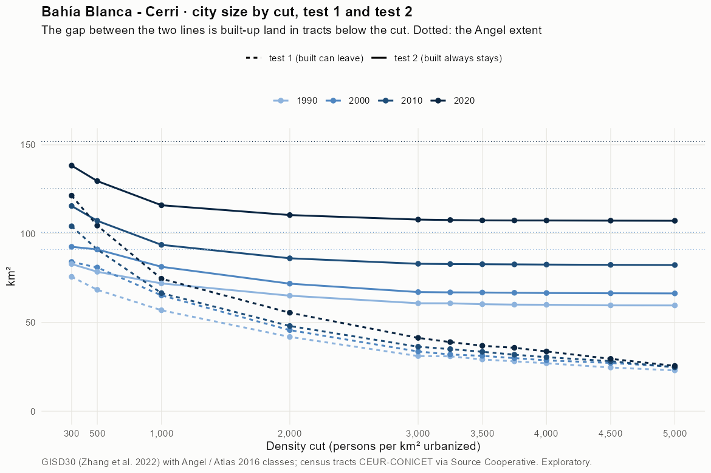
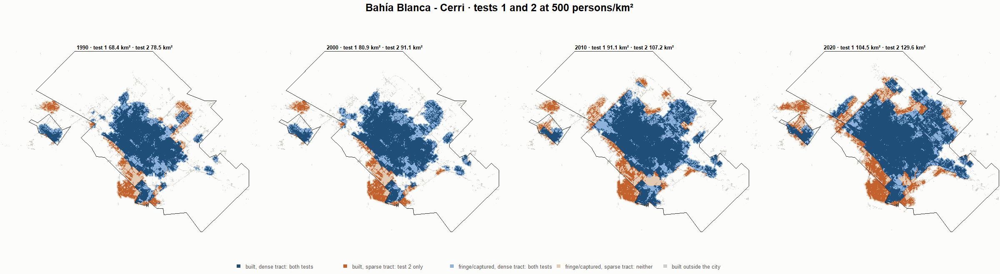
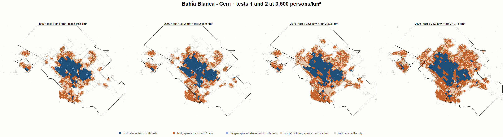
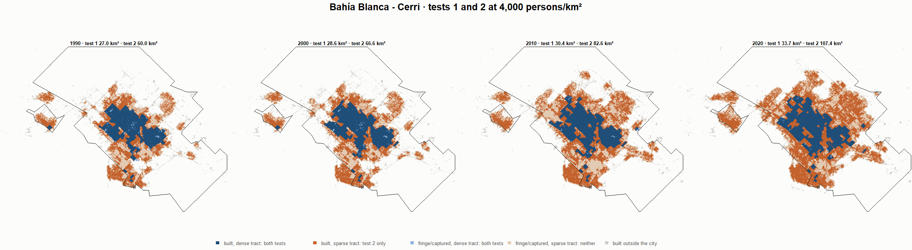

# Bahía Blanca - Cerri · tests 1 and 2 at the same cut, 1990-2020

Exploratory. None of these numbers are project figures (they are not in `CIFRAS_CANONICAS.json`). Generated by `Rpipe/scripts/14_prueba_comparada.R` from the tract tables of step 11. Run of 2026-11-08. [All agglomerations](../REPORTE.md) · [test 1](../../densidad_radios/bahia_blanca/REPORTE.md) · [test 2](../../franja_densa/bahia_blanca/REPORTE.md) · [methods](../../METODOS.md).

**At the same cut the two tests keep the same fringe and captured land**: that of the tracts at or above the cut. They differ only in the **built-up land of tracts below the cut**: test 1 drops it, test 2 keeps it. Test 2 minus test 1 is exactly that land.

## City size by cut

**1990 (census 1991).** Angel extent 91.0 km².

| Cut (p/km²) | Test 1 km² | Test 2 km² | Built in sparse tracts km² (test 2 only) | % of built-up in sparse tracts | Fringe in dense tracts km² (both) | Fringe in sparse tracts km² (neither) |
|---|---|---|---|---|---|---|
| 300 | 75.7 | 82.9 | 7.2 | 12.2 | 23.9 | 8.2 |
| 500 | 68.4 | 78.5 | 10.2 | 17.2 | 19.6 | 12.5 |
| 1,000 | 56.9 | 72.0 | 15.1 | 25.6 | 13.0 | 19.1 |
| 2,000 | 41.8 | 65.1 | 23.2 | 39.4 | 6.1 | 26.0 |
| 3,000 | 31.1 | 60.8 | 29.7 | 50.5 | 1.8 | 30.3 |
| 3,250 | 30.9 | 60.8 | 29.9 | 50.7 | 1.8 | 30.3 |
| 3,500 | 29.1 | 60.3 | 31.1 | 52.8 | 1.3 | 30.8 |
| 3,750 | 28.1 | 60.0 | 31.9 | 54.2 | 1.1 | 31.0 |
| 4,000 | 27.0 | 60.0 | 33.0 | 55.9 | 1.0 | 31.1 |
| 4,500 | 24.6 | 59.6 | 35.0 | 59.4 | 0.7 | 31.4 |
| 5,000 | 23.0 | 59.6 | 36.6 | 62.1 | 0.6 | 31.5 |

**2000 (census 2001).** Angel extent 100.7 km².

| Cut (p/km²) | Test 1 km² | Test 2 km² | Built in sparse tracts km² (test 2 only) | % of built-up in sparse tracts | Fringe in dense tracts km² (both) | Fringe in sparse tracts km² (neither) |
|---|---|---|---|---|---|---|
| 300 | 84.1 | 92.6 | 8.5 | 13.0 | 26.8 | 8.1 |
| 500 | 80.9 | 91.1 | 10.2 | 15.5 | 25.3 | 9.6 |
| 1,000 | 65.2 | 81.3 | 16.1 | 24.5 | 15.5 | 19.4 |
| 2,000 | 45.7 | 71.8 | 26.2 | 39.8 | 6.0 | 28.9 |
| 3,000 | 33.6 | 67.1 | 33.5 | 50.9 | 1.3 | 33.6 |
| 3,250 | 31.9 | 66.9 | 35.0 | 53.2 | 1.1 | 33.8 |
| 3,500 | 31.2 | 66.9 | 35.7 | 54.2 | 1.1 | 33.8 |
| 3,750 | 29.9 | 66.7 | 36.8 | 55.9 | 0.9 | 34.0 |
| 4,000 | 28.6 | 66.6 | 37.9 | 57.7 | 0.8 | 34.1 |
| 4,500 | 27.2 | 66.4 | 39.2 | 59.6 | 0.6 | 34.3 |
| 5,000 | 25.0 | 66.3 | 41.3 | 62.8 | 0.5 | 34.4 |

**2010 (census 2010).** Angel extent 125.3 km².

| Cut (p/km²) | Test 1 km² | Test 2 km² | Built in sparse tracts km² (test 2 only) | % of built-up in sparse tracts | Fringe in dense tracts km² (both) | Fringe in sparse tracts km² (neither) |
|---|---|---|---|---|---|---|
| 300 | 104.2 | 115.6 | 11.4 | 13.9 | 33.4 | 9.7 |
| 500 | 91.1 | 107.2 | 16.2 | 19.7 | 25.1 | 18.0 |
| 1,000 | 66.5 | 93.7 | 27.2 | 33.1 | 11.5 | 31.6 |
| 2,000 | 48.0 | 86.1 | 38.1 | 46.4 | 4.0 | 39.1 |
| 3,000 | 36.3 | 83.0 | 46.7 | 56.8 | 0.8 | 42.3 |
| 3,250 | 35.0 | 82.9 | 47.9 | 58.3 | 0.7 | 42.4 |
| 3,500 | 33.5 | 82.8 | 49.3 | 60.0 | 0.6 | 42.5 |
| 3,750 | 31.8 | 82.7 | 50.9 | 61.9 | 0.5 | 42.6 |
| 4,000 | 30.4 | 82.6 | 52.1 | 63.5 | 0.4 | 42.7 |
| 4,500 | 28.2 | 82.4 | 54.3 | 66.0 | 0.3 | 42.9 |
| 5,000 | 24.7 | 82.3 | 57.6 | 70.1 | 0.2 | 42.9 |

**2020 (census 2022).** Angel extent 151.8 km².

| Cut (p/km²) | Test 1 km² | Test 2 km² | Built in sparse tracts km² (test 2 only) | % of built-up in sparse tracts | Fringe in dense tracts km² (both) | Fringe in sparse tracts km² (neither) |
|---|---|---|---|---|---|---|
| 300 | 121.4 | 138.3 | 16.9 | 15.8 | 31.3 | 13.5 |
| 500 | 104.5 | 129.6 | 25.1 | 23.4 | 22.6 | 22.2 |
| 1,000 | 74.6 | 116.0 | 41.4 | 38.7 | 8.9 | 35.9 |
| 2,000 | 55.5 | 110.5 | 55.0 | 51.4 | 3.4 | 41.4 |
| 3,000 | 41.3 | 107.9 | 66.6 | 62.2 | 0.9 | 43.9 |
| 3,250 | 38.9 | 107.7 | 68.7 | 64.2 | 0.6 | 44.2 |
| 3,500 | 36.9 | 107.5 | 70.6 | 65.9 | 0.4 | 44.4 |
| 3,750 | 35.7 | 107.4 | 71.7 | 67.0 | 0.4 | 44.4 |
| 4,000 | 33.7 | 107.4 | 73.7 | 68.9 | 0.4 | 44.4 |
| 4,500 | 29.5 | 107.3 | 77.8 | 72.7 | 0.3 | 44.5 |
| 5,000 | 25.5 | 107.3 | 81.7 | 76.3 | 0.2 | 44.6 |

## Growth 1990-2020 by cut

Angel extent: 1.72 %/yr.

| Cut (p/km²) | Test 1 %/yr | Test 2 %/yr |
|---|---|---|
| 300 | 1.59 | 1.72 |
| 500 | 1.42 | 1.68 |
| 1,000 | 0.91 | 1.60 |
| 2,000 | 0.94 | 1.78 |
| 3,000 | 0.96 | 1.93 |
| 3,250 | 0.77 | 1.93 |
| 3,500 | 0.79 | 1.95 |
| 3,750 | 0.80 | 1.96 |
| 4,000 | 0.74 | 1.96 |
| 4,500 | 0.60 | 1.98 |
| 5,000 | 0.35 | 1.98 |

## Maps

Same frame in the four years: the 2020 city plus 3 km. Dark blue and light blue are in both tests; orange is built-up in tracts below the cut, which only test 2 keeps; beige is fringe or captured land in tracts below the cut, which neither keeps. Black line: the analysis perimeter.

### 500 persons/km²

### 3,000 persons/km²

### 3,500 persons/km²

### 4,000 persons/km²

