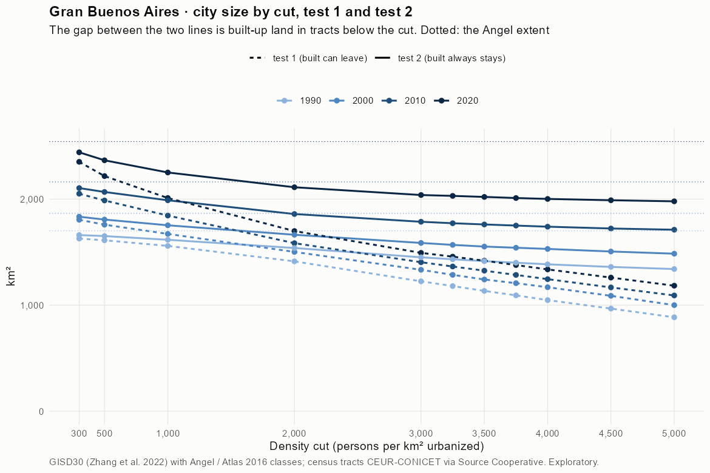
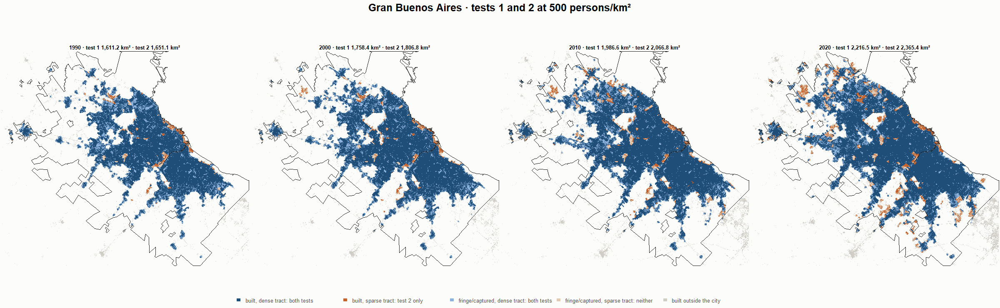
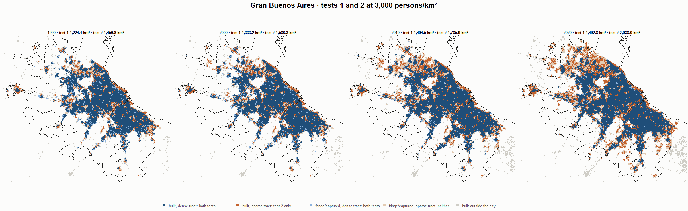
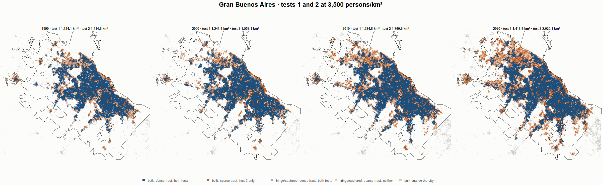

# Gran Buenos Aires · tests 1 and 2 at the same cut, 1990-2020

Exploratory. None of these numbers are project figures (they are not in `CIFRAS_CANONICAS.json`). Generated by `Rpipe/scripts/14_prueba_comparada.R` from the tract tables of step 11. Run of 2026-11-08. [All agglomerations](../REPORTE.md) · [test 1](../../densidad_radios/buenos_aires/REPORTE.md) · [test 2](../../franja_densa/buenos_aires/REPORTE.md) · [methods](../../METODOS.md).

**At the same cut the two tests keep the same fringe and captured land**: that of the tracts at or above the cut. They differ only in the **built-up land of tracts below the cut**: test 1 drops it, test 2 keeps it. Test 2 minus test 1 is exactly that land.

## City size by cut

**1990 (census 1991).** Angel extent 1,700.6 km².

| Cut (p/km²) | Test 1 km² | Test 2 km² | Built in sparse tracts km² (test 2 only) | % of built-up in sparse tracts | Fringe in dense tracts km² (both) | Fringe in sparse tracts km² (neither) |
|---|---|---|---|---|---|---|
| 300 | 1,627.8 | 1,660.4 | 32.6 | 2.6 | 382.2 | 40.2 |
| 500 | 1,611.2 | 1,651.1 | 39.9 | 3.1 | 372.9 | 49.4 |
| 1,000 | 1,558.4 | 1,616.1 | 57.8 | 4.5 | 337.9 | 84.4 |
| 2,000 | 1,412.8 | 1,538.6 | 125.8 | 9.8 | 260.4 | 161.9 |
| 3,000 | 1,224.4 | 1,450.8 | 226.3 | 17.7 | 172.5 | 249.8 |
| 3,250 | 1,179.7 | 1,432.4 | 252.7 | 19.8 | 154.2 | 268.2 |
| 3,500 | 1,134.1 | 1,414.6 | 280.5 | 21.9 | 136.4 | 286.0 |
| 3,750 | 1,092.2 | 1,400.0 | 307.8 | 24.1 | 121.8 | 300.6 |
| 4,000 | 1,047.4 | 1,384.7 | 337.3 | 26.4 | 106.5 | 315.8 |
| 4,500 | 967.5 | 1,360.4 | 392.9 | 30.7 | 82.1 | 340.2 |
| 5,000 | 885.4 | 1,340.1 | 454.7 | 35.6 | 61.9 | 360.5 |

**2000 (census 2001).** Angel extent 1,865.0 km².

| Cut (p/km²) | Test 1 km² | Test 2 km² | Built in sparse tracts km² (test 2 only) | % of built-up in sparse tracts | Fringe in dense tracts km² (both) | Fringe in sparse tracts km² (neither) |
|---|---|---|---|---|---|---|
| 300 | 1,804.8 | 1,833.5 | 28.6 | 2.0 | 417.5 | 31.5 |
| 500 | 1,758.4 | 1,806.8 | 48.4 | 3.4 | 390.8 | 58.2 |
| 1,000 | 1,671.4 | 1,752.7 | 81.3 | 5.7 | 336.8 | 112.3 |
| 2,000 | 1,501.8 | 1,663.4 | 161.6 | 11.4 | 247.5 | 201.6 |
| 3,000 | 1,333.2 | 1,586.3 | 253.2 | 17.9 | 170.4 | 278.6 |
| 3,250 | 1,285.5 | 1,567.9 | 282.3 | 19.9 | 152.0 | 297.1 |
| 3,500 | 1,241.8 | 1,552.1 | 310.3 | 21.9 | 136.1 | 312.9 |
| 3,750 | 1,206.9 | 1,541.0 | 334.1 | 23.6 | 125.1 | 324.0 |
| 4,000 | 1,168.8 | 1,529.8 | 361.0 | 25.5 | 113.9 | 335.1 |
| 4,500 | 1,087.8 | 1,505.6 | 417.7 | 29.5 | 89.6 | 359.4 |
| 5,000 | 999.8 | 1,485.0 | 485.2 | 34.3 | 69.1 | 380.0 |

**2010 (census 2010).** Angel extent 2,161.9 km².

| Cut (p/km²) | Test 1 km² | Test 2 km² | Built in sparse tracts km² (test 2 only) | % of built-up in sparse tracts | Fringe in dense tracts km² (both) | Fringe in sparse tracts km² (neither) |
|---|---|---|---|---|---|---|
| 300 | 2,050.4 | 2,103.5 | 53.1 | 3.2 | 444.1 | 58.3 |
| 500 | 1,986.6 | 2,066.8 | 80.2 | 4.8 | 407.3 | 95.1 |
| 1,000 | 1,844.5 | 1,988.4 | 143.8 | 8.7 | 328.9 | 173.5 |
| 2,000 | 1,584.2 | 1,858.9 | 274.7 | 16.6 | 199.5 | 303.0 |
| 3,000 | 1,404.5 | 1,785.9 | 381.4 | 23.0 | 126.5 | 376.0 |
| 3,250 | 1,364.3 | 1,772.0 | 407.8 | 24.6 | 112.6 | 389.8 |
| 3,500 | 1,324.8 | 1,760.6 | 435.8 | 26.3 | 101.2 | 401.2 |
| 3,750 | 1,284.9 | 1,750.0 | 465.1 | 28.0 | 90.6 | 411.8 |
| 4,000 | 1,244.9 | 1,739.5 | 494.6 | 29.8 | 80.1 | 422.4 |
| 4,500 | 1,167.0 | 1,722.4 | 555.4 | 33.5 | 63.0 | 439.4 |
| 5,000 | 1,091.2 | 1,710.8 | 619.6 | 37.3 | 51.4 | 451.0 |

**2020 (census 2022).** Angel extent 2,541.8 km².

| Cut (p/km²) | Test 1 km² | Test 2 km² | Built in sparse tracts km² (test 2 only) | % of built-up in sparse tracts | Fringe in dense tracts km² (both) | Fringe in sparse tracts km² (neither) |
|---|---|---|---|---|---|---|
| 300 | 2,351.0 | 2,440.7 | 89.7 | 4.6 | 500.6 | 101.2 |
| 500 | 2,216.5 | 2,365.4 | 148.9 | 7.7 | 425.4 | 176.4 |
| 1,000 | 2,009.7 | 2,250.6 | 240.8 | 12.4 | 310.5 | 291.3 |
| 2,000 | 1,698.5 | 2,111.3 | 412.8 | 21.3 | 171.2 | 430.5 |
| 3,000 | 1,492.8 | 2,038.0 | 545.3 | 28.1 | 97.9 | 503.8 |
| 3,250 | 1,457.2 | 2,029.8 | 572.6 | 29.5 | 89.7 | 512.0 |
| 3,500 | 1,418.8 | 2,020.1 | 601.3 | 31.0 | 80.0 | 521.7 |
| 3,750 | 1,377.9 | 2,009.7 | 631.9 | 32.6 | 69.7 | 532.1 |
| 4,000 | 1,336.8 | 2,001.2 | 664.4 | 34.2 | 61.2 | 540.6 |
| 4,500 | 1,259.7 | 1,988.8 | 729.1 | 37.6 | 48.7 | 553.1 |
| 5,000 | 1,183.4 | 1,978.6 | 795.2 | 41.0 | 38.5 | 563.2 |

## Growth 1990-2020 by cut

Angel extent: 1.35 %/yr.

| Cut (p/km²) | Test 1 %/yr | Test 2 %/yr |
|---|---|---|
| 300 | 1.23 | 1.29 |
| 500 | 1.07 | 1.21 |
| 1,000 | 0.85 | 1.11 |
| 2,000 | 0.62 | 1.06 |
| 3,000 | 0.66 | 1.14 |
| 3,250 | 0.71 | 1.17 |
| 3,500 | 0.75 | 1.19 |
| 3,750 | 0.78 | 1.21 |
| 4,000 | 0.82 | 1.24 |
| 4,500 | 0.88 | 1.27 |
| 5,000 | 0.97 | 1.31 |

## Maps

Same frame in the four years: the 2020 city plus 3 km. Dark blue and light blue are in both tests; orange is built-up in tracts below the cut, which only test 2 keeps; beige is fringe or captured land in tracts below the cut, which neither keeps. Black line: the analysis perimeter.

### 500 persons/km²

### 3,000 persons/km²

### 3,500 persons/km²

### 4,000 persons/km²

