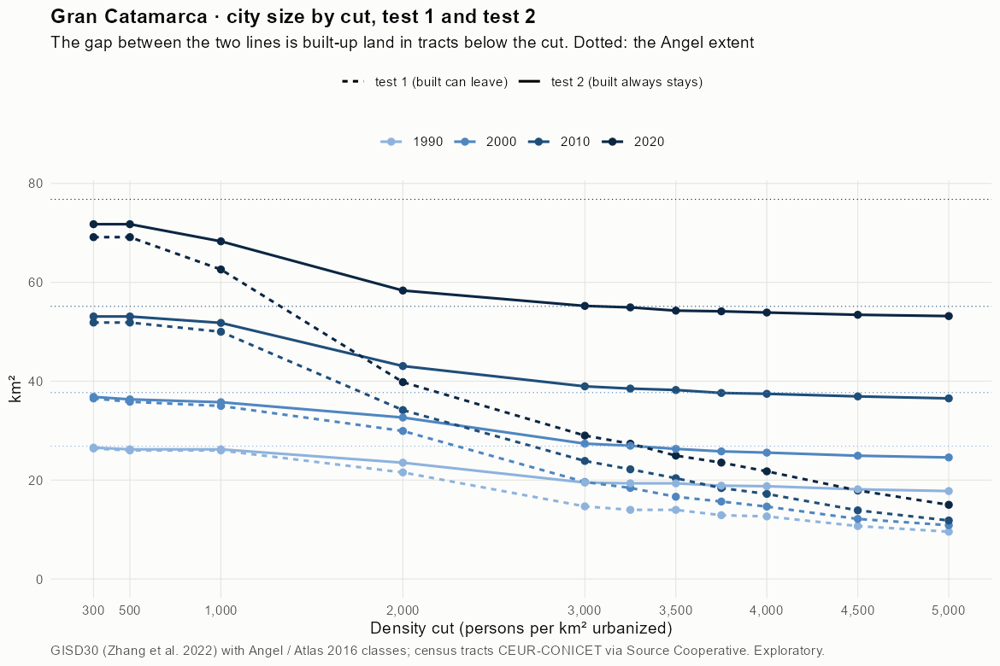
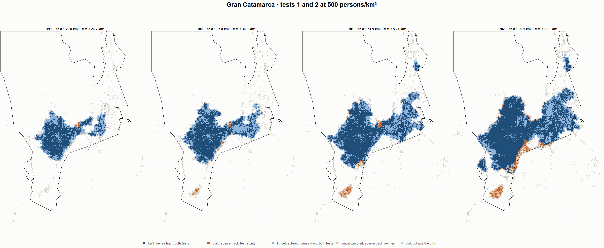
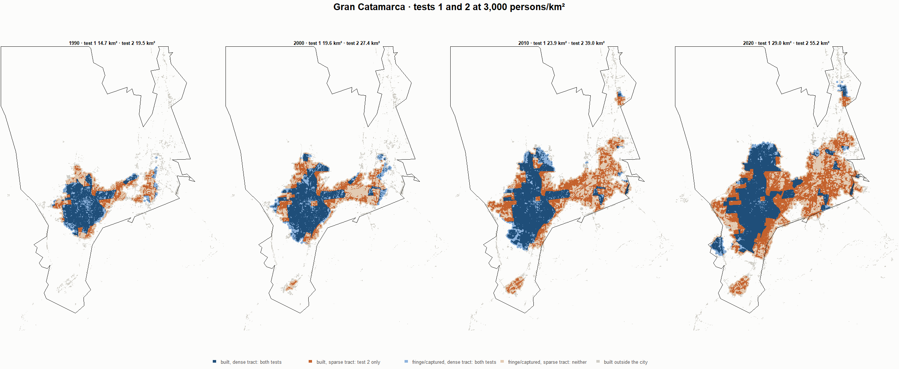
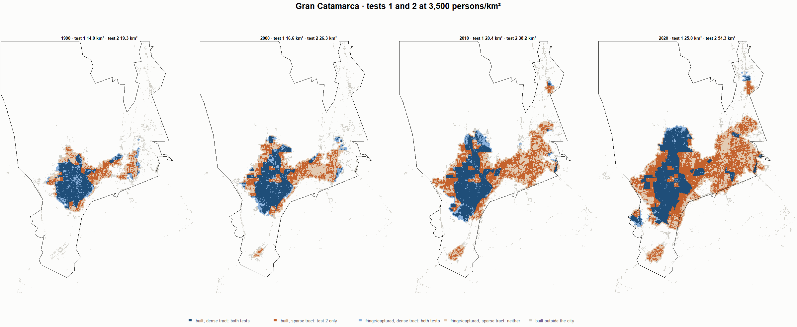
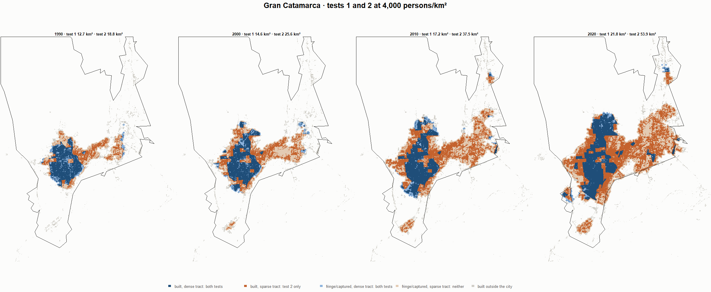

# Gran Catamarca · tests 1 and 2 at the same cut, 1990-2020

Exploratory. None of these numbers are project figures (they are not in `CIFRAS_CANONICAS.json`). Generated by `Rpipe/scripts/14_prueba_comparada.R` from the tract tables of step 11. Run of 2026-11-08. [All agglomerations](../REPORTE.md) · [test 1](../../densidad_radios/catamarca/REPORTE.md) · [test 2](../../franja_densa/catamarca/REPORTE.md) · [methods](../../METODOS.md).

**At the same cut the two tests keep the same fringe and captured land**: that of the tracts at or above the cut. They differ only in the **built-up land of tracts below the cut**: test 1 drops it, test 2 keeps it. Test 2 minus test 1 is exactly that land.

## City size by cut

**1990 (census 1991).** Angel extent 26.9 km².

| Cut (p/km²) | Test 1 km² | Test 2 km² | Built in sparse tracts km² (test 2 only) | % of built-up in sparse tracts | Fringe in dense tracts km² (both) | Fringe in sparse tracts km² (neither) |
|---|---|---|---|---|---|---|
| 300 | 26.4 | 26.6 | 0.2 | 1.1 | 10.6 | 0.3 |
| 500 | 26.0 | 26.2 | 0.2 | 1.4 | 10.3 | 0.6 |
| 1,000 | 26.0 | 26.2 | 0.2 | 1.4 | 10.3 | 0.6 |
| 2,000 | 21.6 | 23.5 | 2.0 | 12.4 | 7.6 | 3.3 |
| 3,000 | 14.7 | 19.5 | 4.8 | 30.2 | 3.6 | 7.4 |
| 3,250 | 14.0 | 19.3 | 5.4 | 33.7 | 3.4 | 7.5 |
| 3,500 | 14.0 | 19.3 | 5.4 | 33.7 | 3.4 | 7.5 |
| 3,750 | 12.9 | 18.9 | 6.0 | 37.5 | 3.0 | 8.0 |
| 4,000 | 12.7 | 18.8 | 6.1 | 38.3 | 2.8 | 8.1 |
| 4,500 | 10.7 | 18.1 | 7.4 | 46.7 | 2.2 | 8.7 |
| 5,000 | 9.6 | 17.8 | 8.2 | 51.6 | 1.9 | 9.1 |

**2000 (census 2001).** Angel extent 37.7 km².

| Cut (p/km²) | Test 1 km² | Test 2 km² | Built in sparse tracts km² (test 2 only) | % of built-up in sparse tracts | Fringe in dense tracts km² (both) | Fringe in sparse tracts km² (neither) |
|---|---|---|---|---|---|---|
| 300 | 36.5 | 36.8 | 0.3 | 1.4 | 14.1 | 0.9 |
| 500 | 35.8 | 36.3 | 0.5 | 2.1 | 13.6 | 1.4 |
| 1,000 | 35.0 | 35.8 | 0.8 | 3.3 | 13.0 | 2.0 |
| 2,000 | 29.9 | 32.7 | 2.7 | 12.0 | 10.0 | 5.1 |
| 3,000 | 19.6 | 27.4 | 7.8 | 34.2 | 4.7 | 10.3 |
| 3,250 | 18.4 | 27.0 | 8.5 | 37.6 | 4.2 | 10.8 |
| 3,500 | 16.6 | 26.3 | 9.7 | 42.6 | 3.6 | 11.4 |
| 3,750 | 15.7 | 25.8 | 10.1 | 44.7 | 3.1 | 11.9 |
| 4,000 | 14.6 | 25.6 | 10.9 | 48.1 | 2.9 | 12.1 |
| 4,500 | 12.1 | 24.9 | 12.8 | 56.3 | 2.2 | 12.8 |
| 5,000 | 10.9 | 24.6 | 13.7 | 60.4 | 1.9 | 13.1 |

**2010 (census 2010).** Angel extent 55.1 km².

| Cut (p/km²) | Test 1 km² | Test 2 km² | Built in sparse tracts km² (test 2 only) | % of built-up in sparse tracts | Fringe in dense tracts km² (both) | Fringe in sparse tracts km² (neither) |
|---|---|---|---|---|---|---|
| 300 | 51.9 | 53.1 | 1.2 | 3.5 | 18.4 | 2.1 |
| 500 | 51.9 | 53.1 | 1.2 | 3.5 | 18.4 | 2.1 |
| 1,000 | 50.0 | 51.8 | 1.8 | 5.2 | 17.1 | 3.3 |
| 2,000 | 34.2 | 43.1 | 8.9 | 25.7 | 8.3 | 12.1 |
| 3,000 | 23.9 | 39.0 | 15.1 | 43.5 | 4.2 | 16.2 |
| 3,250 | 22.2 | 38.5 | 16.3 | 47.0 | 3.8 | 16.6 |
| 3,500 | 20.4 | 38.2 | 17.8 | 51.4 | 3.5 | 16.9 |
| 3,750 | 18.4 | 37.6 | 19.2 | 55.4 | 2.9 | 17.5 |
| 4,000 | 17.2 | 37.5 | 20.2 | 58.3 | 2.7 | 17.7 |
| 4,500 | 13.9 | 36.9 | 23.0 | 66.4 | 2.2 | 18.2 |
| 5,000 | 11.8 | 36.5 | 24.7 | 71.1 | 1.8 | 18.6 |

**2020 (census 2022).** Angel extent 76.8 km².

| Cut (p/km²) | Test 1 km² | Test 2 km² | Built in sparse tracts km² (test 2 only) | % of built-up in sparse tracts | Fringe in dense tracts km² (both) | Fringe in sparse tracts km² (neither) |
|---|---|---|---|---|---|---|
| 300 | 69.1 | 71.8 | 2.6 | 5.0 | 19.7 | 5.0 |
| 500 | 69.1 | 71.8 | 2.6 | 5.0 | 19.7 | 5.0 |
| 1,000 | 62.6 | 68.3 | 5.7 | 10.9 | 16.3 | 8.5 |
| 2,000 | 39.8 | 58.3 | 18.5 | 35.6 | 6.3 | 18.4 |
| 3,000 | 29.0 | 55.2 | 26.2 | 50.4 | 3.2 | 21.6 |
| 3,250 | 27.4 | 54.9 | 27.6 | 53.0 | 2.9 | 21.8 |
| 3,500 | 25.0 | 54.3 | 29.3 | 56.4 | 2.3 | 22.5 |
| 3,750 | 23.5 | 54.1 | 30.6 | 58.8 | 2.1 | 22.6 |
| 4,000 | 21.8 | 53.9 | 32.1 | 61.7 | 1.9 | 22.9 |
| 4,500 | 17.9 | 53.4 | 35.5 | 68.3 | 1.4 | 23.3 |
| 5,000 | 15.0 | 53.2 | 38.2 | 73.4 | 1.2 | 23.6 |

## Growth 1990-2020 by cut

Angel extent: 3.56 %/yr.

| Cut (p/km²) | Test 1 %/yr | Test 2 %/yr |
|---|---|---|
| 300 | 3.26 | 3.37 |
| 500 | 3.31 | 3.41 |
| 1,000 | 2.97 | 3.24 |
| 2,000 | 2.07 | 3.07 |
| 3,000 | 2.29 | 3.53 |
| 3,250 | 2.26 | 3.54 |
| 3,500 | 1.95 | 3.50 |
| 3,750 | 2.02 | 3.57 |
| 4,000 | 1.83 | 3.58 |
| 4,500 | 1.73 | 3.67 |
| 5,000 | 1.51 | 3.72 |

## Maps

Same frame in the four years: the 2020 city plus 3 km. Dark blue and light blue are in both tests; orange is built-up in tracts below the cut, which only test 2 keeps; beige is fringe or captured land in tracts below the cut, which neither keeps. Black line: the analysis perimeter.

### 500 persons/km²

### 3,000 persons/km²

### 3,500 persons/km²

### 4,000 persons/km²

