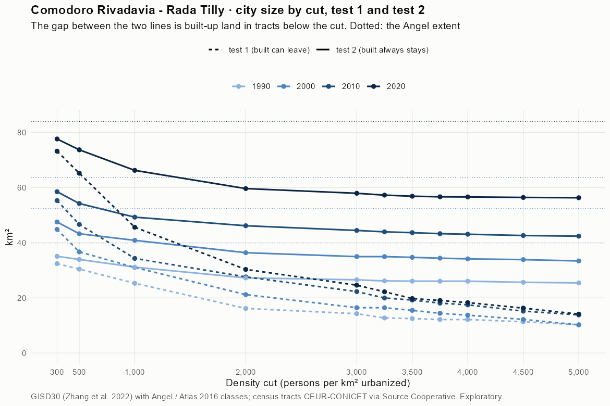
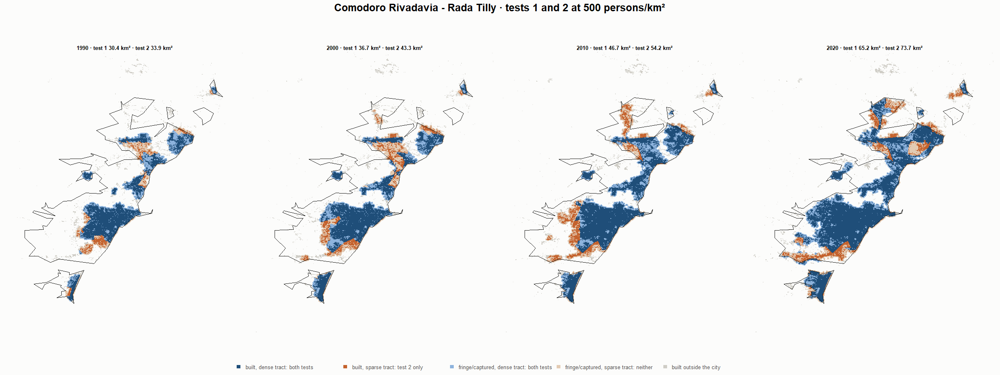
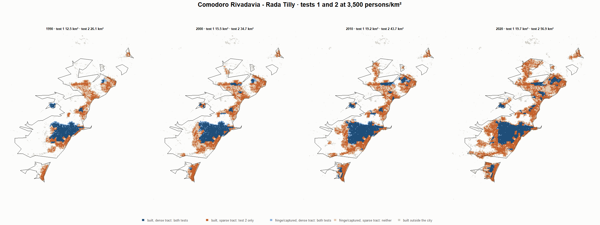
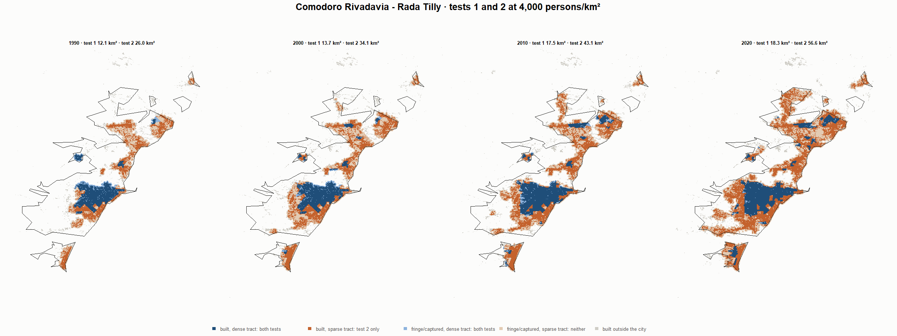

# Comodoro Rivadavia - Rada Tilly · tests 1 and 2 at the same cut, 1990-2020

Exploratory. None of these numbers are project figures (they are not in `CIFRAS_CANONICAS.json`). Generated by `Rpipe/scripts/14_prueba_comparada.R` from the tract tables of step 11. Run of 2026-11-08. [All agglomerations](../REPORTE.md) · [test 1](../../densidad_radios/comodoro_rivadavia/REPORTE.md) · [test 2](../../franja_densa/comodoro_rivadavia/REPORTE.md) · [methods](../../METODOS.md).

**At the same cut the two tests keep the same fringe and captured land**: that of the tracts at or above the cut. They differ only in the **built-up land of tracts below the cut**: test 1 drops it, test 2 keeps it. Test 2 minus test 1 is exactly that land.

## City size by cut

**1990 (census 1991).** Angel extent 39.9 km².

| Cut (p/km²) | Test 1 km² | Test 2 km² | Built in sparse tracts km² (test 2 only) | % of built-up in sparse tracts | Fringe in dense tracts km² (both) | Fringe in sparse tracts km² (neither) |
|---|---|---|---|---|---|---|
| 300 | 32.4 | 35.1 | 2.7 | 11.1 | 11.2 | 4.8 |
| 500 | 30.4 | 33.9 | 3.5 | 14.7 | 10.0 | 5.9 |
| 1,000 | 25.3 | 31.1 | 5.8 | 24.4 | 7.2 | 8.7 |
| 2,000 | 16.2 | 27.3 | 11.1 | 46.4 | 3.3 | 12.6 |
| 3,000 | 14.3 | 26.5 | 12.3 | 51.4 | 2.6 | 13.3 |
| 3,250 | 12.7 | 26.2 | 13.5 | 56.3 | 2.2 | 13.7 |
| 3,500 | 12.5 | 26.1 | 13.6 | 56.8 | 2.1 | 13.8 |
| 3,750 | 12.1 | 26.0 | 13.9 | 58.1 | 2.1 | 13.8 |
| 4,000 | 12.1 | 26.0 | 13.9 | 58.1 | 2.1 | 13.8 |
| 4,500 | 11.3 | 25.6 | 14.3 | 59.9 | 1.7 | 14.2 |
| 5,000 | 10.3 | 25.4 | 15.2 | 63.4 | 1.5 | 14.4 |

**2000 (census 2001).** Angel extent 52.5 km².

| Cut (p/km²) | Test 1 km² | Test 2 km² | Built in sparse tracts km² (test 2 only) | % of built-up in sparse tracts | Fringe in dense tracts km² (both) | Fringe in sparse tracts km² (neither) |
|---|---|---|---|---|---|---|
| 300 | 44.9 | 47.5 | 2.7 | 8.4 | 15.4 | 4.9 |
| 500 | 36.7 | 43.3 | 6.6 | 20.4 | 11.1 | 9.2 |
| 1,000 | 31.0 | 40.9 | 9.8 | 30.6 | 8.7 | 11.6 |
| 2,000 | 21.2 | 36.4 | 15.2 | 47.3 | 4.2 | 16.1 |
| 3,000 | 16.4 | 35.0 | 18.5 | 57.6 | 2.8 | 17.5 |
| 3,250 | 16.4 | 35.0 | 18.5 | 57.6 | 2.8 | 17.5 |
| 3,500 | 15.5 | 34.7 | 19.2 | 59.8 | 2.5 | 17.8 |
| 3,750 | 14.4 | 34.4 | 20.0 | 62.2 | 2.2 | 18.1 |
| 4,000 | 13.7 | 34.1 | 20.4 | 63.5 | 2.0 | 18.3 |
| 4,500 | 12.2 | 33.9 | 21.7 | 67.5 | 1.7 | 18.6 |
| 5,000 | 10.2 | 33.4 | 23.2 | 72.1 | 1.2 | 19.1 |

**2010 (census 2010).** Angel extent 63.7 km².

| Cut (p/km²) | Test 1 km² | Test 2 km² | Built in sparse tracts km² (test 2 only) | % of built-up in sparse tracts | Fringe in dense tracts km² (both) | Fringe in sparse tracts km² (neither) |
|---|---|---|---|---|---|---|
| 300 | 55.3 | 58.5 | 3.2 | 7.8 | 17.4 | 5.2 |
| 500 | 46.7 | 54.2 | 7.6 | 18.5 | 13.1 | 9.5 |
| 1,000 | 34.3 | 49.3 | 15.0 | 36.4 | 8.2 | 14.4 |
| 2,000 | 27.6 | 46.2 | 18.6 | 45.2 | 5.1 | 17.6 |
| 3,000 | 22.3 | 44.5 | 22.2 | 54.0 | 3.4 | 19.3 |
| 3,250 | 20.0 | 44.0 | 24.0 | 58.4 | 2.9 | 19.8 |
| 3,500 | 19.2 | 43.7 | 24.5 | 59.5 | 2.6 | 20.1 |
| 3,750 | 18.1 | 43.3 | 25.2 | 61.3 | 2.2 | 20.4 |
| 4,000 | 17.5 | 43.1 | 25.6 | 62.4 | 2.0 | 20.6 |
| 4,500 | 15.2 | 42.6 | 27.4 | 66.8 | 1.5 | 21.1 |
| 5,000 | 13.8 | 42.4 | 28.6 | 69.5 | 1.3 | 21.3 |

**2020 (census 2022).** Angel extent 84.0 km².

| Cut (p/km²) | Test 1 km² | Test 2 km² | Built in sparse tracts km² (test 2 only) | % of built-up in sparse tracts | Fringe in dense tracts km² (both) | Fringe in sparse tracts km² (neither) |
|---|---|---|---|---|---|---|
| 300 | 73.2 | 77.7 | 4.4 | 7.9 | 21.9 | 6.3 |
| 500 | 65.2 | 73.7 | 8.5 | 15.3 | 18.0 | 10.3 |
| 1,000 | 45.6 | 66.3 | 20.6 | 37.0 | 10.5 | 17.7 |
| 2,000 | 30.3 | 59.7 | 29.3 | 52.6 | 3.9 | 24.3 |
| 3,000 | 24.6 | 58.0 | 33.3 | 59.8 | 2.2 | 26.0 |
| 3,250 | 22.2 | 57.3 | 35.1 | 62.9 | 1.5 | 26.7 |
| 3,500 | 19.7 | 56.9 | 37.1 | 66.6 | 1.1 | 27.1 |
| 3,750 | 19.1 | 56.7 | 37.6 | 67.5 | 0.9 | 27.3 |
| 4,000 | 18.3 | 56.6 | 38.3 | 68.8 | 0.9 | 27.4 |
| 4,500 | 16.3 | 56.4 | 40.2 | 72.0 | 0.7 | 27.5 |
| 5,000 | 14.1 | 56.3 | 42.2 | 75.7 | 0.6 | 27.7 |

## Growth 1990-2020 by cut

Angel extent: 2.51 %/yr.

| Cut (p/km²) | Test 1 %/yr | Test 2 %/yr |
|---|---|---|
| 300 | 2.75 | 2.68 |
| 500 | 2.58 | 2.62 |
| 1,000 | 1.98 | 2.55 |
| 2,000 | 2.12 | 2.65 |
| 3,000 | 1.84 | 2.64 |
| 3,250 | 1.88 | 2.65 |
| 3,500 | 1.54 | 2.64 |
| 3,750 | 1.51 | 2.62 |
| 4,000 | 1.37 | 2.62 |
| 4,500 | 1.22 | 2.67 |
| 5,000 | 1.06 | 2.69 |

## Maps

Same frame in the four years: the 2020 city plus 3 km. Dark blue and light blue are in both tests; orange is built-up in tracts below the cut, which only test 2 keeps; beige is fringe or captured land in tracts below the cut, which neither keeps. Black line: the analysis perimeter.

### 500 persons/km²

### 3,000 persons/km²

### 3,500 persons/km²

### 4,000 persons/km²

