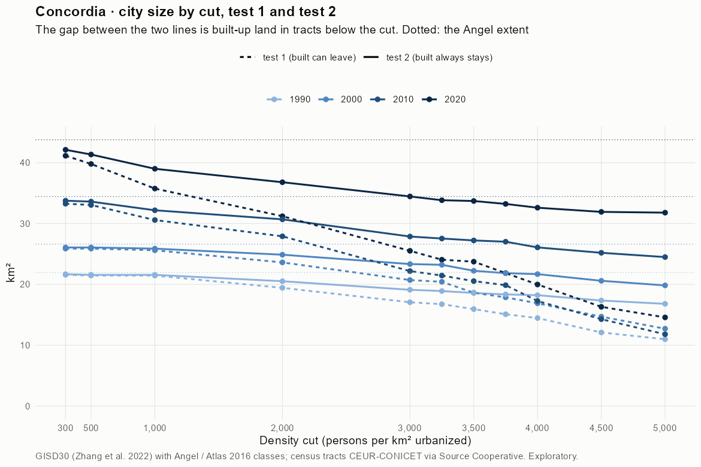
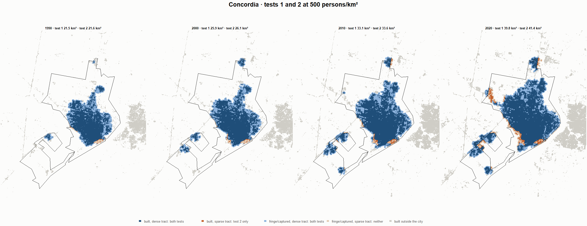
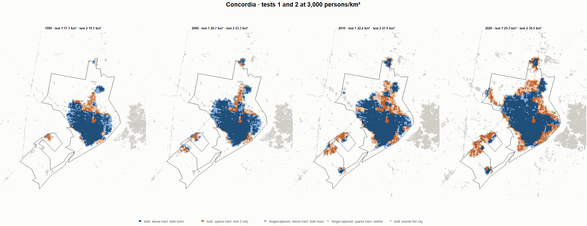
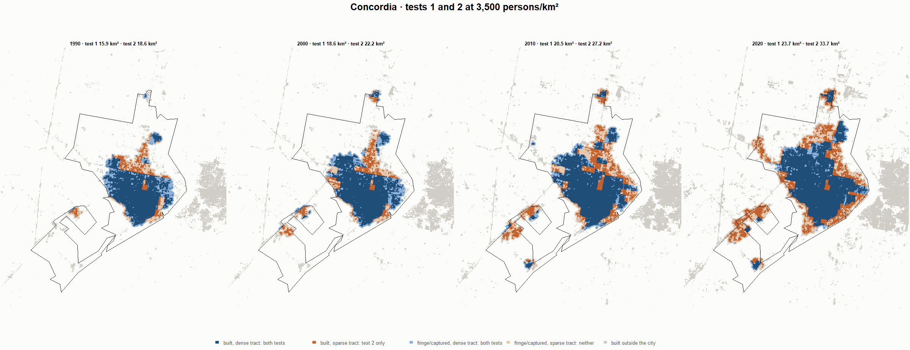
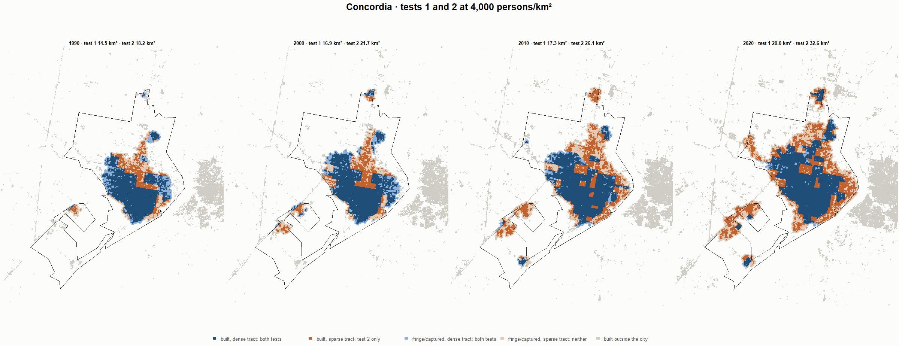

# Concordia · tests 1 and 2 at the same cut, 1990-2020

Exploratory. None of these numbers are project figures (they are not in `CIFRAS_CANONICAS.json`). Generated by `Rpipe/scripts/14_prueba_comparada.R` from the tract tables of step 11. Run of 2026-11-08. [All agglomerations](../REPORTE.md) · [test 1](../../densidad_radios/concordia/REPORTE.md) · [test 2](../../franja_densa/concordia/REPORTE.md) · [methods](../../METODOS.md).

**At the same cut the two tests keep the same fringe and captured land**: that of the tracts at or above the cut. They differ only in the **built-up land of tracts below the cut**: test 1 drops it, test 2 keeps it. Test 2 minus test 1 is exactly that land.

## City size by cut

**1990 (census 1991).** Angel extent 22.0 km².

| Cut (p/km²) | Test 1 km² | Test 2 km² | Built in sparse tracts km² (test 2 only) | % of built-up in sparse tracts | Fringe in dense tracts km² (both) | Fringe in sparse tracts km² (neither) |
|---|---|---|---|---|---|---|
| 300 | 21.6 | 21.7 | 0.1 | 0.7 | 6.8 | 0.3 |
| 500 | 21.5 | 21.6 | 0.1 | 0.8 | 6.7 | 0.4 |
| 1,000 | 21.5 | 21.6 | 0.1 | 0.8 | 6.7 | 0.4 |
| 2,000 | 19.4 | 20.5 | 1.1 | 7.3 | 5.6 | 1.4 |
| 3,000 | 17.1 | 19.1 | 2.1 | 13.8 | 4.2 | 2.9 |
| 3,250 | 16.7 | 18.9 | 2.2 | 14.5 | 4.0 | 3.1 |
| 3,500 | 15.9 | 18.6 | 2.7 | 17.8 | 3.7 | 3.4 |
| 3,750 | 15.1 | 18.4 | 3.3 | 21.9 | 3.5 | 3.6 |
| 4,000 | 14.5 | 18.2 | 3.8 | 25.2 | 3.3 | 3.7 |
| 4,500 | 12.1 | 17.3 | 5.3 | 35.3 | 2.4 | 4.6 |
| 5,000 | 11.0 | 16.8 | 5.8 | 39.1 | 1.9 | 5.2 |

**2000 (census 2001).** Angel extent 26.6 km².

| Cut (p/km²) | Test 1 km² | Test 2 km² | Built in sparse tracts km² (test 2 only) | % of built-up in sparse tracts | Fringe in dense tracts km² (both) | Fringe in sparse tracts km² (neither) |
|---|---|---|---|---|---|---|
| 300 | 25.9 | 26.1 | 0.2 | 1.1 | 8.2 | 0.5 |
| 500 | 25.9 | 26.1 | 0.2 | 1.1 | 8.2 | 0.5 |
| 1,000 | 25.6 | 25.9 | 0.3 | 1.5 | 8.0 | 0.7 |
| 2,000 | 23.6 | 24.9 | 1.3 | 7.1 | 7.0 | 1.7 |
| 3,000 | 20.7 | 23.3 | 2.6 | 14.7 | 5.5 | 3.3 |
| 3,250 | 20.4 | 23.2 | 2.8 | 15.7 | 5.4 | 3.4 |
| 3,500 | 18.6 | 22.2 | 3.6 | 20.2 | 4.4 | 4.4 |
| 3,750 | 17.9 | 21.8 | 4.0 | 22.3 | 4.0 | 4.8 |
| 4,000 | 16.9 | 21.7 | 4.8 | 26.9 | 3.8 | 4.9 |
| 4,500 | 14.7 | 20.6 | 5.9 | 33.1 | 2.7 | 6.0 |
| 5,000 | 12.7 | 19.8 | 7.1 | 39.9 | 2.0 | 6.8 |

**2010 (census 2010).** Angel extent 34.4 km².

| Cut (p/km²) | Test 1 km² | Test 2 km² | Built in sparse tracts km² (test 2 only) | % of built-up in sparse tracts | Fringe in dense tracts km² (both) | Fringe in sparse tracts km² (neither) |
|---|---|---|---|---|---|---|
| 300 | 33.3 | 33.8 | 0.5 | 2.1 | 10.1 | 0.7 |
| 500 | 33.1 | 33.6 | 0.6 | 2.3 | 9.9 | 0.8 |
| 1,000 | 30.6 | 32.2 | 1.6 | 6.8 | 8.5 | 2.2 |
| 2,000 | 27.9 | 30.7 | 2.8 | 11.8 | 7.0 | 3.7 |
| 3,000 | 22.2 | 27.9 | 5.7 | 24.0 | 4.2 | 6.6 |
| 3,250 | 21.5 | 27.5 | 6.1 | 25.7 | 3.9 | 6.9 |
| 3,500 | 20.5 | 27.2 | 6.7 | 28.3 | 3.6 | 7.2 |
| 3,750 | 19.9 | 27.0 | 7.1 | 30.2 | 3.4 | 7.4 |
| 4,000 | 17.3 | 26.1 | 8.8 | 37.3 | 2.4 | 8.4 |
| 4,500 | 14.3 | 25.2 | 10.9 | 46.1 | 1.5 | 9.2 |
| 5,000 | 11.8 | 24.5 | 12.7 | 53.7 | 0.8 | 9.9 |

**2020 (census 2022).** Angel extent 43.8 km².

| Cut (p/km²) | Test 1 km² | Test 2 km² | Built in sparse tracts km² (test 2 only) | % of built-up in sparse tracts | Fringe in dense tracts km² (both) | Fringe in sparse tracts km² (neither) |
|---|---|---|---|---|---|---|
| 300 | 41.2 | 42.1 | 1.0 | 3.2 | 11.1 | 1.6 |
| 500 | 39.8 | 41.4 | 1.6 | 5.0 | 10.3 | 2.4 |
| 1,000 | 35.8 | 39.0 | 3.3 | 10.5 | 8.0 | 4.8 |
| 2,000 | 31.2 | 36.8 | 5.6 | 18.0 | 5.7 | 7.0 |
| 3,000 | 25.5 | 34.5 | 8.9 | 28.8 | 3.4 | 9.3 |
| 3,250 | 24.1 | 33.8 | 9.8 | 31.5 | 2.8 | 9.9 |
| 3,500 | 23.7 | 33.7 | 10.0 | 32.1 | 2.7 | 10.1 |
| 3,750 | 21.9 | 33.2 | 11.4 | 36.6 | 2.2 | 10.6 |
| 4,000 | 20.0 | 32.6 | 12.6 | 40.7 | 1.6 | 11.2 |
| 4,500 | 16.3 | 31.9 | 15.6 | 50.3 | 0.9 | 11.9 |
| 5,000 | 14.6 | 31.8 | 17.2 | 55.5 | 0.7 | 12.0 |

## Growth 1990-2020 by cut

Angel extent: 2.33 %/yr.

| Cut (p/km²) | Test 1 %/yr | Test 2 %/yr |
|---|---|---|
| 300 | 2.18 | 2.24 |
| 500 | 2.08 | 2.19 |
| 1,000 | 1.72 | 2.00 |
| 2,000 | 1.59 | 1.97 |
| 3,000 | 1.35 | 1.98 |
| 3,250 | 1.21 | 1.96 |
| 3,500 | 1.34 | 2.00 |
| 3,750 | 1.24 | 2.00 |
| 4,000 | 1.08 | 1.96 |
| 4,500 | 1.00 | 2.05 |
| 5,000 | 0.95 | 2.15 |

## Maps

Same frame in the four years: the 2020 city plus 3 km. Dark blue and light blue are in both tests; orange is built-up in tracts below the cut, which only test 2 keeps; beige is fringe or captured land in tracts below the cut, which neither keeps. Black line: the analysis perimeter.

### 500 persons/km²

### 3,000 persons/km²

### 3,500 persons/km²

### 4,000 persons/km²

