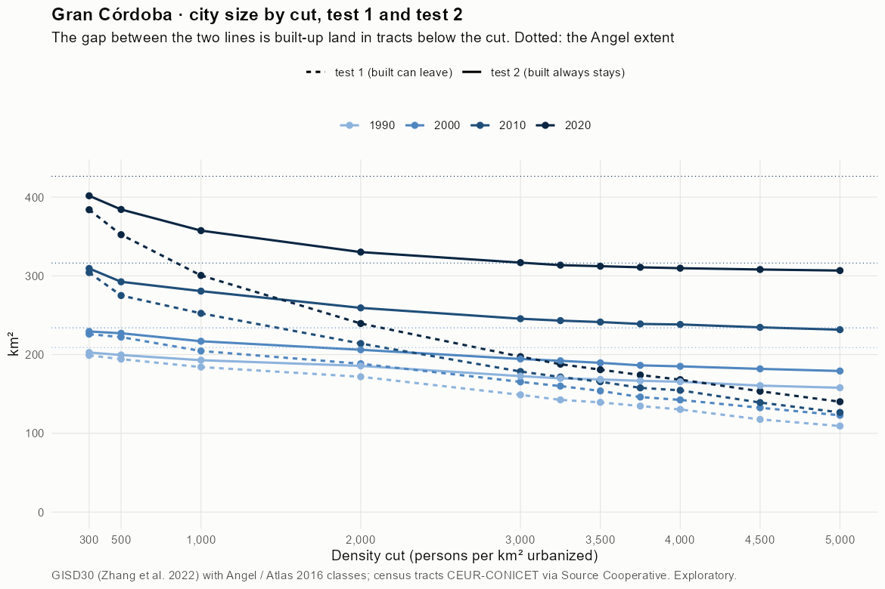
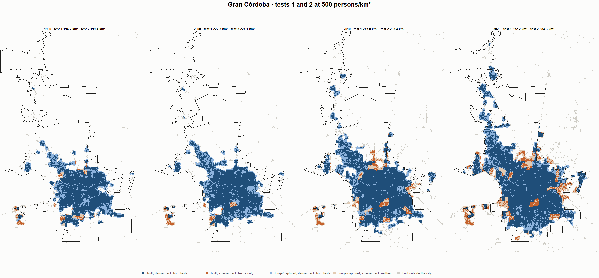
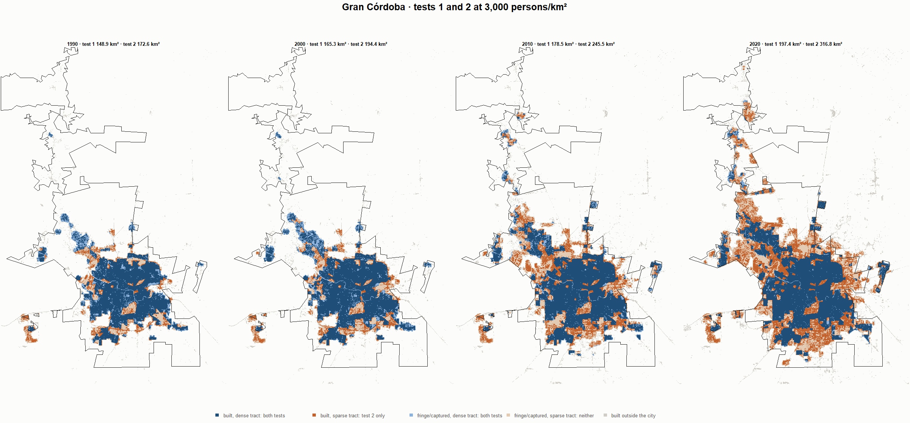
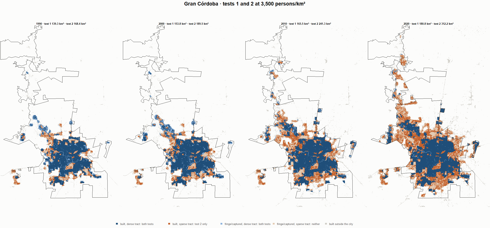
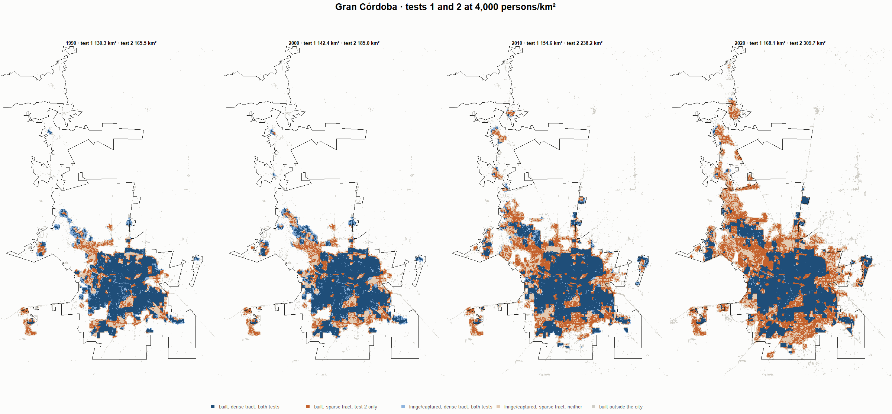

# Gran Córdoba · tests 1 and 2 at the same cut, 1990-2020

Exploratory. None of these numbers are project figures (they are not in `CIFRAS_CANONICAS.json`). Generated by `Rpipe/scripts/14_prueba_comparada.R` from the tract tables of step 11. Run of 2026-11-08. [All agglomerations](../REPORTE.md) · [test 1](../../densidad_radios/cordoba/REPORTE.md) · [test 2](../../franja_densa/cordoba/REPORTE.md) · [methods](../../METODOS.md).

**At the same cut the two tests keep the same fringe and captured land**: that of the tracts at or above the cut. They differ only in the **built-up land of tracts below the cut**: test 1 drops it, test 2 keeps it. Test 2 minus test 1 is exactly that land.

## City size by cut

**1990 (census 1991).** Angel extent 208.9 km².

| Cut (p/km²) | Test 1 km² | Test 2 km² | Built in sparse tracts km² (test 2 only) | % of built-up in sparse tracts | Fringe in dense tracts km² (both) | Fringe in sparse tracts km² (neither) |
|---|---|---|---|---|---|---|
| 300 | 199.0 | 202.6 | 3.6 | 2.5 | 56.8 | 6.2 |
| 500 | 194.2 | 199.4 | 5.3 | 3.6 | 53.6 | 9.4 |
| 1,000 | 184.1 | 192.9 | 8.7 | 6.0 | 47.0 | 16.0 |
| 2,000 | 171.8 | 185.6 | 13.8 | 9.5 | 39.7 | 23.3 |
| 3,000 | 148.9 | 172.6 | 23.8 | 16.3 | 26.8 | 36.2 |
| 3,250 | 142.5 | 169.8 | 27.3 | 18.7 | 23.9 | 39.1 |
| 3,500 | 139.3 | 168.4 | 29.1 | 20.0 | 22.6 | 40.4 |
| 3,750 | 134.6 | 166.7 | 32.0 | 22.0 | 20.8 | 42.2 |
| 4,000 | 130.3 | 165.5 | 35.2 | 24.1 | 19.6 | 43.3 |
| 4,500 | 117.7 | 160.6 | 42.9 | 29.4 | 14.7 | 48.3 |
| 5,000 | 109.2 | 157.9 | 48.6 | 33.3 | 12.0 | 51.0 |

**2000 (census 2001).** Angel extent 233.9 km².

| Cut (p/km²) | Test 1 km² | Test 2 km² | Built in sparse tracts km² (test 2 only) | % of built-up in sparse tracts | Fringe in dense tracts km² (both) | Fringe in sparse tracts km² (neither) |
|---|---|---|---|---|---|---|
| 300 | 226.0 | 229.3 | 3.4 | 2.0 | 64.5 | 4.6 |
| 500 | 222.2 | 227.1 | 4.9 | 3.0 | 62.2 | 6.9 |
| 1,000 | 204.6 | 216.9 | 12.4 | 7.5 | 52.0 | 17.0 |
| 2,000 | 188.3 | 206.1 | 17.8 | 10.8 | 41.2 | 27.8 |
| 3,000 | 165.3 | 194.4 | 29.1 | 17.6 | 29.5 | 39.5 |
| 3,250 | 160.0 | 192.1 | 32.1 | 19.5 | 27.2 | 41.9 |
| 3,500 | 153.8 | 189.5 | 35.7 | 21.6 | 24.6 | 44.4 |
| 3,750 | 146.1 | 186.3 | 40.3 | 24.4 | 21.4 | 47.6 |
| 4,000 | 142.4 | 185.0 | 42.6 | 25.8 | 20.2 | 48.9 |
| 4,500 | 132.5 | 181.9 | 49.4 | 30.0 | 17.0 | 52.1 |
| 5,000 | 122.9 | 179.1 | 56.2 | 34.1 | 14.2 | 54.8 |

**2010 (census 2010).** Angel extent 316.2 km².

| Cut (p/km²) | Test 1 km² | Test 2 km² | Built in sparse tracts km² (test 2 only) | % of built-up in sparse tracts | Fringe in dense tracts km² (both) | Fringe in sparse tracts km² (neither) |
|---|---|---|---|---|---|---|
| 300 | 304.1 | 309.3 | 5.2 | 2.3 | 85.8 | 6.9 |
| 500 | 275.0 | 292.4 | 17.4 | 7.8 | 68.9 | 23.8 |
| 1,000 | 252.4 | 280.6 | 28.2 | 12.6 | 57.1 | 35.6 |
| 2,000 | 214.0 | 259.3 | 45.3 | 20.3 | 35.8 | 56.9 |
| 3,000 | 178.5 | 245.5 | 67.0 | 30.0 | 22.0 | 70.7 |
| 3,250 | 171.5 | 243.1 | 71.6 | 32.0 | 19.6 | 73.1 |
| 3,500 | 165.5 | 241.3 | 75.8 | 33.9 | 17.8 | 74.9 |
| 3,750 | 157.7 | 238.9 | 81.2 | 36.3 | 15.4 | 77.3 |
| 4,000 | 154.6 | 238.2 | 83.7 | 37.4 | 14.7 | 78.0 |
| 4,500 | 139.1 | 234.6 | 95.5 | 42.7 | 11.0 | 81.6 |
| 5,000 | 126.5 | 231.6 | 105.1 | 47.0 | 8.1 | 84.6 |

**2020 (census 2022).** Angel extent 426.4 km².

| Cut (p/km²) | Test 1 km² | Test 2 km² | Built in sparse tracts km² (test 2 only) | % of built-up in sparse tracts | Fringe in dense tracts km² (both) | Fringe in sparse tracts km² (neither) |
|---|---|---|---|---|---|---|
| 300 | 384.0 | 401.7 | 17.7 | 5.9 | 99.6 | 24.7 |
| 500 | 352.2 | 384.3 | 32.0 | 10.6 | 82.2 | 42.1 |
| 1,000 | 300.5 | 357.4 | 56.9 | 18.8 | 55.4 | 69.0 |
| 2,000 | 239.5 | 330.1 | 90.7 | 30.0 | 28.1 | 96.3 |
| 3,000 | 197.4 | 316.8 | 119.4 | 39.5 | 14.7 | 109.6 |
| 3,250 | 187.8 | 313.6 | 125.8 | 41.6 | 11.5 | 112.8 |
| 3,500 | 180.8 | 312.2 | 131.4 | 43.5 | 10.2 | 114.2 |
| 3,750 | 174.0 | 310.8 | 136.8 | 45.3 | 8.8 | 115.6 |
| 4,000 | 168.1 | 309.7 | 141.6 | 46.9 | 7.7 | 116.7 |
| 4,500 | 153.4 | 308.0 | 154.6 | 51.2 | 6.0 | 118.4 |
| 5,000 | 140.1 | 306.7 | 166.6 | 55.2 | 4.7 | 119.7 |

## Growth 1990-2020 by cut

Angel extent: 2.41 %/yr.

| Cut (p/km²) | Test 1 %/yr | Test 2 %/yr |
|---|---|---|
| 300 | 2.21 | 2.31 |
| 500 | 2.00 | 2.21 |
| 1,000 | 1.65 | 2.08 |
| 2,000 | 1.11 | 1.94 |
| 3,000 | 0.94 | 2.04 |
| 3,250 | 0.93 | 2.07 |
| 3,500 | 0.87 | 2.08 |
| 3,750 | 0.86 | 2.10 |
| 4,000 | 0.85 | 2.11 |
| 4,500 | 0.89 | 2.20 |
| 5,000 | 0.83 | 2.24 |

## Maps

Same frame in the four years: the 2020 city plus 3 km. Dark blue and light blue are in both tests; orange is built-up in tracts below the cut, which only test 2 keeps; beige is fringe or captured land in tracts below the cut, which neither keeps. Black line: the analysis perimeter.

### 500 persons/km²

### 3,000 persons/km²

### 3,500 persons/km²

### 4,000 persons/km²

