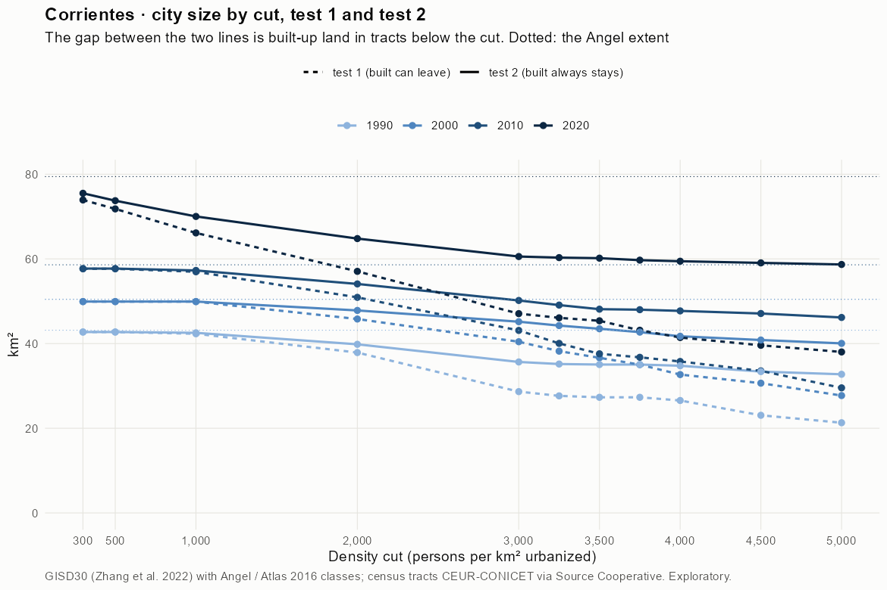
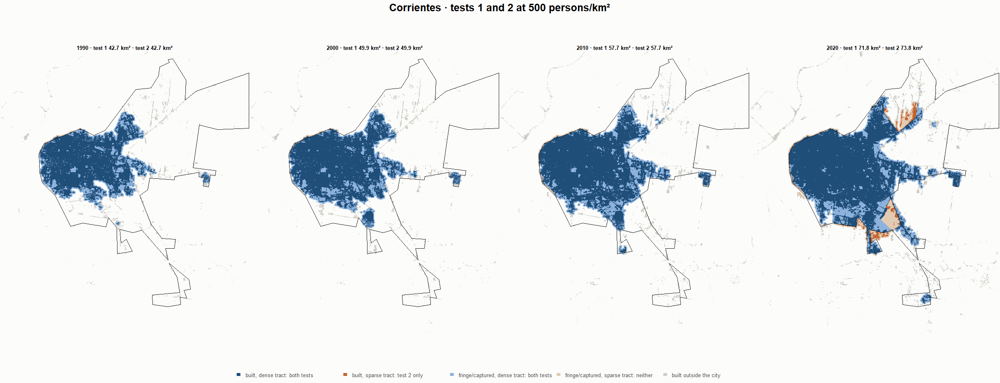
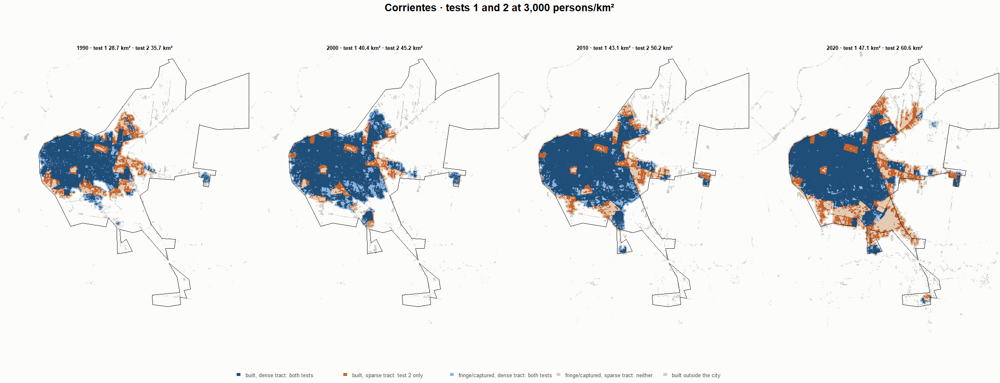
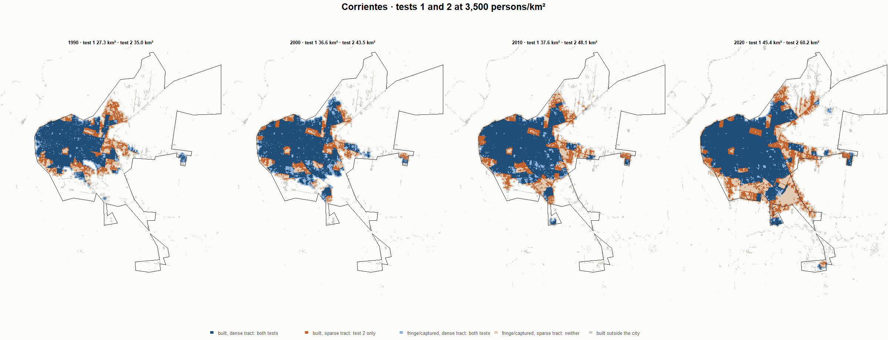
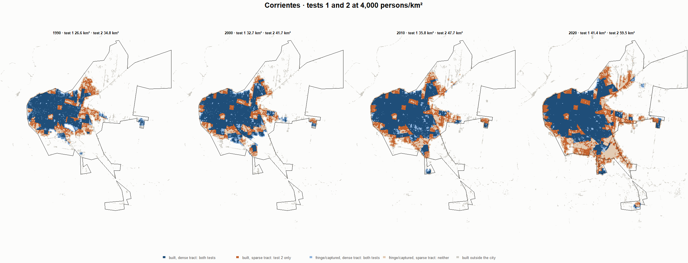

# Corrientes · tests 1 and 2 at the same cut, 1990-2020

Exploratory. None of these numbers are project figures (they are not in `CIFRAS_CANONICAS.json`). Generated by `Rpipe/scripts/14_prueba_comparada.R` from the tract tables of step 11. Run of 2026-11-08. [All agglomerations](../REPORTE.md) · [test 1](../../densidad_radios/corrientes/REPORTE.md) · [test 2](../../franja_densa/corrientes/REPORTE.md) · [methods](../../METODOS.md).

**At the same cut the two tests keep the same fringe and captured land**: that of the tracts at or above the cut. They differ only in the **built-up land of tracts below the cut**: test 1 drops it, test 2 keeps it. Test 2 minus test 1 is exactly that land.

## City size by cut

**1990 (census 1991).** Angel extent 43.2 km².

| Cut (p/km²) | Test 1 km² | Test 2 km² | Built in sparse tracts km² (test 2 only) | % of built-up in sparse tracts | Fringe in dense tracts km² (both) | Fringe in sparse tracts km² (neither) |
|---|---|---|---|---|---|---|
| 300 | 42.7 | 42.7 | 0.0 | 0.0 | 11.8 | 0.4 |
| 500 | 42.7 | 42.7 | 0.0 | 0.0 | 11.8 | 0.4 |
| 1,000 | 42.3 | 42.5 | 0.2 | 0.7 | 11.6 | 0.6 |
| 2,000 | 37.9 | 39.8 | 1.9 | 6.3 | 8.9 | 3.3 |
| 3,000 | 28.7 | 35.7 | 7.0 | 22.6 | 4.7 | 7.5 |
| 3,250 | 27.6 | 35.2 | 7.5 | 24.3 | 4.2 | 8.0 |
| 3,500 | 27.3 | 35.0 | 7.7 | 25.0 | 4.1 | 8.1 |
| 3,750 | 27.3 | 35.0 | 7.7 | 25.0 | 4.1 | 8.1 |
| 4,000 | 26.6 | 34.8 | 8.2 | 26.5 | 3.8 | 8.4 |
| 4,500 | 23.1 | 33.4 | 10.3 | 33.4 | 2.4 | 9.8 |
| 5,000 | 21.3 | 32.7 | 11.4 | 37.0 | 1.8 | 10.4 |

**2000 (census 2001).** Angel extent 50.5 km².

| Cut (p/km²) | Test 1 km² | Test 2 km² | Built in sparse tracts km² (test 2 only) | % of built-up in sparse tracts | Fringe in dense tracts km² (both) | Fringe in sparse tracts km² (neither) |
|---|---|---|---|---|---|---|
| 300 | 49.9 | 49.9 | 0.0 | 0.0 | 12.6 | 0.5 |
| 500 | 49.9 | 49.9 | 0.0 | 0.0 | 12.6 | 0.5 |
| 1,000 | 49.9 | 49.9 | 0.0 | 0.0 | 12.6 | 0.5 |
| 2,000 | 45.8 | 47.8 | 2.0 | 5.4 | 10.5 | 2.6 |
| 3,000 | 40.4 | 45.2 | 4.7 | 12.7 | 7.9 | 5.3 |
| 3,250 | 38.2 | 44.3 | 6.0 | 16.2 | 7.0 | 6.2 |
| 3,500 | 36.6 | 43.5 | 6.9 | 18.4 | 6.2 | 7.0 |
| 3,750 | 35.0 | 42.7 | 7.7 | 20.6 | 5.4 | 7.8 |
| 4,000 | 32.7 | 41.7 | 9.1 | 24.3 | 4.5 | 8.7 |
| 4,500 | 30.6 | 40.8 | 10.2 | 27.3 | 3.6 | 9.6 |
| 5,000 | 27.7 | 40.0 | 12.3 | 33.1 | 2.8 | 10.4 |

**2010 (census 2010).** Angel extent 58.6 km².

| Cut (p/km²) | Test 1 km² | Test 2 km² | Built in sparse tracts km² (test 2 only) | % of built-up in sparse tracts | Fringe in dense tracts km² (both) | Fringe in sparse tracts km² (neither) |
|---|---|---|---|---|---|---|
| 300 | 57.7 | 57.7 | 0.1 | 0.1 | 13.5 | 0.9 |
| 500 | 57.7 | 57.7 | 0.1 | 0.1 | 13.5 | 0.9 |
| 1,000 | 57.0 | 57.3 | 0.3 | 0.7 | 13.1 | 1.3 |
| 2,000 | 50.9 | 54.1 | 3.2 | 7.2 | 9.9 | 4.5 |
| 3,000 | 43.1 | 50.2 | 7.1 | 16.0 | 6.0 | 8.4 |
| 3,250 | 40.0 | 49.1 | 9.0 | 20.5 | 4.9 | 9.5 |
| 3,500 | 37.6 | 48.1 | 10.5 | 23.8 | 3.9 | 10.5 |
| 3,750 | 36.8 | 48.0 | 11.2 | 25.4 | 3.8 | 10.6 |
| 4,000 | 35.8 | 47.7 | 11.9 | 27.0 | 3.5 | 10.9 |
| 4,500 | 33.6 | 47.1 | 13.6 | 30.7 | 2.9 | 11.5 |
| 5,000 | 29.5 | 46.2 | 16.6 | 37.6 | 2.0 | 12.4 |

**2020 (census 2022).** Angel extent 79.4 km².

| Cut (p/km²) | Test 1 km² | Test 2 km² | Built in sparse tracts km² (test 2 only) | % of built-up in sparse tracts | Fringe in dense tracts km² (both) | Fringe in sparse tracts km² (neither) |
|---|---|---|---|---|---|---|
| 300 | 73.9 | 75.5 | 1.6 | 2.8 | 18.9 | 3.9 |
| 500 | 71.8 | 73.8 | 1.9 | 3.4 | 17.1 | 5.7 |
| 1,000 | 66.1 | 70.0 | 3.9 | 6.9 | 13.4 | 9.4 |
| 2,000 | 57.1 | 64.8 | 7.7 | 13.7 | 8.2 | 14.6 |
| 3,000 | 47.1 | 60.6 | 13.5 | 23.8 | 3.9 | 18.9 |
| 3,250 | 46.1 | 60.3 | 14.2 | 25.1 | 3.7 | 19.1 |
| 3,500 | 45.4 | 60.2 | 14.8 | 26.1 | 3.5 | 19.3 |
| 3,750 | 43.1 | 59.7 | 16.6 | 29.2 | 3.1 | 19.7 |
| 4,000 | 41.4 | 59.5 | 18.0 | 31.8 | 2.8 | 20.0 |
| 4,500 | 39.6 | 59.1 | 19.5 | 34.4 | 2.4 | 20.4 |
| 5,000 | 38.0 | 58.7 | 20.7 | 36.5 | 2.0 | 20.8 |

## Growth 1990-2020 by cut

Angel extent: 2.05 %/yr.

| Cut (p/km²) | Test 1 %/yr | Test 2 %/yr |
|---|---|---|
| 300 | 1.84 | 1.92 |
| 500 | 1.75 | 1.84 |
| 1,000 | 1.50 | 1.68 |
| 2,000 | 1.38 | 1.64 |
| 3,000 | 1.67 | 1.78 |
| 3,250 | 1.72 | 1.81 |
| 3,500 | 1.71 | 1.82 |
| 3,750 | 1.54 | 1.79 |
| 4,000 | 1.49 | 1.80 |
| 4,500 | 1.82 | 1.92 |
| 5,000 | 1.95 | 1.96 |

## Maps

Same frame in the four years: the 2020 city plus 3 km. Dark blue and light blue are in both tests; orange is built-up in tracts below the cut, which only test 2 keeps; beige is fringe or captured land in tracts below the cut, which neither keeps. Black line: the analysis perimeter.

### 500 persons/km²

### 3,000 persons/km²

### 3,500 persons/km²

### 4,000 persons/km²

