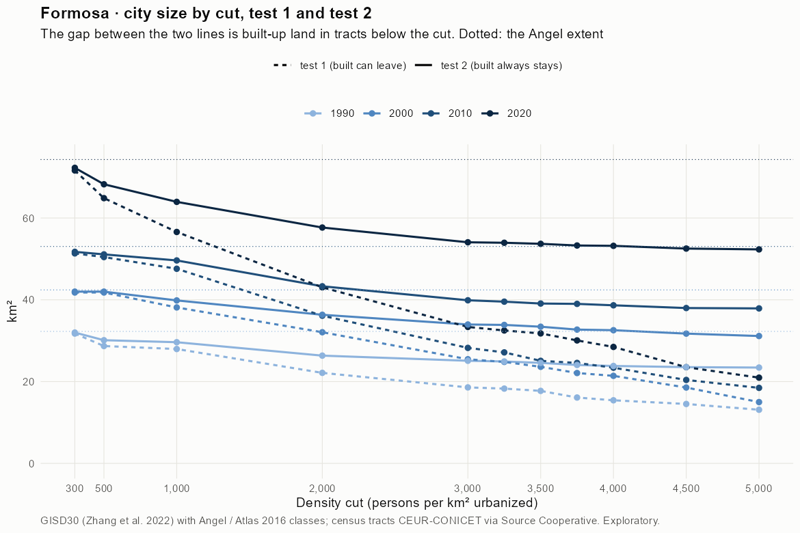
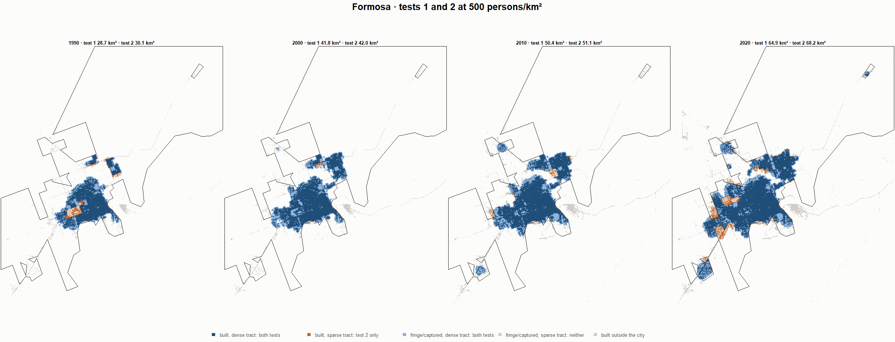
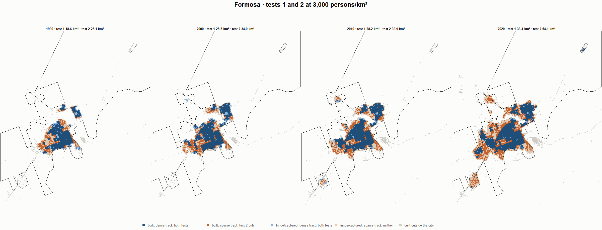
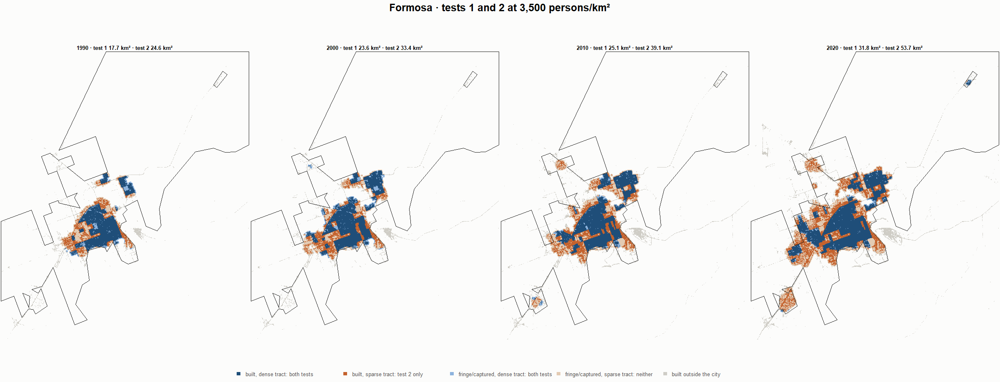
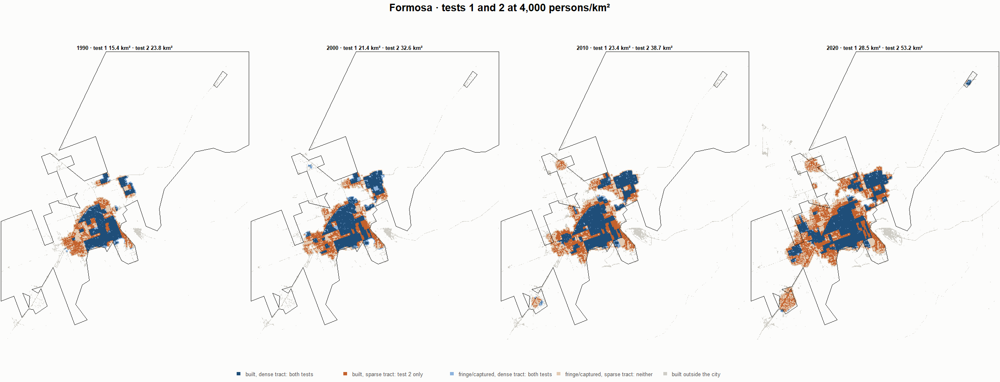

# Formosa · tests 1 and 2 at the same cut, 1990-2020

Exploratory. None of these numbers are project figures (they are not in `CIFRAS_CANONICAS.json`). Generated by `Rpipe/scripts/14_prueba_comparada.R` from the tract tables of step 11. Run of 2026-11-08. [All agglomerations](../REPORTE.md) · [test 1](../../densidad_radios/formosa/REPORTE.md) · [test 2](../../franja_densa/formosa/REPORTE.md) · [methods](../../METODOS.md).

**At the same cut the two tests keep the same fringe and captured land**: that of the tracts at or above the cut. They differ only in the **built-up land of tracts below the cut**: test 1 drops it, test 2 keeps it. Test 2 minus test 1 is exactly that land.

## City size by cut

**1990 (census 1991).** Angel extent 32.3 km².

| Cut (p/km²) | Test 1 km² | Test 2 km² | Built in sparse tracts km² (test 2 only) | % of built-up in sparse tracts | Fringe in dense tracts km² (both) | Fringe in sparse tracts km² (neither) |
|---|---|---|---|---|---|---|
| 300 | 31.7 | 32.0 | 0.2 | 1.1 | 10.0 | 0.3 |
| 500 | 28.7 | 30.1 | 1.4 | 6.5 | 8.1 | 2.2 |
| 1,000 | 28.0 | 29.6 | 1.7 | 7.5 | 7.6 | 2.6 |
| 2,000 | 22.1 | 26.3 | 4.2 | 19.1 | 4.3 | 5.9 |
| 3,000 | 18.6 | 25.1 | 6.5 | 29.6 | 3.1 | 7.2 |
| 3,250 | 18.3 | 24.9 | 6.6 | 30.1 | 2.9 | 7.4 |
| 3,500 | 17.7 | 24.6 | 6.8 | 31.1 | 2.6 | 7.7 |
| 3,750 | 16.1 | 24.1 | 8.0 | 36.1 | 2.0 | 8.2 |
| 4,000 | 15.4 | 23.8 | 8.4 | 38.1 | 1.8 | 8.5 |
| 4,500 | 14.5 | 23.5 | 9.0 | 40.9 | 1.5 | 8.7 |
| 5,000 | 13.1 | 23.4 | 10.3 | 46.9 | 1.4 | 8.8 |

**2000 (census 2001).** Angel extent 42.4 km².

| Cut (p/km²) | Test 1 km² | Test 2 km² | Built in sparse tracts km² (test 2 only) | % of built-up in sparse tracts | Fringe in dense tracts km² (both) | Fringe in sparse tracts km² (neither) |
|---|---|---|---|---|---|---|
| 300 | 41.8 | 42.0 | 0.2 | 0.7 | 12.2 | 0.4 |
| 500 | 41.8 | 42.0 | 0.2 | 0.7 | 12.2 | 0.4 |
| 1,000 | 38.1 | 39.8 | 1.7 | 5.8 | 10.1 | 2.6 |
| 2,000 | 32.1 | 36.3 | 4.3 | 14.3 | 6.6 | 6.1 |
| 3,000 | 25.5 | 34.0 | 8.5 | 28.5 | 4.2 | 8.5 |
| 3,250 | 24.8 | 33.9 | 9.1 | 30.4 | 4.1 | 8.6 |
| 3,500 | 23.6 | 33.4 | 9.8 | 32.9 | 3.6 | 9.0 |
| 3,750 | 22.1 | 32.7 | 10.6 | 35.7 | 2.9 | 9.7 |
| 4,000 | 21.4 | 32.6 | 11.2 | 37.5 | 2.8 | 9.9 |
| 4,500 | 18.5 | 31.7 | 13.2 | 44.3 | 2.0 | 10.7 |
| 5,000 | 15.0 | 31.1 | 16.2 | 54.2 | 1.4 | 11.3 |

**2010 (census 2010).** Angel extent 53.0 km².

| Cut (p/km²) | Test 1 km² | Test 2 km² | Built in sparse tracts km² (test 2 only) | % of built-up in sparse tracts | Fringe in dense tracts km² (both) | Fringe in sparse tracts km² (neither) |
|---|---|---|---|---|---|---|
| 300 | 51.3 | 51.7 | 0.4 | 1.0 | 14.8 | 1.3 |
| 500 | 50.4 | 51.1 | 0.7 | 1.8 | 14.2 | 1.9 |
| 1,000 | 47.6 | 49.6 | 2.0 | 5.5 | 12.7 | 3.4 |
| 2,000 | 36.1 | 43.3 | 7.2 | 19.5 | 6.4 | 9.7 |
| 3,000 | 28.2 | 39.9 | 11.6 | 31.5 | 2.9 | 13.2 |
| 3,250 | 27.1 | 39.5 | 12.4 | 33.6 | 2.6 | 13.5 |
| 3,500 | 25.1 | 39.1 | 14.0 | 37.9 | 2.2 | 14.0 |
| 3,750 | 24.6 | 39.0 | 14.4 | 39.1 | 2.1 | 14.0 |
| 4,000 | 23.4 | 38.7 | 15.3 | 41.3 | 1.7 | 14.4 |
| 4,500 | 20.4 | 38.0 | 17.6 | 47.6 | 1.0 | 15.1 |
| 5,000 | 18.5 | 37.9 | 19.4 | 52.6 | 1.0 | 15.1 |

**2020 (census 2022).** Angel extent 74.3 km².

| Cut (p/km²) | Test 1 km² | Test 2 km² | Built in sparse tracts km² (test 2 only) | % of built-up in sparse tracts | Fringe in dense tracts km² (both) | Fringe in sparse tracts km² (neither) |
|---|---|---|---|---|---|---|
| 300 | 71.6 | 72.3 | 0.6 | 1.3 | 20.9 | 2.0 |
| 500 | 64.9 | 68.2 | 3.4 | 6.6 | 16.9 | 6.0 |
| 1,000 | 56.6 | 63.9 | 7.4 | 14.3 | 12.6 | 10.3 |
| 2,000 | 43.1 | 57.7 | 14.6 | 28.4 | 6.3 | 16.6 |
| 3,000 | 33.4 | 54.1 | 20.7 | 40.3 | 2.7 | 20.2 |
| 3,250 | 32.5 | 53.9 | 21.4 | 41.7 | 2.6 | 20.4 |
| 3,500 | 31.8 | 53.7 | 21.9 | 42.6 | 2.3 | 20.6 |
| 3,750 | 30.1 | 53.3 | 23.2 | 45.2 | 1.9 | 21.0 |
| 4,000 | 28.5 | 53.2 | 24.7 | 48.1 | 1.8 | 21.1 |
| 4,500 | 23.5 | 52.5 | 29.0 | 56.5 | 1.2 | 21.8 |
| 5,000 | 21.0 | 52.3 | 31.4 | 61.0 | 0.9 | 22.0 |

## Growth 1990-2020 by cut

Angel extent: 2.82 %/yr.

| Cut (p/km²) | Test 1 %/yr | Test 2 %/yr |
|---|---|---|
| 300 | 2.75 | 2.75 |
| 500 | 2.76 | 2.76 |
| 1,000 | 2.38 | 2.60 |
| 2,000 | 2.24 | 2.65 |
| 3,000 | 1.97 | 2.59 |
| 3,250 | 1.94 | 2.61 |
| 3,500 | 1.96 | 2.64 |
| 3,750 | 2.10 | 2.69 |
| 4,000 | 2.06 | 2.71 |
| 4,500 | 1.62 | 2.71 |
| 5,000 | 1.58 | 2.71 |

## Maps

Same frame in the four years: the 2020 city plus 3 km. Dark blue and light blue are in both tests; orange is built-up in tracts below the cut, which only test 2 keeps; beige is fringe or captured land in tracts below the cut, which neither keeps. Black line: the analysis perimeter.

### 500 persons/km²

### 3,000 persons/km²

### 3,500 persons/km²

### 4,000 persons/km²

