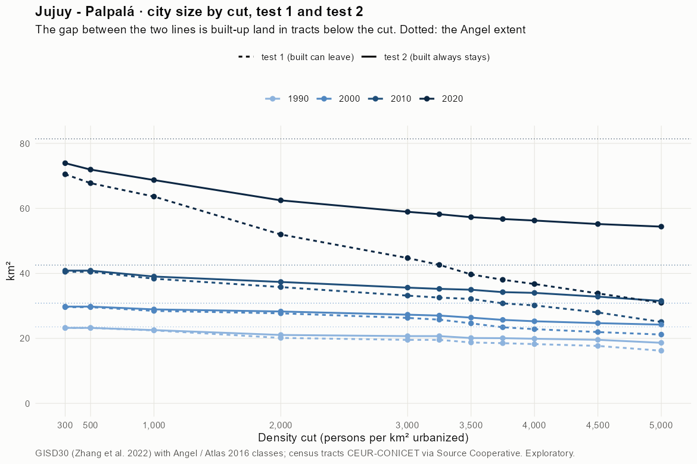
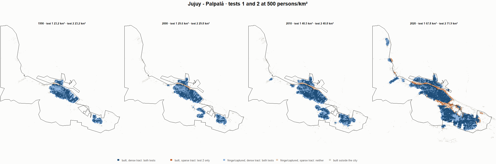
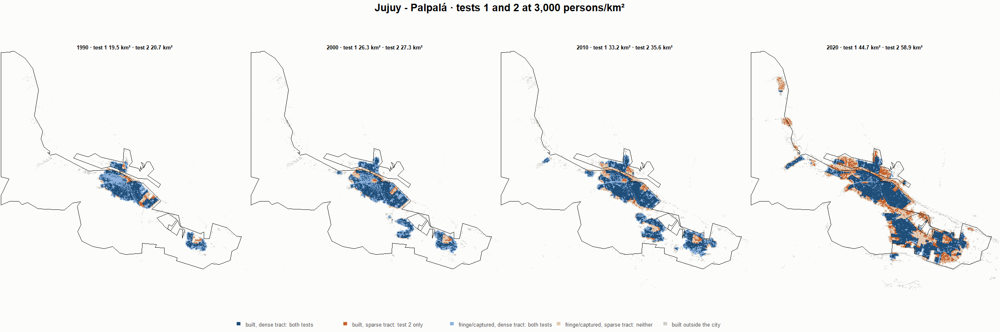
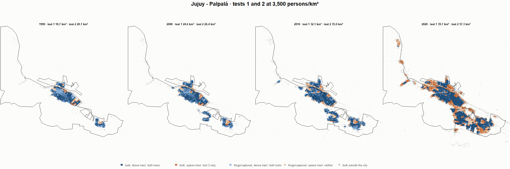
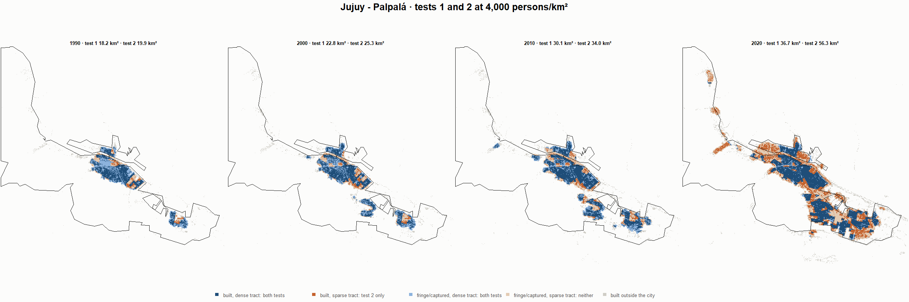

# Jujuy - Palpalá · tests 1 and 2 at the same cut, 1990-2020

Exploratory. None of these numbers are project figures (they are not in `CIFRAS_CANONICAS.json`). Generated by `Rpipe/scripts/14_prueba_comparada.R` from the tract tables of step 11. Run of 2026-11-08. [All agglomerations](../REPORTE.md) · [test 1](../../densidad_radios/jujuy/REPORTE.md) · [test 2](../../franja_densa/jujuy/REPORTE.md) · [methods](../../METODOS.md).

**At the same cut the two tests keep the same fringe and captured land**: that of the tracts at or above the cut. They differ only in the **built-up land of tracts below the cut**: test 1 drops it, test 2 keeps it. Test 2 minus test 1 is exactly that land.

## City size by cut

**1990 (census 1991).** Angel extent 23.5 km².

| Cut (p/km²) | Test 1 km² | Test 2 km² | Built in sparse tracts km² (test 2 only) | % of built-up in sparse tracts | Fringe in dense tracts km² (both) | Fringe in sparse tracts km² (neither) |
|---|---|---|---|---|---|---|
| 300 | 23.2 | 23.2 | 0.0 | 0.1 | 11.2 | 0.3 |
| 500 | 23.2 | 23.2 | 0.0 | 0.1 | 11.2 | 0.3 |
| 1,000 | 22.5 | 22.6 | 0.1 | 0.8 | 10.6 | 1.0 |
| 2,000 | 20.1 | 21.1 | 0.9 | 7.6 | 9.1 | 2.5 |
| 3,000 | 19.5 | 20.7 | 1.2 | 9.6 | 8.7 | 2.8 |
| 3,250 | 19.5 | 20.7 | 1.2 | 9.6 | 8.7 | 2.8 |
| 3,500 | 18.7 | 20.1 | 1.4 | 11.5 | 8.1 | 3.4 |
| 3,750 | 18.5 | 20.1 | 1.5 | 12.8 | 8.1 | 3.5 |
| 4,000 | 18.2 | 19.9 | 1.6 | 13.7 | 7.9 | 3.6 |
| 4,500 | 17.7 | 19.6 | 1.9 | 15.7 | 7.6 | 4.0 |
| 5,000 | 16.2 | 18.6 | 2.4 | 20.3 | 6.6 | 4.9 |

**2000 (census 2001).** Angel extent 30.8 km².

| Cut (p/km²) | Test 1 km² | Test 2 km² | Built in sparse tracts km² (test 2 only) | % of built-up in sparse tracts | Fringe in dense tracts km² (both) | Fringe in sparse tracts km² (neither) |
|---|---|---|---|---|---|---|
| 300 | 29.6 | 29.8 | 0.2 | 1.1 | 13.6 | 1.1 |
| 500 | 29.6 | 29.8 | 0.2 | 1.1 | 13.6 | 1.1 |
| 1,000 | 28.5 | 28.9 | 0.5 | 2.9 | 12.7 | 1.9 |
| 2,000 | 27.7 | 28.3 | 0.6 | 3.5 | 12.1 | 2.6 |
| 3,000 | 26.3 | 27.3 | 1.0 | 6.1 | 11.1 | 3.6 |
| 3,250 | 25.8 | 27.0 | 1.3 | 7.7 | 10.8 | 3.8 |
| 3,500 | 24.6 | 26.4 | 1.8 | 10.8 | 10.2 | 4.5 |
| 3,750 | 23.4 | 25.7 | 2.3 | 14.0 | 9.5 | 5.2 |
| 4,000 | 22.8 | 25.3 | 2.4 | 15.0 | 9.1 | 5.6 |
| 4,500 | 22.0 | 24.7 | 2.7 | 16.9 | 8.5 | 6.2 |
| 5,000 | 21.2 | 24.2 | 3.1 | 18.9 | 8.0 | 6.6 |

**2010 (census 2010).** Angel extent 42.6 km².

| Cut (p/km²) | Test 1 km² | Test 2 km² | Built in sparse tracts km² (test 2 only) | % of built-up in sparse tracts | Fringe in dense tracts km² (both) | Fringe in sparse tracts km² (neither) |
|---|---|---|---|---|---|---|
| 300 | 40.5 | 40.8 | 0.4 | 1.5 | 16.7 | 1.7 |
| 500 | 40.5 | 40.8 | 0.4 | 1.5 | 16.7 | 1.7 |
| 1,000 | 38.4 | 39.0 | 0.7 | 2.8 | 14.9 | 3.5 |
| 2,000 | 35.8 | 37.4 | 1.6 | 6.5 | 13.2 | 5.2 |
| 3,000 | 33.2 | 35.6 | 2.5 | 10.2 | 11.5 | 6.9 |
| 3,250 | 32.5 | 35.2 | 2.7 | 11.2 | 11.1 | 7.3 |
| 3,500 | 32.1 | 35.0 | 2.8 | 11.8 | 10.8 | 7.6 |
| 3,750 | 30.8 | 34.2 | 3.5 | 14.3 | 10.1 | 8.3 |
| 4,000 | 30.1 | 34.0 | 3.9 | 16.0 | 9.9 | 8.6 |
| 4,500 | 28.0 | 32.8 | 4.9 | 20.1 | 8.7 | 9.7 |
| 5,000 | 25.1 | 31.5 | 6.5 | 26.8 | 7.4 | 11.0 |

**2020 (census 2022).** Angel extent 81.4 km².

| Cut (p/km²) | Test 1 km² | Test 2 km² | Built in sparse tracts km² (test 2 only) | % of built-up in sparse tracts | Fringe in dense tracts km² (both) | Fringe in sparse tracts km² (neither) |
|---|---|---|---|---|---|---|
| 300 | 70.5 | 73.9 | 3.4 | 6.7 | 23.0 | 7.5 |
| 500 | 67.8 | 71.9 | 4.2 | 8.2 | 21.0 | 9.4 |
| 1,000 | 63.6 | 68.7 | 5.1 | 10.0 | 17.8 | 12.7 |
| 2,000 | 52.0 | 62.5 | 10.5 | 20.6 | 11.6 | 18.9 |
| 3,000 | 44.7 | 58.9 | 14.2 | 27.9 | 8.0 | 22.4 |
| 3,250 | 42.6 | 58.2 | 15.6 | 30.6 | 7.3 | 23.2 |
| 3,500 | 39.7 | 57.3 | 17.6 | 34.6 | 6.4 | 24.1 |
| 3,750 | 38.0 | 56.7 | 18.7 | 36.7 | 5.8 | 24.7 |
| 4,000 | 36.7 | 56.3 | 19.5 | 38.4 | 5.4 | 25.1 |
| 4,500 | 33.8 | 55.2 | 21.3 | 41.9 | 4.3 | 26.2 |
| 5,000 | 31.0 | 54.4 | 23.4 | 46.0 | 3.5 | 27.0 |

## Growth 1990-2020 by cut

Angel extent: 4.22 %/yr.

| Cut (p/km²) | Test 1 %/yr | Test 2 %/yr |
|---|---|---|
| 300 | 3.77 | 3.93 |
| 500 | 3.64 | 3.84 |
| 1,000 | 3.53 | 3.78 |
| 2,000 | 3.21 | 3.69 |
| 3,000 | 2.80 | 3.55 |
| 3,250 | 2.63 | 3.51 |
| 3,500 | 2.53 | 3.55 |
| 3,750 | 2.43 | 3.52 |
| 4,000 | 2.36 | 3.53 |
| 4,500 | 2.19 | 3.52 |
| 5,000 | 2.18 | 3.63 |

## Maps

Same frame in the four years: the 2020 city plus 3 km. Dark blue and light blue are in both tests; orange is built-up in tracts below the cut, which only test 2 keeps; beige is fringe or captured land in tracts below the cut, which neither keeps. Black line: the analysis perimeter.

### 500 persons/km²

### 3,000 persons/km²

### 3,500 persons/km²

### 4,000 persons/km²

