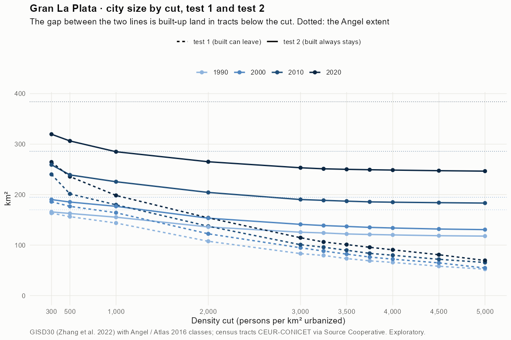
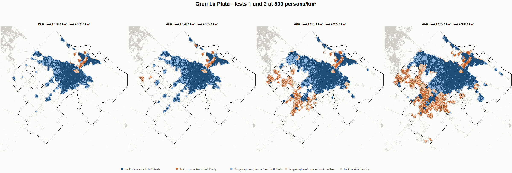
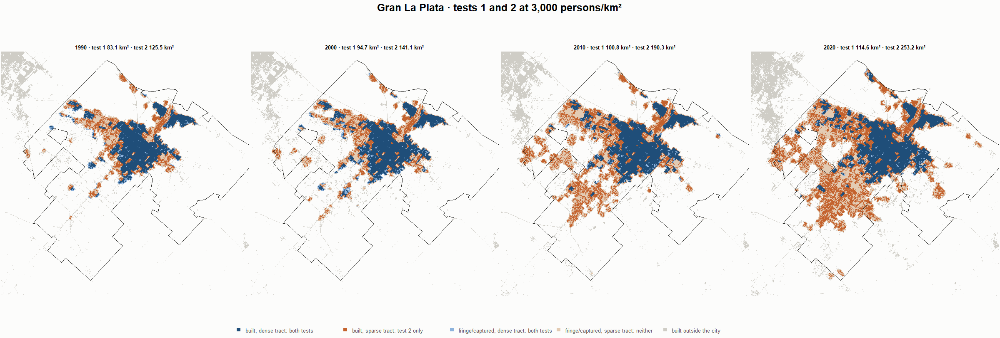
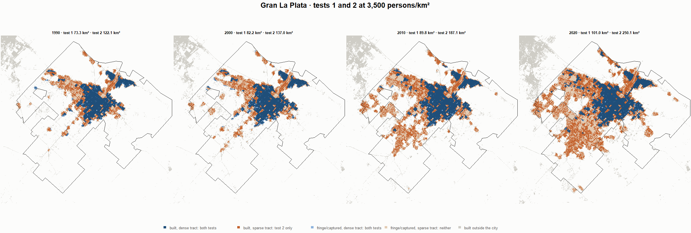

# Gran La Plata · tests 1 and 2 at the same cut, 1990-2020

Exploratory. None of these numbers are project figures (they are not in `CIFRAS_CANONICAS.json`). Generated by `Rpipe/scripts/14_prueba_comparada.R` from the tract tables of step 11. Run of 2026-11-08. [All agglomerations](../REPORTE.md) · [test 1](../../densidad_radios/la_plata/REPORTE.md) · [test 2](../../franja_densa/la_plata/REPORTE.md) · [methods](../../METODOS.md).

**At the same cut the two tests keep the same fringe and captured land**: that of the tracts at or above the cut. They differ only in the **built-up land of tracts below the cut**: test 1 drops it, test 2 keeps it. Test 2 minus test 1 is exactly that land.

## City size by cut

**1990 (census 1991).** Angel extent 169.9 km².

| Cut (p/km²) | Test 1 km² | Test 2 km² | Built in sparse tracts km² (test 2 only) | % of built-up in sparse tracts | Fringe in dense tracts km² (both) | Fringe in sparse tracts km² (neither) |
|---|---|---|---|---|---|---|
| 300 | 163.3 | 165.8 | 2.5 | 2.2 | 50.9 | 4.1 |
| 500 | 156.3 | 162.7 | 6.4 | 5.5 | 47.8 | 7.2 |
| 1,000 | 143.7 | 155.3 | 11.6 | 10.1 | 40.4 | 14.6 |
| 2,000 | 107.6 | 135.9 | 28.3 | 24.7 | 21.0 | 33.9 |
| 3,000 | 83.1 | 125.5 | 42.4 | 36.9 | 10.6 | 44.4 |
| 3,250 | 79.5 | 124.1 | 44.6 | 38.8 | 9.2 | 45.8 |
| 3,500 | 73.3 | 122.1 | 48.8 | 42.5 | 7.2 | 47.8 |
| 3,750 | 68.9 | 121.0 | 52.1 | 45.4 | 6.1 | 48.9 |
| 4,000 | 65.7 | 120.2 | 54.5 | 47.4 | 5.3 | 49.7 |
| 4,500 | 58.1 | 118.6 | 60.5 | 52.6 | 3.7 | 51.3 |
| 5,000 | 52.3 | 117.8 | 65.5 | 57.0 | 2.9 | 52.1 |

**2000 (census 2001).** Angel extent 194.8 km².

| Cut (p/km²) | Test 1 km² | Test 2 km² | Built in sparse tracts km² (test 2 only) | % of built-up in sparse tracts | Fringe in dense tracts km² (both) | Fringe in sparse tracts km² (neither) |
|---|---|---|---|---|---|---|
| 300 | 186.0 | 190.2 | 4.2 | 3.3 | 61.9 | 4.6 |
| 500 | 176.7 | 185.3 | 8.6 | 6.7 | 57.0 | 9.5 |
| 1,000 | 164.1 | 176.8 | 12.7 | 9.9 | 48.5 | 18.0 |
| 2,000 | 122.4 | 153.4 | 31.0 | 24.1 | 25.1 | 41.4 |
| 3,000 | 94.7 | 141.1 | 46.4 | 36.1 | 12.8 | 53.7 |
| 3,250 | 88.2 | 138.7 | 50.5 | 39.4 | 10.5 | 56.0 |
| 3,500 | 82.2 | 137.0 | 54.8 | 42.7 | 8.7 | 57.8 |
| 3,750 | 76.3 | 135.1 | 58.8 | 45.8 | 6.8 | 59.7 |
| 4,000 | 72.2 | 133.9 | 61.7 | 48.1 | 5.6 | 60.9 |
| 4,500 | 64.8 | 131.9 | 67.1 | 52.3 | 3.6 | 62.9 |
| 5,000 | 54.7 | 130.7 | 76.0 | 59.2 | 2.4 | 64.1 |

**2010 (census 2010).** Angel extent 285.7 km².

| Cut (p/km²) | Test 1 km² | Test 2 km² | Built in sparse tracts km² (test 2 only) | % of built-up in sparse tracts | Fringe in dense tracts km² (both) | Fringe in sparse tracts km² (neither) |
|---|---|---|---|---|---|---|
| 300 | 240.1 | 259.1 | 19.1 | 10.5 | 77.9 | 26.6 |
| 500 | 201.4 | 239.0 | 37.6 | 20.7 | 57.8 | 46.7 |
| 1,000 | 179.8 | 225.5 | 45.7 | 25.2 | 44.3 | 60.2 |
| 2,000 | 137.3 | 204.3 | 67.0 | 37.0 | 23.1 | 81.4 |
| 3,000 | 100.8 | 190.3 | 89.5 | 49.4 | 9.1 | 95.4 |
| 3,250 | 95.8 | 188.6 | 92.8 | 51.2 | 7.5 | 97.1 |
| 3,500 | 89.8 | 187.1 | 97.3 | 53.7 | 5.9 | 98.6 |
| 3,750 | 83.6 | 185.6 | 102.0 | 56.3 | 4.5 | 100.1 |
| 4,000 | 79.9 | 185.0 | 105.1 | 58.0 | 3.8 | 100.7 |
| 4,500 | 71.9 | 184.0 | 112.2 | 61.9 | 2.9 | 101.7 |
| 5,000 | 65.6 | 183.2 | 117.7 | 65.0 | 2.1 | 102.5 |

**2020 (census 2022).** Angel extent 383.9 km².

| Cut (p/km²) | Test 1 km² | Test 2 km² | Built in sparse tracts km² (test 2 only) | % of built-up in sparse tracts | Fringe in dense tracts km² (both) | Fringe in sparse tracts km² (neither) |
|---|---|---|---|---|---|---|
| 300 | 264.5 | 319.6 | 55.1 | 22.5 | 74.7 | 64.3 |
| 500 | 235.7 | 306.3 | 70.6 | 28.8 | 61.4 | 77.6 |
| 1,000 | 198.4 | 284.9 | 86.6 | 35.3 | 40.0 | 99.0 |
| 2,000 | 154.0 | 265.1 | 111.1 | 45.4 | 20.2 | 118.8 |
| 3,000 | 114.6 | 253.2 | 138.6 | 56.6 | 8.3 | 130.7 |
| 3,250 | 106.2 | 251.1 | 144.9 | 59.2 | 6.2 | 132.8 |
| 3,500 | 101.0 | 250.1 | 149.1 | 60.9 | 5.2 | 133.8 |
| 3,750 | 95.7 | 249.3 | 153.6 | 62.7 | 4.3 | 134.6 |
| 4,000 | 90.6 | 248.6 | 158.0 | 64.5 | 3.7 | 135.3 |
| 4,500 | 80.9 | 247.4 | 166.5 | 68.0 | 2.5 | 136.5 |
| 5,000 | 69.5 | 246.5 | 177.0 | 72.3 | 1.6 | 137.4 |

## Growth 1990-2020 by cut

Angel extent: 2.75 %/yr.

| Cut (p/km²) | Test 1 %/yr | Test 2 %/yr |
|---|---|---|
| 300 | 1.62 | 2.21 |
| 500 | 1.38 | 2.13 |
| 1,000 | 1.08 | 2.04 |
| 2,000 | 1.20 | 2.25 |
| 3,000 | 1.08 | 2.37 |
| 3,250 | 0.97 | 2.38 |
| 3,500 | 1.08 | 2.42 |
| 3,750 | 1.10 | 2.44 |
| 4,000 | 1.08 | 2.45 |
| 4,500 | 1.11 | 2.48 |
| 5,000 | 0.95 | 2.49 |

## Maps

Same frame in the four years: the 2020 city plus 3 km. Dark blue and light blue are in both tests; orange is built-up in tracts below the cut, which only test 2 keeps; beige is fringe or captured land in tracts below the cut, which neither keeps. Black line: the analysis perimeter.

### 500 persons/km²

### 3,000 persons/km²

### 3,500 persons/km²

### 4,000 persons/km²

