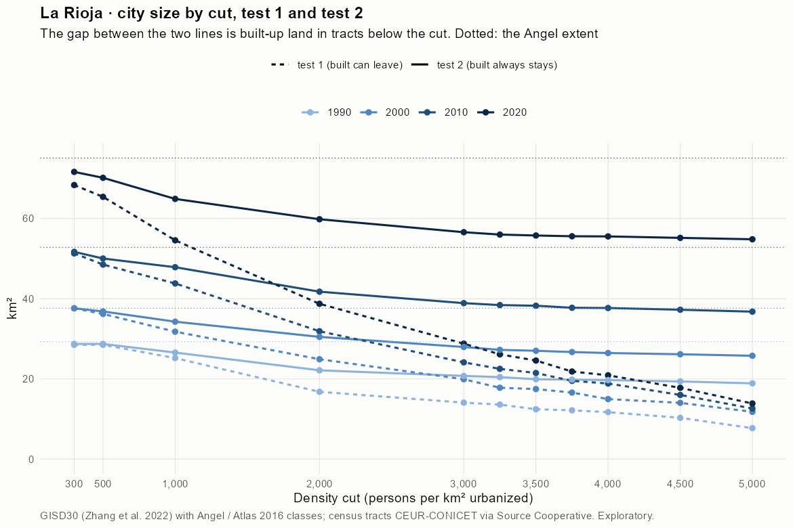
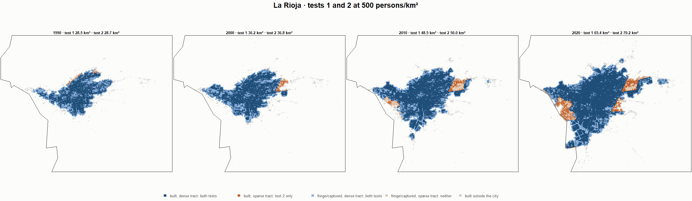
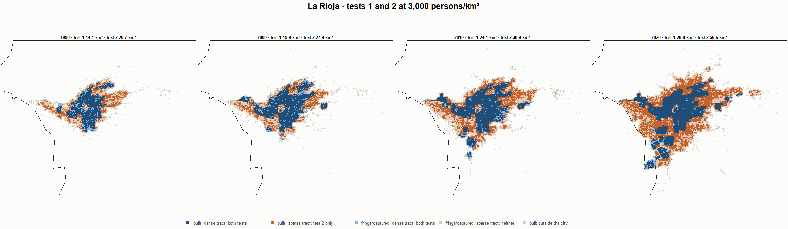
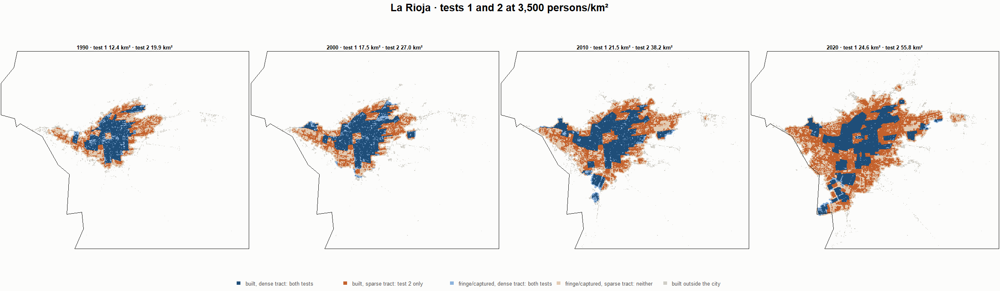
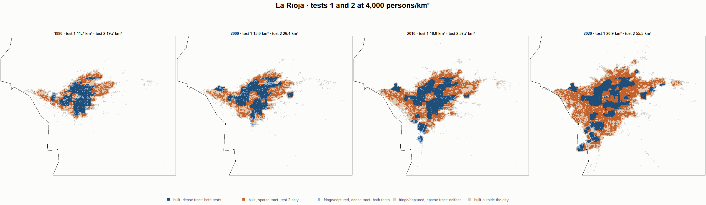

# La Rioja · tests 1 and 2 at the same cut, 1990-2020

Exploratory. None of these numbers are project figures (they are not in `CIFRAS_CANONICAS.json`). Generated by `Rpipe/scripts/14_prueba_comparada.R` from the tract tables of step 11. Run of 2026-11-08. [All agglomerations](../REPORTE.md) · [test 1](../../densidad_radios/la_rioja/REPORTE.md) · [test 2](../../franja_densa/la_rioja/REPORTE.md) · [methods](../../METODOS.md).

**At the same cut the two tests keep the same fringe and captured land**: that of the tracts at or above the cut. They differ only in the **built-up land of tracts below the cut**: test 1 drops it, test 2 keeps it. Test 2 minus test 1 is exactly that land.

## City size by cut

**1990 (census 1991).** Angel extent 29.3 km².

| Cut (p/km²) | Test 1 km² | Test 2 km² | Built in sparse tracts km² (test 2 only) | % of built-up in sparse tracts | Fringe in dense tracts km² (both) | Fringe in sparse tracts km² (neither) |
|---|---|---|---|---|---|---|
| 300 | 28.5 | 28.7 | 0.2 | 1.2 | 11.0 | 0.6 |
| 500 | 28.5 | 28.7 | 0.2 | 1.2 | 11.0 | 0.6 |
| 1,000 | 25.2 | 26.6 | 1.4 | 7.8 | 8.9 | 2.7 |
| 2,000 | 16.8 | 22.1 | 5.4 | 30.3 | 4.4 | 7.1 |
| 3,000 | 14.1 | 20.7 | 6.7 | 37.6 | 3.0 | 8.5 |
| 3,250 | 13.6 | 20.4 | 6.9 | 38.7 | 2.7 | 8.8 |
| 3,500 | 12.4 | 19.9 | 7.5 | 42.3 | 2.2 | 9.4 |
| 3,750 | 12.2 | 19.8 | 7.7 | 43.2 | 2.1 | 9.5 |
| 4,000 | 11.7 | 19.7 | 8.0 | 45.1 | 2.0 | 9.6 |
| 4,500 | 10.3 | 19.4 | 9.1 | 51.2 | 1.7 | 9.9 |
| 5,000 | 7.7 | 18.9 | 11.2 | 63.1 | 1.2 | 10.4 |

**2000 (census 2001).** Angel extent 37.6 km².

| Cut (p/km²) | Test 1 km² | Test 2 km² | Built in sparse tracts km² (test 2 only) | % of built-up in sparse tracts | Fringe in dense tracts km² (both) | Fringe in sparse tracts km² (neither) |
|---|---|---|---|---|---|---|
| 300 | 37.6 | 37.6 | 0.0 | 0.0 | 13.5 | 0.0 |
| 500 | 36.2 | 36.8 | 0.6 | 2.6 | 12.8 | 0.8 |
| 1,000 | 31.8 | 34.3 | 2.5 | 10.4 | 10.2 | 3.3 |
| 2,000 | 24.9 | 30.5 | 5.6 | 23.2 | 6.4 | 7.1 |
| 3,000 | 19.9 | 27.9 | 8.0 | 33.4 | 3.9 | 9.7 |
| 3,250 | 17.8 | 27.2 | 9.4 | 39.3 | 3.2 | 10.4 |
| 3,500 | 17.5 | 27.0 | 9.6 | 39.7 | 2.9 | 10.6 |
| 3,750 | 16.6 | 26.7 | 10.1 | 42.0 | 2.6 | 10.9 |
| 4,000 | 15.0 | 26.4 | 11.5 | 47.7 | 2.4 | 11.2 |
| 4,500 | 14.0 | 26.1 | 12.1 | 50.4 | 2.1 | 11.5 |
| 5,000 | 11.8 | 25.8 | 14.0 | 58.1 | 1.7 | 11.8 |

**2010 (census 2010).** Angel extent 52.8 km².

| Cut (p/km²) | Test 1 km² | Test 2 km² | Built in sparse tracts km² (test 2 only) | % of built-up in sparse tracts | Fringe in dense tracts km² (both) | Fringe in sparse tracts km² (neither) |
|---|---|---|---|---|---|---|
| 300 | 51.3 | 51.7 | 0.4 | 1.1 | 16.0 | 1.1 |
| 500 | 48.5 | 50.0 | 1.5 | 4.3 | 14.4 | 2.8 |
| 1,000 | 43.8 | 47.9 | 4.0 | 11.3 | 12.2 | 5.0 |
| 2,000 | 31.9 | 41.8 | 9.9 | 27.7 | 6.1 | 11.1 |
| 3,000 | 24.1 | 38.9 | 14.8 | 41.4 | 3.2 | 13.9 |
| 3,250 | 22.5 | 38.4 | 15.9 | 44.6 | 2.8 | 14.4 |
| 3,500 | 21.5 | 38.2 | 16.8 | 47.1 | 2.6 | 14.6 |
| 3,750 | 19.5 | 37.7 | 18.2 | 51.2 | 2.1 | 15.1 |
| 4,000 | 18.8 | 37.7 | 18.8 | 52.8 | 2.0 | 15.1 |
| 4,500 | 16.0 | 37.2 | 21.3 | 59.6 | 1.6 | 15.6 |
| 5,000 | 12.6 | 36.8 | 24.2 | 67.8 | 1.1 | 16.0 |

**2020 (census 2022).** Angel extent 75.1 km².

| Cut (p/km²) | Test 1 km² | Test 2 km² | Built in sparse tracts km² (test 2 only) | % of built-up in sparse tracts | Fringe in dense tracts km² (both) | Fringe in sparse tracts km² (neither) |
|---|---|---|---|---|---|---|
| 300 | 68.4 | 71.6 | 3.3 | 6.1 | 17.5 | 3.5 |
| 500 | 65.4 | 70.2 | 4.8 | 8.8 | 16.0 | 4.9 |
| 1,000 | 54.6 | 64.9 | 10.3 | 19.1 | 10.7 | 10.2 |
| 2,000 | 38.7 | 59.8 | 21.1 | 38.9 | 5.7 | 15.3 |
| 3,000 | 28.8 | 56.6 | 27.8 | 51.3 | 2.4 | 18.5 |
| 3,250 | 26.1 | 56.0 | 29.9 | 55.2 | 1.8 | 19.1 |
| 3,500 | 24.6 | 55.8 | 31.2 | 57.6 | 1.6 | 19.3 |
| 3,750 | 21.8 | 55.6 | 33.8 | 62.3 | 1.4 | 19.5 |
| 4,000 | 20.9 | 55.5 | 34.6 | 64.0 | 1.4 | 19.6 |
| 4,500 | 17.8 | 55.2 | 37.4 | 69.1 | 1.0 | 19.9 |
| 5,000 | 13.9 | 54.8 | 41.0 | 75.7 | 0.7 | 20.3 |

## Growth 1990-2020 by cut

Angel extent: 3.19 %/yr.

| Cut (p/km²) | Test 1 %/yr | Test 2 %/yr |
|---|---|---|
| 300 | 2.96 | 3.09 |
| 500 | 2.81 | 3.02 |
| 1,000 | 2.61 | 3.02 |
| 2,000 | 2.83 | 3.37 |
| 3,000 | 2.41 | 3.40 |
| 3,250 | 2.20 | 3.42 |
| 3,500 | 2.30 | 3.49 |
| 3,750 | 1.97 | 3.50 |
| 4,000 | 1.95 | 3.52 |
| 4,500 | 1.84 | 3.55 |
| 5,000 | 1.97 | 3.62 |

## Maps

Same frame in the four years: the 2020 city plus 3 km. Dark blue and light blue are in both tests; orange is built-up in tracts below the cut, which only test 2 keeps; beige is fringe or captured land in tracts below the cut, which neither keeps. Black line: the analysis perimeter.

### 500 persons/km²

### 3,000 persons/km²

### 3,500 persons/km²

### 4,000 persons/km²

