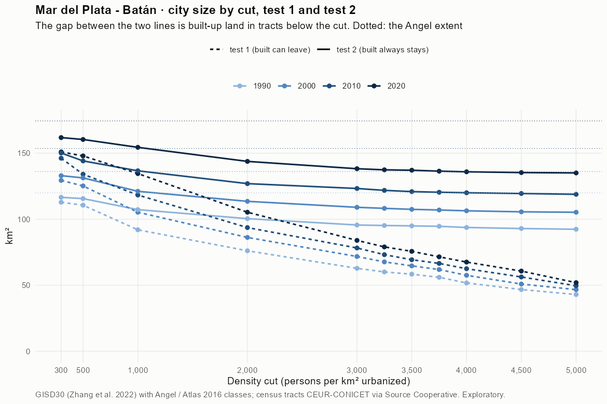
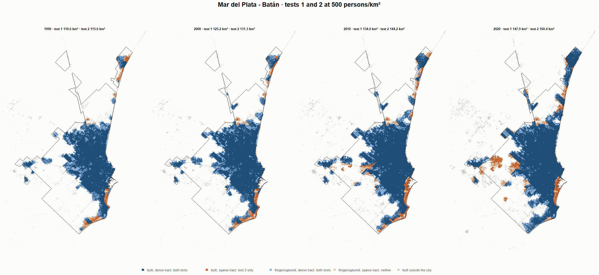
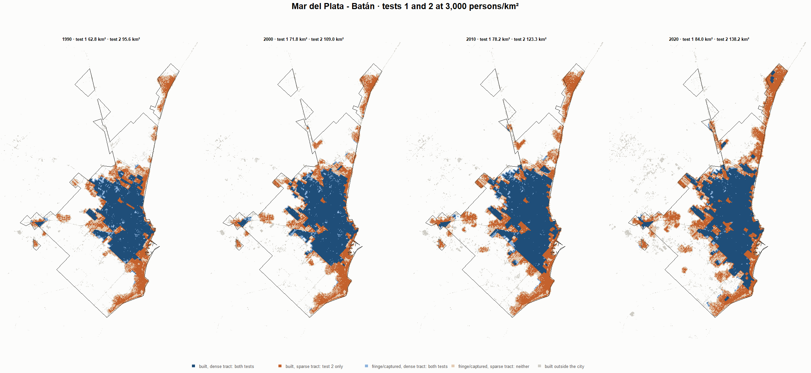
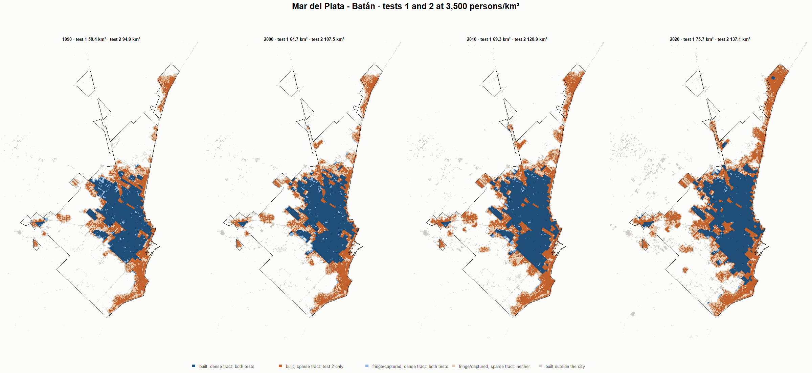
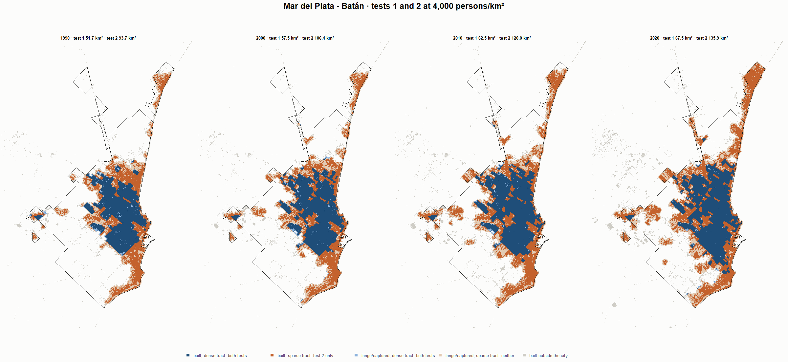

# Mar del Plata - Batán · tests 1 and 2 at the same cut, 1990-2020

Exploratory. None of these numbers are project figures (they are not in `CIFRAS_CANONICAS.json`). Generated by `Rpipe/scripts/14_prueba_comparada.R` from the tract tables of step 11. Run of 2026-11-08. [All agglomerations](../REPORTE.md) · [test 1](../../densidad_radios/mar_del_plata/REPORTE.md) · [test 2](../../franja_densa/mar_del_plata/REPORTE.md) · [methods](../../METODOS.md).

**At the same cut the two tests keep the same fringe and captured land**: that of the tracts at or above the cut. They differ only in the **built-up land of tracts below the cut**: test 1 drops it, test 2 keeps it. Test 2 minus test 1 is exactly that land.

## City size by cut

**1990 (census 1991).** Angel extent 119.9 km².

| Cut (p/km²) | Test 1 km² | Test 2 km² | Built in sparse tracts km² (test 2 only) | % of built-up in sparse tracts | Fringe in dense tracts km² (both) | Fringe in sparse tracts km² (neither) |
|---|---|---|---|---|---|---|
| 300 | 112.9 | 116.6 | 3.7 | 4.1 | 26.0 | 3.4 |
| 500 | 110.6 | 115.6 | 5.0 | 5.5 | 25.0 | 4.3 |
| 1,000 | 92.0 | 107.3 | 15.3 | 16.9 | 16.7 | 12.7 |
| 2,000 | 76.1 | 100.4 | 24.3 | 26.9 | 9.8 | 19.5 |
| 3,000 | 62.8 | 95.6 | 32.8 | 36.2 | 5.0 | 24.3 |
| 3,250 | 60.1 | 95.2 | 35.2 | 38.8 | 4.7 | 24.7 |
| 3,500 | 58.4 | 94.9 | 36.6 | 40.4 | 4.4 | 25.0 |
| 3,750 | 56.0 | 94.6 | 38.7 | 42.7 | 4.1 | 25.3 |
| 4,000 | 51.7 | 93.7 | 42.0 | 46.4 | 3.2 | 26.2 |
| 4,500 | 46.7 | 92.9 | 46.2 | 51.0 | 2.4 | 27.0 |
| 5,000 | 42.9 | 92.4 | 49.4 | 54.6 | 1.8 | 27.5 |

**2000 (census 2001).** Angel extent 136.1 km².

| Cut (p/km²) | Test 1 km² | Test 2 km² | Built in sparse tracts km² (test 2 only) | % of built-up in sparse tracts | Fringe in dense tracts km² (both) | Fringe in sparse tracts km² (neither) |
|---|---|---|---|---|---|---|
| 300 | 129.4 | 133.0 | 3.6 | 3.4 | 29.2 | 3.2 |
| 500 | 125.2 | 131.3 | 6.1 | 5.9 | 27.5 | 4.8 |
| 1,000 | 105.3 | 121.1 | 15.9 | 15.3 | 17.3 | 15.0 |
| 2,000 | 86.2 | 113.5 | 27.3 | 26.3 | 9.7 | 22.6 |
| 3,000 | 71.8 | 109.0 | 37.3 | 35.9 | 5.2 | 27.1 |
| 3,250 | 67.6 | 108.2 | 40.6 | 39.1 | 4.4 | 27.9 |
| 3,500 | 64.7 | 107.5 | 42.8 | 41.2 | 3.6 | 28.7 |
| 3,750 | 61.9 | 107.0 | 45.1 | 43.4 | 3.2 | 29.2 |
| 4,000 | 57.5 | 106.4 | 48.9 | 47.1 | 2.5 | 29.8 |
| 4,500 | 50.9 | 105.6 | 54.7 | 52.7 | 1.8 | 30.5 |
| 5,000 | 46.7 | 105.3 | 58.6 | 56.4 | 1.4 | 30.9 |

**2010 (census 2010).** Angel extent 153.6 km².

| Cut (p/km²) | Test 1 km² | Test 2 km² | Built in sparse tracts km² (test 2 only) | % of built-up in sparse tracts | Fringe in dense tracts km² (both) | Fringe in sparse tracts km² (neither) |
|---|---|---|---|---|---|---|
| 300 | 146.2 | 150.1 | 4.0 | 3.3 | 32.1 | 3.4 |
| 500 | 134.0 | 144.2 | 10.1 | 8.6 | 26.1 | 9.4 |
| 1,000 | 118.3 | 136.7 | 18.3 | 15.5 | 18.6 | 16.9 |
| 2,000 | 93.7 | 126.9 | 33.3 | 28.2 | 8.9 | 26.6 |
| 3,000 | 78.2 | 123.3 | 45.1 | 38.2 | 5.2 | 30.3 |
| 3,250 | 73.1 | 121.8 | 48.7 | 41.2 | 3.7 | 31.7 |
| 3,500 | 69.3 | 120.9 | 51.6 | 43.7 | 2.8 | 32.7 |
| 3,750 | 66.5 | 120.4 | 53.9 | 45.6 | 2.3 | 33.2 |
| 4,000 | 62.5 | 120.0 | 57.5 | 48.7 | 1.9 | 33.5 |
| 4,500 | 56.2 | 119.5 | 63.2 | 53.5 | 1.4 | 34.1 |
| 5,000 | 49.6 | 118.9 | 69.3 | 58.7 | 0.8 | 34.7 |

**2020 (census 2022).** Angel extent 174.4 km².

| Cut (p/km²) | Test 1 km² | Test 2 km² | Built in sparse tracts km² (test 2 only) | % of built-up in sparse tracts | Fringe in dense tracts km² (both) | Fringe in sparse tracts km² (neither) |
|---|---|---|---|---|---|---|
| 300 | 151.0 | 161.8 | 10.9 | 8.1 | 27.5 | 12.6 |
| 500 | 147.9 | 160.4 | 12.5 | 9.3 | 26.0 | 14.1 |
| 1,000 | 134.6 | 154.4 | 19.9 | 14.8 | 20.1 | 20.0 |
| 2,000 | 105.3 | 143.8 | 38.5 | 28.7 | 9.4 | 30.7 |
| 3,000 | 84.0 | 138.2 | 54.3 | 40.4 | 3.9 | 36.2 |
| 3,250 | 79.0 | 137.4 | 58.4 | 43.5 | 3.0 | 37.0 |
| 3,500 | 75.7 | 137.1 | 61.4 | 45.7 | 2.7 | 37.4 |
| 3,750 | 71.5 | 136.4 | 64.9 | 48.3 | 2.0 | 38.1 |
| 4,000 | 67.5 | 135.9 | 68.4 | 50.9 | 1.5 | 38.5 |
| 4,500 | 60.7 | 135.3 | 74.6 | 55.5 | 1.0 | 39.1 |
| 5,000 | 51.9 | 135.1 | 83.1 | 61.9 | 0.7 | 39.4 |

## Growth 1990-2020 by cut

Angel extent: 1.26 %/yr.

| Cut (p/km²) | Test 1 %/yr | Test 2 %/yr |
|---|---|---|
| 300 | 0.97 | 1.10 |
| 500 | 0.97 | 1.10 |
| 1,000 | 1.28 | 1.22 |
| 2,000 | 1.09 | 1.20 |
| 3,000 | 0.97 | 1.24 |
| 3,250 | 0.92 | 1.23 |
| 3,500 | 0.87 | 1.23 |
| 3,750 | 0.82 | 1.23 |
| 4,000 | 0.89 | 1.25 |
| 4,500 | 0.88 | 1.26 |
| 5,000 | 0.64 | 1.27 |

## Maps

Same frame in the four years: the 2020 city plus 3 km. Dark blue and light blue are in both tests; orange is built-up in tracts below the cut, which only test 2 keeps; beige is fringe or captured land in tracts below the cut, which neither keeps. Black line: the analysis perimeter.

### 500 persons/km²

### 3,000 persons/km²

### 3,500 persons/km²

### 4,000 persons/km²

