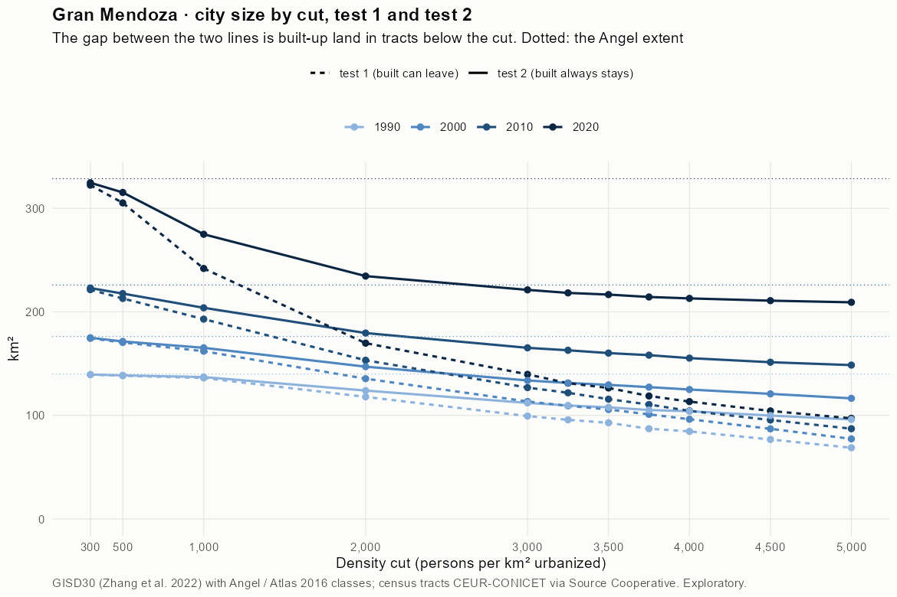
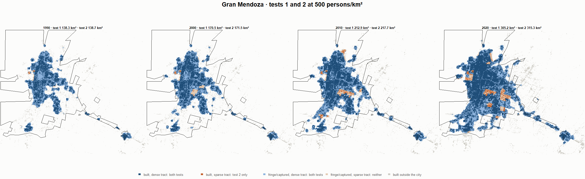
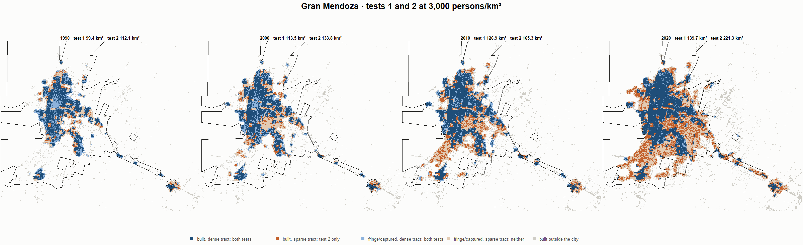
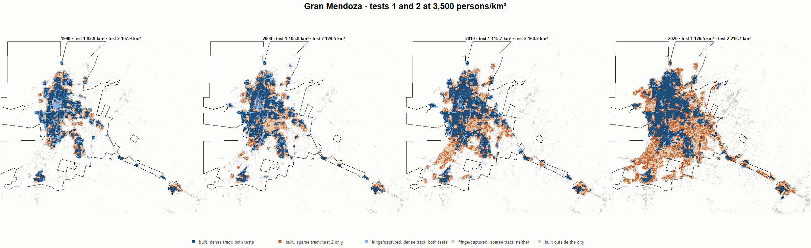
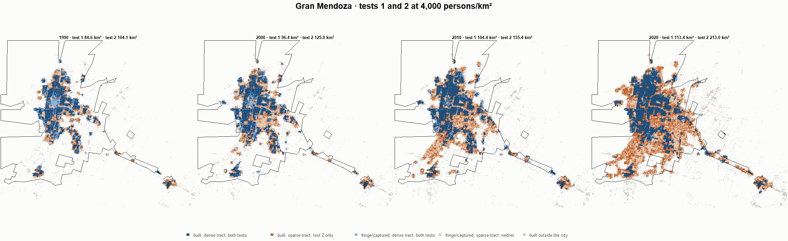

# Gran Mendoza · tests 1 and 2 at the same cut, 1990-2020

Exploratory. None of these numbers are project figures (they are not in `CIFRAS_CANONICAS.json`). Generated by `Rpipe/scripts/14_prueba_comparada.R` from the tract tables of step 11. Run of 2026-11-08. [All agglomerations](../REPORTE.md) · [test 1](../../densidad_radios/mendoza/REPORTE.md) · [test 2](../../franja_densa/mendoza/REPORTE.md) · [methods](../../METODOS.md).

**At the same cut the two tests keep the same fringe and captured land**: that of the tracts at or above the cut. They differ only in the **built-up land of tracts below the cut**: test 1 drops it, test 2 keeps it. Test 2 minus test 1 is exactly that land.

## City size by cut

**1990 (census 1991).** Angel extent 140.1 km².

| Cut (p/km²) | Test 1 km² | Test 2 km² | Built in sparse tracts km² (test 2 only) | % of built-up in sparse tracts | Fringe in dense tracts km² (both) | Fringe in sparse tracts km² (neither) |
|---|---|---|---|---|---|---|
| 300 | 139.4 | 139.5 | 0.1 | 0.2 | 63.6 | 0.6 |
| 500 | 138.3 | 138.7 | 0.4 | 0.5 | 62.8 | 1.3 |
| 1,000 | 136.2 | 137.1 | 0.9 | 1.2 | 61.2 | 3.0 |
| 2,000 | 118.0 | 124.0 | 6.1 | 8.0 | 48.1 | 16.0 |
| 3,000 | 99.4 | 112.1 | 12.7 | 16.7 | 36.2 | 28.0 |
| 3,250 | 95.8 | 109.6 | 13.8 | 18.2 | 33.7 | 30.4 |
| 3,500 | 92.9 | 107.9 | 14.9 | 19.7 | 31.9 | 32.2 |
| 3,750 | 87.2 | 105.2 | 18.0 | 23.8 | 29.3 | 34.8 |
| 4,000 | 84.6 | 104.1 | 19.5 | 25.6 | 28.2 | 36.0 |
| 4,500 | 76.8 | 99.9 | 23.1 | 30.4 | 24.0 | 40.2 |
| 5,000 | 68.8 | 96.1 | 27.3 | 36.0 | 20.2 | 43.9 |

**2000 (census 2001).** Angel extent 176.2 km².

| Cut (p/km²) | Test 1 km² | Test 2 km² | Built in sparse tracts km² (test 2 only) | % of built-up in sparse tracts | Fringe in dense tracts km² (both) | Fringe in sparse tracts km² (neither) |
|---|---|---|---|---|---|---|
| 300 | 174.5 | 175.0 | 0.5 | 0.6 | 76.9 | 1.2 |
| 500 | 170.5 | 171.5 | 1.0 | 1.0 | 73.4 | 4.8 |
| 1,000 | 162.1 | 165.3 | 3.3 | 3.3 | 67.2 | 10.9 |
| 2,000 | 135.5 | 147.1 | 11.6 | 11.8 | 49.0 | 29.1 |
| 3,000 | 113.5 | 133.8 | 20.3 | 20.7 | 35.7 | 42.4 |
| 3,250 | 109.3 | 131.4 | 22.1 | 22.5 | 33.3 | 44.8 |
| 3,500 | 105.8 | 129.5 | 23.8 | 24.2 | 31.4 | 46.7 |
| 3,750 | 101.1 | 127.3 | 26.3 | 26.8 | 29.2 | 48.9 |
| 4,000 | 96.4 | 125.0 | 28.7 | 29.2 | 26.9 | 51.2 |
| 4,500 | 87.1 | 120.8 | 33.8 | 34.4 | 22.7 | 55.4 |
| 5,000 | 77.4 | 116.5 | 39.1 | 39.9 | 18.4 | 59.7 |

**2010 (census 2010).** Angel extent 226.0 km².

| Cut (p/km²) | Test 1 km² | Test 2 km² | Built in sparse tracts km² (test 2 only) | % of built-up in sparse tracts | Fringe in dense tracts km² (both) | Fringe in sparse tracts km² (neither) |
|---|---|---|---|---|---|---|
| 300 | 221.5 | 223.0 | 1.5 | 1.2 | 88.8 | 2.9 |
| 500 | 212.9 | 217.7 | 4.7 | 3.5 | 83.5 | 8.3 |
| 1,000 | 193.0 | 203.9 | 10.9 | 8.2 | 69.7 | 22.0 |
| 2,000 | 153.3 | 179.6 | 26.3 | 19.6 | 45.4 | 46.4 |
| 3,000 | 126.9 | 165.3 | 38.4 | 28.6 | 31.1 | 60.6 |
| 3,250 | 121.9 | 162.9 | 41.0 | 30.6 | 28.7 | 63.0 |
| 3,500 | 115.7 | 160.2 | 44.5 | 33.2 | 26.0 | 65.7 |
| 3,750 | 110.6 | 158.2 | 47.7 | 35.5 | 24.0 | 67.7 |
| 4,000 | 104.4 | 155.4 | 50.9 | 38.0 | 21.2 | 70.6 |
| 4,500 | 95.6 | 151.4 | 55.8 | 41.6 | 17.2 | 74.5 |
| 5,000 | 87.2 | 148.6 | 61.4 | 45.8 | 14.4 | 77.3 |

**2020 (census 2022).** Angel extent 328.6 km².

| Cut (p/km²) | Test 1 km² | Test 2 km² | Built in sparse tracts km² (test 2 only) | % of built-up in sparse tracts | Fringe in dense tracts km² (both) | Fringe in sparse tracts km² (neither) |
|---|---|---|---|---|---|---|
| 300 | 322.4 | 324.7 | 2.3 | 1.1 | 124.4 | 3.9 |
| 500 | 305.2 | 315.3 | 10.1 | 5.0 | 115.0 | 13.3 |
| 1,000 | 241.9 | 275.0 | 33.0 | 16.5 | 74.6 | 53.7 |
| 2,000 | 169.8 | 234.6 | 64.8 | 32.3 | 34.2 | 94.1 |
| 3,000 | 139.7 | 221.3 | 81.6 | 40.7 | 21.0 | 107.3 |
| 3,250 | 131.2 | 218.3 | 87.2 | 43.5 | 18.0 | 110.3 |
| 3,500 | 126.5 | 216.7 | 90.2 | 45.0 | 16.4 | 111.9 |
| 3,750 | 118.8 | 214.4 | 95.6 | 47.7 | 14.1 | 114.2 |
| 4,000 | 113.4 | 213.0 | 99.6 | 49.7 | 12.7 | 115.6 |
| 4,500 | 104.4 | 210.8 | 106.5 | 53.2 | 10.5 | 117.8 |
| 5,000 | 97.2 | 209.2 | 112.0 | 55.9 | 8.9 | 119.4 |

## Growth 1990-2020 by cut

Angel extent: 2.88 %/yr.

| Cut (p/km²) | Test 1 %/yr | Test 2 %/yr |
|---|---|---|
| 300 | 2.84 | 2.86 |
| 500 | 2.67 | 2.77 |
| 1,000 | 1.93 | 2.35 |
| 2,000 | 1.22 | 2.15 |
| 3,000 | 1.14 | 2.29 |
| 3,250 | 1.05 | 2.32 |
| 3,500 | 1.04 | 2.35 |
| 3,750 | 1.04 | 2.40 |
| 4,000 | 0.98 | 2.42 |
| 4,500 | 1.03 | 2.52 |
| 5,000 | 1.16 | 2.63 |

## Maps

Same frame in the four years: the 2020 city plus 3 km. Dark blue and light blue are in both tests; orange is built-up in tracts below the cut, which only test 2 keeps; beige is fringe or captured land in tracts below the cut, which neither keeps. Black line: the analysis perimeter.

### 500 persons/km²

### 3,000 persons/km²

### 3,500 persons/km²

### 4,000 persons/km²

