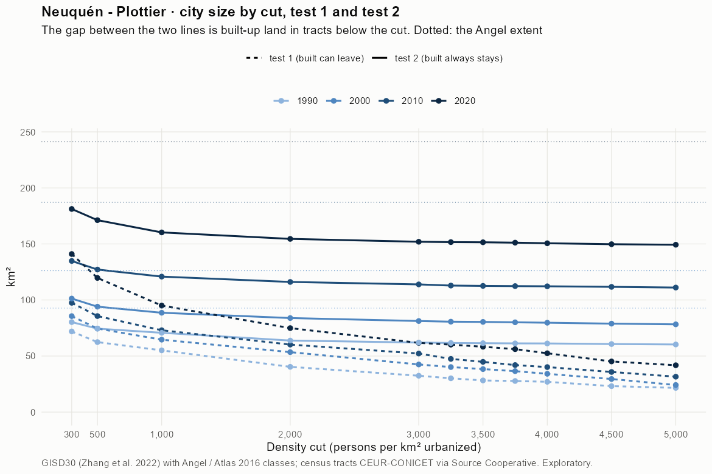
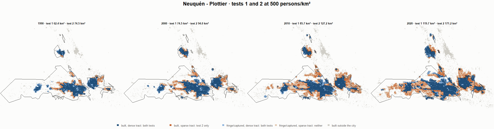
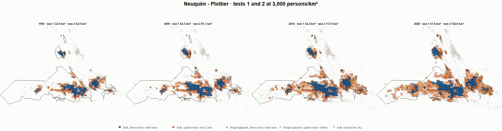

# Neuquén - Plottier · tests 1 and 2 at the same cut, 1990-2020

Exploratory. None of these numbers are project figures (they are not in `CIFRAS_CANONICAS.json`). Generated by `Rpipe/scripts/14_prueba_comparada.R` from the tract tables of step 11. Run of 2026-11-08. [All agglomerations](../REPORTE.md) · [test 1](../../densidad_radios/neuquen/REPORTE.md) · [test 2](../../franja_densa/neuquen/REPORTE.md) · [methods](../../METODOS.md).

**At the same cut the two tests keep the same fringe and captured land**: that of the tracts at or above the cut. They differ only in the **built-up land of tracts below the cut**: test 1 drops it, test 2 keeps it. Test 2 minus test 1 is exactly that land.

## City size by cut

**1990 (census 1991).** Angel extent 92.7 km².

| Cut (p/km²) | Test 1 km² | Test 2 km² | Built in sparse tracts km² (test 2 only) | % of built-up in sparse tracts | Fringe in dense tracts km² (both) | Fringe in sparse tracts km² (neither) |
|---|---|---|---|---|---|---|
| 300 | 72.0 | 80.3 | 8.3 | 14.4 | 22.2 | 12.4 |
| 500 | 62.4 | 74.5 | 12.0 | 20.7 | 16.4 | 18.3 |
| 1,000 | 55.1 | 70.7 | 15.7 | 27.0 | 12.7 | 22.0 |
| 2,000 | 40.4 | 63.8 | 23.4 | 40.4 | 5.8 | 28.9 |
| 3,000 | 32.4 | 62.0 | 29.6 | 51.0 | 4.0 | 30.7 |
| 3,250 | 30.1 | 61.7 | 31.5 | 54.3 | 3.6 | 31.1 |
| 3,500 | 28.2 | 61.5 | 33.2 | 57.2 | 3.4 | 31.3 |
| 3,750 | 27.7 | 61.3 | 33.6 | 57.8 | 3.2 | 31.4 |
| 4,000 | 27.0 | 61.2 | 34.2 | 58.9 | 3.2 | 31.5 |
| 4,500 | 23.2 | 60.7 | 37.6 | 64.7 | 2.6 | 32.0 |
| 5,000 | 21.6 | 60.3 | 38.7 | 66.7 | 2.3 | 32.4 |

**2000 (census 2001).** Angel extent 126.1 km².

| Cut (p/km²) | Test 1 km² | Test 2 km² | Built in sparse tracts km² (test 2 only) | % of built-up in sparse tracts | Fringe in dense tracts km² (both) | Fringe in sparse tracts km² (neither) |
|---|---|---|---|---|---|---|
| 300 | 85.6 | 101.3 | 15.7 | 20.4 | 24.4 | 24.8 |
| 500 | 74.5 | 94.0 | 19.5 | 25.4 | 17.2 | 32.1 |
| 1,000 | 64.6 | 88.6 | 24.0 | 31.2 | 11.8 | 37.5 |
| 2,000 | 53.5 | 83.9 | 30.4 | 39.6 | 7.0 | 42.2 |
| 3,000 | 42.5 | 81.3 | 38.8 | 50.4 | 4.4 | 44.9 |
| 3,250 | 40.2 | 80.6 | 40.5 | 52.7 | 3.8 | 45.5 |
| 3,500 | 38.4 | 80.5 | 42.1 | 54.8 | 3.6 | 45.7 |
| 3,750 | 36.5 | 80.1 | 43.6 | 56.7 | 3.3 | 46.0 |
| 4,000 | 34.1 | 79.7 | 45.6 | 59.3 | 2.9 | 46.4 |
| 4,500 | 29.5 | 78.9 | 49.4 | 64.3 | 2.1 | 47.2 |
| 5,000 | 24.2 | 78.3 | 54.1 | 70.4 | 1.4 | 47.8 |

**2010 (census 2010).** Angel extent 187.2 km².

| Cut (p/km²) | Test 1 km² | Test 2 km² | Built in sparse tracts km² (test 2 only) | % of built-up in sparse tracts | Fringe in dense tracts km² (both) | Fringe in sparse tracts km² (neither) |
|---|---|---|---|---|---|---|
| 300 | 97.5 | 134.8 | 37.3 | 34.1 | 25.3 | 52.4 |
| 500 | 85.7 | 127.2 | 41.5 | 37.9 | 17.6 | 60.1 |
| 1,000 | 73.0 | 120.9 | 47.9 | 43.7 | 11.3 | 66.4 |
| 2,000 | 60.2 | 116.1 | 55.9 | 51.0 | 6.6 | 71.1 |
| 3,000 | 52.2 | 113.9 | 61.7 | 56.3 | 4.4 | 73.3 |
| 3,250 | 47.5 | 112.9 | 65.4 | 59.7 | 3.3 | 74.4 |
| 3,500 | 44.8 | 112.6 | 67.8 | 61.9 | 3.0 | 74.7 |
| 3,750 | 41.9 | 112.4 | 70.5 | 64.3 | 2.9 | 74.8 |
| 4,000 | 40.1 | 112.2 | 72.1 | 65.8 | 2.7 | 75.0 |
| 4,500 | 35.8 | 111.7 | 75.9 | 69.3 | 2.2 | 75.5 |
| 5,000 | 31.6 | 111.1 | 79.5 | 72.6 | 1.6 | 76.1 |

**2020 (census 2022).** Angel extent 241.1 km².

| Cut (p/km²) | Test 1 km² | Test 2 km² | Built in sparse tracts km² (test 2 only) | % of built-up in sparse tracts | Fringe in dense tracts km² (both) | Fringe in sparse tracts km² (neither) |
|---|---|---|---|---|---|---|
| 300 | 141.0 | 181.2 | 40.2 | 27.4 | 34.4 | 59.9 |
| 500 | 119.7 | 171.2 | 51.5 | 35.1 | 24.5 | 69.8 |
| 1,000 | 95.0 | 160.3 | 65.3 | 44.5 | 13.5 | 80.8 |
| 2,000 | 74.9 | 154.5 | 79.6 | 54.2 | 7.7 | 86.5 |
| 3,000 | 61.8 | 152.0 | 90.2 | 61.4 | 5.2 | 89.1 |
| 3,250 | 60.2 | 151.6 | 91.5 | 62.3 | 4.9 | 89.4 |
| 3,500 | 58.3 | 151.5 | 93.2 | 63.5 | 4.7 | 89.6 |
| 3,750 | 56.2 | 151.2 | 95.0 | 64.7 | 4.4 | 89.9 |
| 4,000 | 52.5 | 150.6 | 98.1 | 66.9 | 3.8 | 90.5 |
| 4,500 | 45.2 | 149.8 | 104.6 | 71.3 | 3.0 | 91.3 |
| 5,000 | 41.8 | 149.3 | 107.5 | 73.2 | 2.5 | 91.8 |

## Growth 1990-2020 by cut

Angel extent: 3.24 %/yr.

| Cut (p/km²) | Test 1 %/yr | Test 2 %/yr |
|---|---|---|
| 300 | 2.27 | 2.75 |
| 500 | 2.19 | 2.81 |
| 1,000 | 1.84 | 2.76 |
| 2,000 | 2.08 | 2.99 |
| 3,000 | 2.17 | 3.03 |
| 3,250 | 2.33 | 3.05 |
| 3,500 | 2.45 | 3.05 |
| 3,750 | 2.38 | 3.05 |
| 4,000 | 2.24 | 3.05 |
| 4,500 | 2.25 | 3.06 |
| 5,000 | 2.22 | 3.07 |

## Maps

Same frame in the four years: the 2020 city plus 3 km. Dark blue and light blue are in both tests; orange is built-up in tracts below the cut, which only test 2 keeps; beige is fringe or captured land in tracts below the cut, which neither keeps. Black line: the analysis perimeter.

### 500 persons/km²

### 3,000 persons/km²

### 3,500 persons/km²

### 4,000 persons/km²

