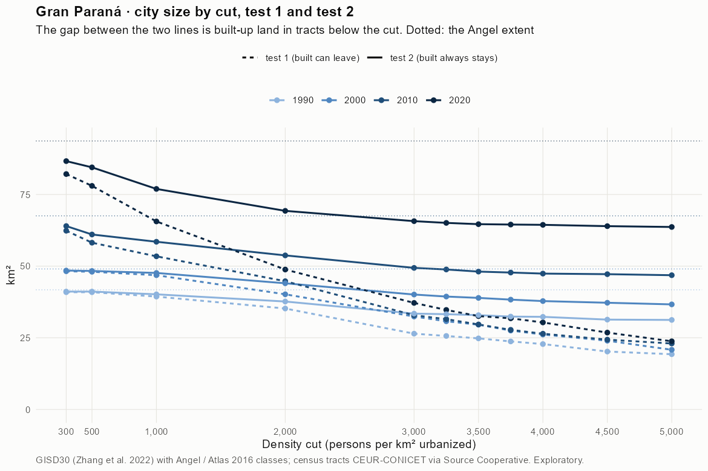
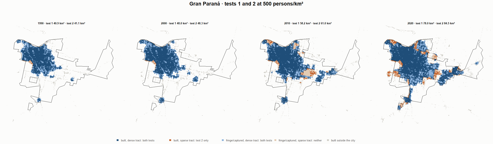
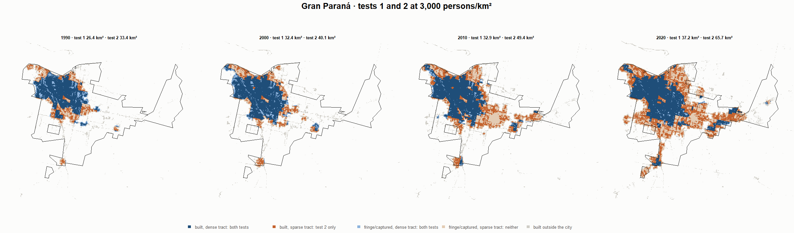
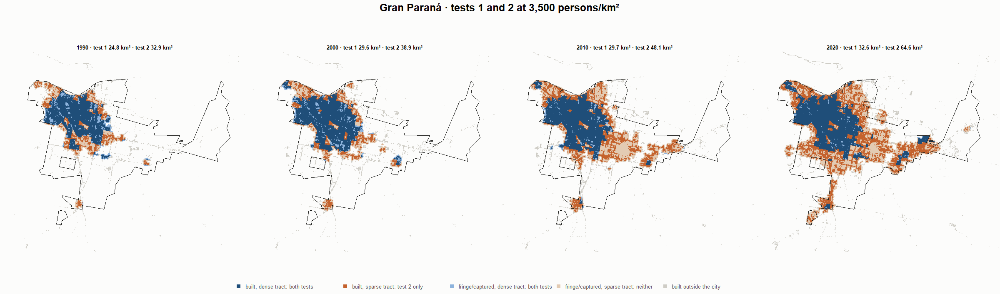
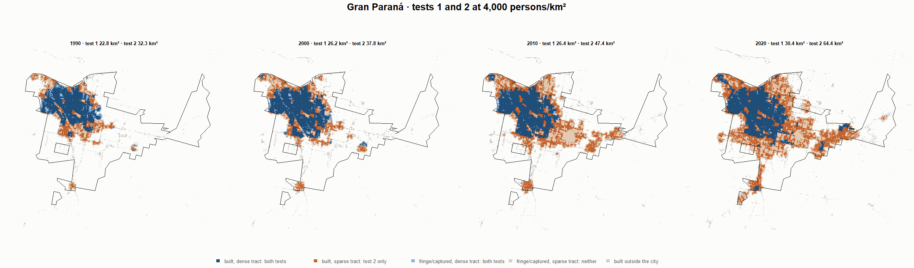

# Gran Paraná · tests 1 and 2 at the same cut, 1990-2020

Exploratory. None of these numbers are project figures (they are not in `CIFRAS_CANONICAS.json`). Generated by `Rpipe/scripts/14_prueba_comparada.R` from the tract tables of step 11. Run of 2026-11-08. [All agglomerations](../REPORTE.md) · [test 1](../../densidad_radios/parana/REPORTE.md) · [test 2](../../franja_densa/parana/REPORTE.md) · [methods](../../METODOS.md).

**At the same cut the two tests keep the same fringe and captured land**: that of the tracts at or above the cut. They differ only in the **built-up land of tracts below the cut**: test 1 drops it, test 2 keeps it. Test 2 minus test 1 is exactly that land.

## City size by cut

**1990 (census 1991).** Angel extent 41.7 km².

| Cut (p/km²) | Test 1 km² | Test 2 km² | Built in sparse tracts km² (test 2 only) | % of built-up in sparse tracts | Fringe in dense tracts km² (both) | Fringe in sparse tracts km² (neither) |
|---|---|---|---|---|---|---|
| 300 | 40.9 | 41.1 | 0.2 | 0.8 | 12.5 | 0.6 |
| 500 | 40.9 | 41.1 | 0.2 | 0.8 | 12.5 | 0.6 |
| 1,000 | 39.4 | 40.2 | 0.8 | 2.7 | 11.6 | 1.6 |
| 2,000 | 35.2 | 37.7 | 2.4 | 8.5 | 9.0 | 4.1 |
| 3,000 | 26.4 | 33.4 | 7.0 | 24.4 | 4.8 | 8.3 |
| 3,250 | 25.6 | 33.2 | 7.6 | 26.5 | 4.6 | 8.5 |
| 3,500 | 24.8 | 32.9 | 8.1 | 28.3 | 4.3 | 8.8 |
| 3,750 | 23.7 | 32.4 | 8.7 | 30.3 | 3.8 | 9.3 |
| 4,000 | 22.8 | 32.3 | 9.5 | 33.2 | 3.7 | 9.4 |
| 4,500 | 20.2 | 31.4 | 11.1 | 38.9 | 2.7 | 10.4 |
| 5,000 | 19.3 | 31.2 | 12.0 | 41.8 | 2.6 | 10.5 |

**2000 (census 2001).** Angel extent 49.0 km².

| Cut (p/km²) | Test 1 km² | Test 2 km² | Built in sparse tracts km² (test 2 only) | % of built-up in sparse tracts | Fringe in dense tracts km² (both) | Fringe in sparse tracts km² (neither) |
|---|---|---|---|---|---|---|
| 300 | 48.2 | 48.5 | 0.2 | 0.7 | 13.6 | 0.6 |
| 500 | 48.0 | 48.3 | 0.3 | 0.8 | 13.4 | 0.7 |
| 1,000 | 46.8 | 47.6 | 0.8 | 2.2 | 12.7 | 1.4 |
| 2,000 | 40.2 | 44.0 | 3.8 | 11.0 | 9.1 | 5.0 |
| 3,000 | 32.4 | 40.1 | 7.7 | 22.0 | 5.2 | 8.9 |
| 3,250 | 30.8 | 39.4 | 8.6 | 24.7 | 4.5 | 9.6 |
| 3,500 | 29.6 | 38.9 | 9.4 | 26.8 | 4.0 | 10.1 |
| 3,750 | 27.5 | 38.3 | 10.8 | 30.9 | 3.4 | 10.7 |
| 4,000 | 26.2 | 37.8 | 11.7 | 33.4 | 2.9 | 11.2 |
| 4,500 | 24.0 | 37.2 | 13.2 | 37.9 | 2.3 | 11.8 |
| 5,000 | 20.8 | 36.7 | 15.8 | 45.4 | 1.8 | 12.4 |

**2010 (census 2010).** Angel extent 67.5 km².

| Cut (p/km²) | Test 1 km² | Test 2 km² | Built in sparse tracts km² (test 2 only) | % of built-up in sparse tracts | Fringe in dense tracts km² (both) | Fringe in sparse tracts km² (neither) |
|---|---|---|---|---|---|---|
| 300 | 62.4 | 64.0 | 1.6 | 3.5 | 18.1 | 3.6 |
| 500 | 58.2 | 61.0 | 2.9 | 6.2 | 15.2 | 6.5 |
| 1,000 | 53.4 | 58.5 | 5.1 | 11.1 | 12.6 | 9.0 |
| 2,000 | 44.8 | 53.8 | 9.0 | 19.6 | 7.9 | 13.8 |
| 3,000 | 32.9 | 49.4 | 16.5 | 36.0 | 3.5 | 18.1 |
| 3,250 | 31.5 | 48.8 | 17.3 | 37.8 | 3.0 | 18.7 |
| 3,500 | 29.7 | 48.1 | 18.4 | 40.2 | 2.2 | 19.4 |
| 3,750 | 27.8 | 47.8 | 20.0 | 43.6 | 1.9 | 19.8 |
| 4,000 | 26.4 | 47.4 | 21.0 | 45.7 | 1.5 | 20.1 |
| 4,500 | 24.4 | 47.2 | 22.8 | 49.8 | 1.3 | 20.3 |
| 5,000 | 23.0 | 46.8 | 23.8 | 51.9 | 1.0 | 20.7 |

**2020 (census 2022).** Angel extent 93.7 km².

| Cut (p/km²) | Test 1 km² | Test 2 km² | Built in sparse tracts km² (test 2 only) | % of built-up in sparse tracts | Fringe in dense tracts km² (both) | Fringe in sparse tracts km² (neither) |
|---|---|---|---|---|---|---|
| 300 | 82.1 | 86.6 | 4.5 | 7.1 | 23.5 | 7.0 |
| 500 | 78.0 | 84.5 | 6.5 | 10.2 | 21.3 | 9.2 |
| 1,000 | 65.6 | 76.9 | 11.3 | 18.0 | 13.8 | 16.7 |
| 2,000 | 48.8 | 69.3 | 20.5 | 32.4 | 6.2 | 24.4 |
| 3,000 | 37.2 | 65.7 | 28.5 | 45.2 | 2.6 | 28.0 |
| 3,250 | 34.7 | 65.1 | 30.4 | 48.1 | 2.0 | 28.6 |
| 3,500 | 32.6 | 64.6 | 32.1 | 50.8 | 1.5 | 29.0 |
| 3,750 | 31.8 | 64.5 | 32.7 | 51.8 | 1.4 | 29.2 |
| 4,000 | 30.4 | 64.4 | 34.1 | 53.9 | 1.3 | 29.3 |
| 4,500 | 26.8 | 64.0 | 37.1 | 58.8 | 0.8 | 29.7 |
| 5,000 | 23.8 | 63.7 | 39.9 | 63.2 | 0.5 | 30.0 |

## Growth 1990-2020 by cut

Angel extent: 2.73 %/yr.

| Cut (p/km²) | Test 1 %/yr | Test 2 %/yr |
|---|---|---|
| 300 | 2.35 | 2.51 |
| 500 | 2.17 | 2.43 |
| 1,000 | 1.72 | 2.19 |
| 2,000 | 1.09 | 2.05 |
| 3,000 | 1.14 | 2.28 |
| 3,250 | 1.02 | 2.27 |
| 3,500 | 0.91 | 2.28 |
| 3,750 | 0.98 | 2.32 |
| 4,000 | 0.96 | 2.33 |
| 4,500 | 0.95 | 2.40 |
| 5,000 | 0.70 | 2.40 |

## Maps

Same frame in the four years: the 2020 city plus 3 km. Dark blue and light blue are in both tests; orange is built-up in tracts below the cut, which only test 2 keeps; beige is fringe or captured land in tracts below the cut, which neither keeps. Black line: the analysis perimeter.

### 500 persons/km²

### 3,000 persons/km²

### 3,500 persons/km²

### 4,000 persons/km²

