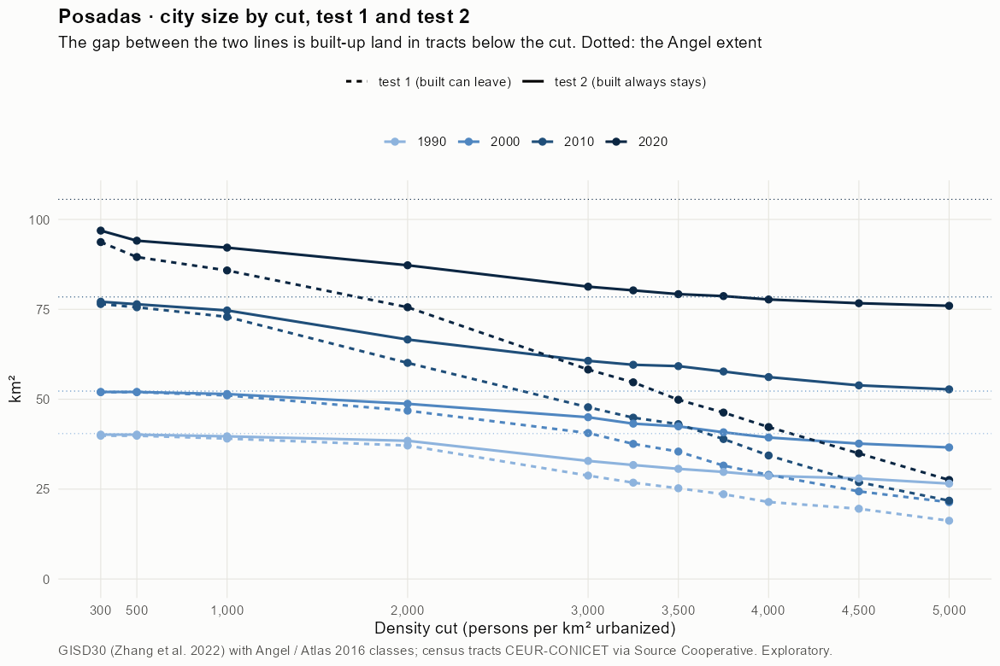
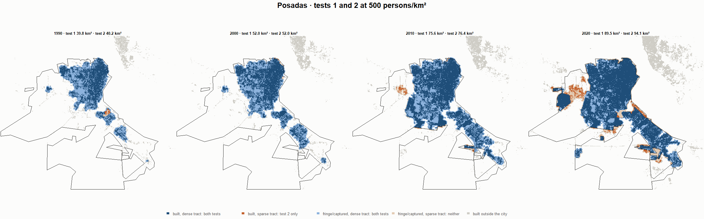
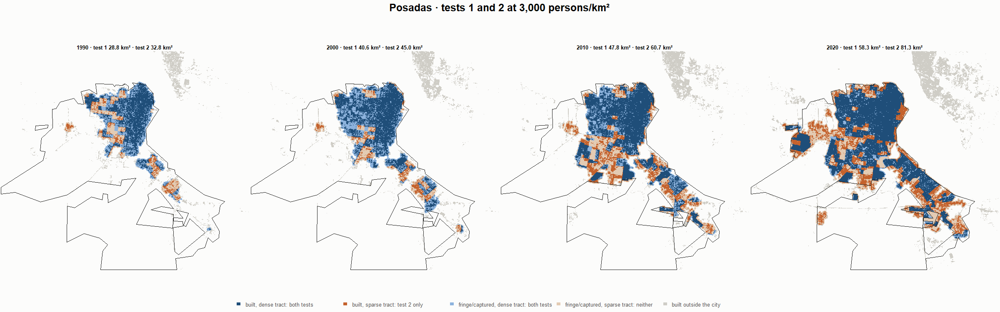
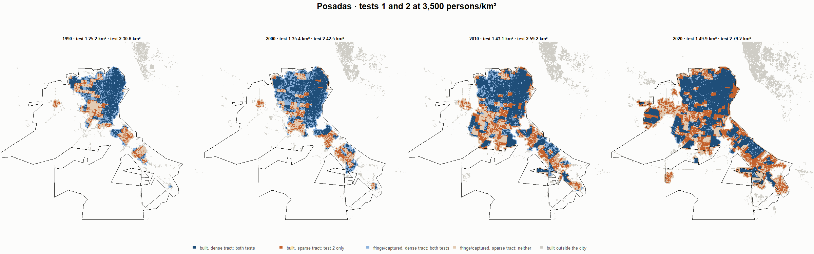
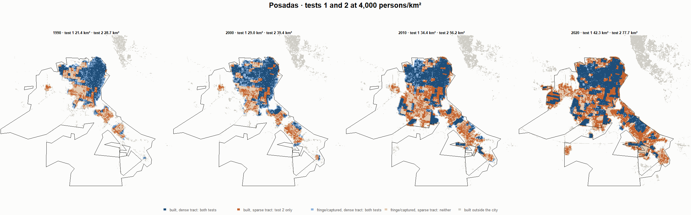

# Posadas · tests 1 and 2 at the same cut, 1990-2020

Exploratory. None of these numbers are project figures (they are not in `CIFRAS_CANONICAS.json`). Generated by `Rpipe/scripts/14_prueba_comparada.R` from the tract tables of step 11. Run of 2026-11-08. [All agglomerations](../REPORTE.md) · [test 1](../../densidad_radios/posadas/REPORTE.md) · [test 2](../../franja_densa/posadas/REPORTE.md) · [methods](../../METODOS.md).

**At the same cut the two tests keep the same fringe and captured land**: that of the tracts at or above the cut. They differ only in the **built-up land of tracts below the cut**: test 1 drops it, test 2 keeps it. Test 2 minus test 1 is exactly that land.

## City size by cut

**1990 (census 1991).** Angel extent 40.4 km².

| Cut (p/km²) | Test 1 km² | Test 2 km² | Built in sparse tracts km² (test 2 only) | % of built-up in sparse tracts | Fringe in dense tracts km² (both) | Fringe in sparse tracts km² (neither) |
|---|---|---|---|---|---|---|
| 300 | 39.8 | 40.2 | 0.3 | 1.5 | 18.7 | 0.3 |
| 500 | 39.8 | 40.2 | 0.3 | 1.5 | 18.7 | 0.3 |
| 1,000 | 39.0 | 39.7 | 0.6 | 2.9 | 18.3 | 0.8 |
| 2,000 | 37.1 | 38.4 | 1.3 | 6.2 | 17.0 | 2.0 |
| 3,000 | 28.8 | 32.8 | 4.1 | 19.1 | 11.4 | 7.6 |
| 3,250 | 26.8 | 31.7 | 4.9 | 22.9 | 10.3 | 8.7 |
| 3,500 | 25.2 | 30.6 | 5.4 | 25.2 | 9.2 | 9.8 |
| 3,750 | 23.6 | 29.8 | 6.2 | 29.0 | 8.4 | 10.7 |
| 4,000 | 21.4 | 28.7 | 7.3 | 33.9 | 7.3 | 11.8 |
| 4,500 | 19.5 | 28.0 | 8.4 | 39.4 | 6.6 | 12.5 |
| 5,000 | 16.2 | 26.5 | 10.3 | 48.2 | 5.1 | 13.9 |

**2000 (census 2001).** Angel extent 52.3 km².

| Cut (p/km²) | Test 1 km² | Test 2 km² | Built in sparse tracts km² (test 2 only) | % of built-up in sparse tracts | Fringe in dense tracts km² (both) | Fringe in sparse tracts km² (neither) |
|---|---|---|---|---|---|---|
| 300 | 52.0 | 52.0 | 0.1 | 0.2 | 22.0 | 0.2 |
| 500 | 52.0 | 52.0 | 0.1 | 0.2 | 22.0 | 0.2 |
| 1,000 | 51.1 | 51.4 | 0.4 | 1.3 | 21.4 | 0.8 |
| 2,000 | 46.8 | 48.7 | 1.9 | 6.4 | 18.7 | 3.5 |
| 3,000 | 40.6 | 45.0 | 4.4 | 14.6 | 14.9 | 7.3 |
| 3,250 | 37.6 | 43.2 | 5.6 | 18.7 | 13.2 | 9.1 |
| 3,500 | 35.4 | 42.5 | 7.0 | 23.3 | 12.4 | 9.8 |
| 3,750 | 31.5 | 40.8 | 9.3 | 30.8 | 10.8 | 11.5 |
| 4,000 | 29.0 | 39.4 | 10.4 | 34.6 | 9.3 | 12.9 |
| 4,500 | 24.4 | 37.6 | 13.3 | 44.2 | 7.6 | 14.6 |
| 5,000 | 21.4 | 36.6 | 15.2 | 50.7 | 6.6 | 15.7 |

**2010 (census 2010).** Angel extent 78.4 km².

| Cut (p/km²) | Test 1 km² | Test 2 km² | Built in sparse tracts km² (test 2 only) | % of built-up in sparse tracts | Fringe in dense tracts km² (both) | Fringe in sparse tracts km² (neither) |
|---|---|---|---|---|---|---|
| 300 | 76.5 | 77.1 | 0.6 | 1.3 | 27.9 | 1.3 |
| 500 | 75.6 | 76.4 | 0.8 | 1.7 | 27.2 | 2.0 |
| 1,000 | 72.9 | 74.7 | 1.8 | 3.6 | 25.5 | 3.7 |
| 2,000 | 60.1 | 66.6 | 6.5 | 13.2 | 17.4 | 11.8 |
| 3,000 | 47.8 | 60.7 | 12.9 | 26.2 | 11.4 | 17.8 |
| 3,250 | 44.9 | 59.6 | 14.7 | 29.9 | 10.3 | 18.9 |
| 3,500 | 43.1 | 59.2 | 16.1 | 32.8 | 10.0 | 19.2 |
| 3,750 | 38.9 | 57.7 | 18.8 | 38.1 | 8.5 | 20.7 |
| 4,000 | 34.4 | 56.2 | 21.8 | 44.3 | 6.9 | 22.3 |
| 4,500 | 26.9 | 53.9 | 26.9 | 54.7 | 4.6 | 24.6 |
| 5,000 | 21.8 | 52.7 | 31.0 | 62.9 | 3.5 | 25.7 |

**2020 (census 2022).** Angel extent 105.6 km².

| Cut (p/km²) | Test 1 km² | Test 2 km² | Built in sparse tracts km² (test 2 only) | % of built-up in sparse tracts | Fringe in dense tracts km² (both) | Fringe in sparse tracts km² (neither) |
|---|---|---|---|---|---|---|
| 300 | 93.7 | 96.9 | 3.2 | 4.3 | 22.5 | 8.7 |
| 500 | 89.5 | 94.1 | 4.5 | 6.1 | 19.6 | 11.5 |
| 1,000 | 85.8 | 92.2 | 6.3 | 8.5 | 17.7 | 13.4 |
| 2,000 | 75.6 | 87.3 | 11.7 | 15.7 | 12.8 | 18.3 |
| 3,000 | 58.3 | 81.3 | 23.0 | 31.0 | 6.9 | 24.3 |
| 3,250 | 54.7 | 80.3 | 25.6 | 34.4 | 5.8 | 25.3 |
| 3,500 | 49.9 | 79.2 | 29.4 | 39.4 | 4.8 | 26.4 |
| 3,750 | 46.3 | 78.7 | 32.4 | 43.5 | 4.2 | 26.9 |
| 4,000 | 42.3 | 77.7 | 35.5 | 47.7 | 3.3 | 27.8 |
| 4,500 | 34.9 | 76.7 | 41.8 | 56.1 | 2.3 | 28.9 |
| 5,000 | 27.5 | 76.0 | 48.4 | 65.1 | 1.5 | 29.6 |

## Growth 1990-2020 by cut

Angel extent: 3.25 %/yr.

| Cut (p/km²) | Test 1 %/yr | Test 2 %/yr |
|---|---|---|
| 300 | 2.89 | 2.98 |
| 500 | 2.74 | 2.88 |
| 1,000 | 2.66 | 2.85 |
| 2,000 | 2.40 | 2.77 |
| 3,000 | 2.38 | 3.07 |
| 3,250 | 2.41 | 3.15 |
| 3,500 | 2.30 | 3.22 |
| 3,750 | 2.27 | 3.29 |
| 4,000 | 2.29 | 3.38 |
| 4,500 | 1.96 | 3.42 |
| 5,000 | 1.78 | 3.57 |

## Maps

Same frame in the four years: the 2020 city plus 3 km. Dark blue and light blue are in both tests; orange is built-up in tracts below the cut, which only test 2 keeps; beige is fringe or captured land in tracts below the cut, which neither keeps. Black line: the analysis perimeter.

### 500 persons/km²

### 3,000 persons/km²

### 3,500 persons/km²

### 4,000 persons/km²

