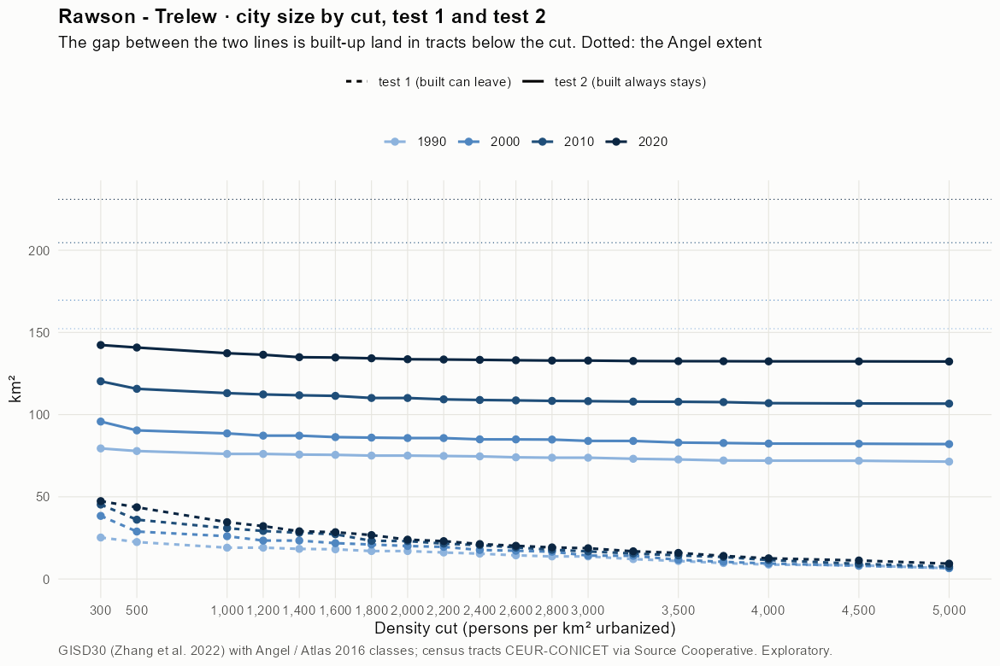
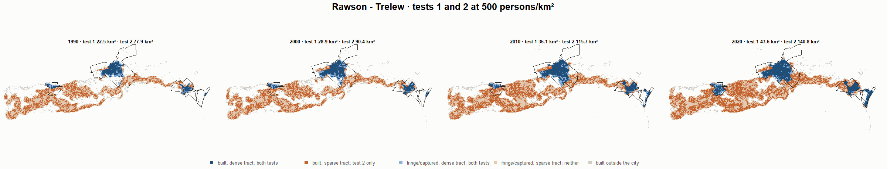
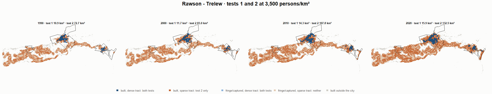

# Rawson - Trelew · tests 1 and 2 at the same cut, 1990-2020

Exploratory. None of these numbers are project figures (they are not in `CIFRAS_CANONICAS.json`). Generated by `Rpipe/scripts/14_prueba_comparada.R` from the tract tables of step 11. Run of 2026-11-15. [All agglomerations](../REPORTE.md) · [test 1](../../densidad_radios/rawson/REPORTE.md) · [test 2](../../franja_densa/rawson/REPORTE.md) · [methods](../../METODOS.md).

**At the same cut the two tests keep the same fringe and captured land**: that of the tracts at or above the cut. They differ only in the **built-up land of tracts below the cut**: test 1 drops it, test 2 keeps it. Test 2 minus test 1 is exactly that land.

## City size by cut

**1990 (census 1991).** Angel extent 152.3 km².

| Cut (p/km²) | Test 1 km² | Test 2 km² | Built in sparse tracts km² (test 2 only) | % of built-up in sparse tracts | Fringe in dense tracts km² (both) | Fringe in sparse tracts km² (neither) |
|---|---|---|---|---|---|---|
| 300 | 25.2 | 79.4 | 54.2 | 76.6 | 8.7 | 72.8 |
| 500 | 22.5 | 77.9 | 55.4 | 78.3 | 7.1 | 74.4 |
| 1,000 | 19.1 | 76.1 | 57.0 | 80.7 | 5.4 | 76.2 |
| 1,200 | 19.1 | 76.1 | 57.0 | 80.7 | 5.4 | 76.2 |
| 1,400 | 18.3 | 75.7 | 57.4 | 81.1 | 5.0 | 76.6 |
| 1,600 | 18.1 | 75.5 | 57.5 | 81.2 | 4.8 | 76.7 |
| 1,800 | 17.0 | 75.1 | 58.1 | 82.1 | 4.4 | 77.2 |
| 2,000 | 17.0 | 75.1 | 58.1 | 82.1 | 4.4 | 77.2 |
| 2,200 | 16.1 | 74.8 | 58.7 | 83.0 | 4.1 | 77.4 |
| 2,400 | 15.4 | 74.6 | 59.2 | 83.7 | 3.9 | 77.7 |
| 2,600 | 14.4 | 74.0 | 59.6 | 84.3 | 3.3 | 78.2 |
| 2,800 | 13.7 | 73.8 | 60.1 | 84.9 | 3.1 | 78.5 |
| 3,000 | 13.7 | 73.8 | 60.1 | 84.9 | 3.1 | 78.5 |
| 3,250 | 12.1 | 73.1 | 61.0 | 86.3 | 2.4 | 79.1 |
| 3,500 | 10.9 | 72.7 | 61.8 | 87.4 | 2.0 | 79.5 |
| 3,750 | 9.7 | 72.1 | 62.4 | 88.3 | 1.4 | 80.2 |
| 4,000 | 8.8 | 72.0 | 63.2 | 89.4 | 1.3 | 80.3 |
| 4,500 | 8.3 | 71.9 | 63.6 | 90.0 | 1.2 | 80.3 |
| 5,000 | 6.6 | 71.4 | 64.8 | 91.7 | 0.7 | 80.9 |

**2000 (census 2001).** Angel extent 169.6 km².

| Cut (p/km²) | Test 1 km² | Test 2 km² | Built in sparse tracts km² (test 2 only) | % of built-up in sparse tracts | Fringe in dense tracts km² (both) | Fringe in sparse tracts km² (neither) |
|---|---|---|---|---|---|---|
| 300 | 38.4 | 95.8 | 57.4 | 70.4 | 14.2 | 73.9 |
| 500 | 28.9 | 90.4 | 61.5 | 75.4 | 8.8 | 79.2 |
| 1,000 | 26.0 | 88.6 | 62.5 | 76.7 | 7.0 | 81.1 |
| 1,200 | 23.4 | 87.2 | 63.8 | 78.3 | 5.6 | 82.4 |
| 1,400 | 23.4 | 87.2 | 63.8 | 78.3 | 5.6 | 82.4 |
| 1,600 | 21.8 | 86.3 | 64.5 | 79.1 | 4.7 | 83.3 |
| 1,800 | 21.0 | 86.0 | 65.0 | 79.7 | 4.4 | 83.6 |
| 2,000 | 20.1 | 85.8 | 65.7 | 80.5 | 4.2 | 83.9 |
| 2,200 | 19.5 | 85.7 | 66.2 | 81.2 | 4.2 | 83.9 |
| 2,400 | 17.7 | 85.0 | 67.3 | 82.5 | 3.4 | 84.7 |
| 2,600 | 17.2 | 84.9 | 67.7 | 83.1 | 3.4 | 84.7 |
| 2,800 | 16.6 | 84.8 | 68.2 | 83.6 | 3.3 | 84.8 |
| 3,000 | 14.2 | 84.0 | 69.8 | 85.5 | 2.4 | 85.6 |
| 3,250 | 14.1 | 84.0 | 69.9 | 85.7 | 2.4 | 85.7 |
| 3,500 | 11.7 | 83.0 | 71.3 | 87.4 | 1.4 | 86.6 |
| 3,750 | 10.4 | 82.7 | 72.3 | 88.6 | 1.2 | 86.9 |
| 4,000 | 9.4 | 82.4 | 73.0 | 89.5 | 0.8 | 87.2 |
| 4,500 | 8.0 | 82.3 | 74.2 | 91.0 | 0.7 | 87.4 |
| 5,000 | 6.6 | 82.1 | 75.5 | 92.5 | 0.5 | 87.6 |

**2010 (census 2010).** Angel extent 204.6 km².

| Cut (p/km²) | Test 1 km² | Test 2 km² | Built in sparse tracts km² (test 2 only) | % of built-up in sparse tracts | Fringe in dense tracts km² (both) | Fringe in sparse tracts km² (neither) |
|---|---|---|---|---|---|---|
| 300 | 45.3 | 120.3 | 75.0 | 70.6 | 14.1 | 84.3 |
| 500 | 36.1 | 115.7 | 79.6 | 75.0 | 9.5 | 88.9 |
| 1,000 | 30.9 | 113.1 | 82.2 | 77.4 | 6.9 | 91.5 |
| 1,200 | 29.2 | 112.3 | 83.1 | 78.2 | 6.1 | 92.3 |
| 1,400 | 28.1 | 111.8 | 83.6 | 78.8 | 5.6 | 92.8 |
| 1,600 | 27.2 | 111.4 | 84.2 | 79.3 | 5.2 | 93.2 |
| 1,800 | 23.2 | 110.1 | 86.9 | 81.9 | 3.9 | 94.5 |
| 2,000 | 23.1 | 110.1 | 87.1 | 82.0 | 3.9 | 94.5 |
| 2,200 | 21.5 | 109.3 | 87.8 | 82.7 | 3.1 | 95.3 |
| 2,400 | 20.6 | 108.9 | 88.3 | 83.2 | 2.7 | 95.7 |
| 2,600 | 19.2 | 108.7 | 89.5 | 84.3 | 2.5 | 95.9 |
| 2,800 | 17.8 | 108.4 | 90.6 | 85.3 | 2.2 | 96.2 |
| 3,000 | 16.8 | 108.2 | 91.4 | 86.1 | 2.0 | 96.4 |
| 3,250 | 15.5 | 107.9 | 92.4 | 87.0 | 1.8 | 96.6 |
| 3,500 | 14.3 | 107.8 | 93.5 | 88.0 | 1.6 | 96.8 |
| 3,750 | 13.4 | 107.6 | 94.2 | 88.7 | 1.4 | 97.0 |
| 4,000 | 11.5 | 107.0 | 95.5 | 89.9 | 0.8 | 97.6 |
| 4,500 | 9.2 | 106.8 | 97.6 | 91.9 | 0.6 | 97.8 |
| 5,000 | 7.5 | 106.7 | 99.2 | 93.4 | 0.5 | 97.9 |

**2020 (census 2022).** Angel extent 231.0 km².

| Cut (p/km²) | Test 1 km² | Test 2 km² | Built in sparse tracts km² (test 2 only) | % of built-up in sparse tracts | Fringe in dense tracts km² (both) | Fringe in sparse tracts km² (neither) |
|---|---|---|---|---|---|---|
| 300 | 47.4 | 142.3 | 95.0 | 71.9 | 10.3 | 88.6 |
| 500 | 43.6 | 140.8 | 97.2 | 73.6 | 8.8 | 90.1 |
| 1,000 | 34.6 | 137.4 | 102.8 | 77.9 | 5.3 | 93.6 |
| 1,200 | 32.2 | 136.4 | 104.3 | 79.0 | 4.4 | 94.5 |
| 1,400 | 29.0 | 134.9 | 105.9 | 80.2 | 2.9 | 96.0 |
| 1,600 | 28.5 | 134.7 | 106.3 | 80.5 | 2.7 | 96.2 |
| 1,800 | 26.7 | 134.3 | 107.5 | 81.5 | 2.3 | 96.7 |
| 2,000 | 23.9 | 133.7 | 109.7 | 83.1 | 1.7 | 97.3 |
| 2,200 | 23.0 | 133.5 | 110.5 | 83.7 | 1.5 | 97.4 |
| 2,400 | 21.3 | 133.3 | 112.1 | 84.9 | 1.3 | 97.6 |
| 2,600 | 20.2 | 133.1 | 112.9 | 85.5 | 1.1 | 97.9 |
| 2,800 | 19.2 | 132.9 | 113.7 | 86.1 | 0.9 | 98.1 |
| 3,000 | 18.7 | 132.9 | 114.2 | 86.5 | 0.9 | 98.1 |
| 3,250 | 16.9 | 132.6 | 115.8 | 87.7 | 0.6 | 98.4 |
| 3,500 | 15.9 | 132.5 | 116.7 | 88.4 | 0.5 | 98.4 |
| 3,750 | 14.1 | 132.5 | 118.4 | 89.7 | 0.5 | 98.5 |
| 4,000 | 12.6 | 132.4 | 119.8 | 90.8 | 0.4 | 98.5 |
| 4,500 | 11.3 | 132.4 | 121.1 | 91.8 | 0.4 | 98.6 |
| 5,000 | 9.3 | 132.3 | 123.0 | 93.1 | 0.3 | 98.7 |

## Growth 1990-2020 by cut

Angel extent: 1.40 %/yr.

| Cut (p/km²) | Test 1 %/yr | Test 2 %/yr |
|---|---|---|
| 300 | 2.12 | 1.96 |
| 500 | 2.23 | 1.99 |
| 1,000 | 2.00 | 1.99 |
| 1,200 | 1.76 | 1.97 |
| 1,400 | 1.55 | 1.95 |
| 1,600 | 1.53 | 1.95 |
| 1,800 | 1.52 | 1.96 |
| 2,000 | 1.15 | 1.94 |
| 2,200 | 1.20 | 1.95 |
| 2,400 | 1.08 | 1.95 |
| 2,600 | 1.13 | 1.97 |
| 2,800 | 1.13 | 1.98 |
| 3,000 | 1.04 | 1.98 |
| 3,250 | 1.11 | 2.00 |
| 3,500 | 1.25 | 2.02 |
| 3,750 | 1.25 | 2.05 |
| 4,000 | 1.21 | 2.05 |
| 4,500 | 1.02 | 2.05 |
| 5,000 | 1.19 | 2.08 |

## Maps

Same frame in the four years: the 2020 city plus 3 km. Dark blue and light blue are in both tests; orange is built-up in tracts below the cut, which only test 2 keeps; beige is fringe or captured land in tracts below the cut, which neither keeps. Black line: the analysis perimeter.

### 500 persons/km²

### 3,000 persons/km²

### 3,500 persons/km²

### 4,000 persons/km²

