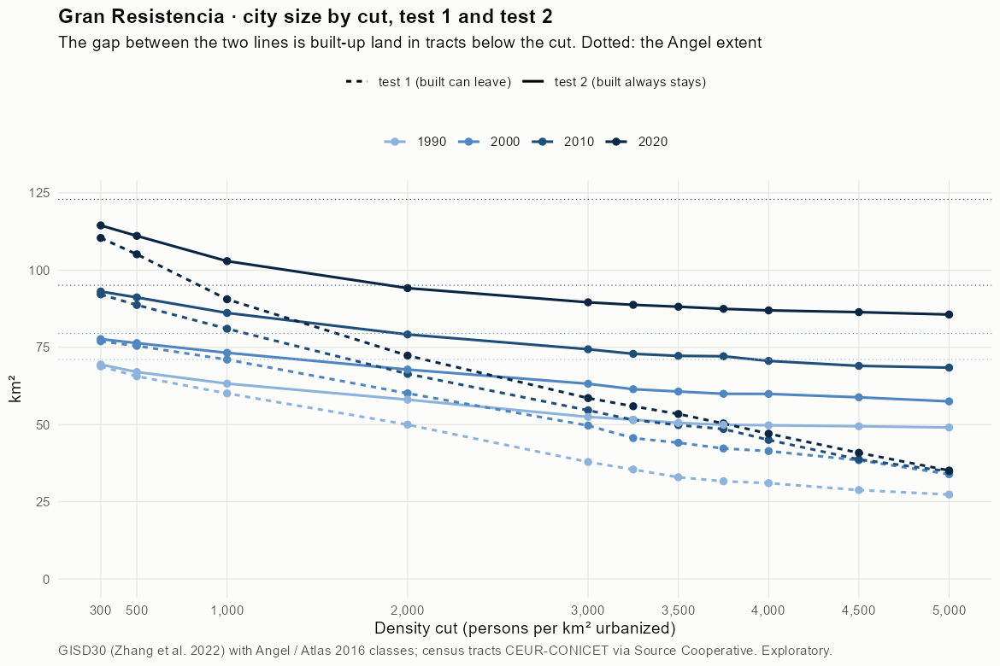
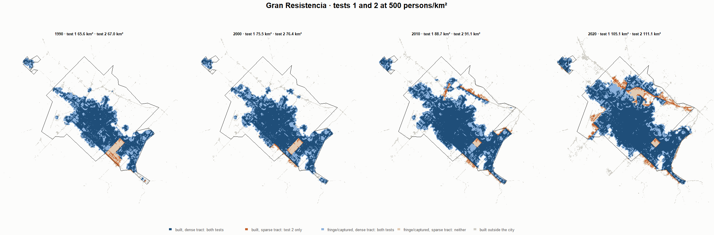
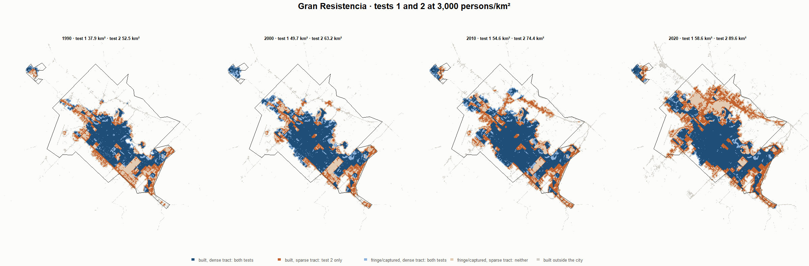
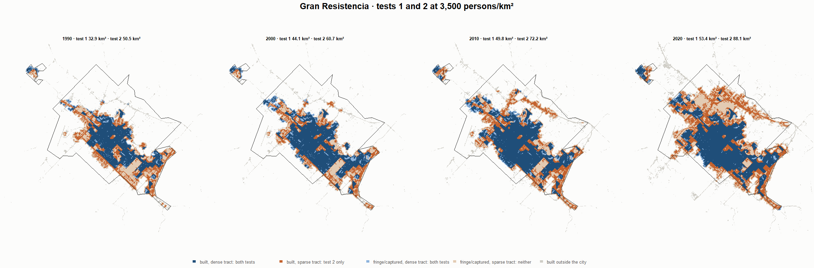
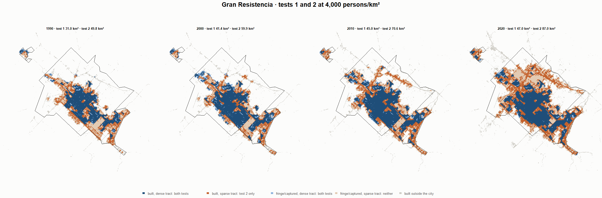

# Gran Resistencia · tests 1 and 2 at the same cut, 1990-2020

Exploratory. None of these numbers are project figures (they are not in `CIFRAS_CANONICAS.json`). Generated by `Rpipe/scripts/14_prueba_comparada.R` from the tract tables of step 11. Run of 2026-11-08. [All agglomerations](../REPORTE.md) · [test 1](../../densidad_radios/resistencia/REPORTE.md) · [test 2](../../franja_densa/resistencia/REPORTE.md) · [methods](../../METODOS.md).

**At the same cut the two tests keep the same fringe and captured land**: that of the tracts at or above the cut. They differ only in the **built-up land of tracts below the cut**: test 1 drops it, test 2 keeps it. Test 2 minus test 1 is exactly that land.

## City size by cut

**1990 (census 1991).** Angel extent 71.1 km².

| Cut (p/km²) | Test 1 km² | Test 2 km² | Built in sparse tracts km² (test 2 only) | % of built-up in sparse tracts | Fringe in dense tracts km² (both) | Fringe in sparse tracts km² (neither) |
|---|---|---|---|---|---|---|
| 300 | 68.8 | 69.4 | 0.6 | 1.3 | 23.4 | 1.6 |
| 500 | 65.6 | 67.0 | 1.4 | 3.0 | 21.0 | 4.0 |
| 1,000 | 60.1 | 63.3 | 3.2 | 6.9 | 17.3 | 7.8 |
| 2,000 | 50.0 | 58.1 | 8.1 | 17.6 | 12.1 | 13.0 |
| 3,000 | 37.9 | 52.5 | 14.6 | 31.7 | 6.5 | 18.6 |
| 3,250 | 35.4 | 51.6 | 16.1 | 35.1 | 5.6 | 19.5 |
| 3,500 | 32.9 | 50.5 | 17.6 | 38.3 | 4.5 | 20.5 |
| 3,750 | 31.6 | 49.9 | 18.3 | 39.8 | 3.9 | 21.1 |
| 4,000 | 31.0 | 49.8 | 18.7 | 40.7 | 3.8 | 21.3 |
| 4,500 | 28.8 | 49.4 | 20.7 | 44.9 | 3.4 | 21.6 |
| 5,000 | 27.3 | 49.1 | 21.7 | 47.2 | 3.1 | 22.0 |

**2000 (census 2001).** Angel extent 79.5 km².

| Cut (p/km²) | Test 1 km² | Test 2 km² | Built in sparse tracts km² (test 2 only) | % of built-up in sparse tracts | Fringe in dense tracts km² (both) | Fringe in sparse tracts km² (neither) |
|---|---|---|---|---|---|---|
| 300 | 76.9 | 77.7 | 0.7 | 1.3 | 24.2 | 1.8 |
| 500 | 75.5 | 76.4 | 0.9 | 1.7 | 22.9 | 3.1 |
| 1,000 | 71.0 | 73.2 | 2.2 | 4.1 | 19.7 | 6.3 |
| 2,000 | 60.1 | 67.8 | 7.7 | 14.4 | 14.3 | 11.7 |
| 3,000 | 49.7 | 63.2 | 13.5 | 25.3 | 9.7 | 16.3 |
| 3,250 | 45.6 | 61.4 | 15.8 | 29.6 | 7.9 | 18.0 |
| 3,500 | 44.1 | 60.7 | 16.6 | 31.0 | 7.2 | 18.8 |
| 3,750 | 42.3 | 60.0 | 17.7 | 33.1 | 6.5 | 19.5 |
| 4,000 | 41.4 | 59.9 | 18.5 | 34.6 | 6.4 | 19.6 |
| 4,500 | 38.4 | 58.8 | 20.4 | 38.1 | 5.3 | 20.7 |
| 5,000 | 33.9 | 57.5 | 23.6 | 44.1 | 4.0 | 22.0 |

**2010 (census 2010).** Angel extent 95.1 km².

| Cut (p/km²) | Test 1 km² | Test 2 km² | Built in sparse tracts km² (test 2 only) | % of built-up in sparse tracts | Fringe in dense tracts km² (both) | Fringe in sparse tracts km² (neither) |
|---|---|---|---|---|---|---|
| 300 | 92.1 | 93.1 | 0.9 | 1.4 | 27.1 | 2.0 |
| 500 | 88.7 | 91.1 | 2.4 | 3.7 | 25.2 | 3.9 |
| 1,000 | 81.0 | 86.1 | 5.1 | 7.8 | 20.2 | 8.9 |
| 2,000 | 66.4 | 79.2 | 12.8 | 19.3 | 13.2 | 15.9 |
| 3,000 | 54.6 | 74.4 | 19.8 | 30.0 | 8.5 | 20.7 |
| 3,250 | 51.5 | 72.9 | 21.4 | 32.4 | 7.0 | 22.2 |
| 3,500 | 49.8 | 72.2 | 22.4 | 34.0 | 6.3 | 22.8 |
| 3,750 | 48.6 | 72.1 | 23.5 | 35.7 | 6.2 | 23.0 |
| 4,000 | 45.0 | 70.6 | 25.6 | 38.8 | 4.7 | 24.5 |
| 4,500 | 38.7 | 69.0 | 30.3 | 45.9 | 3.1 | 26.1 |
| 5,000 | 34.8 | 68.4 | 33.6 | 51.0 | 2.5 | 26.7 |

**2020 (census 2022).** Angel extent 122.9 km².

| Cut (p/km²) | Test 1 km² | Test 2 km² | Built in sparse tracts km² (test 2 only) | % of built-up in sparse tracts | Fringe in dense tracts km² (both) | Fringe in sparse tracts km² (neither) |
|---|---|---|---|---|---|---|
| 300 | 110.4 | 114.5 | 4.0 | 4.8 | 30.1 | 8.4 |
| 500 | 105.1 | 111.1 | 6.0 | 7.1 | 26.7 | 11.8 |
| 1,000 | 90.6 | 102.9 | 12.3 | 14.6 | 18.5 | 20.0 |
| 2,000 | 72.3 | 94.2 | 21.8 | 25.9 | 9.8 | 28.7 |
| 3,000 | 58.6 | 89.6 | 31.0 | 36.7 | 5.2 | 33.3 |
| 3,250 | 55.9 | 88.8 | 32.8 | 38.9 | 4.4 | 34.1 |
| 3,500 | 53.4 | 88.1 | 34.7 | 41.2 | 3.7 | 34.8 |
| 3,750 | 50.4 | 87.5 | 37.1 | 44.0 | 3.1 | 35.4 |
| 4,000 | 47.0 | 87.0 | 39.9 | 47.3 | 2.6 | 35.9 |
| 4,500 | 40.8 | 86.4 | 45.5 | 54.0 | 2.0 | 36.5 |
| 5,000 | 35.1 | 85.6 | 50.5 | 59.8 | 1.2 | 37.3 |

## Growth 1990-2020 by cut

Angel extent: 1.84 %/yr.

| Cut (p/km²) | Test 1 %/yr | Test 2 %/yr |
|---|---|---|
| 300 | 1.59 | 1.68 |
| 500 | 1.58 | 1.70 |
| 1,000 | 1.38 | 1.64 |
| 2,000 | 1.24 | 1.63 |
| 3,000 | 1.46 | 1.80 |
| 3,250 | 1.53 | 1.83 |
| 3,500 | 1.62 | 1.87 |
| 3,750 | 1.56 | 1.89 |
| 4,000 | 1.40 | 1.88 |
| 4,500 | 1.17 | 1.88 |
| 5,000 | 0.84 | 1.87 |

## Maps

Same frame in the four years: the 2020 city plus 3 km. Dark blue and light blue are in both tests; orange is built-up in tracts below the cut, which only test 2 keeps; beige is fringe or captured land in tracts below the cut, which neither keeps. Black line: the analysis perimeter.

### 500 persons/km²

### 3,000 persons/km²

### 3,500 persons/km²

### 4,000 persons/km²

