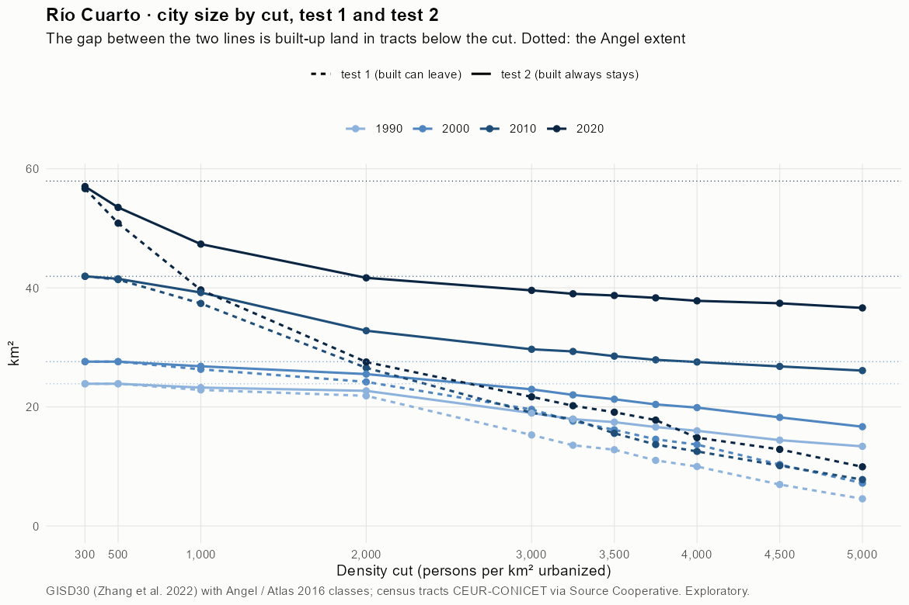
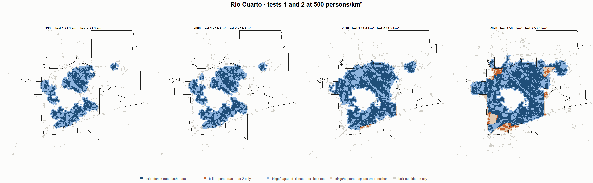
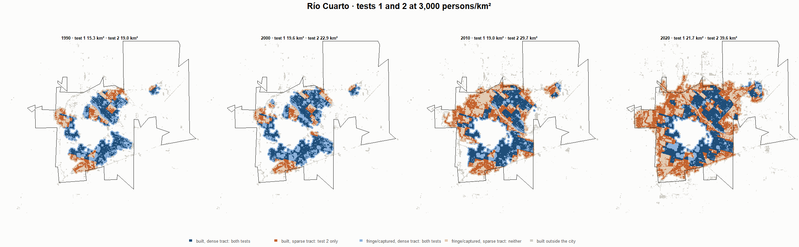
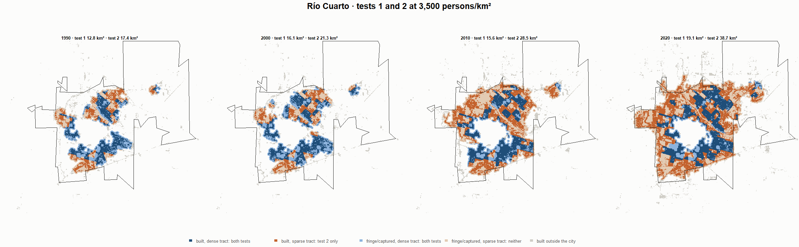
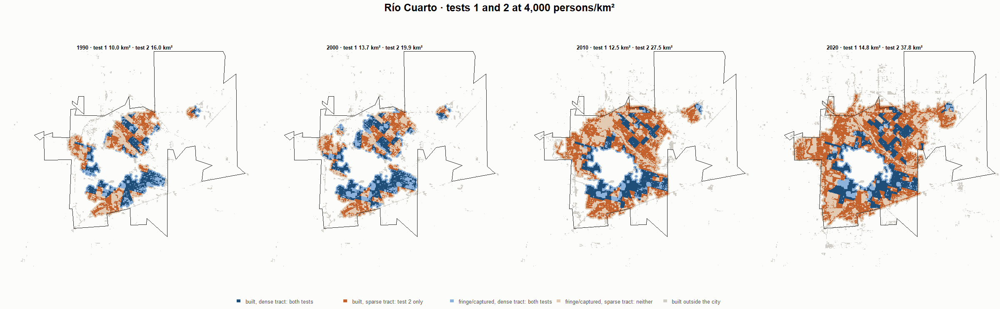

# Río Cuarto · tests 1 and 2 at the same cut, 1990-2020

Exploratory. None of these numbers are project figures (they are not in `CIFRAS_CANONICAS.json`). Generated by `Rpipe/scripts/14_prueba_comparada.R` from the tract tables of step 11. Run of 2026-11-08. [All agglomerations](../REPORTE.md) · [test 1](../../densidad_radios/rio_cuarto/REPORTE.md) · [test 2](../../franja_densa/rio_cuarto/REPORTE.md) · [methods](../../METODOS.md).

**At the same cut the two tests keep the same fringe and captured land**: that of the tracts at or above the cut. They differ only in the **built-up land of tracts below the cut**: test 1 drops it, test 2 keeps it. Test 2 minus test 1 is exactly that land.

## City size by cut

**1990 (census 1991).** Angel extent 23.9 km².

| Cut (p/km²) | Test 1 km² | Test 2 km² | Built in sparse tracts km² (test 2 only) | % of built-up in sparse tracts | Fringe in dense tracts km² (both) | Fringe in sparse tracts km² (neither) |
|---|---|---|---|---|---|---|
| 300 | 23.9 | 23.9 | 0.0 | 0.0 | 12.7 | 0.0 |
| 500 | 23.9 | 23.9 | 0.0 | 0.0 | 12.7 | 0.0 |
| 1,000 | 22.8 | 23.2 | 0.4 | 3.6 | 12.1 | 0.6 |
| 2,000 | 21.9 | 22.7 | 0.8 | 7.5 | 11.5 | 1.2 |
| 3,000 | 15.3 | 19.0 | 3.7 | 33.1 | 7.8 | 4.9 |
| 3,250 | 13.6 | 17.9 | 4.4 | 39.3 | 6.8 | 5.9 |
| 3,500 | 12.8 | 17.4 | 4.6 | 41.6 | 6.3 | 6.4 |
| 3,750 | 11.0 | 16.6 | 5.6 | 50.2 | 5.5 | 7.3 |
| 4,000 | 10.0 | 16.0 | 6.0 | 53.8 | 4.8 | 7.9 |
| 4,500 | 7.0 | 14.4 | 7.5 | 66.9 | 3.3 | 9.5 |
| 5,000 | 4.6 | 13.4 | 8.8 | 79.0 | 2.2 | 10.5 |

**2000 (census 2001).** Angel extent 27.6 km².

| Cut (p/km²) | Test 1 km² | Test 2 km² | Built in sparse tracts km² (test 2 only) | % of built-up in sparse tracts | Fringe in dense tracts km² (both) | Fringe in sparse tracts km² (neither) |
|---|---|---|---|---|---|---|
| 300 | 27.6 | 27.6 | 0.0 | 0.0 | 14.4 | 0.0 |
| 500 | 27.6 | 27.6 | 0.0 | 0.0 | 14.4 | 0.0 |
| 1,000 | 26.3 | 26.8 | 0.5 | 3.9 | 13.6 | 0.8 |
| 2,000 | 24.2 | 25.5 | 1.3 | 9.9 | 12.3 | 2.1 |
| 3,000 | 19.6 | 22.9 | 3.4 | 25.5 | 9.7 | 4.7 |
| 3,250 | 17.6 | 22.0 | 4.4 | 33.4 | 8.8 | 5.6 |
| 3,500 | 16.1 | 21.3 | 5.1 | 38.9 | 8.1 | 6.3 |
| 3,750 | 14.6 | 20.4 | 5.9 | 44.3 | 7.2 | 7.2 |
| 4,000 | 13.7 | 19.9 | 6.2 | 47.0 | 6.7 | 7.7 |
| 4,500 | 10.3 | 18.2 | 7.9 | 59.9 | 5.0 | 9.4 |
| 5,000 | 7.2 | 16.7 | 9.5 | 71.7 | 3.5 | 10.9 |

**2010 (census 2010).** Angel extent 41.9 km².

| Cut (p/km²) | Test 1 km² | Test 2 km² | Built in sparse tracts km² (test 2 only) | % of built-up in sparse tracts | Fringe in dense tracts km² (both) | Fringe in sparse tracts km² (neither) |
|---|---|---|---|---|---|---|
| 300 | 41.9 | 41.9 | 0.0 | 0.0 | 18.6 | 0.0 |
| 500 | 41.4 | 41.5 | 0.1 | 0.5 | 18.2 | 0.4 |
| 1,000 | 37.4 | 39.2 | 1.8 | 7.9 | 15.9 | 2.7 |
| 2,000 | 26.6 | 32.8 | 6.2 | 26.8 | 9.5 | 9.1 |
| 3,000 | 19.0 | 29.7 | 10.7 | 45.8 | 6.4 | 12.3 |
| 3,250 | 17.9 | 29.3 | 11.4 | 48.9 | 6.0 | 12.6 |
| 3,500 | 15.6 | 28.5 | 13.0 | 55.7 | 5.2 | 13.4 |
| 3,750 | 13.7 | 27.9 | 14.2 | 61.1 | 4.6 | 14.0 |
| 4,000 | 12.5 | 27.5 | 15.0 | 64.5 | 4.3 | 14.4 |
| 4,500 | 10.1 | 26.8 | 16.7 | 71.6 | 3.5 | 15.1 |
| 5,000 | 7.8 | 26.1 | 18.3 | 78.7 | 2.8 | 15.8 |

**2020 (census 2022).** Angel extent 57.9 km².

| Cut (p/km²) | Test 1 km² | Test 2 km² | Built in sparse tracts km² (test 2 only) | % of built-up in sparse tracts | Fringe in dense tracts km² (both) | Fringe in sparse tracts km² (neither) |
|---|---|---|---|---|---|---|
| 300 | 56.7 | 57.0 | 0.3 | 1.0 | 23.4 | 0.9 |
| 500 | 50.9 | 53.5 | 2.6 | 7.9 | 19.9 | 4.4 |
| 1,000 | 39.6 | 47.3 | 7.7 | 22.9 | 13.8 | 10.6 |
| 2,000 | 27.5 | 41.7 | 14.1 | 42.1 | 8.1 | 16.2 |
| 3,000 | 21.7 | 39.6 | 17.9 | 53.2 | 6.0 | 18.4 |
| 3,250 | 20.2 | 39.0 | 18.8 | 56.0 | 5.4 | 18.9 |
| 3,500 | 19.1 | 38.7 | 19.6 | 58.4 | 5.1 | 19.2 |
| 3,750 | 17.8 | 38.3 | 20.5 | 61.1 | 4.7 | 19.6 |
| 4,000 | 14.8 | 37.8 | 23.0 | 68.4 | 4.2 | 20.1 |
| 4,500 | 12.9 | 37.4 | 24.5 | 73.1 | 3.8 | 20.5 |
| 5,000 | 9.9 | 36.6 | 26.7 | 79.5 | 3.0 | 21.3 |

## Growth 1990-2020 by cut

Angel extent: 3.00 %/yr.

| Cut (p/km²) | Test 1 %/yr | Test 2 %/yr |
|---|---|---|
| 300 | 2.92 | 2.94 |
| 500 | 2.55 | 2.72 |
| 1,000 | 1.85 | 2.40 |
| 2,000 | 0.77 | 2.05 |
| 3,000 | 1.17 | 2.48 |
| 3,250 | 1.34 | 2.62 |
| 3,500 | 1.34 | 2.69 |
| 3,750 | 1.61 | 2.82 |
| 4,000 | 1.33 | 2.91 |
| 4,500 | 2.07 | 3.23 |
| 5,000 | 2.63 | 3.42 |

## Maps

Same frame in the four years: the 2020 city plus 3 km. Dark blue and light blue are in both tests; orange is built-up in tracts below the cut, which only test 2 keeps; beige is fringe or captured land in tracts below the cut, which neither keeps. Black line: the analysis perimeter.

### 500 persons/km²

### 3,000 persons/km²

### 3,500 persons/km²

### 4,000 persons/km²

