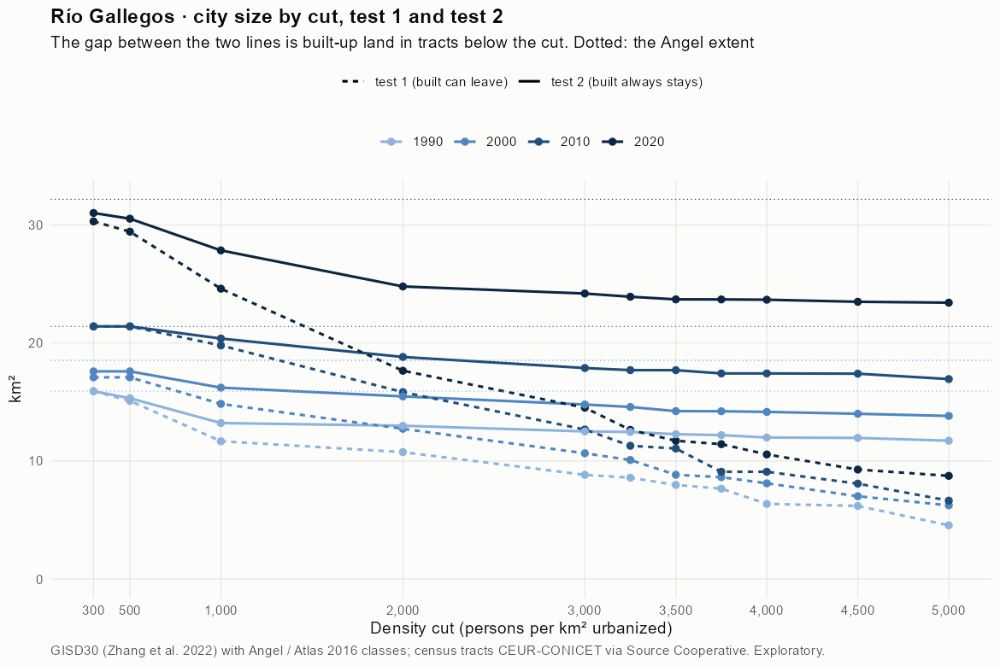
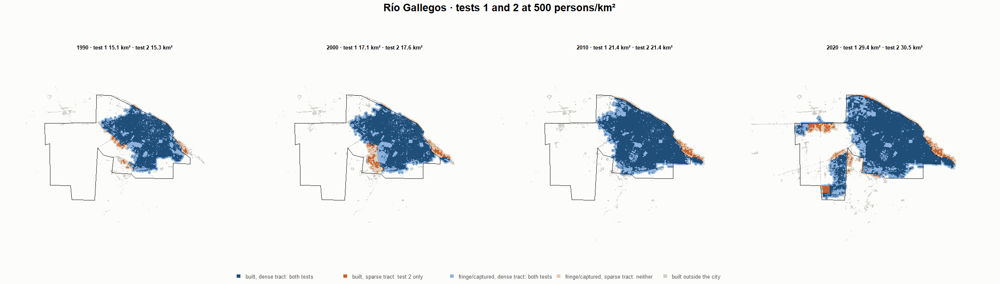
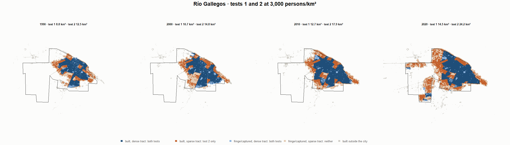
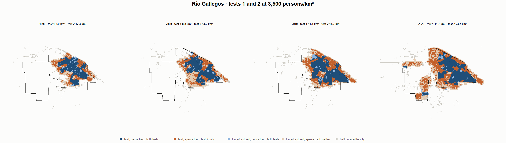
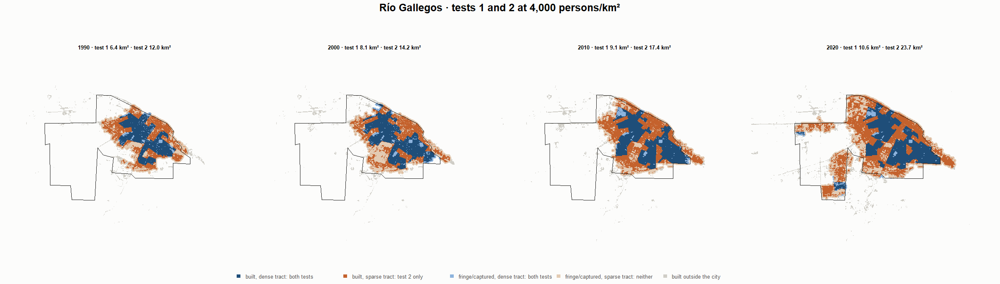

# Río Gallegos · tests 1 and 2 at the same cut, 1990-2020

Exploratory. None of these numbers are project figures (they are not in `CIFRAS_CANONICAS.json`). Generated by `Rpipe/scripts/14_prueba_comparada.R` from the tract tables of step 11. Run of 2026-11-08. [All agglomerations](../REPORTE.md) · [test 1](../../densidad_radios/rio_gallegos/REPORTE.md) · [test 2](../../franja_densa/rio_gallegos/REPORTE.md) · [methods](../../METODOS.md).

**At the same cut the two tests keep the same fringe and captured land**: that of the tracts at or above the cut. They differ only in the **built-up land of tracts below the cut**: test 1 drops it, test 2 keeps it. Test 2 minus test 1 is exactly that land.

## City size by cut

**1990 (census 1991).** Angel extent 15.9 km².

| Cut (p/km²) | Test 1 km² | Test 2 km² | Built in sparse tracts km² (test 2 only) | % of built-up in sparse tracts | Fringe in dense tracts km² (both) | Fringe in sparse tracts km² (neither) |
|---|---|---|---|---|---|---|
| 300 | 15.9 | 15.9 | 0.0 | 0.0 | 4.6 | 0.0 |
| 500 | 15.1 | 15.3 | 0.2 | 2.0 | 4.0 | 0.6 |
| 1,000 | 11.7 | 13.2 | 1.5 | 13.6 | 1.9 | 2.7 |
| 2,000 | 10.8 | 13.0 | 2.2 | 19.8 | 1.7 | 2.9 |
| 3,000 | 8.8 | 12.5 | 3.7 | 32.5 | 1.2 | 3.4 |
| 3,250 | 8.6 | 12.5 | 3.9 | 34.3 | 1.2 | 3.5 |
| 3,500 | 8.0 | 12.3 | 4.3 | 38.0 | 1.0 | 3.6 |
| 3,750 | 7.7 | 12.2 | 4.5 | 40.1 | 0.9 | 3.7 |
| 4,000 | 6.4 | 12.0 | 5.6 | 49.7 | 0.7 | 3.9 |
| 4,500 | 6.2 | 12.0 | 5.8 | 51.0 | 0.7 | 4.0 |
| 5,000 | 4.5 | 11.7 | 7.2 | 63.4 | 0.4 | 4.2 |

**2000 (census 2001).** Angel extent 18.5 km².

| Cut (p/km²) | Test 1 km² | Test 2 km² | Built in sparse tracts km² (test 2 only) | % of built-up in sparse tracts | Fringe in dense tracts km² (both) | Fringe in sparse tracts km² (neither) |
|---|---|---|---|---|---|---|
| 300 | 17.1 | 17.6 | 0.5 | 3.9 | 4.5 | 0.9 |
| 500 | 17.1 | 17.6 | 0.5 | 3.9 | 4.5 | 0.9 |
| 1,000 | 14.8 | 16.2 | 1.4 | 10.5 | 3.1 | 2.3 |
| 2,000 | 12.7 | 15.5 | 2.7 | 20.9 | 2.3 | 3.1 |
| 3,000 | 10.7 | 14.8 | 4.1 | 31.4 | 1.6 | 3.7 |
| 3,250 | 10.1 | 14.6 | 4.5 | 34.2 | 1.4 | 4.0 |
| 3,500 | 8.8 | 14.2 | 5.4 | 41.0 | 1.1 | 4.3 |
| 3,750 | 8.6 | 14.2 | 5.6 | 42.5 | 1.1 | 4.3 |
| 4,000 | 8.1 | 14.2 | 6.1 | 46.0 | 1.0 | 4.4 |
| 4,500 | 7.0 | 14.0 | 7.0 | 53.2 | 0.9 | 4.5 |
| 5,000 | 6.2 | 13.8 | 7.6 | 57.6 | 0.7 | 4.7 |

**2010 (census 2010).** Angel extent 21.4 km².

| Cut (p/km²) | Test 1 km² | Test 2 km² | Built in sparse tracts km² (test 2 only) | % of built-up in sparse tracts | Fringe in dense tracts km² (both) | Fringe in sparse tracts km² (neither) |
|---|---|---|---|---|---|---|
| 300 | 21.4 | 21.4 | 0.0 | 0.0 | 4.8 | 0.0 |
| 500 | 21.4 | 21.4 | 0.0 | 0.0 | 4.8 | 0.0 |
| 1,000 | 19.8 | 20.4 | 0.6 | 3.5 | 3.7 | 1.0 |
| 2,000 | 15.8 | 18.8 | 3.0 | 17.9 | 2.2 | 2.6 |
| 3,000 | 12.7 | 17.9 | 5.2 | 31.3 | 1.2 | 3.5 |
| 3,250 | 11.3 | 17.7 | 6.4 | 38.5 | 1.1 | 3.7 |
| 3,500 | 11.1 | 17.7 | 6.6 | 39.9 | 1.1 | 3.7 |
| 3,750 | 9.1 | 17.4 | 8.3 | 50.1 | 0.8 | 4.0 |
| 4,000 | 9.1 | 17.4 | 8.3 | 50.1 | 0.8 | 4.0 |
| 4,500 | 8.1 | 17.4 | 9.3 | 56.0 | 0.8 | 4.0 |
| 5,000 | 6.6 | 16.9 | 10.3 | 61.9 | 0.3 | 4.5 |

**2020 (census 2022).** Angel extent 32.2 km².

| Cut (p/km²) | Test 1 km² | Test 2 km² | Built in sparse tracts km² (test 2 only) | % of built-up in sparse tracts | Fringe in dense tracts km² (both) | Fringe in sparse tracts km² (neither) |
|---|---|---|---|---|---|---|
| 300 | 30.3 | 31.0 | 0.7 | 3.1 | 8.3 | 1.2 |
| 500 | 29.4 | 30.5 | 1.1 | 4.8 | 7.8 | 1.6 |
| 1,000 | 24.6 | 27.8 | 3.2 | 14.3 | 5.1 | 4.3 |
| 2,000 | 17.7 | 24.8 | 7.1 | 31.4 | 2.1 | 7.4 |
| 3,000 | 14.5 | 24.2 | 9.7 | 42.6 | 1.5 | 8.0 |
| 3,250 | 12.6 | 23.9 | 11.3 | 49.7 | 1.2 | 8.3 |
| 3,500 | 11.7 | 23.7 | 12.0 | 52.8 | 1.0 | 8.5 |
| 3,750 | 11.4 | 23.7 | 12.3 | 54.0 | 1.0 | 8.5 |
| 4,000 | 10.6 | 23.7 | 13.1 | 57.7 | 1.0 | 8.5 |
| 4,500 | 9.3 | 23.5 | 14.2 | 62.6 | 0.8 | 8.7 |
| 5,000 | 8.7 | 23.4 | 14.7 | 64.6 | 0.7 | 8.8 |

## Growth 1990-2020 by cut

Angel extent: 2.37 %/yr.

| Cut (p/km²) | Test 1 %/yr | Test 2 %/yr |
|---|---|---|
| 300 | 2.17 | 2.25 |
| 500 | 2.25 | 2.33 |
| 1,000 | 2.52 | 2.52 |
| 2,000 | 1.67 | 2.18 |
| 3,000 | 1.67 | 2.22 |
| 3,250 | 1.30 | 2.20 |
| 3,500 | 1.29 | 2.22 |
| 3,750 | 1.34 | 2.24 |
| 4,000 | 1.70 | 2.29 |
| 4,500 | 1.36 | 2.28 |
| 5,000 | 2.20 | 2.33 |

## Maps

Same frame in the four years: the 2020 city plus 3 km. Dark blue and light blue are in both tests; orange is built-up in tracts below the cut, which only test 2 keeps; beige is fringe or captured land in tracts below the cut, which neither keeps. Black line: the analysis perimeter.

### 500 persons/km²

### 3,000 persons/km²

### 3,500 persons/km²

### 4,000 persons/km²

