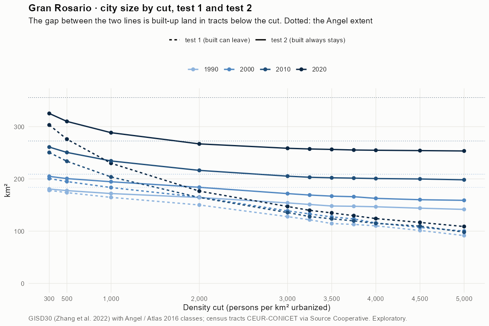
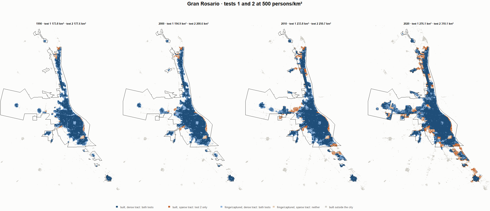
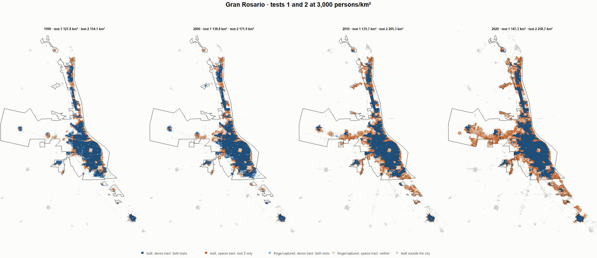
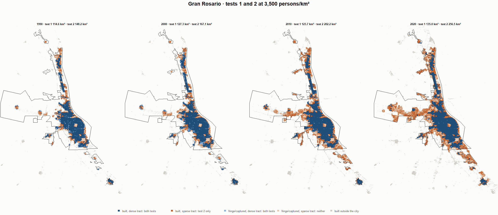
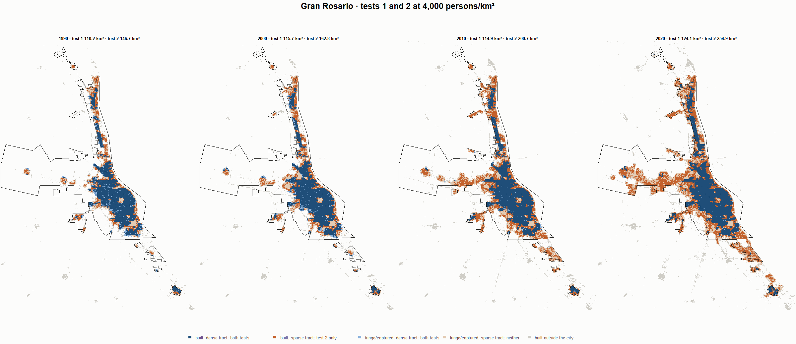

# Gran Rosario · tests 1 and 2 at the same cut, 1990-2020

Exploratory. None of these numbers are project figures (they are not in `CIFRAS_CANONICAS.json`). Generated by `Rpipe/scripts/14_prueba_comparada.R` from the tract tables of step 11. Run of 2026-11-08. [All agglomerations](../REPORTE.md) · [test 1](../../densidad_radios/rosario/REPORTE.md) · [test 2](../../franja_densa/rosario/REPORTE.md) · [methods](../../METODOS.md).

**At the same cut the two tests keep the same fringe and captured land**: that of the tracts at or above the cut. They differ only in the **built-up land of tracts below the cut**: test 1 drops it, test 2 keeps it. Test 2 minus test 1 is exactly that land.

## City size by cut

**1990 (census 1991).** Angel extent 183.8 km².

| Cut (p/km²) | Test 1 km² | Test 2 km² | Built in sparse tracts km² (test 2 only) | % of built-up in sparse tracts | Fringe in dense tracts km² (both) | Fringe in sparse tracts km² (neither) |
|---|---|---|---|---|---|---|
| 300 | 178.1 | 180.7 | 2.6 | 1.9 | 48.0 | 3.1 |
| 500 | 173.8 | 177.6 | 3.9 | 2.9 | 45.0 | 6.2 |
| 1,000 | 164.7 | 172.0 | 7.4 | 5.5 | 39.4 | 11.8 |
| 2,000 | 150.1 | 164.5 | 14.3 | 10.8 | 31.8 | 19.3 |
| 3,000 | 127.8 | 154.1 | 26.3 | 19.8 | 21.5 | 29.7 |
| 3,250 | 121.7 | 151.1 | 29.4 | 22.1 | 18.5 | 32.7 |
| 3,500 | 114.6 | 148.2 | 33.5 | 25.3 | 15.5 | 35.6 |
| 3,750 | 112.9 | 147.6 | 34.7 | 26.2 | 15.0 | 36.2 |
| 4,000 | 110.2 | 146.7 | 36.5 | 27.5 | 14.1 | 37.1 |
| 4,500 | 101.3 | 144.0 | 42.7 | 32.2 | 11.4 | 39.8 |
| 5,000 | 91.6 | 141.7 | 50.1 | 37.8 | 9.0 | 42.1 |

**2000 (census 2001).** Angel extent 209.0 km².

| Cut (p/km²) | Test 1 km² | Test 2 km² | Built in sparse tracts km² (test 2 only) | % of built-up in sparse tracts | Fringe in dense tracts km² (both) | Fringe in sparse tracts km² (neither) |
|---|---|---|---|---|---|---|
| 300 | 200.7 | 204.9 | 4.2 | 2.8 | 54.6 | 4.2 |
| 500 | 194.9 | 200.6 | 5.7 | 3.8 | 50.4 | 8.4 |
| 1,000 | 183.5 | 194.6 | 11.1 | 7.4 | 44.3 | 14.4 |
| 2,000 | 165.1 | 184.0 | 18.9 | 12.6 | 33.7 | 25.1 |
| 3,000 | 138.8 | 171.9 | 33.1 | 22.0 | 21.6 | 37.1 |
| 3,250 | 133.0 | 169.1 | 36.1 | 24.0 | 18.9 | 39.9 |
| 3,500 | 127.3 | 167.1 | 39.8 | 26.5 | 16.8 | 42.0 |
| 3,750 | 123.5 | 166.0 | 42.5 | 28.3 | 15.7 | 43.1 |
| 4,000 | 115.7 | 162.8 | 47.1 | 31.4 | 12.5 | 46.3 |
| 4,500 | 107.1 | 160.2 | 53.1 | 35.3 | 9.9 | 48.8 |
| 5,000 | 100.2 | 159.0 | 58.9 | 39.2 | 8.7 | 50.0 |

**2010 (census 2010).** Angel extent 272.6 km².

| Cut (p/km²) | Test 1 km² | Test 2 km² | Built in sparse tracts km² (test 2 only) | % of built-up in sparse tracts | Fringe in dense tracts km² (both) | Fringe in sparse tracts km² (neither) |
|---|---|---|---|---|---|---|
| 300 | 250.6 | 261.0 | 10.4 | 5.3 | 65.2 | 11.6 |
| 500 | 233.8 | 250.7 | 16.9 | 8.6 | 55.0 | 21.8 |
| 1,000 | 203.7 | 234.4 | 30.7 | 15.7 | 38.7 | 38.1 |
| 2,000 | 164.5 | 216.4 | 51.8 | 26.5 | 20.6 | 56.2 |
| 3,000 | 135.7 | 205.3 | 69.6 | 35.6 | 9.6 | 67.3 |
| 3,250 | 127.9 | 203.2 | 75.2 | 38.4 | 7.4 | 69.4 |
| 3,500 | 123.7 | 202.2 | 78.5 | 40.1 | 6.4 | 70.4 |
| 3,750 | 119.7 | 201.6 | 81.8 | 41.8 | 5.8 | 71.0 |
| 4,000 | 114.9 | 200.7 | 85.8 | 43.8 | 5.0 | 71.8 |
| 4,500 | 109.7 | 199.9 | 90.2 | 46.1 | 4.2 | 72.7 |
| 5,000 | 98.1 | 198.3 | 100.1 | 51.1 | 2.5 | 74.3 |

**2020 (census 2022).** Angel extent 355.7 km².

| Cut (p/km²) | Test 1 km² | Test 2 km² | Built in sparse tracts km² (test 2 only) | % of built-up in sparse tracts | Fringe in dense tracts km² (both) | Fringe in sparse tracts km² (neither) |
|---|---|---|---|---|---|---|
| 300 | 303.2 | 325.3 | 22.1 | 8.8 | 73.3 | 30.4 |
| 500 | 276.1 | 310.1 | 34.0 | 13.5 | 58.1 | 45.6 |
| 1,000 | 230.0 | 288.5 | 58.5 | 23.2 | 36.5 | 67.2 |
| 2,000 | 176.7 | 267.1 | 90.4 | 35.9 | 15.0 | 88.6 |
| 3,000 | 147.3 | 258.7 | 111.4 | 44.2 | 6.6 | 97.0 |
| 3,250 | 139.9 | 257.3 | 117.5 | 46.6 | 5.3 | 98.4 |
| 3,500 | 135.0 | 256.5 | 121.5 | 48.2 | 4.5 | 99.2 |
| 3,750 | 129.7 | 255.4 | 125.7 | 49.9 | 3.3 | 100.3 |
| 4,000 | 124.1 | 254.9 | 130.8 | 51.9 | 2.9 | 100.8 |
| 4,500 | 116.7 | 254.2 | 137.5 | 54.5 | 2.2 | 101.5 |
| 5,000 | 108.9 | 253.5 | 144.6 | 57.4 | 1.5 | 102.2 |

## Growth 1990-2020 by cut

Angel extent: 2.23 %/yr.

| Cut (p/km²) | Test 1 %/yr | Test 2 %/yr |
|---|---|---|
| 300 | 1.79 | 1.98 |
| 500 | 1.56 | 1.87 |
| 1,000 | 1.12 | 1.74 |
| 2,000 | 0.54 | 1.63 |
| 3,000 | 0.47 | 1.74 |
| 3,250 | 0.46 | 1.79 |
| 3,500 | 0.55 | 1.85 |
| 3,750 | 0.46 | 1.84 |
| 4,000 | 0.40 | 1.86 |
| 4,500 | 0.47 | 1.91 |
| 5,000 | 0.58 | 1.96 |

## Maps

Same frame in the four years: the 2020 city plus 3 km. Dark blue and light blue are in both tests; orange is built-up in tracts below the cut, which only test 2 keeps; beige is fringe or captured land in tracts below the cut, which neither keeps. Black line: the analysis perimeter.

### 500 persons/km²

### 3,000 persons/km²

### 3,500 persons/km²

### 4,000 persons/km²

