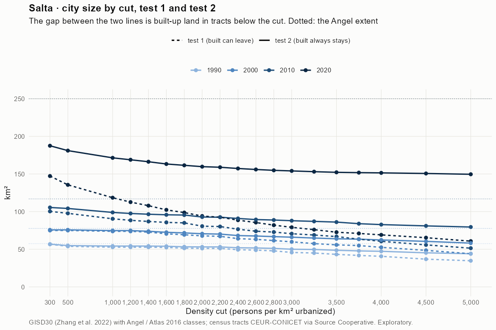
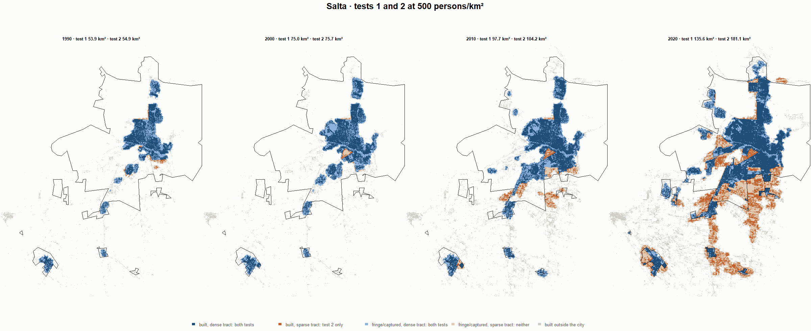
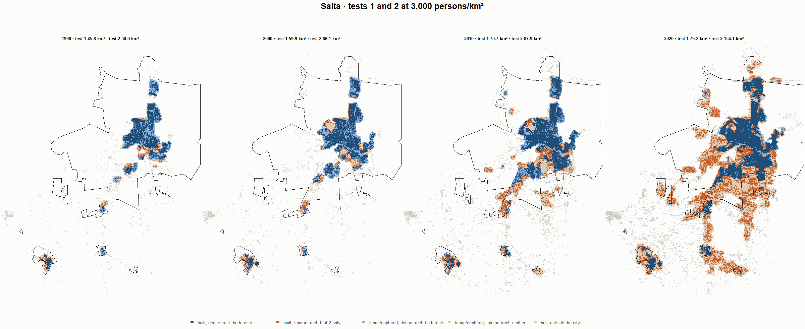

# Salta · tests 1 and 2 at the same cut, 1990-2020

Exploratory. None of these numbers are project figures (they are not in `CIFRAS_CANONICAS.json`). Generated by `Rpipe/scripts/14_prueba_comparada.R` from the tract tables of step 11. Run of 2026-11-15. [All agglomerations](../REPORTE.md) · [test 1](../../densidad_radios/salta/REPORTE.md) · [test 2](../../franja_densa/salta/REPORTE.md) · [methods](../../METODOS.md).

**At the same cut the two tests keep the same fringe and captured land**: that of the tracts at or above the cut. They differ only in the **built-up land of tracts below the cut**: test 1 drops it, test 2 keeps it. Test 2 minus test 1 is exactly that land.

## City size by cut

**1990 (census 1991).** Angel extent 57.5 km².

| Cut (p/km²) | Test 1 km² | Test 2 km² | Built in sparse tracts km² (test 2 only) | % of built-up in sparse tracts | Fringe in dense tracts km² (both) | Fringe in sparse tracts km² (neither) |
|---|---|---|---|---|---|---|
| 300 | 56.6 | 56.8 | 0.2 | 0.7 | 23.8 | 0.7 |
| 500 | 53.9 | 54.9 | 1.0 | 3.1 | 21.8 | 2.6 |
| 1,000 | 52.8 | 54.2 | 1.5 | 4.5 | 21.2 | 3.2 |
| 1,200 | 52.8 | 54.2 | 1.5 | 4.5 | 21.2 | 3.2 |
| 1,400 | 52.8 | 54.2 | 1.5 | 4.5 | 21.2 | 3.2 |
| 1,600 | 52.4 | 54.0 | 1.6 | 4.7 | 20.9 | 3.5 |
| 1,800 | 51.4 | 53.3 | 1.9 | 5.8 | 20.2 | 4.2 |
| 2,000 | 51.1 | 53.1 | 2.0 | 6.0 | 20.1 | 4.3 |
| 2,200 | 51.1 | 53.1 | 2.0 | 6.0 | 20.1 | 4.3 |
| 2,400 | 49.4 | 52.0 | 2.6 | 7.8 | 18.9 | 5.5 |
| 2,600 | 48.9 | 51.7 | 2.9 | 8.7 | 18.7 | 5.7 |
| 2,800 | 47.8 | 51.2 | 3.3 | 10.0 | 18.1 | 6.3 |
| 3,000 | 45.8 | 50.0 | 4.3 | 12.9 | 17.0 | 7.4 |
| 3,250 | 45.0 | 49.7 | 4.7 | 14.2 | 16.7 | 7.7 |
| 3,500 | 43.2 | 48.7 | 5.4 | 16.5 | 15.6 | 8.8 |
| 3,750 | 41.8 | 47.8 | 6.0 | 18.2 | 14.8 | 9.6 |
| 4,000 | 40.6 | 47.3 | 6.6 | 20.1 | 14.2 | 10.2 |
| 4,500 | 36.8 | 45.3 | 8.4 | 25.5 | 12.2 | 12.2 |
| 5,000 | 34.7 | 44.1 | 9.3 | 28.2 | 11.0 | 13.4 |

**2000 (census 2001).** Angel extent 77.7 km².

| Cut (p/km²) | Test 1 km² | Test 2 km² | Built in sparse tracts km² (test 2 only) | % of built-up in sparse tracts | Fringe in dense tracts km² (both) | Fringe in sparse tracts km² (neither) |
|---|---|---|---|---|---|---|
| 300 | 75.0 | 75.7 | 0.8 | 1.8 | 31.8 | 1.9 |
| 500 | 75.0 | 75.7 | 0.8 | 1.8 | 31.8 | 1.9 |
| 1,000 | 73.8 | 74.8 | 1.0 | 2.3 | 30.9 | 2.9 |
| 1,200 | 73.8 | 74.8 | 1.0 | 2.3 | 30.9 | 2.9 |
| 1,400 | 72.8 | 73.9 | 1.1 | 2.6 | 29.9 | 3.8 |
| 1,600 | 70.5 | 72.5 | 2.0 | 4.5 | 28.6 | 5.2 |
| 1,800 | 69.2 | 71.7 | 2.5 | 5.6 | 27.7 | 6.0 |
| 2,000 | 67.8 | 70.6 | 2.8 | 6.4 | 26.6 | 7.1 |
| 2,200 | 67.2 | 70.2 | 3.0 | 6.8 | 26.2 | 7.5 |
| 2,400 | 64.1 | 68.2 | 4.1 | 9.3 | 24.2 | 9.5 |
| 2,600 | 63.2 | 67.6 | 4.4 | 10.1 | 23.6 | 10.1 |
| 2,800 | 61.6 | 66.8 | 5.2 | 11.9 | 22.8 | 10.9 |
| 3,000 | 59.9 | 66.1 | 6.2 | 14.0 | 22.1 | 11.6 |
| 3,250 | 57.5 | 64.9 | 7.4 | 16.8 | 20.9 | 12.8 |
| 3,500 | 55.8 | 63.9 | 8.1 | 18.3 | 19.9 | 13.8 |
| 3,750 | 54.9 | 63.4 | 8.5 | 19.3 | 19.4 | 14.3 |
| 4,000 | 52.5 | 62.4 | 9.8 | 22.3 | 18.4 | 15.3 |
| 4,500 | 48.5 | 60.5 | 11.9 | 27.1 | 16.5 | 17.2 |
| 5,000 | 44.1 | 58.2 | 14.1 | 32.1 | 14.2 | 19.5 |

**2010 (census 2010).** Angel extent 116.9 km².

| Cut (p/km²) | Test 1 km² | Test 2 km² | Built in sparse tracts km² (test 2 only) | % of built-up in sparse tracts | Fringe in dense tracts km² (both) | Fringe in sparse tracts km² (neither) |
|---|---|---|---|---|---|---|
| 300 | 100.4 | 105.5 | 5.1 | 7.5 | 37.4 | 11.4 |
| 500 | 97.7 | 104.2 | 6.5 | 9.5 | 36.1 | 12.7 |
| 1,000 | 90.5 | 98.9 | 8.5 | 12.4 | 30.8 | 18.0 |
| 1,200 | 88.5 | 97.5 | 9.1 | 13.3 | 29.4 | 19.3 |
| 1,400 | 86.9 | 96.5 | 9.6 | 14.1 | 28.4 | 20.4 |
| 1,600 | 85.7 | 95.8 | 10.1 | 14.8 | 27.7 | 21.1 |
| 1,800 | 85.0 | 95.5 | 10.4 | 15.3 | 27.3 | 21.4 |
| 2,000 | 80.7 | 92.8 | 12.2 | 17.9 | 24.7 | 24.1 |
| 2,200 | 80.2 | 92.6 | 12.4 | 18.2 | 24.4 | 24.3 |
| 2,400 | 76.6 | 90.9 | 14.3 | 21.0 | 22.8 | 26.0 |
| 2,600 | 74.0 | 89.4 | 15.5 | 22.7 | 21.3 | 27.5 |
| 2,800 | 72.8 | 88.8 | 16.0 | 23.5 | 20.7 | 28.0 |
| 3,000 | 70.7 | 87.9 | 17.3 | 25.3 | 19.8 | 29.0 |
| 3,250 | 68.9 | 87.0 | 18.1 | 26.6 | 18.9 | 29.9 |
| 3,500 | 66.9 | 86.1 | 19.2 | 28.2 | 17.9 | 30.8 |
| 3,750 | 63.4 | 84.0 | 20.6 | 30.2 | 15.8 | 32.9 |
| 4,000 | 60.5 | 82.8 | 22.2 | 32.6 | 14.6 | 34.1 |
| 4,500 | 55.8 | 81.1 | 25.2 | 37.1 | 12.9 | 35.8 |
| 5,000 | 51.4 | 79.5 | 28.1 | 41.3 | 11.4 | 37.4 |

**2020 (census 2022).** Angel extent 249.9 km².

| Cut (p/km²) | Test 1 km² | Test 2 km² | Built in sparse tracts km² (test 2 only) | % of built-up in sparse tracts | Fringe in dense tracts km² (both) | Fringe in sparse tracts km² (neither) |
|---|---|---|---|---|---|---|
| 300 | 147.3 | 187.5 | 40.2 | 27.9 | 43.3 | 62.4 |
| 500 | 135.6 | 181.1 | 45.5 | 31.5 | 36.9 | 68.9 |
| 1,000 | 118.5 | 171.5 | 53.0 | 36.7 | 27.3 | 78.5 |
| 1,200 | 112.6 | 168.9 | 56.3 | 39.0 | 24.7 | 81.0 |
| 1,400 | 107.9 | 166.3 | 58.4 | 40.5 | 22.1 | 83.6 |
| 1,600 | 102.3 | 163.3 | 60.9 | 42.3 | 19.1 | 86.6 |
| 1,800 | 98.7 | 161.5 | 62.8 | 43.5 | 17.3 | 88.4 |
| 2,000 | 94.1 | 159.7 | 65.6 | 45.5 | 15.6 | 90.2 |
| 2,200 | 92.6 | 158.9 | 66.4 | 46.0 | 14.8 | 91.0 |
| 2,400 | 88.6 | 157.3 | 68.7 | 47.6 | 13.1 | 92.6 |
| 2,600 | 85.5 | 156.0 | 70.5 | 48.9 | 11.8 | 93.9 |
| 2,800 | 82.0 | 154.9 | 72.8 | 50.5 | 10.7 | 95.1 |
| 3,000 | 79.2 | 154.1 | 74.9 | 52.0 | 9.9 | 95.8 |
| 3,250 | 76.0 | 153.1 | 77.0 | 53.4 | 8.9 | 96.9 |
| 3,500 | 72.6 | 152.2 | 79.6 | 55.2 | 8.0 | 97.7 |
| 3,750 | 71.0 | 151.8 | 80.8 | 56.0 | 7.6 | 98.1 |
| 4,000 | 69.1 | 151.5 | 82.4 | 57.1 | 7.3 | 98.5 |
| 4,500 | 65.4 | 150.7 | 85.3 | 59.2 | 6.5 | 99.3 |
| 5,000 | 60.8 | 149.6 | 88.8 | 61.6 | 5.4 | 100.3 |

## Growth 1990-2020 by cut

Angel extent: 5.02 %/yr.

| Cut (p/km²) | Test 1 %/yr | Test 2 %/yr |
|---|---|---|
| 300 | 3.24 | 4.06 |
| 500 | 3.12 | 4.06 |
| 1,000 | 2.73 | 3.91 |
| 1,200 | 2.56 | 3.86 |
| 1,400 | 2.41 | 3.80 |
| 1,600 | 2.26 | 3.76 |
| 1,800 | 2.20 | 3.77 |
| 2,000 | 2.06 | 3.74 |
| 2,200 | 2.00 | 3.72 |
| 2,400 | 1.97 | 3.76 |
| 2,600 | 1.88 | 3.75 |
| 2,800 | 1.81 | 3.76 |
| 3,000 | 1.84 | 3.82 |
| 3,250 | 1.76 | 3.82 |
| 3,500 | 1.75 | 3.88 |
| 3,750 | 1.78 | 3.93 |
| 4,000 | 1.79 | 3.96 |
| 4,500 | 1.93 | 4.09 |
| 5,000 | 1.88 | 4.16 |

## Maps

Same frame in the four years: the 2020 city plus 3 km. Dark blue and light blue are in both tests; orange is built-up in tracts below the cut, which only test 2 keeps; beige is fringe or captured land in tracts below the cut, which neither keeps. Black line: the analysis perimeter.

### 500 persons/km²

### 3,000 persons/km²

### 3,500 persons/km²

### 4,000 persons/km²

