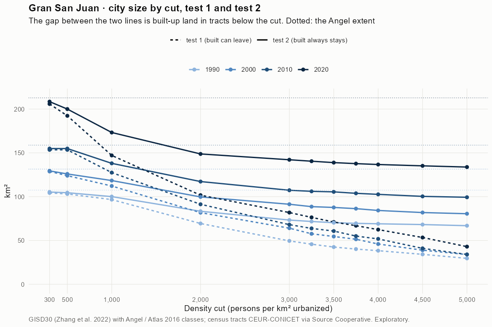
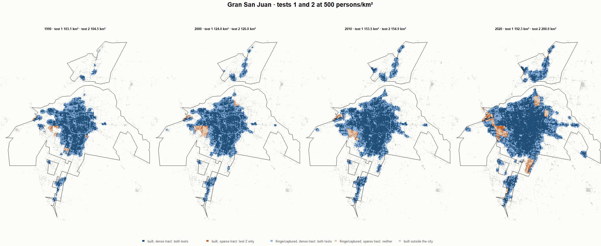
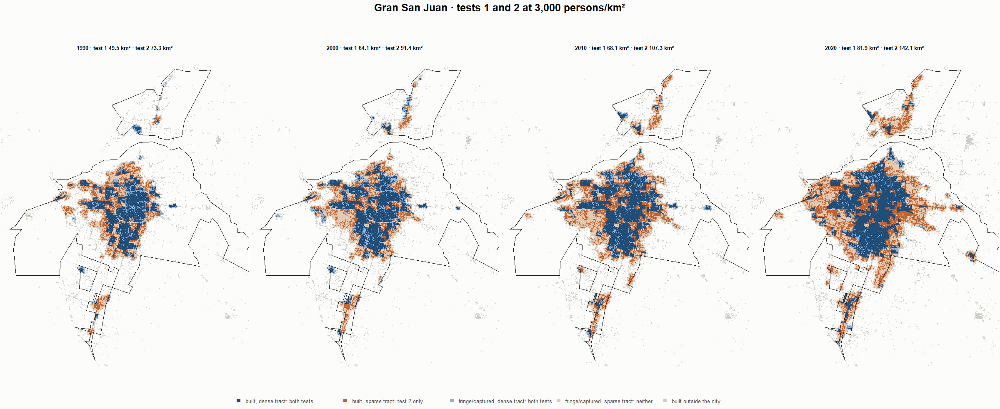
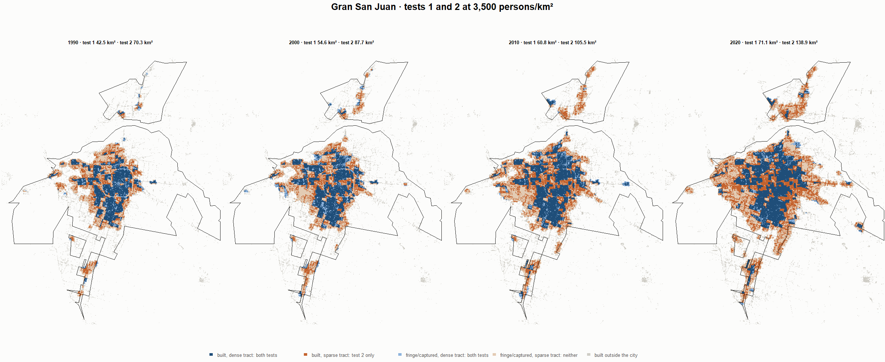
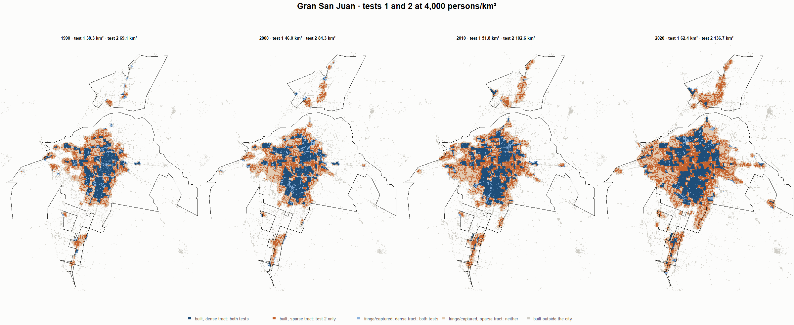

# Gran San Juan · tests 1 and 2 at the same cut, 1990-2020

Exploratory. None of these numbers are project figures (they are not in `CIFRAS_CANONICAS.json`). Generated by `Rpipe/scripts/14_prueba_comparada.R` from the tract tables of step 11. Run of 2026-11-08. [All agglomerations](../REPORTE.md) · [test 1](../../densidad_radios/san_juan/REPORTE.md) · [test 2](../../franja_densa/san_juan/REPORTE.md) · [methods](../../METODOS.md).

**At the same cut the two tests keep the same fringe and captured land**: that of the tracts at or above the cut. They differ only in the **built-up land of tracts below the cut**: test 1 drops it, test 2 keeps it. Test 2 minus test 1 is exactly that land.

## City size by cut

**1990 (census 1991).** Angel extent 107.5 km².

| Cut (p/km²) | Test 1 km² | Test 2 km² | Built in sparse tracts km² (test 2 only) | % of built-up in sparse tracts | Fringe in dense tracts km² (both) | Fringe in sparse tracts km² (neither) |
|---|---|---|---|---|---|---|
| 300 | 104.3 | 105.3 | 1.0 | 1.6 | 43.5 | 2.2 |
| 500 | 103.1 | 104.5 | 1.4 | 2.3 | 42.7 | 3.0 |
| 1,000 | 96.7 | 100.1 | 3.4 | 5.5 | 38.2 | 7.4 |
| 2,000 | 69.4 | 83.4 | 14.0 | 22.6 | 21.5 | 24.1 |
| 3,000 | 49.5 | 73.3 | 23.8 | 38.5 | 11.5 | 34.2 |
| 3,250 | 45.7 | 71.7 | 25.9 | 41.9 | 9.8 | 35.8 |
| 3,500 | 42.5 | 70.3 | 27.8 | 44.9 | 8.5 | 37.2 |
| 3,750 | 40.2 | 69.5 | 29.3 | 47.4 | 7.7 | 37.9 |
| 4,000 | 38.3 | 69.1 | 30.7 | 49.6 | 7.2 | 38.4 |
| 4,500 | 34.2 | 68.2 | 34.0 | 55.0 | 6.3 | 39.3 |
| 5,000 | 29.6 | 66.9 | 37.3 | 60.3 | 5.0 | 40.6 |

**2000 (census 2001).** Angel extent 131.5 km².

| Cut (p/km²) | Test 1 km² | Test 2 km² | Built in sparse tracts km² (test 2 only) | % of built-up in sparse tracts | Fringe in dense tracts km² (both) | Fringe in sparse tracts km² (neither) |
|---|---|---|---|---|---|---|
| 300 | 128.8 | 129.4 | 0.6 | 0.9 | 54.4 | 2.0 |
| 500 | 124.0 | 126.0 | 2.0 | 2.6 | 51.0 | 5.5 |
| 1,000 | 112.2 | 118.4 | 6.2 | 8.3 | 43.4 | 13.1 |
| 2,000 | 81.8 | 99.7 | 18.0 | 23.9 | 24.7 | 31.7 |
| 3,000 | 64.1 | 91.4 | 27.3 | 36.4 | 16.4 | 40.1 |
| 3,250 | 57.6 | 88.6 | 31.0 | 41.3 | 13.6 | 42.8 |
| 3,500 | 54.6 | 87.7 | 33.1 | 44.2 | 12.7 | 43.8 |
| 3,750 | 51.4 | 86.3 | 34.9 | 46.6 | 11.3 | 45.1 |
| 4,000 | 46.0 | 84.3 | 38.3 | 51.0 | 9.3 | 47.2 |
| 4,500 | 38.9 | 81.9 | 43.0 | 57.3 | 6.9 | 49.6 |
| 5,000 | 34.0 | 80.5 | 46.6 | 62.1 | 5.5 | 50.9 |

**2010 (census 2010).** Angel extent 158.8 km².

| Cut (p/km²) | Test 1 km² | Test 2 km² | Built in sparse tracts km² (test 2 only) | % of built-up in sparse tracts | Fringe in dense tracts km² (both) | Fringe in sparse tracts km² (neither) |
|---|---|---|---|---|---|---|
| 300 | 153.5 | 154.9 | 1.4 | 1.5 | 59.5 | 3.9 |
| 500 | 153.5 | 154.9 | 1.4 | 1.5 | 59.5 | 3.9 |
| 1,000 | 127.5 | 138.0 | 10.6 | 11.1 | 42.6 | 20.8 |
| 2,000 | 91.3 | 117.3 | 26.0 | 27.2 | 21.8 | 41.6 |
| 3,000 | 68.1 | 107.3 | 39.3 | 41.1 | 11.9 | 51.5 |
| 3,250 | 63.8 | 106.1 | 42.3 | 44.3 | 10.6 | 52.7 |
| 3,500 | 60.8 | 105.5 | 44.7 | 46.9 | 10.0 | 53.3 |
| 3,750 | 55.0 | 103.8 | 48.8 | 51.1 | 8.4 | 55.0 |
| 4,000 | 51.8 | 102.6 | 50.8 | 53.3 | 7.2 | 56.2 |
| 4,500 | 41.0 | 100.3 | 59.4 | 62.2 | 4.9 | 58.5 |
| 5,000 | 34.1 | 99.3 | 65.3 | 68.4 | 3.8 | 59.5 |

**2020 (census 2022).** Angel extent 212.8 km².

| Cut (p/km²) | Test 1 km² | Test 2 km² | Built in sparse tracts km² (test 2 only) | % of built-up in sparse tracts | Fringe in dense tracts km² (both) | Fringe in sparse tracts km² (neither) |
|---|---|---|---|---|---|---|
| 300 | 205.8 | 208.5 | 2.7 | 2.1 | 78.1 | 4.3 |
| 500 | 192.3 | 200.0 | 7.7 | 5.9 | 69.6 | 12.8 |
| 1,000 | 147.1 | 173.3 | 26.2 | 20.1 | 42.9 | 39.5 |
| 2,000 | 101.7 | 148.8 | 47.1 | 36.1 | 18.4 | 64.0 |
| 3,000 | 81.9 | 142.1 | 60.3 | 46.2 | 11.8 | 70.6 |
| 3,250 | 76.4 | 140.5 | 64.1 | 49.2 | 10.1 | 72.3 |
| 3,500 | 71.1 | 138.9 | 67.8 | 52.0 | 8.5 | 73.9 |
| 3,750 | 66.9 | 137.7 | 70.8 | 54.3 | 7.4 | 75.1 |
| 4,000 | 62.4 | 136.7 | 74.3 | 57.0 | 6.3 | 76.1 |
| 4,500 | 53.4 | 135.2 | 81.8 | 62.8 | 4.8 | 77.6 |
| 5,000 | 43.0 | 133.8 | 90.8 | 69.7 | 3.4 | 79.0 |

## Growth 1990-2020 by cut

Angel extent: 2.30 %/yr.

| Cut (p/km²) | Test 1 %/yr | Test 2 %/yr |
|---|---|---|
| 300 | 2.29 | 2.30 |
| 500 | 2.10 | 2.19 |
| 1,000 | 1.41 | 1.85 |
| 2,000 | 1.28 | 1.95 |
| 3,000 | 1.69 | 2.23 |
| 3,250 | 1.72 | 2.27 |
| 3,500 | 1.73 | 2.30 |
| 3,750 | 1.71 | 2.30 |
| 4,000 | 1.64 | 2.30 |
| 4,500 | 1.50 | 2.31 |
| 5,000 | 1.25 | 2.34 |

## Maps

Same frame in the four years: the 2020 city plus 3 km. Dark blue and light blue are in both tests; orange is built-up in tracts below the cut, which only test 2 keeps; beige is fringe or captured land in tracts below the cut, which neither keeps. Black line: the analysis perimeter.

### 500 persons/km²

### 3,000 persons/km²

### 3,500 persons/km²

### 4,000 persons/km²

