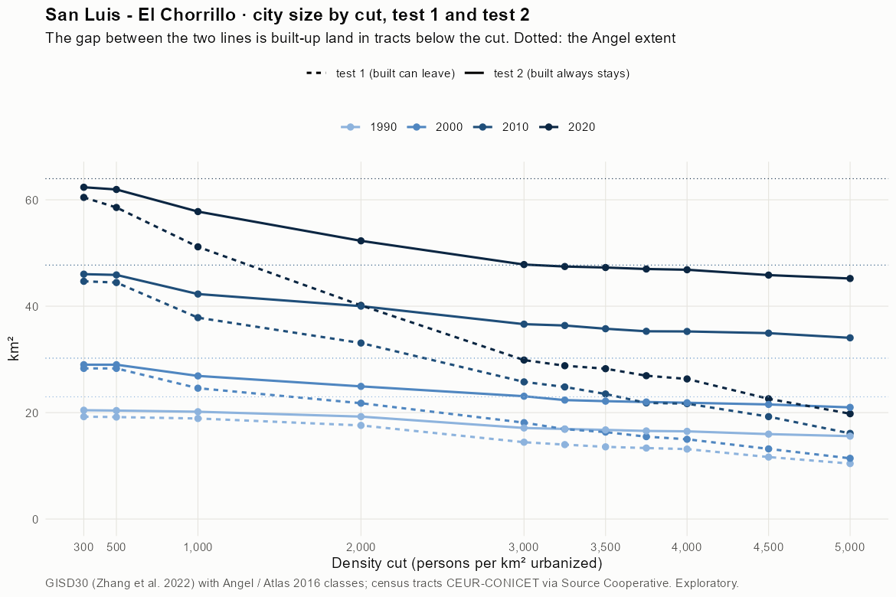
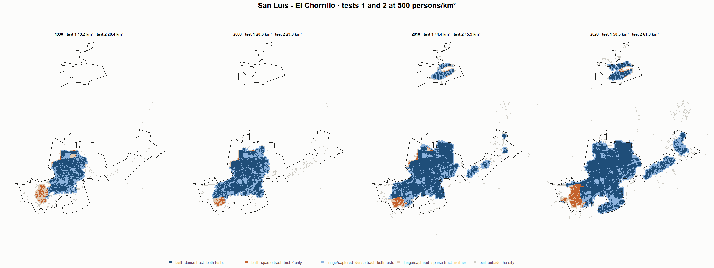
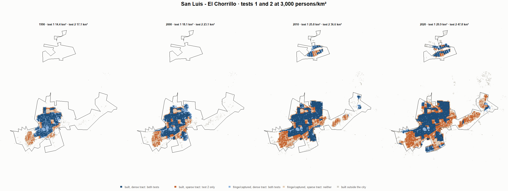
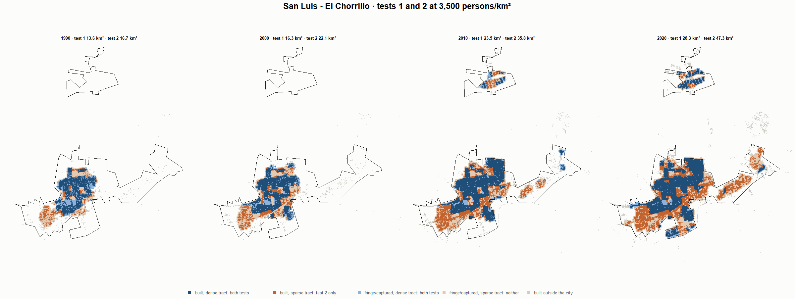
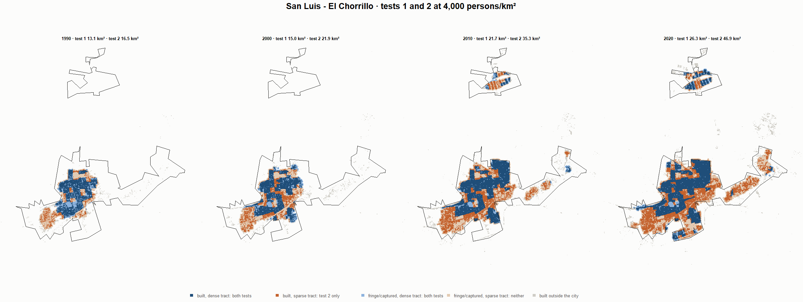

# San Luis - El Chorrillo · tests 1 and 2 at the same cut, 1990-2020

Exploratory. None of these numbers are project figures (they are not in `CIFRAS_CANONICAS.json`). Generated by `Rpipe/scripts/14_prueba_comparada.R` from the tract tables of step 11. Run of 2026-11-09. [All agglomerations](../REPORTE.md) · [test 1](../../densidad_radios/san_luis/REPORTE.md) · [test 2](../../franja_densa/san_luis/REPORTE.md) · [methods](../../METODOS.md).

**At the same cut the two tests keep the same fringe and captured land**: that of the tracts at or above the cut. They differ only in the **built-up land of tracts below the cut**: test 1 drops it, test 2 keeps it. Test 2 minus test 1 is exactly that land.

## City size by cut

**1990 (census 1991).** Angel extent 23.0 km².

| Cut (p/km²) | Test 1 km² | Test 2 km² | Built in sparse tracts km² (test 2 only) | % of built-up in sparse tracts | Fringe in dense tracts km² (both) | Fringe in sparse tracts km² (neither) |
|---|---|---|---|---|---|---|
| 300 | 19.2 | 20.4 | 1.2 | 9.6 | 7.9 | 2.5 |
| 500 | 19.2 | 20.4 | 1.2 | 9.7 | 7.8 | 2.6 |
| 1,000 | 18.9 | 20.2 | 1.3 | 10.1 | 7.6 | 2.8 |
| 2,000 | 17.6 | 19.2 | 1.7 | 13.2 | 6.7 | 3.7 |
| 3,000 | 14.4 | 17.1 | 2.7 | 21.3 | 4.5 | 5.9 |
| 3,250 | 14.0 | 16.9 | 2.9 | 23.4 | 4.3 | 6.0 |
| 3,500 | 13.6 | 16.7 | 3.2 | 25.3 | 4.2 | 6.2 |
| 3,750 | 13.3 | 16.6 | 3.2 | 25.5 | 4.0 | 6.4 |
| 4,000 | 13.1 | 16.5 | 3.3 | 26.5 | 3.9 | 6.5 |
| 4,500 | 11.6 | 16.0 | 4.3 | 34.2 | 3.4 | 7.0 |
| 5,000 | 10.4 | 15.6 | 5.2 | 41.0 | 3.0 | 7.4 |

**2000 (census 2001).** Angel extent 30.2 km².

| Cut (p/km²) | Test 1 km² | Test 2 km² | Built in sparse tracts km² (test 2 only) | % of built-up in sparse tracts | Fringe in dense tracts km² (both) | Fringe in sparse tracts km² (neither) |
|---|---|---|---|---|---|---|
| 300 | 28.3 | 29.0 | 0.7 | 3.8 | 10.6 | 1.2 |
| 500 | 28.3 | 29.0 | 0.7 | 3.8 | 10.6 | 1.2 |
| 1,000 | 24.6 | 26.9 | 2.3 | 12.5 | 8.5 | 3.3 |
| 2,000 | 21.8 | 24.9 | 3.2 | 17.2 | 6.5 | 5.3 |
| 3,000 | 18.1 | 23.1 | 5.0 | 27.0 | 4.7 | 7.2 |
| 3,250 | 16.9 | 22.4 | 5.5 | 29.7 | 4.0 | 7.9 |
| 3,500 | 16.3 | 22.1 | 5.8 | 31.6 | 3.8 | 8.1 |
| 3,750 | 15.5 | 22.0 | 6.5 | 35.4 | 3.6 | 8.2 |
| 4,000 | 15.0 | 21.9 | 6.9 | 37.3 | 3.5 | 8.4 |
| 4,500 | 13.2 | 21.5 | 8.4 | 45.4 | 3.2 | 8.7 |
| 5,000 | 11.4 | 21.0 | 9.6 | 52.1 | 2.6 | 9.3 |

**2010 (census 2010).** Angel extent 47.7 km².

| Cut (p/km²) | Test 1 km² | Test 2 km² | Built in sparse tracts km² (test 2 only) | % of built-up in sparse tracts | Fringe in dense tracts km² (both) | Fringe in sparse tracts km² (neither) |
|---|---|---|---|---|---|---|
| 300 | 44.7 | 46.0 | 1.3 | 4.2 | 13.8 | 1.7 |
| 500 | 44.4 | 45.9 | 1.4 | 4.4 | 13.7 | 1.8 |
| 1,000 | 37.8 | 42.3 | 4.4 | 13.8 | 10.1 | 5.4 |
| 2,000 | 33.1 | 40.0 | 6.9 | 21.5 | 7.8 | 7.7 |
| 3,000 | 25.8 | 36.6 | 10.9 | 33.7 | 4.4 | 11.1 |
| 3,250 | 24.8 | 36.4 | 11.6 | 35.9 | 4.2 | 11.4 |
| 3,500 | 23.5 | 35.8 | 12.3 | 38.1 | 3.6 | 12.0 |
| 3,750 | 21.8 | 35.3 | 13.5 | 41.8 | 3.1 | 12.4 |
| 4,000 | 21.7 | 35.3 | 13.6 | 42.2 | 3.1 | 12.5 |
| 4,500 | 19.2 | 34.9 | 15.7 | 48.8 | 2.7 | 12.8 |
| 5,000 | 16.1 | 34.1 | 18.0 | 55.8 | 1.9 | 13.7 |

**2020 (census 2022).** Angel extent 64.0 km².

| Cut (p/km²) | Test 1 km² | Test 2 km² | Built in sparse tracts km² (test 2 only) | % of built-up in sparse tracts | Fringe in dense tracts km² (both) | Fringe in sparse tracts km² (neither) |
|---|---|---|---|---|---|---|
| 300 | 60.4 | 62.4 | 1.9 | 4.4 | 19.2 | 1.6 |
| 500 | 58.6 | 61.9 | 3.4 | 7.8 | 18.8 | 2.0 |
| 1,000 | 51.2 | 57.8 | 6.6 | 15.4 | 14.6 | 6.2 |
| 2,000 | 40.2 | 52.3 | 12.1 | 28.1 | 9.1 | 11.7 |
| 3,000 | 29.9 | 47.8 | 18.0 | 41.6 | 4.7 | 16.1 |
| 3,250 | 28.8 | 47.5 | 18.6 | 43.2 | 4.3 | 16.5 |
| 3,500 | 28.3 | 47.3 | 19.0 | 44.1 | 4.1 | 16.7 |
| 3,750 | 26.9 | 47.0 | 20.1 | 46.5 | 3.8 | 17.0 |
| 4,000 | 26.3 | 46.9 | 20.5 | 47.6 | 3.7 | 17.1 |
| 4,500 | 22.6 | 45.8 | 23.2 | 53.9 | 2.7 | 18.1 |
| 5,000 | 19.8 | 45.2 | 25.4 | 58.9 | 2.1 | 18.8 |

## Growth 1990-2020 by cut

Angel extent: 3.47 %/yr.

| Cut (p/km²) | Test 1 %/yr | Test 2 %/yr |
|---|---|---|
| 300 | 3.89 | 3.79 |
| 500 | 3.79 | 3.77 |
| 1,000 | 3.38 | 3.57 |
| 2,000 | 2.79 | 3.39 |
| 3,000 | 2.45 | 3.49 |
| 3,250 | 2.44 | 3.50 |
| 3,500 | 2.48 | 3.52 |
| 3,750 | 2.37 | 3.54 |
| 4,000 | 2.34 | 3.54 |
| 4,500 | 2.23 | 3.58 |
| 5,000 | 2.16 | 3.62 |

## Maps

Same frame in the four years: the 2020 city plus 3 km. Dark blue and light blue are in both tests; orange is built-up in tracts below the cut, which only test 2 keeps; beige is fringe or captured land in tracts below the cut, which neither keeps. Black line: the analysis perimeter.

### 500 persons/km²

### 3,000 persons/km²

### 3,500 persons/km²

### 4,000 persons/km²

