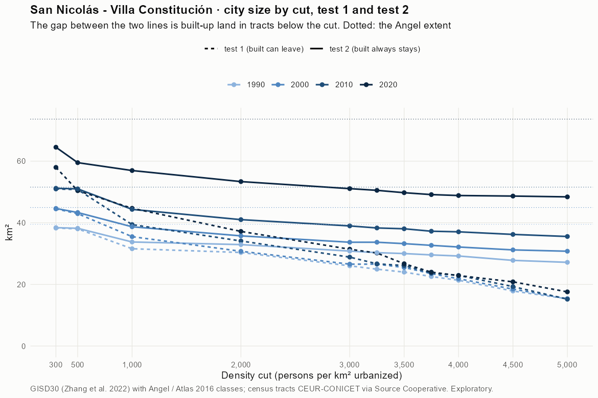
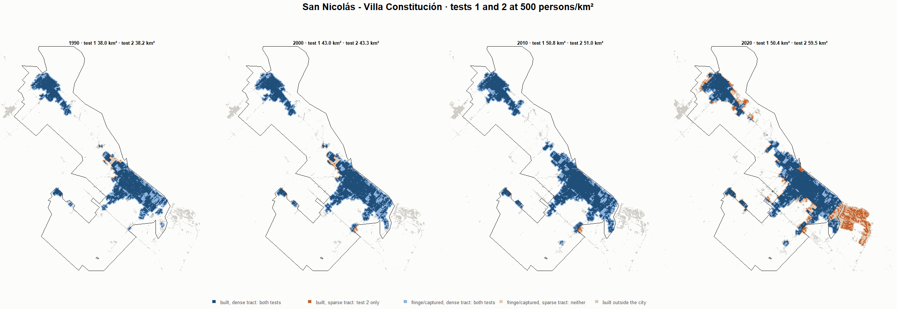
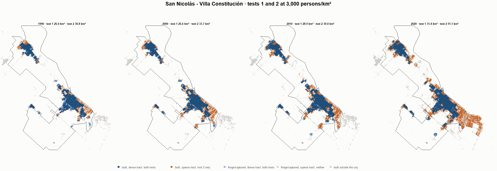
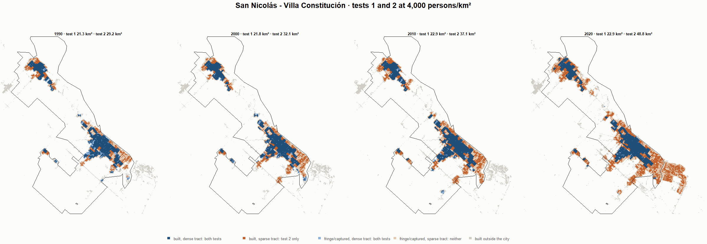

# San Nicolás - Villa Constitución · tests 1 and 2 at the same cut, 1990-2020

Exploratory. None of these numbers are project figures (they are not in `CIFRAS_CANONICAS.json`). Generated by `Rpipe/scripts/14_prueba_comparada.R` from the tract tables of step 11. Run of 2026-11-09. [All agglomerations](../REPORTE.md) · [test 1](../../densidad_radios/san_nicolas/REPORTE.md) · [test 2](../../franja_densa/san_nicolas/REPORTE.md) · [methods](../../METODOS.md).

**At the same cut the two tests keep the same fringe and captured land**: that of the tracts at or above the cut. They differ only in the **built-up land of tracts below the cut**: test 1 drops it, test 2 keeps it. Test 2 minus test 1 is exactly that land.

## City size by cut

**1990 (census 1991).** Angel extent 39.5 km².

| Cut (p/km²) | Test 1 km² | Test 2 km² | Built in sparse tracts km² (test 2 only) | % of built-up in sparse tracts | Fringe in dense tracts km² (both) | Fringe in sparse tracts km² (neither) |
|---|---|---|---|---|---|---|
| 300 | 38.3 | 38.4 | 0.1 | 0.5 | 12.9 | 1.1 |
| 500 | 38.0 | 38.2 | 0.2 | 0.7 | 12.7 | 1.3 |
| 1,000 | 31.6 | 33.8 | 2.2 | 8.6 | 8.3 | 5.7 |
| 2,000 | 30.4 | 32.9 | 2.6 | 10.0 | 7.4 | 6.6 |
| 3,000 | 26.0 | 30.8 | 4.8 | 18.7 | 5.3 | 8.7 |
| 3,250 | 24.9 | 30.3 | 5.4 | 21.1 | 4.8 | 9.2 |
| 3,500 | 24.0 | 30.0 | 6.0 | 23.6 | 4.5 | 9.5 |
| 3,750 | 22.5 | 29.6 | 7.0 | 27.6 | 4.1 | 9.9 |
| 4,000 | 21.3 | 29.2 | 7.9 | 30.9 | 3.7 | 10.3 |
| 4,500 | 17.8 | 27.8 | 10.0 | 39.0 | 2.3 | 11.7 |
| 5,000 | 15.3 | 27.2 | 11.8 | 46.5 | 1.7 | 12.3 |

**2000 (census 2001).** Angel extent 45.0 km².

| Cut (p/km²) | Test 1 km² | Test 2 km² | Built in sparse tracts km² (test 2 only) | % of built-up in sparse tracts | Fringe in dense tracts km² (both) | Fringe in sparse tracts km² (neither) |
|---|---|---|---|---|---|---|
| 300 | 44.5 | 44.7 | 0.1 | 0.5 | 15.3 | 0.3 |
| 500 | 43.0 | 43.3 | 0.4 | 1.3 | 14.0 | 1.6 |
| 1,000 | 35.5 | 38.7 | 3.2 | 10.9 | 9.3 | 6.3 |
| 2,000 | 30.7 | 35.8 | 5.0 | 17.0 | 6.4 | 9.2 |
| 3,000 | 26.6 | 33.7 | 7.1 | 24.3 | 4.3 | 11.3 |
| 3,250 | 26.6 | 33.7 | 7.1 | 24.3 | 4.3 | 11.3 |
| 3,500 | 25.5 | 33.2 | 7.7 | 26.4 | 3.9 | 11.7 |
| 3,750 | 23.5 | 32.7 | 9.2 | 31.3 | 3.3 | 12.3 |
| 4,000 | 21.8 | 32.1 | 10.3 | 35.1 | 2.8 | 12.8 |
| 4,500 | 18.5 | 31.2 | 12.7 | 43.4 | 1.8 | 13.8 |
| 5,000 | 15.4 | 30.8 | 15.4 | 52.5 | 1.4 | 14.2 |

**2010 (census 2010).** Angel extent 51.6 km².

| Cut (p/km²) | Test 1 km² | Test 2 km² | Built in sparse tracts km² (test 2 only) | % of built-up in sparse tracts | Fringe in dense tracts km² (both) | Fringe in sparse tracts km² (neither) |
|---|---|---|---|---|---|---|
| 300 | 51.0 | 51.2 | 0.2 | 0.6 | 16.2 | 0.4 |
| 500 | 50.8 | 51.0 | 0.2 | 0.7 | 16.0 | 0.6 |
| 1,000 | 39.4 | 44.4 | 4.9 | 14.1 | 9.4 | 7.2 |
| 2,000 | 34.1 | 41.0 | 6.9 | 19.8 | 6.0 | 10.6 |
| 3,000 | 28.9 | 39.0 | 10.1 | 28.9 | 4.0 | 12.6 |
| 3,250 | 26.7 | 38.3 | 11.6 | 33.3 | 3.3 | 13.3 |
| 3,500 | 26.1 | 38.1 | 11.9 | 34.1 | 3.1 | 13.5 |
| 3,750 | 23.7 | 37.3 | 13.6 | 38.8 | 2.3 | 14.3 |
| 4,000 | 22.9 | 37.1 | 14.1 | 40.4 | 2.1 | 14.5 |
| 4,500 | 19.3 | 36.2 | 16.9 | 48.4 | 1.2 | 15.3 |
| 5,000 | 15.2 | 35.6 | 20.4 | 58.2 | 0.6 | 16.0 |

**2020 (census 2022).** Angel extent 73.6 km².

| Cut (p/km²) | Test 1 km² | Test 2 km² | Built in sparse tracts km² (test 2 only) | % of built-up in sparse tracts | Fringe in dense tracts km² (both) | Fringe in sparse tracts km² (neither) |
|---|---|---|---|---|---|---|
| 300 | 58.0 | 64.5 | 6.5 | 13.7 | 16.7 | 9.1 |
| 500 | 50.4 | 59.5 | 9.1 | 19.0 | 11.7 | 14.1 |
| 1,000 | 44.7 | 57.0 | 12.3 | 25.6 | 9.2 | 16.7 |
| 2,000 | 37.2 | 53.4 | 16.2 | 33.8 | 5.6 | 20.3 |
| 3,000 | 31.4 | 51.1 | 19.7 | 41.2 | 3.3 | 22.6 |
| 3,250 | 30.2 | 50.5 | 20.4 | 42.6 | 2.7 | 23.1 |
| 3,500 | 26.7 | 49.8 | 23.1 | 48.3 | 2.0 | 23.9 |
| 3,750 | 24.0 | 49.2 | 25.2 | 52.7 | 1.4 | 24.5 |
| 4,000 | 22.9 | 48.8 | 26.0 | 54.4 | 1.1 | 24.8 |
| 4,500 | 20.8 | 48.7 | 27.8 | 58.2 | 0.9 | 25.0 |
| 5,000 | 17.6 | 48.4 | 30.8 | 64.5 | 0.6 | 25.2 |

## Growth 1990-2020 by cut

Angel extent: 2.10 %/yr.

| Cut (p/km²) | Test 1 %/yr | Test 2 %/yr |
|---|---|---|
| 300 | 1.39 | 1.74 |
| 500 | 0.94 | 1.49 |
| 1,000 | 1.17 | 1.76 |
| 2,000 | 0.68 | 1.62 |
| 3,000 | 0.63 | 1.70 |
| 3,250 | 0.64 | 1.72 |
| 3,500 | 0.36 | 1.70 |
| 3,750 | 0.21 | 1.71 |
| 4,000 | 0.23 | 1.73 |
| 4,500 | 0.52 | 1.88 |
| 5,000 | 0.46 | 1.95 |

## Maps

Same frame in the four years: the 2020 city plus 3 km. Dark blue and light blue are in both tests; orange is built-up in tracts below the cut, which only test 2 keeps; beige is fringe or captured land in tracts below the cut, which neither keeps. Black line: the analysis perimeter.

### 500 persons/km²

### 3,000 persons/km²

### 3,500 persons/km²

### 4,000 persons/km²

