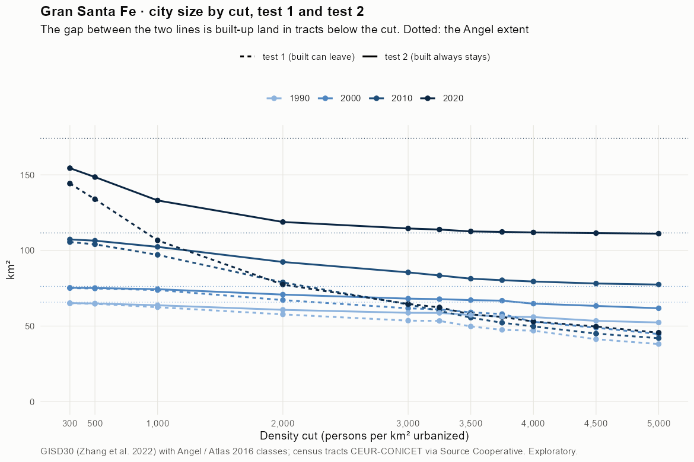
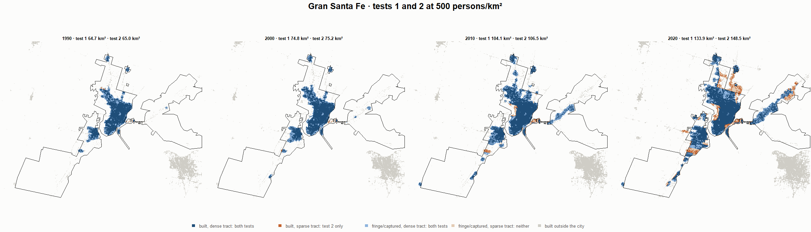
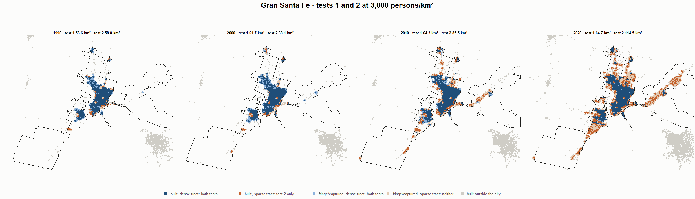
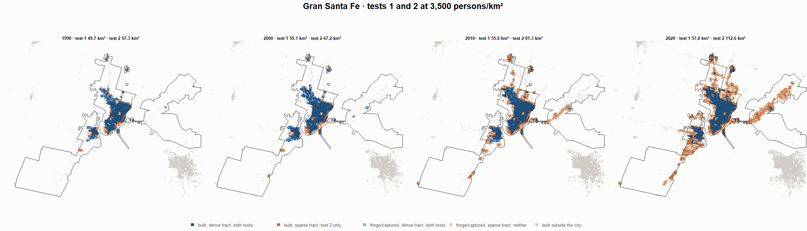
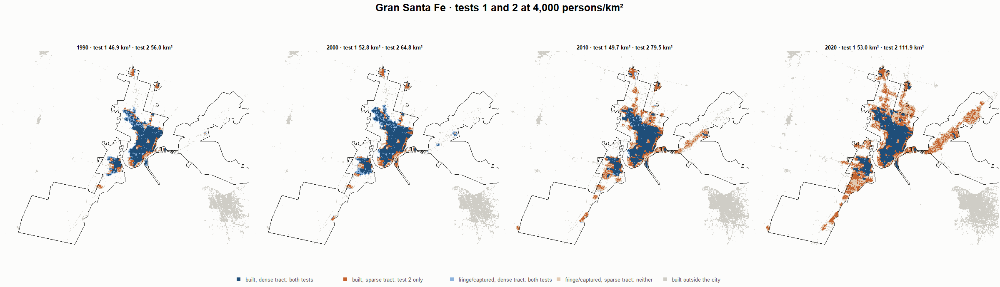

# Gran Santa Fe · tests 1 and 2 at the same cut, 1990-2020

Exploratory. None of these numbers are project figures (they are not in `CIFRAS_CANONICAS.json`). Generated by `Rpipe/scripts/14_prueba_comparada.R` from the tract tables of step 11. Run of 2026-11-09. [All agglomerations](../REPORTE.md) · [test 1](../../densidad_radios/santa_fe/REPORTE.md) · [test 2](../../franja_densa/santa_fe/REPORTE.md) · [methods](../../METODOS.md).

**At the same cut the two tests keep the same fringe and captured land**: that of the tracts at or above the cut. They differ only in the **built-up land of tracts below the cut**: test 1 drops it, test 2 keeps it. Test 2 minus test 1 is exactly that land.

## City size by cut

**1990 (census 1991).** Angel extent 65.8 km².

| Cut (p/km²) | Test 1 km² | Test 2 km² | Built in sparse tracts km² (test 2 only) | % of built-up in sparse tracts | Fringe in dense tracts km² (both) | Fringe in sparse tracts km² (neither) |
|---|---|---|---|---|---|---|
| 300 | 65.0 | 65.2 | 0.3 | 0.5 | 18.7 | 0.6 |
| 500 | 64.7 | 65.0 | 0.3 | 0.5 | 18.4 | 0.8 |
| 1,000 | 62.5 | 63.7 | 1.3 | 2.7 | 17.2 | 2.0 |
| 2,000 | 57.7 | 60.7 | 3.0 | 6.5 | 14.2 | 5.0 |
| 3,000 | 53.6 | 58.8 | 5.2 | 11.1 | 12.2 | 7.0 |
| 3,250 | 53.4 | 58.7 | 5.3 | 11.4 | 12.2 | 7.1 |
| 3,500 | 49.7 | 57.3 | 7.6 | 16.3 | 10.8 | 8.4 |
| 3,750 | 47.5 | 56.2 | 8.7 | 18.8 | 9.7 | 9.6 |
| 4,000 | 46.9 | 56.0 | 9.0 | 19.3 | 9.4 | 9.8 |
| 4,500 | 41.3 | 53.4 | 12.1 | 26.1 | 6.9 | 12.3 |
| 5,000 | 38.1 | 52.4 | 14.3 | 30.6 | 5.8 | 13.4 |

**2000 (census 2001).** Angel extent 76.3 km².

| Cut (p/km²) | Test 1 km² | Test 2 km² | Built in sparse tracts km² (test 2 only) | % of built-up in sparse tracts | Fringe in dense tracts km² (both) | Fringe in sparse tracts km² (neither) |
|---|---|---|---|---|---|---|
| 300 | 75.1 | 75.3 | 0.2 | 0.4 | 20.9 | 0.9 |
| 500 | 74.8 | 75.2 | 0.3 | 0.6 | 20.7 | 1.1 |
| 1,000 | 73.8 | 74.4 | 0.6 | 1.0 | 19.9 | 1.9 |
| 2,000 | 67.2 | 70.8 | 3.6 | 6.7 | 16.3 | 5.4 |
| 3,000 | 61.7 | 68.1 | 6.4 | 11.7 | 13.7 | 8.1 |
| 3,250 | 61.0 | 67.8 | 6.8 | 12.5 | 13.3 | 8.5 |
| 3,500 | 59.1 | 67.2 | 8.1 | 14.8 | 12.7 | 9.1 |
| 3,750 | 57.9 | 66.8 | 8.9 | 16.3 | 12.3 | 9.5 |
| 4,000 | 52.8 | 64.8 | 12.0 | 22.0 | 10.4 | 11.4 |
| 4,500 | 48.9 | 63.3 | 14.4 | 26.5 | 8.9 | 12.9 |
| 5,000 | 44.7 | 61.8 | 17.0 | 31.3 | 7.3 | 14.5 |

**2010 (census 2010).** Angel extent 111.6 km².

| Cut (p/km²) | Test 1 km² | Test 2 km² | Built in sparse tracts km² (test 2 only) | % of built-up in sparse tracts | Fringe in dense tracts km² (both) | Fringe in sparse tracts km² (neither) |
|---|---|---|---|---|---|---|
| 300 | 105.6 | 107.3 | 1.7 | 2.3 | 32.0 | 4.3 |
| 500 | 104.1 | 106.5 | 2.4 | 3.2 | 31.1 | 5.1 |
| 1,000 | 97.1 | 102.4 | 5.3 | 7.0 | 27.1 | 9.2 |
| 2,000 | 78.9 | 92.4 | 13.5 | 17.9 | 17.1 | 19.2 |
| 3,000 | 64.3 | 85.5 | 21.2 | 28.2 | 10.2 | 26.1 |
| 3,250 | 60.0 | 83.4 | 23.4 | 31.1 | 8.1 | 28.2 |
| 3,500 | 55.6 | 81.3 | 25.8 | 34.2 | 6.0 | 30.3 |
| 3,750 | 52.2 | 80.3 | 28.1 | 37.4 | 5.0 | 31.3 |
| 4,000 | 49.7 | 79.5 | 29.7 | 39.5 | 4.1 | 32.1 |
| 4,500 | 45.0 | 78.1 | 33.1 | 44.0 | 2.8 | 33.5 |
| 5,000 | 42.0 | 77.4 | 35.5 | 47.1 | 2.1 | 34.2 |

**2020 (census 2022).** Angel extent 174.2 km².

| Cut (p/km²) | Test 1 km² | Test 2 km² | Built in sparse tracts km² (test 2 only) | % of built-up in sparse tracts | Fringe in dense tracts km² (both) | Fringe in sparse tracts km² (neither) |
|---|---|---|---|---|---|---|
| 300 | 144.2 | 154.4 | 10.2 | 9.3 | 44.5 | 19.8 |
| 500 | 133.9 | 148.5 | 14.6 | 13.3 | 38.6 | 25.6 |
| 1,000 | 106.7 | 133.1 | 26.4 | 24.0 | 23.2 | 41.1 |
| 2,000 | 77.4 | 118.8 | 41.4 | 37.7 | 8.9 | 55.4 |
| 3,000 | 64.7 | 114.5 | 49.9 | 45.4 | 4.6 | 59.7 |
| 3,250 | 62.3 | 113.8 | 51.5 | 46.9 | 3.9 | 60.4 |
| 3,500 | 57.8 | 112.6 | 54.8 | 49.9 | 2.7 | 61.6 |
| 3,750 | 56.0 | 112.3 | 56.3 | 51.2 | 2.4 | 61.9 |
| 4,000 | 53.0 | 111.9 | 58.9 | 53.6 | 2.0 | 62.3 |
| 4,500 | 49.7 | 111.5 | 61.8 | 56.2 | 1.6 | 62.7 |
| 5,000 | 45.6 | 111.1 | 65.5 | 59.6 | 1.2 | 63.1 |

## Growth 1990-2020 by cut

Angel extent: 3.30 %/yr.

| Cut (p/km²) | Test 1 %/yr | Test 2 %/yr |
|---|---|---|
| 300 | 2.69 | 2.92 |
| 500 | 2.45 | 2.80 |
| 1,000 | 1.80 | 2.48 |
| 2,000 | 0.98 | 2.26 |
| 3,000 | 0.63 | 2.25 |
| 3,250 | 0.52 | 2.23 |
| 3,500 | 0.50 | 2.27 |
| 3,750 | 0.55 | 2.33 |
| 4,000 | 0.41 | 2.34 |
| 4,500 | 0.62 | 2.48 |
| 5,000 | 0.60 | 2.54 |

## Maps

Same frame in the four years: the 2020 city plus 3 km. Dark blue and light blue are in both tests; orange is built-up in tracts below the cut, which only test 2 keeps; beige is fringe or captured land in tracts below the cut, which neither keeps. Black line: the analysis perimeter.

### 500 persons/km²

### 3,000 persons/km²

### 3,500 persons/km²

### 4,000 persons/km²

