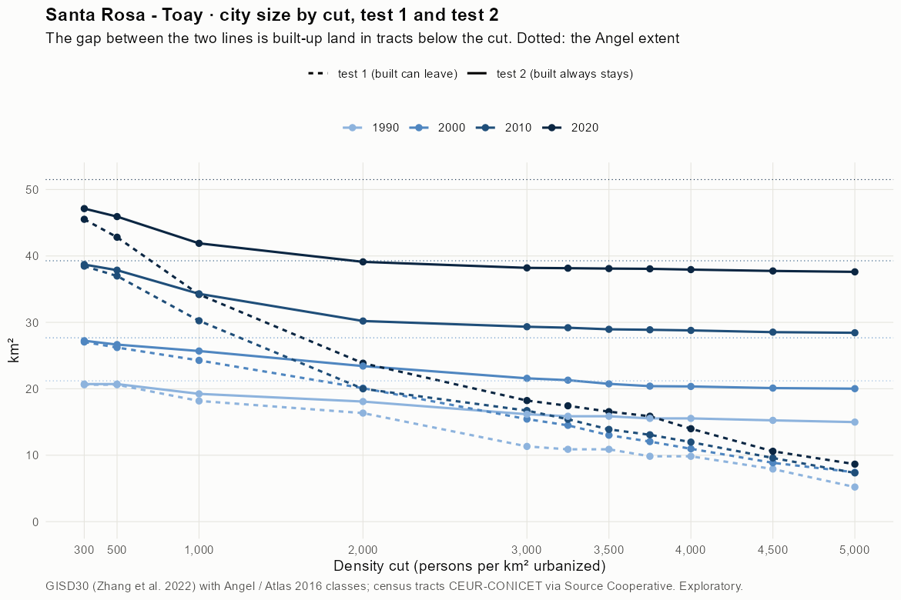
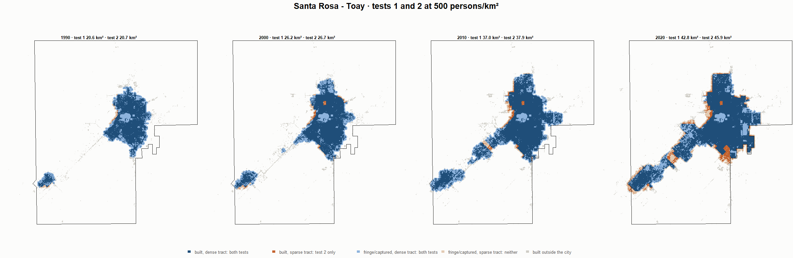
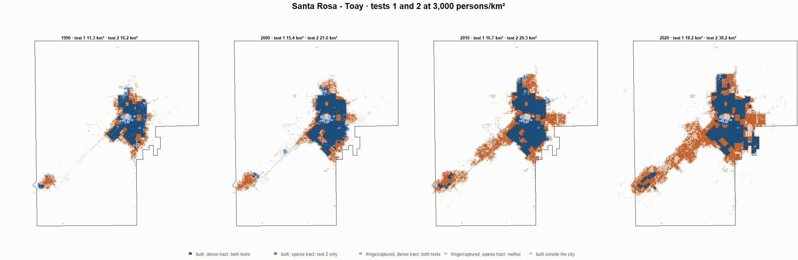
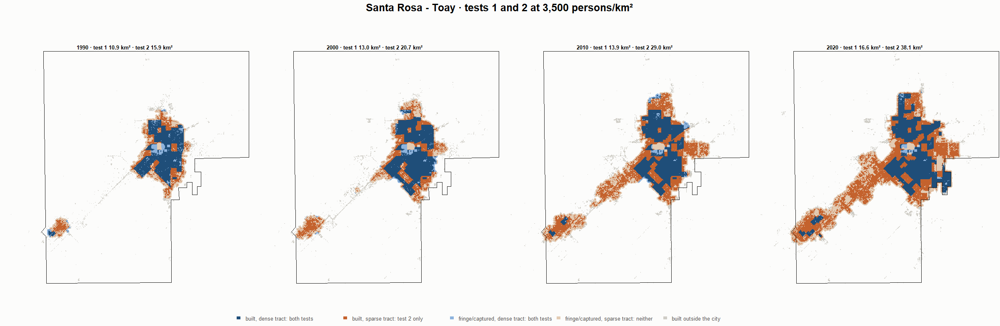
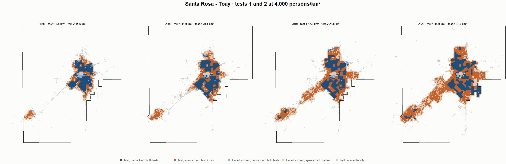

# Santa Rosa - Toay · tests 1 and 2 at the same cut, 1990-2020

Exploratory. None of these numbers are project figures (they are not in `CIFRAS_CANONICAS.json`). Generated by `Rpipe/scripts/14_prueba_comparada.R` from the tract tables of step 11. Run of 2026-11-09. [All agglomerations](../REPORTE.md) · [test 1](../../densidad_radios/santa_rosa/REPORTE.md) · [test 2](../../franja_densa/santa_rosa/REPORTE.md) · [methods](../../METODOS.md).

**At the same cut the two tests keep the same fringe and captured land**: that of the tracts at or above the cut. They differ only in the **built-up land of tracts below the cut**: test 1 drops it, test 2 keeps it. Test 2 minus test 1 is exactly that land.

## City size by cut

**1990 (census 1991).** Angel extent 21.2 km².

| Cut (p/km²) | Test 1 km² | Test 2 km² | Built in sparse tracts km² (test 2 only) | % of built-up in sparse tracts | Fringe in dense tracts km² (both) | Fringe in sparse tracts km² (neither) |
|---|---|---|---|---|---|---|
| 300 | 20.6 | 20.7 | 0.1 | 0.7 | 6.3 | 0.5 |
| 500 | 20.6 | 20.7 | 0.1 | 0.7 | 6.3 | 0.5 |
| 1,000 | 18.2 | 19.2 | 1.1 | 7.4 | 4.9 | 2.0 |
| 2,000 | 16.3 | 18.1 | 1.7 | 12.1 | 3.7 | 3.1 |
| 3,000 | 11.3 | 16.2 | 4.8 | 33.7 | 1.8 | 5.0 |
| 3,250 | 10.9 | 15.9 | 5.0 | 34.7 | 1.5 | 5.3 |
| 3,500 | 10.9 | 15.9 | 5.0 | 34.7 | 1.5 | 5.3 |
| 3,750 | 9.8 | 15.5 | 5.7 | 39.7 | 1.2 | 5.7 |
| 4,000 | 9.8 | 15.5 | 5.7 | 39.7 | 1.2 | 5.7 |
| 4,500 | 7.9 | 15.2 | 7.3 | 51.0 | 0.9 | 5.9 |
| 5,000 | 5.2 | 15.0 | 9.8 | 68.1 | 0.6 | 6.2 |

**2000 (census 2001).** Angel extent 27.7 km².

| Cut (p/km²) | Test 1 km² | Test 2 km² | Built in sparse tracts km² (test 2 only) | % of built-up in sparse tracts | Fringe in dense tracts km² (both) | Fringe in sparse tracts km² (neither) |
|---|---|---|---|---|---|---|
| 300 | 27.0 | 27.2 | 0.2 | 1.0 | 7.7 | 0.4 |
| 500 | 26.2 | 26.7 | 0.4 | 2.3 | 7.2 | 1.0 |
| 1,000 | 24.3 | 25.7 | 1.4 | 7.3 | 6.2 | 2.0 |
| 2,000 | 20.1 | 23.4 | 3.3 | 17.1 | 3.9 | 4.3 |
| 3,000 | 15.4 | 21.6 | 6.1 | 31.5 | 2.1 | 6.1 |
| 3,250 | 14.5 | 21.3 | 6.8 | 34.9 | 1.8 | 6.4 |
| 3,500 | 13.0 | 20.7 | 7.7 | 39.7 | 1.3 | 6.9 |
| 3,750 | 12.1 | 20.4 | 8.3 | 42.8 | 0.9 | 7.3 |
| 4,000 | 11.0 | 20.4 | 9.4 | 48.2 | 0.9 | 7.3 |
| 4,500 | 8.9 | 20.1 | 11.2 | 57.7 | 0.6 | 7.6 |
| 5,000 | 7.4 | 20.0 | 12.6 | 64.6 | 0.5 | 7.7 |

**2010 (census 2010).** Angel extent 39.3 km².

| Cut (p/km²) | Test 1 km² | Test 2 km² | Built in sparse tracts km² (test 2 only) | % of built-up in sparse tracts | Fringe in dense tracts km² (both) | Fringe in sparse tracts km² (neither) |
|---|---|---|---|---|---|---|
| 300 | 38.5 | 38.7 | 0.2 | 0.8 | 10.8 | 0.6 |
| 500 | 37.0 | 37.9 | 0.9 | 3.1 | 9.9 | 1.4 |
| 1,000 | 30.2 | 34.3 | 4.1 | 14.5 | 6.4 | 5.0 |
| 2,000 | 20.0 | 30.2 | 10.2 | 36.5 | 2.3 | 9.1 |
| 3,000 | 16.7 | 29.3 | 12.6 | 45.2 | 1.4 | 9.9 |
| 3,250 | 15.4 | 29.2 | 13.8 | 49.3 | 1.3 | 10.1 |
| 3,500 | 13.9 | 29.0 | 15.1 | 53.9 | 1.0 | 10.3 |
| 3,750 | 13.1 | 28.9 | 15.8 | 56.6 | 1.0 | 10.4 |
| 4,000 | 12.0 | 28.8 | 16.8 | 60.2 | 0.9 | 10.5 |
| 4,500 | 9.6 | 28.5 | 18.9 | 67.8 | 0.6 | 10.7 |
| 5,000 | 7.3 | 28.4 | 21.1 | 75.5 | 0.5 | 10.8 |

**2020 (census 2022).** Angel extent 51.5 km².

| Cut (p/km²) | Test 1 km² | Test 2 km² | Built in sparse tracts km² (test 2 only) | % of built-up in sparse tracts | Fringe in dense tracts km² (both) | Fringe in sparse tracts km² (neither) |
|---|---|---|---|---|---|---|
| 300 | 45.5 | 47.1 | 1.6 | 4.3 | 9.8 | 4.4 |
| 500 | 42.8 | 45.9 | 3.1 | 8.3 | 8.6 | 5.6 |
| 1,000 | 34.2 | 41.9 | 7.7 | 20.6 | 4.6 | 9.6 |
| 2,000 | 23.9 | 39.1 | 15.3 | 40.9 | 1.8 | 12.4 |
| 3,000 | 18.2 | 38.2 | 20.0 | 53.6 | 0.9 | 13.3 |
| 3,250 | 17.4 | 38.2 | 20.7 | 55.5 | 0.9 | 13.3 |
| 3,500 | 16.6 | 38.1 | 21.5 | 57.8 | 0.8 | 13.4 |
| 3,750 | 15.9 | 38.1 | 22.2 | 59.5 | 0.8 | 13.4 |
| 4,000 | 14.0 | 37.9 | 24.0 | 64.2 | 0.6 | 13.6 |
| 4,500 | 10.6 | 37.7 | 27.2 | 72.8 | 0.4 | 13.8 |
| 5,000 | 8.7 | 37.6 | 29.0 | 77.6 | 0.3 | 13.9 |

## Growth 1990-2020 by cut

Angel extent: 3.00 %/yr.

| Cut (p/km²) | Test 1 %/yr | Test 2 %/yr |
|---|---|---|
| 300 | 2.68 | 2.78 |
| 500 | 2.47 | 2.69 |
| 1,000 | 2.13 | 2.63 |
| 2,000 | 1.27 | 2.61 |
| 3,000 | 1.60 | 2.91 |
| 3,250 | 1.58 | 2.97 |
| 3,500 | 1.41 | 2.96 |
| 3,750 | 1.61 | 3.03 |
| 4,000 | 1.18 | 3.02 |
| 4,500 | 0.97 | 3.07 |
| 5,000 | 1.71 | 3.11 |

## Maps

Same frame in the four years: the 2020 city plus 3 km. Dark blue and light blue are in both tests; orange is built-up in tracts below the cut, which only test 2 keeps; beige is fringe or captured land in tracts below the cut, which neither keeps. Black line: the analysis perimeter.

### 500 persons/km²

### 3,000 persons/km²

### 3,500 persons/km²

### 4,000 persons/km²

