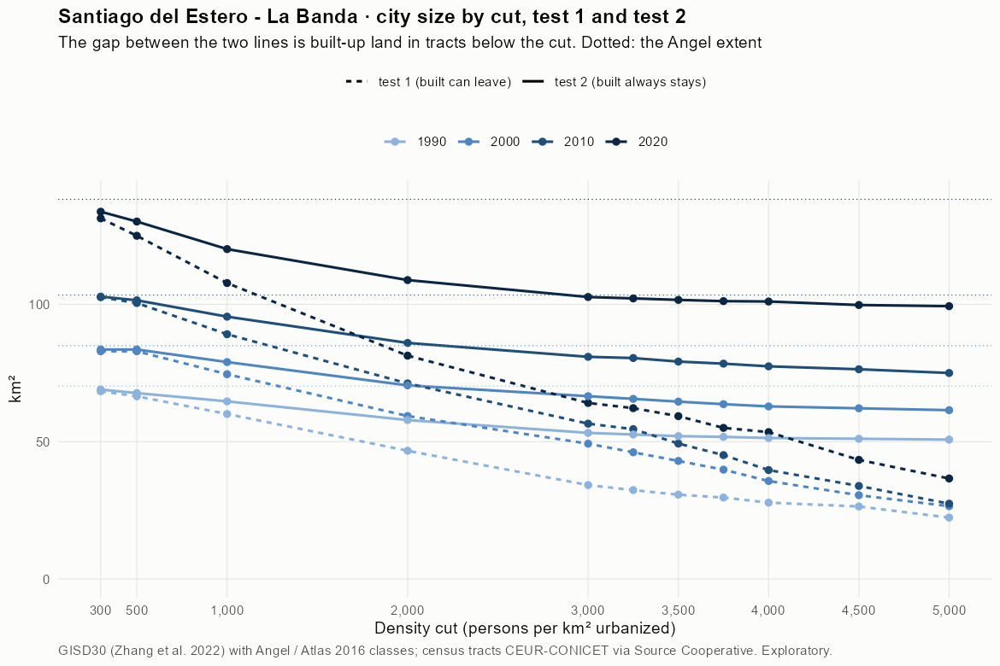
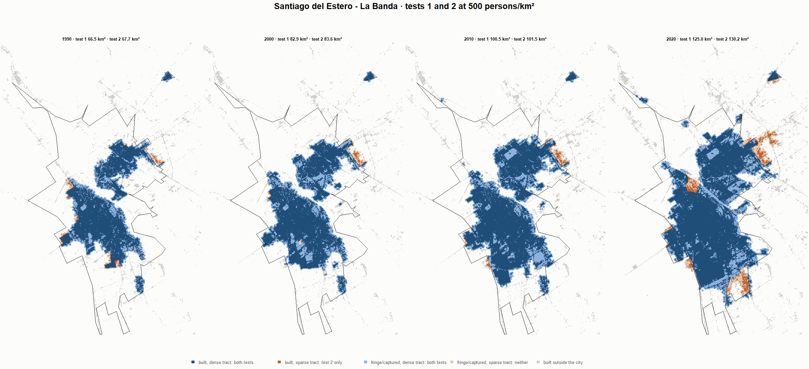
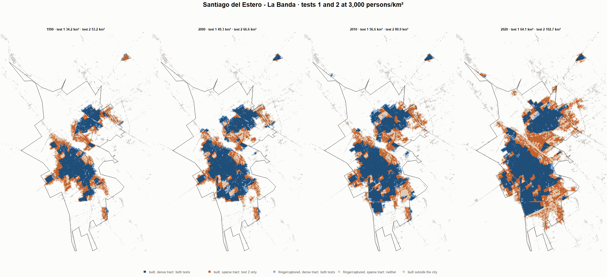
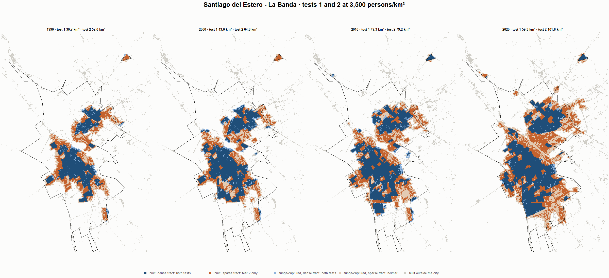
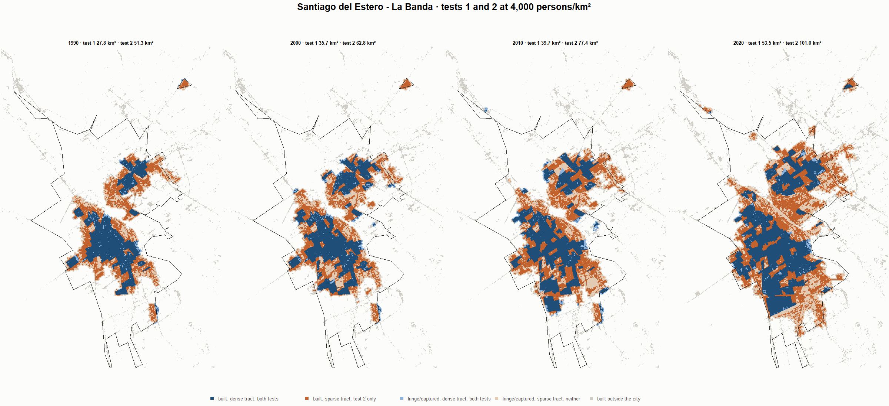

# Santiago del Estero - La Banda · tests 1 and 2 at the same cut, 1990-2020

Exploratory. None of these numbers are project figures (they are not in `CIFRAS_CANONICAS.json`). Generated by `Rpipe/scripts/14_prueba_comparada.R` from the tract tables of step 11. Run of 2026-11-09. [All agglomerations](../REPORTE.md) · [test 1](../../densidad_radios/santiago_del_estero/REPORTE.md) · [test 2](../../franja_densa/santiago_del_estero/REPORTE.md) · [methods](../../METODOS.md).

**At the same cut the two tests keep the same fringe and captured land**: that of the tracts at or above the cut. They differ only in the **built-up land of tracts below the cut**: test 1 drops it, test 2 keeps it. Test 2 minus test 1 is exactly that land.

## City size by cut

**1990 (census 1991).** Angel extent 70.2 km².

| Cut (p/km²) | Test 1 km² | Test 2 km² | Built in sparse tracts km² (test 2 only) | % of built-up in sparse tracts | Fringe in dense tracts km² (both) | Fringe in sparse tracts km² (neither) |
|---|---|---|---|---|---|---|
| 300 | 68.4 | 69.0 | 0.6 | 1.3 | 20.0 | 1.2 |
| 500 | 66.5 | 67.7 | 1.2 | 2.4 | 18.7 | 2.5 |
| 1,000 | 60.1 | 64.7 | 4.6 | 9.4 | 15.7 | 5.5 |
| 2,000 | 46.7 | 57.9 | 11.2 | 22.8 | 8.9 | 12.4 |
| 3,000 | 34.2 | 53.2 | 19.0 | 38.8 | 4.2 | 17.0 |
| 3,250 | 32.4 | 52.6 | 20.2 | 41.3 | 3.6 | 17.6 |
| 3,500 | 30.7 | 52.0 | 21.3 | 43.5 | 3.0 | 18.2 |
| 3,750 | 29.7 | 51.8 | 22.1 | 45.1 | 2.8 | 18.5 |
| 4,000 | 27.8 | 51.3 | 23.5 | 48.0 | 2.3 | 18.9 |
| 4,500 | 26.4 | 51.1 | 24.7 | 50.3 | 2.1 | 19.2 |
| 5,000 | 22.4 | 50.8 | 28.4 | 57.9 | 1.7 | 19.5 |

**2000 (census 2001).** Angel extent 85.0 km².

| Cut (p/km²) | Test 1 km² | Test 2 km² | Built in sparse tracts km² (test 2 only) | % of built-up in sparse tracts | Fringe in dense tracts km² (both) | Fringe in sparse tracts km² (neither) |
|---|---|---|---|---|---|---|
| 300 | 82.9 | 83.6 | 0.6 | 1.1 | 24.2 | 1.4 |
| 500 | 82.9 | 83.6 | 0.6 | 1.1 | 24.2 | 1.4 |
| 1,000 | 74.6 | 79.0 | 4.4 | 7.4 | 19.7 | 6.0 |
| 2,000 | 59.3 | 70.5 | 11.2 | 18.8 | 11.2 | 14.5 |
| 3,000 | 49.3 | 66.6 | 17.3 | 29.1 | 7.2 | 18.4 |
| 3,250 | 46.1 | 65.6 | 19.5 | 32.8 | 6.3 | 19.4 |
| 3,500 | 43.0 | 64.6 | 21.6 | 36.4 | 5.2 | 20.4 |
| 3,750 | 39.8 | 63.7 | 23.8 | 40.2 | 4.3 | 21.3 |
| 4,000 | 35.7 | 62.8 | 27.2 | 45.8 | 3.5 | 22.1 |
| 4,500 | 30.5 | 62.2 | 31.6 | 53.3 | 2.8 | 22.8 |
| 5,000 | 26.5 | 61.5 | 35.0 | 58.9 | 2.1 | 23.5 |

**2010 (census 2010).** Angel extent 103.4 km².

| Cut (p/km²) | Test 1 km² | Test 2 km² | Built in sparse tracts km² (test 2 only) | % of built-up in sparse tracts | Fringe in dense tracts km² (both) | Fringe in sparse tracts km² (neither) |
|---|---|---|---|---|---|---|
| 300 | 102.6 | 102.8 | 0.2 | 0.3 | 29.5 | 0.6 |
| 500 | 100.5 | 101.5 | 1.0 | 1.4 | 28.2 | 1.9 |
| 1,000 | 89.1 | 95.5 | 6.4 | 8.7 | 22.2 | 7.9 |
| 2,000 | 71.2 | 86.0 | 14.7 | 20.1 | 12.7 | 17.4 |
| 3,000 | 56.6 | 80.9 | 24.3 | 33.2 | 7.6 | 22.5 |
| 3,250 | 54.6 | 80.5 | 25.9 | 35.3 | 7.1 | 22.9 |
| 3,500 | 49.3 | 79.2 | 29.8 | 40.7 | 5.9 | 24.2 |
| 3,750 | 45.1 | 78.4 | 33.3 | 45.4 | 5.1 | 25.0 |
| 4,000 | 39.7 | 77.4 | 37.8 | 51.5 | 4.1 | 26.0 |
| 4,500 | 33.9 | 76.4 | 42.5 | 58.0 | 3.1 | 27.0 |
| 5,000 | 27.4 | 75.0 | 47.6 | 64.9 | 1.7 | 28.4 |

**2020 (census 2022).** Angel extent 138.2 km².

| Cut (p/km²) | Test 1 km² | Test 2 km² | Built in sparse tracts km² (test 2 only) | % of built-up in sparse tracts | Fringe in dense tracts km² (both) | Fringe in sparse tracts km² (neither) |
|---|---|---|---|---|---|---|
| 300 | 131.3 | 133.7 | 2.4 | 2.5 | 35.5 | 4.5 |
| 500 | 125.0 | 130.2 | 5.2 | 5.3 | 31.9 | 8.1 |
| 1,000 | 107.8 | 120.1 | 12.4 | 12.6 | 21.9 | 18.1 |
| 2,000 | 81.3 | 108.9 | 27.5 | 28.0 | 10.6 | 29.4 |
| 3,000 | 64.1 | 102.7 | 38.6 | 39.3 | 4.4 | 35.6 |
| 3,250 | 62.2 | 102.2 | 40.0 | 40.7 | 3.9 | 36.1 |
| 3,500 | 59.3 | 101.6 | 42.3 | 43.1 | 3.4 | 36.6 |
| 3,750 | 55.0 | 101.2 | 46.1 | 47.0 | 2.9 | 37.1 |
| 4,000 | 53.5 | 101.0 | 47.6 | 48.4 | 2.8 | 37.2 |
| 4,500 | 43.4 | 99.8 | 56.4 | 57.4 | 1.5 | 38.5 |
| 5,000 | 36.6 | 99.3 | 62.8 | 63.9 | 1.1 | 38.9 |

## Growth 1990-2020 by cut

Angel extent: 2.28 %/yr.

| Cut (p/km²) | Test 1 %/yr | Test 2 %/yr |
|---|---|---|
| 300 | 2.20 | 2.23 |
| 500 | 2.12 | 2.20 |
| 1,000 | 1.97 | 2.09 |
| 2,000 | 1.87 | 2.13 |
| 3,000 | 2.12 | 2.22 |
| 3,250 | 2.20 | 2.24 |
| 3,500 | 2.22 | 2.26 |
| 3,750 | 2.08 | 2.26 |
| 4,000 | 2.20 | 2.28 |
| 4,500 | 1.67 | 2.26 |
| 5,000 | 1.66 | 2.26 |

## Maps

Same frame in the four years: the 2020 city plus 3 km. Dark blue and light blue are in both tests; orange is built-up in tracts below the cut, which only test 2 keeps; beige is fringe or captured land in tracts below the cut, which neither keeps. Black line: the analysis perimeter.

### 500 persons/km²

### 3,000 persons/km²

### 3,500 persons/km²

### 4,000 persons/km²

