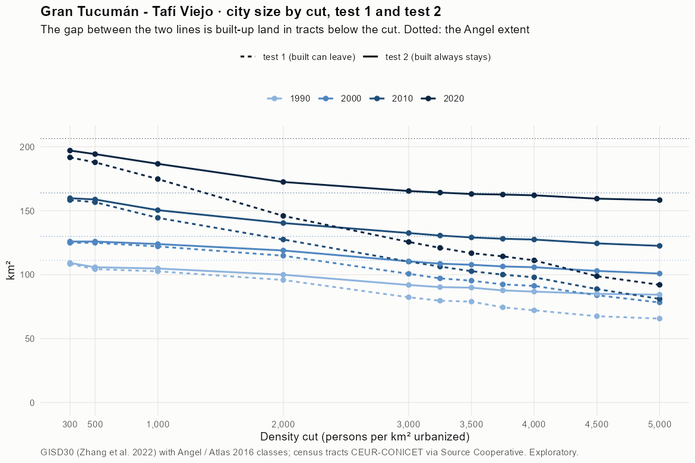
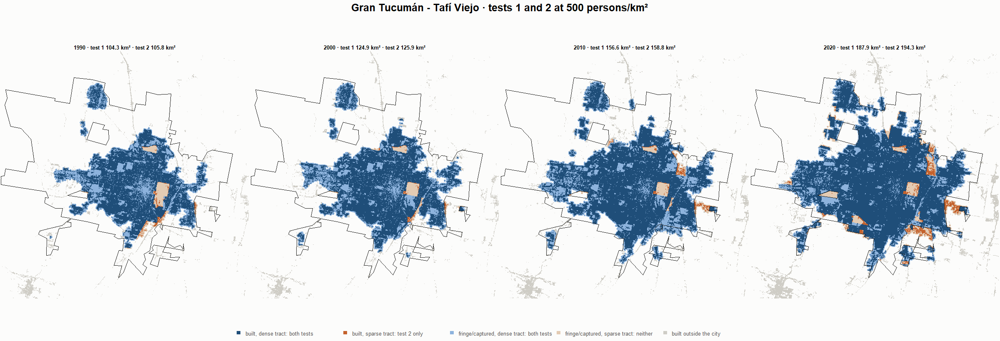
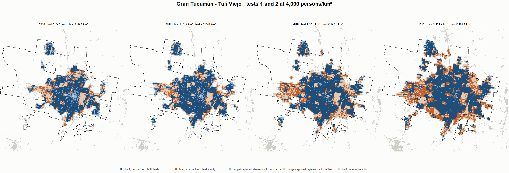

# Gran Tucumán - Tafí Viejo · tests 1 and 2 at the same cut, 1990-2020

Exploratory. None of these numbers are project figures (they are not in `CIFRAS_CANONICAS.json`). Generated by `Rpipe/scripts/14_prueba_comparada.R` from the tract tables of step 11. Run of 2026-11-09. [All agglomerations](../REPORTE.md) · [test 1](../../densidad_radios/tucuman/REPORTE.md) · [test 2](../../franja_densa/tucuman/REPORTE.md) · [methods](../../METODOS.md).

**At the same cut the two tests keep the same fringe and captured land**: that of the tracts at or above the cut. They differ only in the **built-up land of tracts below the cut**: test 1 drops it, test 2 keeps it. Test 2 minus test 1 is exactly that land.

## City size by cut

**1990 (census 1991).** Angel extent 111.2 km².

| Cut (p/km²) | Test 1 km² | Test 2 km² | Built in sparse tracts km² (test 2 only) | % of built-up in sparse tracts | Fringe in dense tracts km² (both) | Fringe in sparse tracts km² (neither) |
|---|---|---|---|---|---|---|
| 300 | 108.4 | 109.2 | 0.8 | 1.1 | 38.3 | 2.1 |
| 500 | 104.3 | 105.8 | 1.5 | 2.1 | 34.9 | 5.4 |
| 1,000 | 102.6 | 104.8 | 2.2 | 3.1 | 33.9 | 6.4 |
| 2,000 | 95.8 | 100.0 | 4.1 | 5.8 | 29.1 | 11.3 |
| 3,000 | 82.3 | 91.9 | 9.6 | 13.6 | 21.0 | 19.3 |
| 3,250 | 79.6 | 90.3 | 10.6 | 15.0 | 19.4 | 21.0 |
| 3,500 | 78.9 | 89.8 | 10.9 | 15.4 | 18.9 | 21.4 |
| 3,750 | 74.4 | 87.7 | 13.2 | 18.7 | 16.8 | 23.5 |
| 4,000 | 72.1 | 86.7 | 14.7 | 20.7 | 15.9 | 24.5 |
| 4,500 | 67.5 | 85.0 | 17.5 | 24.7 | 14.1 | 26.2 |
| 5,000 | 65.6 | 84.4 | 18.7 | 26.4 | 13.5 | 26.9 |

**2000 (census 2001).** Angel extent 129.9 km².

| Cut (p/km²) | Test 1 km² | Test 2 km² | Built in sparse tracts km² (test 2 only) | % of built-up in sparse tracts | Fringe in dense tracts km² (both) | Fringe in sparse tracts km² (neither) |
|---|---|---|---|---|---|---|
| 300 | 124.9 | 125.9 | 1.0 | 1.1 | 39.1 | 4.0 |
| 500 | 124.9 | 125.9 | 1.0 | 1.1 | 39.1 | 4.0 |
| 1,000 | 122.1 | 123.9 | 1.9 | 2.1 | 37.2 | 6.0 |
| 2,000 | 114.8 | 118.9 | 4.1 | 4.7 | 32.1 | 11.0 |
| 3,000 | 100.7 | 110.4 | 9.8 | 11.3 | 23.7 | 19.5 |
| 3,250 | 97.1 | 108.6 | 11.5 | 13.2 | 21.8 | 21.3 |
| 3,500 | 95.3 | 107.7 | 12.5 | 14.4 | 21.0 | 22.2 |
| 3,750 | 92.4 | 106.4 | 14.0 | 16.2 | 19.7 | 23.5 |
| 4,000 | 91.2 | 105.8 | 14.6 | 16.8 | 19.0 | 24.1 |
| 4,500 | 83.9 | 102.9 | 19.0 | 21.9 | 16.2 | 27.0 |
| 5,000 | 78.3 | 100.9 | 22.6 | 26.0 | 14.1 | 29.1 |

**2010 (census 2010).** Angel extent 163.9 km².

| Cut (p/km²) | Test 1 km² | Test 2 km² | Built in sparse tracts km² (test 2 only) | % of built-up in sparse tracts | Fringe in dense tracts km² (both) | Fringe in sparse tracts km² (neither) |
|---|---|---|---|---|---|---|
| 300 | 158.3 | 159.8 | 1.5 | 1.3 | 45.6 | 4.1 |
| 500 | 156.6 | 158.8 | 2.2 | 1.9 | 44.6 | 5.1 |
| 1,000 | 144.4 | 150.5 | 6.0 | 5.3 | 36.3 | 13.5 |
| 2,000 | 127.5 | 140.4 | 12.9 | 11.3 | 26.2 | 23.6 |
| 3,000 | 110.2 | 132.6 | 22.3 | 19.6 | 18.4 | 31.4 |
| 3,250 | 106.3 | 130.6 | 24.3 | 21.3 | 16.4 | 33.3 |
| 3,500 | 102.7 | 129.1 | 26.4 | 23.1 | 14.9 | 34.8 |
| 3,750 | 100.0 | 128.1 | 28.1 | 24.6 | 13.9 | 35.9 |
| 4,000 | 97.9 | 127.5 | 29.5 | 25.9 | 13.3 | 36.5 |
| 4,500 | 88.7 | 124.5 | 35.7 | 31.3 | 10.3 | 39.5 |
| 5,000 | 81.0 | 122.5 | 41.5 | 36.3 | 8.4 | 41.4 |

**2020 (census 2022).** Angel extent 206.4 km².

| Cut (p/km²) | Test 1 km² | Test 2 km² | Built in sparse tracts km² (test 2 only) | % of built-up in sparse tracts | Fringe in dense tracts km² (both) | Fringe in sparse tracts km² (neither) |
|---|---|---|---|---|---|---|
| 300 | 191.7 | 197.1 | 5.4 | 3.5 | 43.8 | 9.4 |
| 500 | 187.9 | 194.3 | 6.4 | 4.2 | 41.1 | 12.1 |
| 1,000 | 174.8 | 186.7 | 11.9 | 7.8 | 33.5 | 19.7 |
| 2,000 | 146.0 | 172.5 | 26.5 | 17.3 | 19.3 | 33.9 |
| 3,000 | 125.6 | 165.4 | 39.8 | 26.0 | 12.2 | 41.0 |
| 3,250 | 121.0 | 164.2 | 43.2 | 28.2 | 11.0 | 42.2 |
| 3,500 | 116.8 | 163.1 | 46.3 | 30.2 | 9.9 | 43.3 |
| 3,750 | 114.3 | 162.7 | 48.3 | 31.5 | 9.4 | 43.8 |
| 4,000 | 111.2 | 162.1 | 50.9 | 33.2 | 8.8 | 44.4 |
| 4,500 | 98.8 | 159.4 | 60.6 | 39.6 | 6.2 | 47.0 |
| 5,000 | 92.0 | 158.3 | 66.3 | 43.3 | 5.1 | 48.1 |

## Growth 1990-2020 by cut

Angel extent: 2.08 %/yr.

| Cut (p/km²) | Test 1 %/yr | Test 2 %/yr |
|---|---|---|
| 300 | 1.92 | 1.99 |
| 500 | 1.98 | 2.05 |
| 1,000 | 1.79 | 1.94 |
| 2,000 | 1.41 | 1.84 |
| 3,000 | 1.42 | 1.98 |
| 3,250 | 1.40 | 2.01 |
| 3,500 | 1.32 | 2.01 |
| 3,750 | 1.44 | 2.08 |
| 4,000 | 1.45 | 2.11 |
| 4,500 | 1.28 | 2.12 |
| 5,000 | 1.13 | 2.12 |

## Maps

Same frame in the four years: the 2020 city plus 3 km. Dark blue and light blue are in both tests; orange is built-up in tracts below the cut, which only test 2 keeps; beige is fringe or captured land in tracts below the cut, which neither keeps. Black line: the analysis perimeter.

### 500 persons/km²

### 3,000 persons/km²

### 3,500 persons/km²

### 4,000 persons/km²

