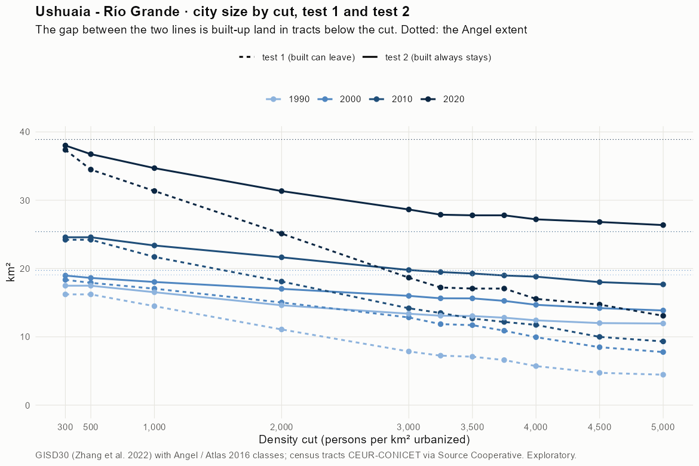
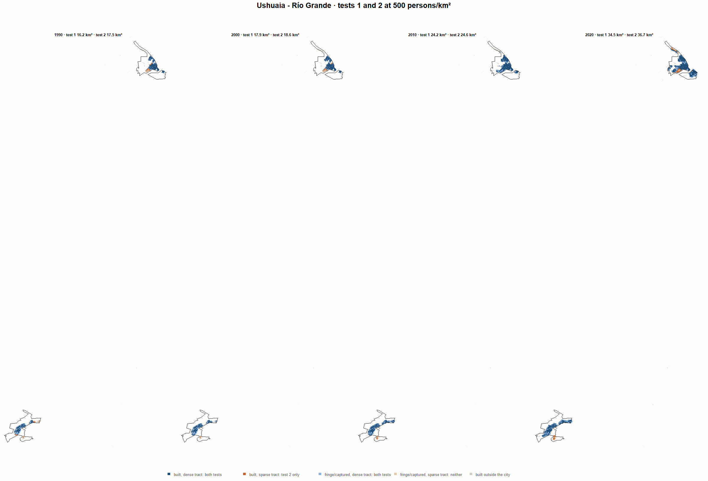
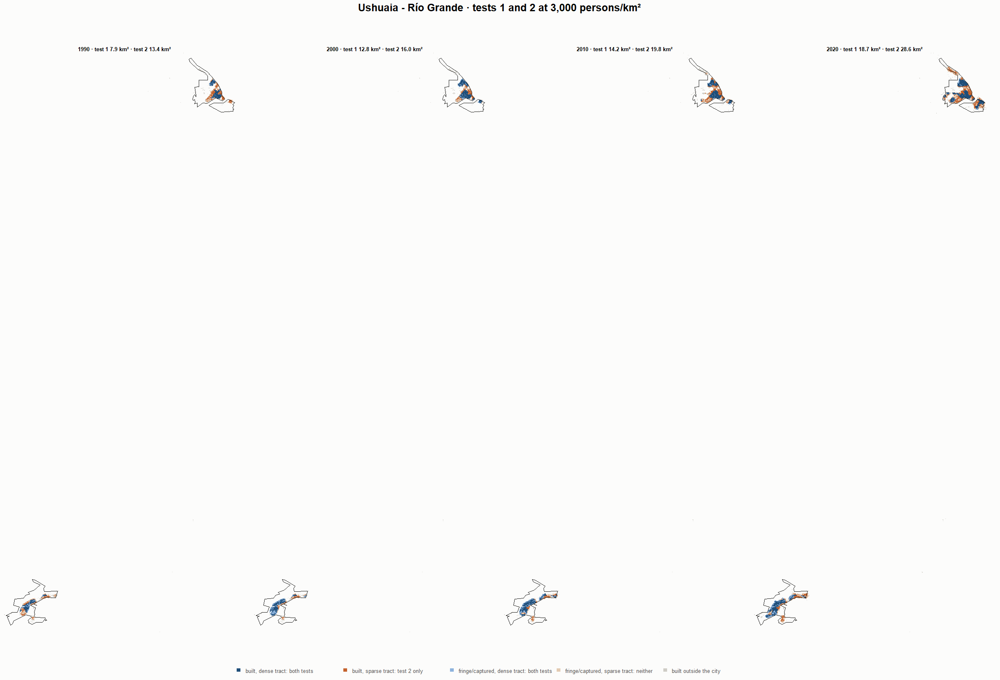
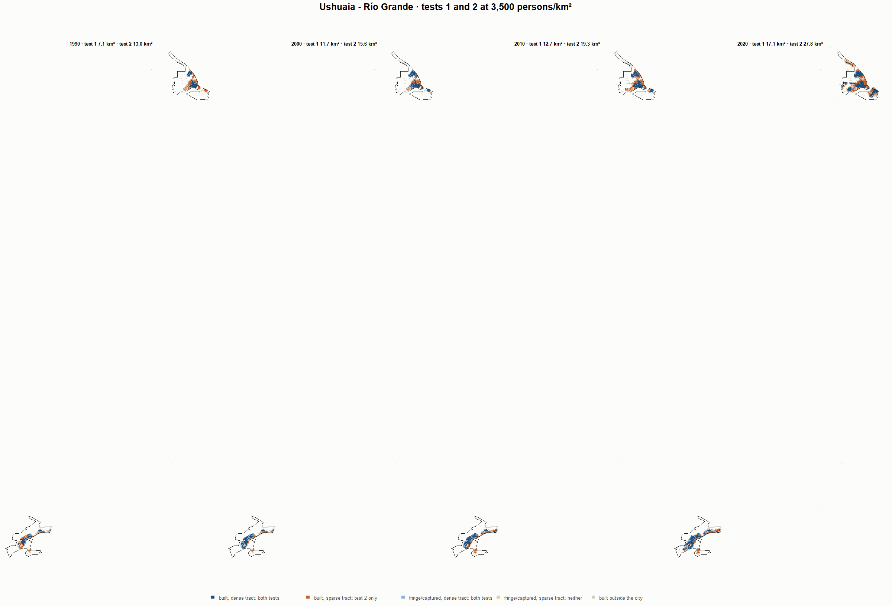
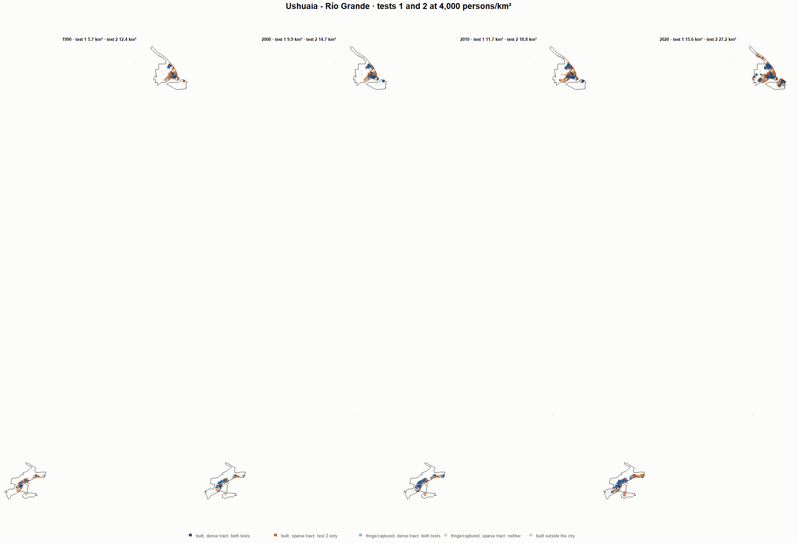

# Ushuaia - Río Grande · tests 1 and 2 at the same cut, 1990-2020

Exploratory. None of these numbers are project figures (they are not in `CIFRAS_CANONICAS.json`). Generated by `Rpipe/scripts/14_prueba_comparada.R` from the tract tables of step 11. Run of 2026-11-09. [All agglomerations](../REPORTE.md) · [test 1](../../densidad_radios/ushuaia/REPORTE.md) · [test 2](../../franja_densa/ushuaia/REPORTE.md) · [methods](../../METODOS.md).

**At the same cut the two tests keep the same fringe and captured land**: that of the tracts at or above the cut. They differ only in the **built-up land of tracts below the cut**: test 1 drops it, test 2 keeps it. Test 2 minus test 1 is exactly that land.

## City size by cut

**1990 (census 1991).** Angel extent 19.1 km².

| Cut (p/km²) | Test 1 km² | Test 2 km² | Built in sparse tracts km² (test 2 only) | % of built-up in sparse tracts | Fringe in dense tracts km² (both) | Fringe in sparse tracts km² (neither) |
|---|---|---|---|---|---|---|
| 300 | 16.2 | 17.5 | 1.3 | 11.4 | 6.4 | 1.6 |
| 500 | 16.2 | 17.5 | 1.3 | 11.4 | 6.4 | 1.6 |
| 1,000 | 14.5 | 16.5 | 2.0 | 18.3 | 5.4 | 2.5 |
| 2,000 | 11.1 | 14.6 | 3.5 | 31.8 | 3.5 | 4.4 |
| 3,000 | 7.9 | 13.4 | 5.5 | 49.7 | 2.3 | 5.7 |
| 3,250 | 7.2 | 13.1 | 5.8 | 52.5 | 2.0 | 6.0 |
| 3,500 | 7.1 | 13.0 | 6.0 | 53.5 | 1.9 | 6.0 |
| 3,750 | 6.6 | 12.8 | 6.2 | 55.7 | 1.7 | 6.3 |
| 4,000 | 5.7 | 12.4 | 6.7 | 60.2 | 1.3 | 6.7 |
| 4,500 | 4.7 | 12.0 | 7.3 | 65.4 | 0.9 | 7.1 |
| 5,000 | 4.5 | 12.0 | 7.5 | 67.4 | 0.8 | 7.1 |

**2000 (census 2001).** Angel extent 19.7 km².

| Cut (p/km²) | Test 1 km² | Test 2 km² | Built in sparse tracts km² (test 2 only) | % of built-up in sparse tracts | Fringe in dense tracts km² (both) | Fringe in sparse tracts km² (neither) |
|---|---|---|---|---|---|---|
| 300 | 18.4 | 19.0 | 0.6 | 5.4 | 7.4 | 0.8 |
| 500 | 17.9 | 18.6 | 0.7 | 6.2 | 7.0 | 1.1 |
| 1,000 | 17.0 | 18.0 | 1.0 | 8.5 | 6.4 | 1.7 |
| 2,000 | 15.0 | 17.0 | 2.0 | 17.2 | 5.4 | 2.7 |
| 3,000 | 12.8 | 16.0 | 3.2 | 27.2 | 4.4 | 3.7 |
| 3,250 | 11.9 | 15.6 | 3.8 | 32.6 | 4.0 | 4.1 |
| 3,500 | 11.7 | 15.6 | 3.9 | 33.7 | 4.0 | 4.1 |
| 3,750 | 10.9 | 15.3 | 4.4 | 37.6 | 3.6 | 4.5 |
| 4,000 | 9.9 | 14.7 | 4.7 | 40.8 | 3.1 | 5.0 |
| 4,500 | 8.5 | 14.2 | 5.7 | 49.3 | 2.6 | 5.5 |
| 5,000 | 7.8 | 13.9 | 6.1 | 52.4 | 2.2 | 5.9 |

**2010 (census 2010).** Angel extent 25.4 km².

| Cut (p/km²) | Test 1 km² | Test 2 km² | Built in sparse tracts km² (test 2 only) | % of built-up in sparse tracts | Fringe in dense tracts km² (both) | Fringe in sparse tracts km² (neither) |
|---|---|---|---|---|---|---|
| 300 | 24.2 | 24.6 | 0.4 | 2.3 | 8.9 | 0.8 |
| 500 | 24.2 | 24.6 | 0.4 | 2.3 | 8.9 | 0.8 |
| 1,000 | 21.7 | 23.4 | 1.7 | 10.6 | 7.7 | 2.0 |
| 2,000 | 18.1 | 21.6 | 3.5 | 22.6 | 5.9 | 3.8 |
| 3,000 | 14.2 | 19.8 | 5.6 | 35.6 | 4.1 | 5.6 |
| 3,250 | 13.5 | 19.5 | 6.0 | 38.1 | 3.8 | 5.9 |
| 3,500 | 12.7 | 19.3 | 6.6 | 41.9 | 3.6 | 6.1 |
| 3,750 | 12.2 | 19.0 | 6.8 | 43.3 | 3.3 | 6.4 |
| 4,000 | 11.7 | 18.8 | 7.1 | 44.9 | 3.1 | 6.6 |
| 4,500 | 10.0 | 18.0 | 8.0 | 51.0 | 2.3 | 7.4 |
| 5,000 | 9.3 | 17.7 | 8.3 | 53.1 | 2.0 | 7.7 |

**2020 (census 2022).** Angel extent 38.9 km².

| Cut (p/km²) | Test 1 km² | Test 2 km² | Built in sparse tracts km² (test 2 only) | % of built-up in sparse tracts | Fringe in dense tracts km² (both) | Fringe in sparse tracts km² (neither) |
|---|---|---|---|---|---|---|
| 300 | 37.4 | 38.0 | 0.6 | 2.6 | 13.9 | 0.9 |
| 500 | 34.5 | 36.7 | 2.3 | 9.4 | 12.6 | 2.1 |
| 1,000 | 31.4 | 34.7 | 3.3 | 13.9 | 10.6 | 4.2 |
| 2,000 | 25.1 | 31.3 | 6.2 | 25.8 | 7.2 | 7.6 |
| 3,000 | 18.7 | 28.6 | 10.0 | 41.4 | 4.5 | 10.3 |
| 3,250 | 17.2 | 27.9 | 10.7 | 44.2 | 3.8 | 11.0 |
| 3,500 | 17.1 | 27.8 | 10.7 | 44.5 | 3.7 | 11.1 |
| 3,750 | 17.1 | 27.8 | 10.7 | 44.5 | 3.7 | 11.1 |
| 4,000 | 15.6 | 27.2 | 11.6 | 48.3 | 3.1 | 11.7 |
| 4,500 | 14.7 | 26.8 | 12.1 | 50.1 | 2.7 | 12.1 |
| 5,000 | 13.1 | 26.4 | 13.3 | 55.1 | 2.2 | 12.5 |

## Growth 1990-2020 by cut

Angel extent: 2.40 %/yr.

| Cut (p/km²) | Test 1 %/yr | Test 2 %/yr |
|---|---|---|
| 300 | 2.82 | 2.62 |
| 500 | 2.55 | 2.51 |
| 1,000 | 2.61 | 2.50 |
| 2,000 | 2.76 | 2.57 |
| 3,000 | 2.93 | 2.57 |
| 3,250 | 2.93 | 2.55 |
| 3,500 | 2.97 | 2.55 |
| 3,750 | 3.22 | 2.62 |
| 4,000 | 3.40 | 2.65 |
| 4,500 | 3.86 | 2.71 |
| 5,000 | 3.66 | 2.67 |

## Maps

Same frame in the four years: the 2020 city plus 3 km. Dark blue and light blue are in both tests; orange is built-up in tracts below the cut, which only test 2 keeps; beige is fringe or captured land in tracts below the cut, which neither keeps. Black line: the analysis perimeter.

### 500 persons/km²

### 3,000 persons/km²

### 3,500 persons/km²

### 4,000 persons/km²

