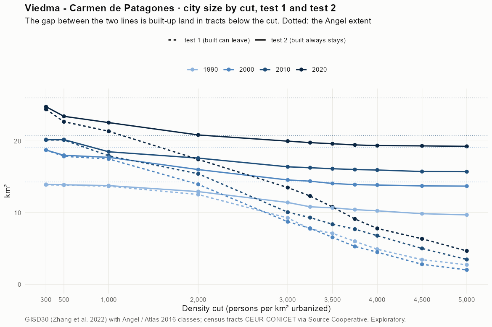
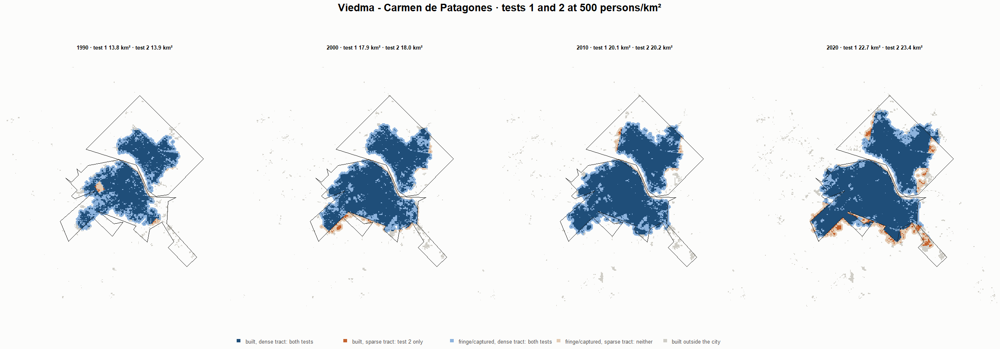
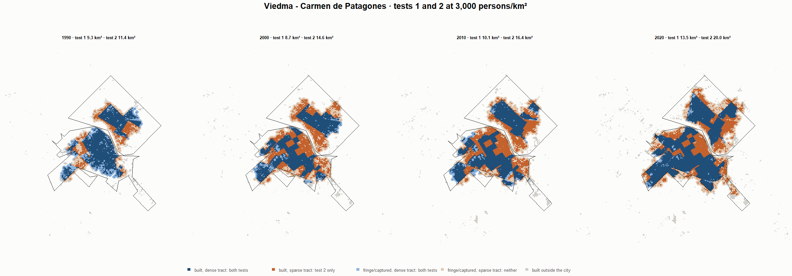
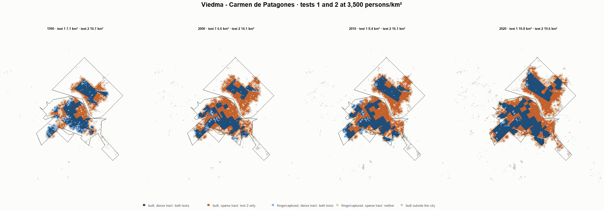
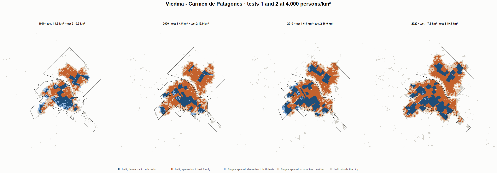

# Viedma - Carmen de Patagones · tests 1 and 2 at the same cut, 1990-2020

Exploratory. None of these numbers are project figures (they are not in `CIFRAS_CANONICAS.json`). Generated by `Rpipe/scripts/14_prueba_comparada.R` from the tract tables of step 11. Run of 2026-11-09. [All agglomerations](../REPORTE.md) · [test 1](../../densidad_radios/viedma/REPORTE.md) · [test 2](../../franja_densa/viedma/REPORTE.md) · [methods](../../METODOS.md).

**At the same cut the two tests keep the same fringe and captured land**: that of the tracts at or above the cut. They differ only in the **built-up land of tracts below the cut**: test 1 drops it, test 2 keeps it. Test 2 minus test 1 is exactly that land.

## City size by cut

**1990 (census 1991).** Angel extent 14.3 km².

| Cut (p/km²) | Test 1 km² | Test 2 km² | Built in sparse tracts km² (test 2 only) | % of built-up in sparse tracts | Fringe in dense tracts km² (both) | Fringe in sparse tracts km² (neither) |
|---|---|---|---|---|---|---|
| 300 | 13.9 | 13.9 | 0.0 | 0.5 | 5.0 | 0.4 |
| 500 | 13.8 | 13.9 | 0.0 | 0.5 | 5.0 | 0.4 |
| 1,000 | 13.7 | 13.8 | 0.1 | 1.0 | 4.9 | 0.5 |
| 2,000 | 12.5 | 12.9 | 0.4 | 4.6 | 4.1 | 1.4 |
| 3,000 | 9.3 | 11.4 | 2.2 | 24.3 | 2.5 | 2.9 |
| 3,250 | 7.7 | 10.8 | 3.1 | 34.8 | 1.9 | 3.5 |
| 3,500 | 7.1 | 10.7 | 3.6 | 40.2 | 1.8 | 3.6 |
| 3,750 | 6.0 | 10.4 | 4.4 | 49.8 | 1.5 | 3.9 |
| 4,000 | 4.9 | 10.3 | 5.4 | 60.4 | 1.4 | 4.0 |
| 4,500 | 3.4 | 9.9 | 6.4 | 72.2 | 1.0 | 4.4 |
| 5,000 | 2.7 | 9.7 | 7.0 | 78.4 | 0.8 | 4.6 |

**2000 (census 2001).** Angel extent 19.1 km².

| Cut (p/km²) | Test 1 km² | Test 2 km² | Built in sparse tracts km² (test 2 only) | % of built-up in sparse tracts | Fringe in dense tracts km² (both) | Fringe in sparse tracts km² (neither) |
|---|---|---|---|---|---|---|
| 300 | 18.7 | 18.7 | 0.0 | 0.1 | 5.5 | 0.3 |
| 500 | 17.9 | 18.0 | 0.1 | 1.1 | 4.8 | 1.1 |
| 1,000 | 17.5 | 17.7 | 0.2 | 1.7 | 4.5 | 1.3 |
| 2,000 | 14.0 | 16.0 | 2.1 | 15.5 | 2.8 | 3.1 |
| 3,000 | 8.7 | 14.6 | 5.8 | 44.0 | 1.3 | 4.5 |
| 3,250 | 7.8 | 14.4 | 6.6 | 49.6 | 1.1 | 4.7 |
| 3,500 | 6.6 | 14.1 | 7.5 | 56.7 | 0.8 | 5.0 |
| 3,750 | 5.3 | 13.9 | 8.6 | 65.1 | 0.7 | 5.2 |
| 4,000 | 4.5 | 13.9 | 9.4 | 70.7 | 0.6 | 5.2 |
| 4,500 | 2.8 | 13.7 | 10.9 | 82.6 | 0.5 | 5.3 |
| 5,000 | 2.0 | 13.7 | 11.7 | 88.2 | 0.4 | 5.4 |

**2010 (census 2010).** Angel extent 20.7 km².

| Cut (p/km²) | Test 1 km² | Test 2 km² | Built in sparse tracts km² (test 2 only) | % of built-up in sparse tracts | Fringe in dense tracts km² (both) | Fringe in sparse tracts km² (neither) |
|---|---|---|---|---|---|---|
| 300 | 20.1 | 20.2 | 0.1 | 0.4 | 5.2 | 0.5 |
| 500 | 20.1 | 20.2 | 0.1 | 0.4 | 5.2 | 0.5 |
| 1,000 | 17.9 | 18.5 | 0.6 | 3.8 | 3.5 | 2.2 |
| 2,000 | 15.4 | 17.6 | 2.2 | 14.6 | 2.6 | 3.1 |
| 3,000 | 10.1 | 16.4 | 6.3 | 42.3 | 1.4 | 4.3 |
| 3,250 | 9.3 | 16.3 | 7.0 | 46.5 | 1.3 | 4.5 |
| 3,500 | 8.4 | 16.1 | 7.8 | 51.8 | 1.2 | 4.6 |
| 3,750 | 7.7 | 16.0 | 8.3 | 55.6 | 1.1 | 4.7 |
| 4,000 | 6.8 | 16.0 | 9.2 | 61.2 | 1.0 | 4.8 |
| 4,500 | 5.0 | 15.7 | 10.7 | 71.8 | 0.8 | 5.0 |
| 5,000 | 3.5 | 15.7 | 12.3 | 81.9 | 0.7 | 5.0 |

**2020 (census 2022).** Angel extent 26.0 km².

| Cut (p/km²) | Test 1 km² | Test 2 km² | Built in sparse tracts km² (test 2 only) | % of built-up in sparse tracts | Fringe in dense tracts km² (both) | Fringe in sparse tracts km² (neither) |
|---|---|---|---|---|---|---|
| 300 | 24.4 | 24.8 | 0.4 | 1.9 | 5.7 | 1.2 |
| 500 | 22.7 | 23.4 | 0.8 | 4.0 | 4.4 | 2.6 |
| 1,000 | 21.4 | 22.6 | 1.2 | 6.3 | 3.5 | 3.5 |
| 2,000 | 17.4 | 20.8 | 3.4 | 17.9 | 1.8 | 5.2 |
| 3,000 | 13.5 | 20.0 | 6.5 | 34.0 | 0.9 | 6.0 |
| 3,250 | 12.3 | 19.8 | 7.5 | 39.1 | 0.7 | 6.2 |
| 3,500 | 10.8 | 19.6 | 8.8 | 46.4 | 0.6 | 6.4 |
| 3,750 | 9.1 | 19.5 | 10.3 | 54.3 | 0.4 | 6.6 |
| 4,000 | 7.8 | 19.4 | 11.6 | 60.7 | 0.3 | 6.7 |
| 4,500 | 6.4 | 19.3 | 13.0 | 68.1 | 0.3 | 6.7 |
| 5,000 | 4.7 | 19.3 | 14.6 | 76.6 | 0.2 | 6.8 |

## Growth 1990-2020 by cut

Angel extent: 2.02 %/yr.

| Cut (p/km²) | Test 1 %/yr | Test 2 %/yr |
|---|---|---|
| 300 | 1.90 | 1.94 |
| 500 | 1.66 | 1.76 |
| 1,000 | 1.50 | 1.66 |
| 2,000 | 1.11 | 1.60 |
| 3,000 | 1.27 | 1.88 |
| 3,250 | 1.57 | 2.03 |
| 3,500 | 1.40 | 2.05 |
| 3,750 | 1.41 | 2.10 |
| 4,000 | 1.57 | 2.14 |
| 4,500 | 2.07 | 2.27 |
| 5,000 | 1.81 | 2.32 |

## Maps

Same frame in the four years: the 2020 city plus 3 km. Dark blue and light blue are in both tests; orange is built-up in tracts below the cut, which only test 2 keeps; beige is fringe or captured land in tracts below the cut, which neither keeps. Black line: the analysis perimeter.

### 500 persons/km²

### 3,000 persons/km²

### 3,500 persons/km²

### 4,000 persons/km²

