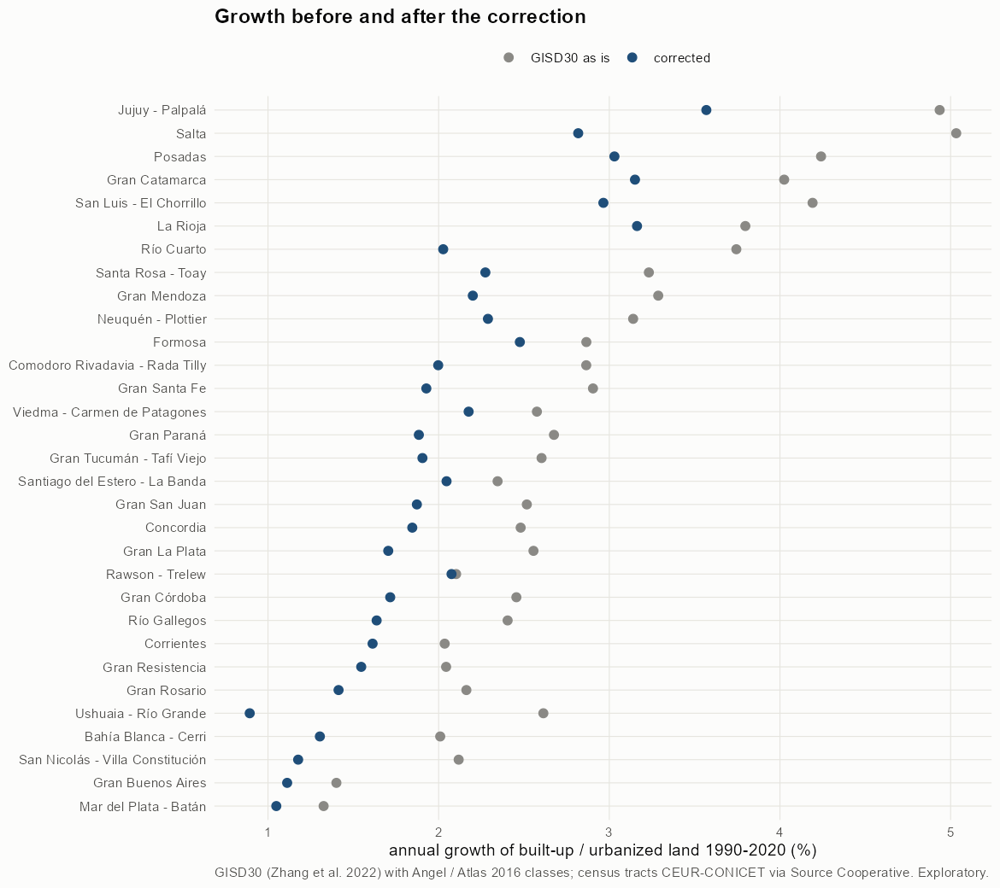

# Corrected built-up: rules 0-3 in sequence

Exploratory. No number here is a project figure; Overture Maps is a validation layer, not an approved project source. Generated by `scripts/23_corregido.R`; do not edit by hand.

Each rule works on the layer the previous one left, with the geometry recomputed in between (edge distance, % built-up within 150 m, open patches, gaps, tract densities). **Urbanized** = GISD30 built-up kept + filled by rule 0 + filled by rule 2. Rasters per city and year in `outputs/corregido/<slug>/` (`clases_<year>.tif`, `urbanizado_<year>.tif`).

## Settings

`rg=200,25,3,2,50,4,tope,10,1,80,1,75,1,1,1,0,25,1,50,1,1,60,30,50,1,1,30,90,10,2,1`

Same order as the cleaning viewer's link, so the run can be reproduced there.

## Growth 1990-2020

| Agglomeration | GISD30 1990 km2 | Urbanized 1990 km2 | GISD30 2020 km2 | Urbanized 2020 km2 | Growth GISD30 %/yr | Growth corrected %/yr |
|---|---|---|---|---|---|---|
| Bahía Blanca - Cerri | 59.0 | 52.7 | 107.1 | 77.7 | 2.01 | 1.30 |
| Comodoro Rivadavia - Rada Tilly | 24.0 | 21.6 | 55.9 | 39.0 | 2.86 | 2.00 |
| Concordia | 14.9 | 16.4 | 31.1 | 28.4 | 2.48 | 1.85 |
| Corrientes | 30.9 | 31.0 | 56.6 | 50.1 | 2.04 | 1.61 |
| Formosa | 22.0 | 20.2 | 51.4 | 42.2 | 2.87 | 2.48 |
| Gran Buenos Aires | 1,278.6 | 1,210.8 | 1,940.8 | 1,687.4 | 1.40 | 1.11 |
| Gran Catamarca | 15.9 | 16.9 | 52.0 | 42.9 | 4.02 | 3.15 |
| Gran Córdoba | 145.9 | 152.9 | 302.0 | 254.7 | 2.46 | 1.72 |
| Gran La Plata | 114.9 | 107.3 | 245.0 | 178.2 | 2.56 | 1.70 |
| Gran Mendoza | 75.9 | 93.2 | 200.3 | 179.0 | 3.29 | 2.20 |
| Gran Paraná | 28.6 | 30.4 | 63.3 | 53.2 | 2.68 | 1.88 |
| Gran Resistencia | 46.0 | 44.0 | 84.4 | 69.7 | 2.04 | 1.55 |
| Gran Rosario | 132.6 | 128.9 | 252.0 | 196.3 | 2.16 | 1.41 |
| Gran San Juan | 61.8 | 62.4 | 130.4 | 108.9 | 2.52 | 1.87 |
| Gran Santa Fe | 46.6 | 50.5 | 109.9 | 89.6 | 2.90 | 1.93 |
| Gran Tucumán - Tafí Viejo | 70.9 | 77.5 | 153.2 | 136.5 | 2.60 | 1.91 |
| Jujuy - Palpalá | 12.0 | 15.4 | 50.9 | 44.1 | 4.94 | 3.57 |
| La Rioja | 17.7 | 17.4 | 54.2 | 44.2 | 3.80 | 3.16 |
| Mar del Plata - Batán | 90.6 | 81.1 | 134.6 | 110.9 | 1.33 | 1.05 |
| Neuquén - Plottier | 58.1 | 45.7 | 146.8 | 90.2 | 3.14 | 2.29 |
| Posadas | 21.4 | 26.8 | 74.4 | 65.7 | 4.24 | 3.03 |
| Rawson - Trelew | 70.7 | 16.2 | 132.0 | 30.0 | 2.10 | 2.08 |
| Río Cuarto | 11.1 | 21.1 | 33.6 | 38.6 | 3.74 | 2.03 |
| Río Gallegos | 11.4 | 13.1 | 23.3 | 21.4 | 2.40 | 1.64 |
| Salta | 33.0 | 42.2 | 144.2 | 97.1 | 5.03 | 2.82 |
| San Luis - El Chorrillo | 12.6 | 16.1 | 43.1 | 38.6 | 4.19 | 2.97 |
| San Nicolás - Villa Constitución | 25.5 | 26.6 | 47.8 | 37.7 | 2.12 | 1.18 |
| Santa Rosa - Toay | 14.4 | 16.3 | 37.3 | 32.1 | 3.23 | 2.27 |
| Santiago del Estero - La Banda | 49.0 | 44.1 | 98.2 | 81.0 | 2.35 | 2.05 |
| Ushuaia - Río Grande | 11.1 | 9.0 | 24.1 | 11.7 | 2.61 | 0.89 |
| Viedma - Carmen de Patagones | 8.9 | 9.7 | 19.0 | 18.6 | 2.58 | 2.18 |

## What each rule did, by year

| Agglomeration | Year | GISD30 | − rule 0 | + rule 0 | − rule 1 | + rule 2 | − rule 3 | = urbanized | fringe | captured open | removed outside the city |
|---|---|---|---|---|---|---|---|---|---|---|---|
| Bahía Blanca - Cerri | 1990 | 59.0 | 10.4 | 11.4 | 0.0 | 0.3 | 7.6 | 52.7 | 14.2 | 15.3 | 7.7 |
| Bahía Blanca - Cerri | 2000 | 65.8 | 12.3 | 12.1 | 0.0 | 0.4 | 6.4 | 59.5 | 15.7 | 15.8 | 7.2 |
| Bahía Blanca - Cerri | 2010 | 82.2 | 17.7 | 11.8 | 0.0 | 0.3 | 9.7 | 66.9 | 16.3 | 23.8 | 6.7 |
| Bahía Blanca - Cerri | 2020 | 107.1 | 27.1 | 11.3 | 0.0 | 0.6 | 14.2 | 77.7 | 16.5 | 25.4 | 5.4 |
| Comodoro Rivadavia - Rada Tilly | 1990 | 24.0 | 4.7 | 4.2 | 0.0 | 0.7 | 2.6 | 21.6 | 8.9 | 5.6 | 4.3 |
| Comodoro Rivadavia - Rada Tilly | 2000 | 32.2 | 7.0 | 4.2 | 0.0 | 0.8 | 4.5 | 25.7 | 10.4 | 8.5 | 4.7 |
| Comodoro Rivadavia - Rada Tilly | 2010 | 41.2 | 9.2 | 3.7 | 0.0 | 0.8 | 5.4 | 31.1 | 13.4 | 8.4 | 4.6 |
| Comodoro Rivadavia - Rada Tilly | 2020 | 55.9 | 14.1 | 3.3 | 0.0 | 0.8 | 6.8 | 39.0 | 16.3 | 11.7 | 4.2 |
| Concordia | 1990 | 14.9 | 1.2 | 2.3 | 0.0 | 0.7 | 0.2 | 16.4 | 3.2 | 1.9 | 2.8 |
| Concordia | 2000 | 17.8 | 1.4 | 2.3 | 0.0 | 0.8 | 0.4 | 19.1 | 4.4 | 2.4 | 4.0 |
| Concordia | 2010 | 23.7 | 2.5 | 2.1 | 0.0 | 0.8 | 0.7 | 23.4 | 5.3 | 3.6 | 5.4 |
| Concordia | 2020 | 31.1 | 4.2 | 2.0 | 0.0 | 0.6 | 1.1 | 28.4 | 7.0 | 4.4 | 8.4 |
| Corrientes | 1990 | 30.9 | 2.6 | 2.5 | 0.0 | 0.6 | 0.4 | 31.0 | 6.1 | 4.5 | 2.9 |
| Corrientes | 2000 | 37.3 | 3.3 | 2.6 | 0.0 | 0.8 | 0.2 | 37.2 | 6.2 | 5.0 | 3.2 |
| Corrientes | 2010 | 44.2 | 4.7 | 2.3 | 0.0 | 0.7 | 0.4 | 42.1 | 6.8 | 6.1 | 4.4 |
| Corrientes | 2020 | 56.6 | 8.2 | 2.1 | 0.0 | 0.5 | 0.9 | 50.1 | 10.1 | 11.2 | 6.6 |
| Formosa | 1990 | 22.0 | 2.8 | 1.5 | 0.0 | 0.3 | 0.8 | 20.2 | 5.1 | 4.2 | 3.4 |
| Formosa | 2000 | 29.8 | 3.8 | 1.6 | 0.0 | 0.7 | 0.6 | 27.7 | 7.4 | 3.8 | 3.9 |
| Formosa | 2010 | 36.9 | 5.7 | 1.2 | 0.0 | 0.6 | 1.4 | 31.6 | 8.5 | 6.6 | 5.9 |
| Formosa | 2020 | 51.4 | 10.4 | 1.2 | 0.0 | 1.1 | 1.2 | 42.2 | 10.9 | 10.3 | 7.3 |
| Gran Buenos Aires | 1990 | 1,278.6 | 118.7 | 70.4 | 0.0 | 10.6 | 30.0 | 1,210.8 | 127.7 | 228.9 | 51.6 |
| Gran Buenos Aires | 2000 | 1,416.5 | 137.6 | 75.6 | 0.0 | 13.8 | 36.6 | 1,331.6 | 142.6 | 233.6 | 65.1 |
| Gran Buenos Aires | 2010 | 1,660.1 | 183.2 | 76.8 | 0.0 | 10.9 | 63.2 | 1,501.4 | 160.3 | 269.2 | 107.2 |
| Gran Buenos Aires | 2020 | 1,940.8 | 249.2 | 78.3 | 0.0 | 9.7 | 92.2 | 1,687.4 | 180.5 | 347.5 | 141.0 |
| Gran Catamarca | 1990 | 15.9 | 1.3 | 1.9 | 0.0 | 0.7 | 0.3 | 16.9 | 5.4 | 2.9 | 2.1 |
| Gran Catamarca | 2000 | 22.7 | 2.2 | 2.0 | 0.0 | 1.2 | 0.4 | 23.3 | 6.3 | 5.6 | 2.3 |
| Gran Catamarca | 2010 | 34.7 | 4.6 | 1.9 | 0.0 | 1.6 | 1.1 | 32.6 | 8.9 | 8.1 | 3.1 |
| Gran Catamarca | 2020 | 52.0 | 9.3 | 0.9 | 0.0 | 0.9 | 1.7 | 42.9 | 10.5 | 12.4 | 3.6 |
| Gran Córdoba | 1990 | 145.9 | 15.7 | 23.9 | 0.0 | 2.0 | 3.1 | 152.9 | 24.9 | 28.7 | 7.4 |
| Gran Córdoba | 2000 | 164.9 | 19.4 | 25.4 | 0.0 | 2.7 | 3.9 | 169.6 | 24.0 | 33.5 | 8.1 |
| Gran Córdoba | 2010 | 223.5 | 30.6 | 25.2 | 0.0 | 2.4 | 12.4 | 208.0 | 36.7 | 44.0 | 15.3 |
| Gran Córdoba | 2020 | 302.0 | 52.5 | 25.4 | 0.0 | 2.3 | 22.5 | 254.7 | 45.1 | 66.2 | 21.4 |
| Gran La Plata | 1990 | 114.9 | 12.3 | 8.8 | 0.0 | 1.5 | 5.6 | 107.3 | 24.8 | 25.1 | 18.9 |
| Gran La Plata | 2000 | 128.3 | 13.9 | 9.7 | 0.0 | 2.2 | 7.0 | 119.2 | 29.9 | 30.3 | 27.5 |
| Gran La Plata | 2010 | 181.2 | 21.6 | 9.8 | 0.0 | 2.5 | 28.0 | 144.1 | 41.7 | 56.0 | 35.0 |
| Gran La Plata | 2020 | 245.0 | 32.1 | 11.0 | 0.0 | 3.4 | 49.1 | 178.2 | 44.2 | 86.1 | 45.6 |
| Gran Mendoza | 1990 | 75.9 | 5.0 | 15.9 | 0.0 | 6.8 | 0.5 | 93.2 | 21.5 | 23.3 | 6.8 |
| Gran Mendoza | 2000 | 98.1 | 7.5 | 14.8 | 0.0 | 6.5 | 1.2 | 110.7 | 24.4 | 35.5 | 7.7 |
| Gran Mendoza | 2010 | 134.2 | 12.6 | 13.6 | 0.0 | 6.0 | 4.7 | 136.5 | 32.1 | 44.1 | 10.8 |
| Gran Mendoza | 2020 | 200.3 | 27.3 | 12.2 | 0.0 | 5.7 | 11.9 | 179.0 | 38.1 | 75.7 | 15.8 |
| Gran Paraná | 1990 | 28.6 | 2.6 | 3.6 | 0.0 | 1.0 | 0.2 | 30.4 | 5.9 | 4.8 | 2.9 |
| Gran Paraná | 2000 | 34.9 | 3.6 | 3.4 | 0.0 | 1.0 | 0.4 | 35.3 | 7.3 | 4.8 | 3.7 |
| Gran Paraná | 2010 | 45.9 | 6.0 | 3.4 | 0.0 | 1.0 | 1.9 | 42.5 | 9.7 | 9.9 | 4.9 |
| Gran Paraná | 2020 | 63.3 | 11.4 | 3.4 | 0.0 | 1.3 | 3.4 | 53.2 | 12.6 | 15.3 | 5.5 |
| Gran Resistencia | 1990 | 46.0 | 5.8 | 4.1 | 0.0 | 1.2 | 1.4 | 44.0 | 9.4 | 12.6 | 5.1 |
| Gran Resistencia | 2000 | 53.5 | 7.2 | 4.4 | 0.0 | 1.3 | 1.1 | 50.9 | 10.4 | 12.0 | 5.7 |
| Gran Resistencia | 2010 | 65.9 | 9.9 | 4.0 | 0.0 | 1.3 | 2.1 | 59.2 | 13.3 | 12.6 | 7.5 |
| Gran Resistencia | 2020 | 84.4 | 15.3 | 3.5 | 0.0 | 0.8 | 3.6 | 69.7 | 16.0 | 20.3 | 10.6 |
| Gran Rosario | 1990 | 132.6 | 15.4 | 12.9 | 0.0 | 2.0 | 3.3 | 128.9 | 23.9 | 17.3 | 8.7 |
| Gran Rosario | 2000 | 150.3 | 19.1 | 13.2 | 0.0 | 1.9 | 4.6 | 141.7 | 26.4 | 22.2 | 12.9 |
| Gran Rosario | 2010 | 195.7 | 32.8 | 14.8 | 0.0 | 0.8 | 12.5 | 166.0 | 36.0 | 31.9 | 20.3 |
| Gran Rosario | 2020 | 252.0 | 53.1 | 14.9 | 0.0 | 0.6 | 18.1 | 196.3 | 41.3 | 52.6 | 26.1 |
| Gran San Juan | 1990 | 61.8 | 5.8 | 5.1 | 0.0 | 4.1 | 2.8 | 62.4 | 16.6 | 20.2 | 14.4 |
| Gran San Juan | 2000 | 75.0 | 8.0 | 5.6 | 0.0 | 5.7 | 3.0 | 75.3 | 19.4 | 26.2 | 15.8 |
| Gran San Juan | 2010 | 95.5 | 12.1 | 4.1 | 0.0 | 5.4 | 4.5 | 88.4 | 24.2 | 29.9 | 18.0 |
| Gran San Juan | 2020 | 130.4 | 24.0 | 3.5 | 0.0 | 4.9 | 5.8 | 108.9 | 26.6 | 47.7 | 21.4 |
| Gran Santa Fe | 1990 | 46.6 | 3.8 | 7.0 | 0.0 | 1.3 | 0.5 | 50.5 | 10.0 | 5.1 | 10.1 |
| Gran Santa Fe | 2000 | 54.5 | 4.9 | 6.9 | 0.0 | 1.4 | 0.1 | 57.7 | 12.3 | 5.3 | 13.1 |
| Gran Santa Fe | 2010 | 75.3 | 10.2 | 6.5 | 0.0 | 1.1 | 1.7 | 71.0 | 21.1 | 11.6 | 22.2 |
| Gran Santa Fe | 2020 | 109.9 | 21.3 | 6.9 | 0.0 | 1.1 | 7.0 | 89.6 | 31.5 | 28.4 | 29.6 |
| Gran Tucumán - Tafí Viejo | 1990 | 70.9 | 6.6 | 10.7 | 0.0 | 3.2 | 0.8 | 77.5 | 13.0 | 15.1 | 5.0 |
| Gran Tucumán - Tafí Viejo | 2000 | 86.8 | 7.9 | 10.4 | 0.0 | 3.3 | 0.4 | 92.2 | 14.7 | 16.4 | 5.3 |
| Gran Tucumán - Tafí Viejo | 2010 | 114.2 | 12.6 | 8.7 | 0.0 | 2.4 | 2.1 | 110.7 | 18.3 | 22.0 | 7.5 |
| Gran Tucumán - Tafí Viejo | 2020 | 153.2 | 21.2 | 7.2 | 0.0 | 1.8 | 4.6 | 136.5 | 21.6 | 24.1 | 10.1 |
| Jujuy - Palpalá | 1990 | 12.0 | 0.9 | 3.2 | 0.0 | 1.2 | 0.1 | 15.4 | 4.5 | 2.7 | 1.5 |
| Jujuy - Palpalá | 2000 | 16.2 | 1.4 | 3.9 | 0.0 | 1.4 | 0.0 | 20.1 | 5.3 | 4.1 | 2.4 |
| Jujuy - Palpalá | 2010 | 24.1 | 2.6 | 3.7 | 0.0 | 1.5 | 0.0 | 26.6 | 7.8 | 5.5 | 3.4 |
| Jujuy - Palpalá | 2020 | 50.9 | 10.1 | 2.8 | 0.0 | 1.4 | 0.8 | 44.1 | 13.6 | 12.8 | 7.2 |
| La Rioja | 1990 | 17.7 | 1.8 | 1.8 | 0.0 | 0.9 | 1.3 | 17.4 | 5.1 | 3.7 | 1.7 |
| La Rioja | 2000 | 24.1 | 2.4 | 2.0 | 0.0 | 1.3 | 0.9 | 24.1 | 5.5 | 4.7 | 1.5 |
| La Rioja | 2010 | 35.6 | 4.4 | 3.2 | 0.0 | 1.3 | 1.9 | 33.8 | 7.4 | 7.0 | 2.2 |
| La Rioja | 2020 | 54.2 | 9.2 | 3.1 | 0.0 | 0.8 | 4.6 | 44.2 | 8.8 | 9.9 | 2.1 |
| Mar del Plata - Batán | 1990 | 90.6 | 11.3 | 4.1 | 0.0 | 1.0 | 3.3 | 81.1 | 15.2 | 12.6 | 6.1 |
| Mar del Plata - Batán | 2000 | 104.0 | 14.0 | 4.3 | 0.0 | 0.9 | 4.5 | 90.6 | 17.7 | 13.4 | 6.9 |
| Mar del Plata - Batán | 2010 | 118.3 | 17.1 | 4.2 | 0.0 | 0.8 | 6.4 | 99.8 | 20.4 | 14.3 | 8.4 |
| Mar del Plata - Batán | 2020 | 134.6 | 21.9 | 4.2 | 0.0 | 0.7 | 6.6 | 110.9 | 23.3 | 16.3 | 12.5 |
| Neuquén - Plottier | 1990 | 58.1 | 10.2 | 5.2 | 0.0 | 1.3 | 8.6 | 45.7 | 17.6 | 11.9 | 18.4 |
| Neuquén - Plottier | 2000 | 76.9 | 15.3 | 5.0 | 0.0 | 1.3 | 11.1 | 56.7 | 25.3 | 18.9 | 25.6 |
| Neuquén - Plottier | 2010 | 109.5 | 26.6 | 4.6 | 0.0 | 1.7 | 21.7 | 67.5 | 31.0 | 40.7 | 29.7 |
| Neuquén - Plottier | 2020 | 146.8 | 40.4 | 5.2 | 0.0 | 2.0 | 23.5 | 90.2 | 32.2 | 55.0 | 32.4 |
| Posadas | 1990 | 21.4 | 2.5 | 5.6 | 0.0 | 2.4 | 0.0 | 26.8 | 5.7 | 7.3 | 2.7 |
| Posadas | 2000 | 30.0 | 3.4 | 5.6 | 0.0 | 3.3 | 0.0 | 35.5 | 7.0 | 8.3 | 3.7 |
| Posadas | 2010 | 49.2 | 6.6 | 5.7 | 0.0 | 4.1 | 0.2 | 52.2 | 10.1 | 11.0 | 4.2 |
| Posadas | 2020 | 74.4 | 14.6 | 4.3 | 0.0 | 2.4 | 0.9 | 65.7 | 13.0 | 13.0 | 8.3 |
| Rawson - Trelew | 1990 | 70.7 | 51.0 | 3.7 | 0.0 | 0.9 | 8.1 | 16.2 | 31.8 | 47.4 | 16.3 |
| Rawson - Trelew | 2000 | 81.6 | 57.6 | 7.6 | 0.0 | 1.1 | 9.1 | 23.6 | 33.4 | 52.3 | 15.8 |
| Rawson - Trelew | 2010 | 106.2 | 75.8 | 7.5 | 0.0 | 1.0 | 12.1 | 26.8 | 32.3 | 63.9 | 12.8 |
| Rawson - Trelew | 2020 | 132.0 | 94.7 | 8.5 | 0.0 | 0.4 | 16.3 | 30.0 | 30.3 | 67.2 | 12.5 |
| Río Cuarto | 1990 | 11.1 | 1.2 | 10.1 | 0.0 | 1.2 | 0.1 | 21.1 | 5.2 | 3.4 | 1.5 |
| Río Cuarto | 2000 | 13.2 | 1.5 | 10.3 | 0.0 | 1.5 | 0.2 | 23.3 | 5.8 | 3.9 | 1.7 |
| Río Cuarto | 2010 | 23.3 | 3.4 | 11.2 | 0.0 | 2.0 | 0.6 | 32.4 | 6.2 | 7.2 | 3.3 |
| Río Cuarto | 2020 | 33.6 | 6.4 | 11.7 | 0.0 | 2.0 | 2.4 | 38.6 | 7.6 | 10.7 | 4.1 |
| Río Gallegos | 1990 | 11.4 | 1.7 | 3.7 | 0.0 | 0.4 | 0.6 | 13.1 | 2.7 | 1.5 | 1.3 |
| Río Gallegos | 2000 | 13.4 | 2.4 | 3.7 | 0.0 | 0.3 | 0.2 | 14.9 | 2.8 | 2.4 | 1.0 |
| Río Gallegos | 2010 | 17.1 | 3.5 | 3.5 | 0.0 | 0.4 | 0.2 | 17.4 | 3.2 | 1.7 | 1.5 |
| Río Gallegos | 2020 | 23.3 | 5.4 | 3.5 | 0.0 | 0.6 | 0.6 | 21.4 | 5.8 | 3.8 | 1.6 |
| Salta | 1990 | 33.0 | 2.7 | 10.0 | 0.0 | 2.2 | 0.4 | 42.2 | 9.9 | 6.7 | 7.5 |
| Salta | 2000 | 44.0 | 3.7 | 11.3 | 0.0 | 3.1 | 0.4 | 54.2 | 12.2 | 11.6 | 9.9 |
| Salta | 2010 | 68.1 | 11.1 | 10.4 | 0.0 | 3.0 | 2.1 | 68.4 | 20.2 | 19.6 | 25.2 |
| Salta | 2020 | 144.2 | 47.7 | 8.6 | 0.0 | 1.9 | 9.9 | 97.1 | 38.8 | 60.6 | 30.8 |
| San Luis - El Chorrillo | 1990 | 12.6 | 0.9 | 4.1 | 0.0 | 1.2 | 0.9 | 16.1 | 3.6 | 3.1 | 0.7 |
| San Luis - El Chorrillo | 2000 | 18.4 | 1.6 | 4.2 | 0.0 | 0.9 | 1.2 | 20.7 | 3.6 | 4.7 | 0.8 |
| San Luis - El Chorrillo | 2010 | 32.2 | 4.1 | 3.6 | 0.0 | 0.8 | 2.6 | 30.0 | 6.9 | 5.8 | 1.7 |
| San Luis - El Chorrillo | 2020 | 43.1 | 6.4 | 3.8 | 0.0 | 0.9 | 2.9 | 38.6 | 10.3 | 7.4 | 1.7 |
| San Nicolás - Villa Constitución | 1990 | 25.5 | 2.1 | 3.0 | 0.0 | 0.8 | 0.6 | 26.6 | 7.7 | 3.7 | 5.6 |
| San Nicolás - Villa Constitución | 2000 | 29.4 | 2.8 | 2.9 | 0.0 | 0.7 | 0.9 | 29.2 | 8.7 | 4.5 | 6.4 |
| San Nicolás - Villa Constitución | 2010 | 35.0 | 3.9 | 3.0 | 0.0 | 0.5 | 1.9 | 32.7 | 9.8 | 4.6 | 8.7 |
| San Nicolás - Villa Constitución | 2020 | 47.8 | 8.6 | 3.0 | 0.0 | 0.8 | 5.2 | 37.7 | 13.9 | 9.4 | 7.3 |
| Santa Rosa - Toay | 1990 | 14.4 | 1.5 | 3.3 | 0.0 | 0.5 | 0.3 | 16.3 | 3.7 | 1.5 | 0.9 |
| Santa Rosa - Toay | 2000 | 19.5 | 2.3 | 3.2 | 0.0 | 0.4 | 0.4 | 20.4 | 4.5 | 2.2 | 1.5 |
| Santa Rosa - Toay | 2010 | 27.9 | 4.2 | 3.3 | 0.0 | 0.4 | 1.5 | 25.9 | 6.4 | 3.2 | 1.9 |
| Santa Rosa - Toay | 2020 | 37.3 | 6.3 | 3.3 | 0.0 | 0.5 | 2.7 | 32.1 | 7.0 | 5.4 | 2.3 |
| Santiago del Estero - La Banda | 1990 | 49.0 | 6.0 | 3.5 | 0.0 | 1.2 | 3.5 | 44.1 | 11.5 | 6.3 | 11.3 |
| Santiago del Estero - La Banda | 2000 | 59.3 | 7.8 | 3.6 | 0.0 | 1.5 | 1.8 | 54.8 | 11.9 | 9.9 | 11.7 |
| Santiago del Estero - La Banda | 2010 | 73.3 | 10.5 | 3.7 | 0.0 | 1.6 | 2.6 | 65.4 | 14.5 | 11.6 | 13.2 |
| Santiago del Estero - La Banda | 2020 | 98.2 | 17.8 | 3.3 | 0.0 | 1.3 | 3.9 | 81.0 | 17.0 | 19.6 | 17.0 |
| Ushuaia - Río Grande | 1990 | 11.1 | 7.2 | 4.8 | 0.0 | 0.7 | 0.4 | 9.0 | 5.3 | 1.2 | 2.4 |
| Ushuaia - Río Grande | 2000 | 11.6 | 7.6 | 4.8 | 0.0 | 0.8 | 0.1 | 9.4 | 5.2 | 1.2 | 2.4 |
| Ushuaia - Río Grande | 2010 | 15.7 | 10.5 | 4.4 | 0.0 | 0.7 | 0.2 | 10.2 | 6.3 | 2.0 | 2.5 |
| Ushuaia - Río Grande | 2020 | 24.1 | 17.4 | 4.3 | 0.0 | 0.9 | 0.3 | 11.7 | 9.2 | 4.2 | 2.5 |
| Viedma - Carmen de Patagones | 1990 | 8.9 | 0.9 | 1.2 | 0.0 | 0.5 | 0.0 | 9.7 | 3.0 | 0.7 | 0.4 |
| Viedma - Carmen de Patagones | 2000 | 13.3 | 1.5 | 2.3 | 0.0 | 0.5 | 0.1 | 14.5 | 3.4 | 1.0 | 0.7 |
| Viedma - Carmen de Patagones | 2010 | 15.0 | 1.9 | 2.2 | 0.0 | 0.4 | 0.1 | 15.7 | 3.8 | 0.7 | 0.7 |
| Viedma - Carmen de Patagones | 2020 | 19.0 | 2.6 | 2.2 | 0.0 | 0.3 | 0.3 | 18.6 | 4.5 | 1.2 | 1.2 |

All values in km². “− rule 0” counts city built-up removed; “+ rule 0” includes airport land outside the city.
