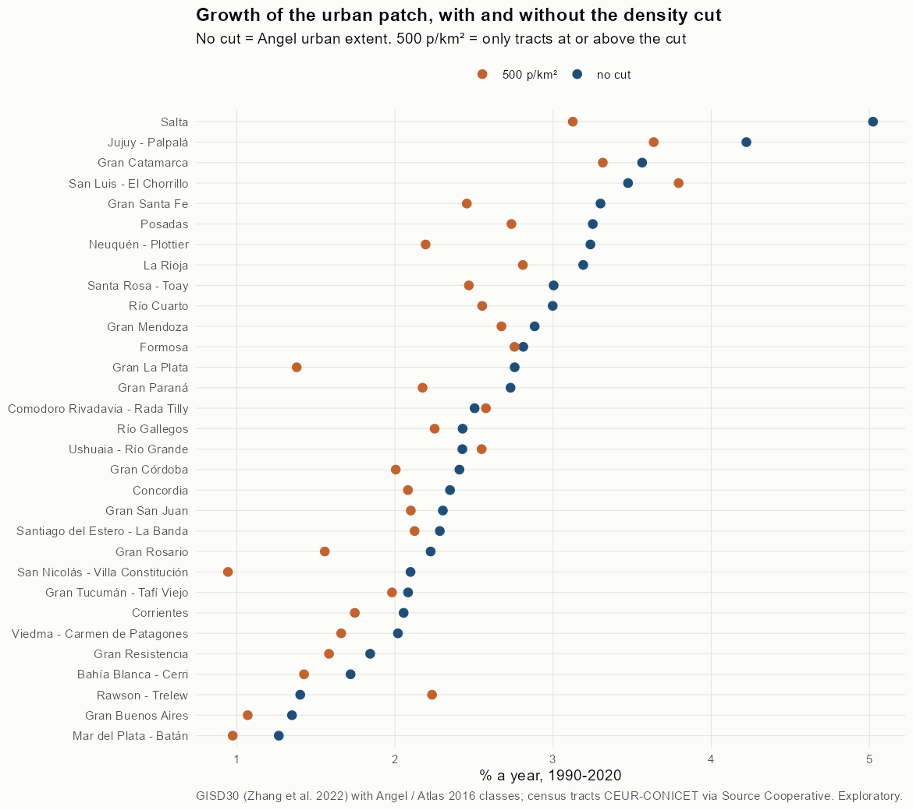
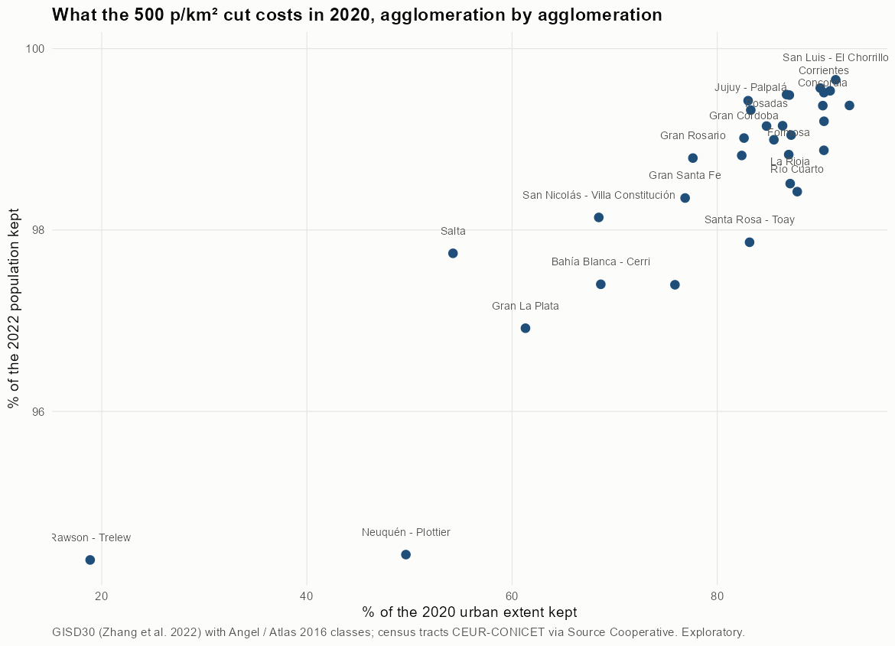

# Test 1 · the urban patch with census density, all agglomerations

Exploratory. None of these numbers are project figures (they are not in `CIFRAS_CANONICAS.json`). Generated by `Rpipe/scripts/12_prueba_densidad.R` from step 11. Run of 2026-11-08. Both tests and how they differ: [METODOS.md](../METODOS.md).

## Method

- **The city**, as in step 04: 8-connected patches of urban + suburban built-up, fringe open space and captured open space that touch the analysis perimeter (with step 04's shared-patch rule for agglomerations whose patches touch). Fringe and captured are unbuilt land that Angel counts as part of the city, and they count as urbanized land here.
- **Pairs**: GISD30 1990 with the 1991 census, 2000-2001, 2010-2010, 2020-2022 (the project rule).
- **Density of a tract** = its persons / km² of the city inside it. It is density on urbanized land, not on the whole tract. Areas come from whole 30 m pixels assigned to the tract that holds their centre (step 11); in Salta this matches exact pixel fractions to within 0.03 km².
- **Patch at cut T** = the city inside tracts with density ≥ T. A tract below the cut leaves entirely, its built land included. Cuts: 300, 500, 1,000, 2,000, 3,000, 3,250, 3,500, 3,750, 4,000, 4,500, 5,000 persons/km² (300, 500 and 1,000 are the project's `U_DENS`, `scripts/rutas.py`).
- **Persons of the patch** = persons of its whole tracts.

## All agglomerations at 500 p/km²

| Agglomeration | Extent 1990 km² | Extent 2020 km² | % kept 1990 | % kept 2020 | % persons kept 2022 | Growth no cut %/yr | Growth at 500 %/yr | Density 2020 no cut | Density 2020 at 500 |
|---|---|---|---|---|---|---|---|---|---|
| [Bahía Blanca - Cerri](bahia_blanca/REPORTE.md) | 91.3 | 152.3 | 74.9 | 68.6 | 97.4 | 1.72 | 1.42 | 2,184 | 3,091 |
| [Comodoro Rivadavia - Rada Tilly](comodoro_rivadavia/REPORTE.md) | 40.9 | 86.0 | 74.3 | 75.9 | 97.4 | 2.50 | 2.58 | 2,514 | 3,153 |
| [Concordia](concordia/REPORTE.md) | 22.0 | 44.1 | 97.6 | 90.3 | 99.4 | 2.35 | 2.08 | 4,074 | 4,453 |
| [Corrientes](corrientes/REPORTE.md) | 43.2 | 79.4 | 99.0 | 90.4 | 99.5 | 2.05 | 1.75 | 5,444 | 5,993 |
| [Formosa](formosa/REPORTE.md) | 32.5 | 74.6 | 88.4 | 87.0 | 98.8 | 2.81 | 2.76 | 3,520 | 3,986 |
| [Gran Buenos Aires](buenos_aires/REPORTE.md) | 1,704.1 | 2,547.0 | 94.6 | 87.0 | 99.5 | 1.35 | 1.07 | 5,929 | 6,764 |
| [Gran Catamarca](catamarca/REPORTE.md) | 26.9 | 76.8 | 96.8 | 90.0 | 99.6 | 3.56 | 3.31 | 2,965 | 3,279 |
| [Gran Córdoba](cordoba/REPORTE.md) | 208.9 | 426.4 | 93.0 | 82.6 | 99.0 | 2.41 | 2.00 | 4,015 | 4,813 |
| [Gran La Plata](la_plata/REPORTE.md) | 170.0 | 384.5 | 91.9 | 61.3 | 96.9 | 2.76 | 1.38 | 2,402 | 3,792 |
| [Gran Mendoza](mendoza/REPORTE.md) | 140.1 | 328.6 | 98.8 | 92.9 | 99.4 | 2.88 | 2.67 | 3,604 | 3,855 |
| [Gran Paraná](parana/REPORTE.md) | 42.2 | 94.7 | 97.0 | 82.4 | 98.8 | 2.73 | 2.17 | 3,240 | 3,845 |
| [Gran Resistencia](resistencia/REPORTE.md) | 71.1 | 122.9 | 92.4 | 85.5 | 99.0 | 1.84 | 1.58 | 3,420 | 3,958 |
| [Gran Rosario](rosario/REPORTE.md) | 183.8 | 355.7 | 94.5 | 77.6 | 98.8 | 2.23 | 1.56 | 4,104 | 5,223 |
| [Gran San Juan](san_juan/REPORTE.md) | 107.5 | 212.8 | 95.9 | 90.4 | 98.9 | 2.30 | 2.10 | 2,897 | 3,169 |
| [Gran Santa Fe](santa_fe/REPORTE.md) | 65.8 | 174.2 | 98.4 | 76.9 | 98.4 | 3.30 | 2.45 | 3,110 | 3,979 |
| [Gran Tucumán - Tafí Viejo](tucuman/REPORTE.md) | 111.2 | 206.4 | 93.8 | 91.0 | 99.5 | 2.08 | 1.98 | 5,110 | 5,589 |
| [Jujuy - Palpalá](jujuy/REPORTE.md) | 23.5 | 81.4 | 98.6 | 83.3 | 99.3 | 4.22 | 3.64 | 4,689 | 5,593 |
| [La Rioja](la_rioja/REPORTE.md) | 29.3 | 75.1 | 97.4 | 87.1 | 98.5 | 3.19 | 2.81 | 2,792 | 3,157 |
| [Mar del Plata - Batán](mar_del_plata/REPORTE.md) | 122.2 | 178.2 | 90.5 | 83.0 | 99.4 | 1.27 | 0.97 | 3,772 | 4,422 |
| [Neuquén - Plottier](neuquen/REPORTE.md) | 92.7 | 241.1 | 67.3 | 49.7 | 94.4 | 3.24 | 2.19 | 2,143 | 4,076 |
| [Posadas](posadas/REPORTE.md) | 40.4 | 105.6 | 98.5 | 84.8 | 99.1 | 3.25 | 2.74 | 3,666 | 4,286 |
| [Rawson - Trelew](rawson/REPORTE.md) | 152.3 | 231.2 | 14.8 | 18.9 | 94.4 | 1.40 | 2.23 | 660 | 3,294 |
| [Río Cuarto](rio_cuarto/REPORTE.md) | 23.9 | 57.9 | 100.0 | 87.8 | 98.4 | 3.00 | 2.55 | 2,820 | 3,162 |
| [Río Gallegos](rio_gallegos/REPORTE.md) | 16.5 | 33.9 | 91.4 | 86.8 | 99.5 | 2.43 | 2.25 | 3,532 | 3,841 |
| [Salta](salta/REPORTE.md) | 57.5 | 249.9 | 93.8 | 54.2 | 97.7 | 5.02 | 3.12 | 2,874 | 5,178 |
| [San Luis - El Chorrillo](san_luis/REPORTE.md) | 23.0 | 64.0 | 83.4 | 91.5 | 99.7 | 3.47 | 3.79 | 3,759 | 4,092 |
| [San Nicolás - Villa Constitución](san_nicolas/REPORTE.md) | 39.5 | 73.7 | 96.3 | 68.5 | 98.1 | 2.10 | 0.94 | 2,906 | 4,165 |
| [Santa Rosa - Toay](santa_rosa/REPORTE.md) | 21.2 | 51.5 | 97.2 | 83.2 | 97.9 | 3.00 | 2.47 | 2,589 | 3,047 |
| [Santiago del Estero - La Banda](santiago_del_estero/REPORTE.md) | 70.2 | 138.2 | 94.7 | 90.4 | 99.2 | 2.28 | 2.12 | 3,301 | 3,622 |
| [Ushuaia - Río Grande](ushuaia/REPORTE.md) | 19.5 | 39.9 | 83.3 | 86.4 | 99.1 | 2.43 | 2.55 | 4,406 | 4,926 |
| [Viedma - Carmen de Patagones](viedma/REPORTE.md) | 14.3 | 26.0 | 96.9 | 87.2 | 99.0 | 2.02 | 1.66 | 3,237 | 3,677 |

## Maps by agglomeration

Each link opens the full map. All maps of an agglomeration share one frame: its 2020 city plus 3 km. *patch*: the extent kept at each cut (12 panels, no cut to 5,000 p/km²); *density*: persons per km² urbanized by tract.

| Agglomeration | 1990 | 2000 | 2010 | 2020 |
|---|---|---|---|---|
| [Bahía Blanca - Cerri](bahia_blanca/REPORTE.md) | [patch](bahia_blanca/img/mapa_1990.png) · [density](bahia_blanca/img/densidad_1990.png) | [patch](bahia_blanca/img/mapa_2000.png) · [density](bahia_blanca/img/densidad_2000.png) | [patch](bahia_blanca/img/mapa_2010.png) · [density](bahia_blanca/img/densidad_2010.png) | [patch](bahia_blanca/img/mapa_2020.png) · [density](bahia_blanca/img/densidad_2020.png) |
| [Comodoro Rivadavia - Rada Tilly](comodoro_rivadavia/REPORTE.md) | [patch](comodoro_rivadavia/img/mapa_1990.png) · [density](comodoro_rivadavia/img/densidad_1990.png) | [patch](comodoro_rivadavia/img/mapa_2000.png) · [density](comodoro_rivadavia/img/densidad_2000.png) | [patch](comodoro_rivadavia/img/mapa_2010.png) · [density](comodoro_rivadavia/img/densidad_2010.png) | [patch](comodoro_rivadavia/img/mapa_2020.png) · [density](comodoro_rivadavia/img/densidad_2020.png) |
| [Concordia](concordia/REPORTE.md) | [patch](concordia/img/mapa_1990.png) · [density](concordia/img/densidad_1990.png) | [patch](concordia/img/mapa_2000.png) · [density](concordia/img/densidad_2000.png) | [patch](concordia/img/mapa_2010.png) · [density](concordia/img/densidad_2010.png) | [patch](concordia/img/mapa_2020.png) · [density](concordia/img/densidad_2020.png) |
| [Corrientes](corrientes/REPORTE.md) | [patch](corrientes/img/mapa_1990.png) · [density](corrientes/img/densidad_1990.png) | [patch](corrientes/img/mapa_2000.png) · [density](corrientes/img/densidad_2000.png) | [patch](corrientes/img/mapa_2010.png) · [density](corrientes/img/densidad_2010.png) | [patch](corrientes/img/mapa_2020.png) · [density](corrientes/img/densidad_2020.png) |
| [Formosa](formosa/REPORTE.md) | [patch](formosa/img/mapa_1990.png) · [density](formosa/img/densidad_1990.png) | [patch](formosa/img/mapa_2000.png) · [density](formosa/img/densidad_2000.png) | [patch](formosa/img/mapa_2010.png) · [density](formosa/img/densidad_2010.png) | [patch](formosa/img/mapa_2020.png) · [density](formosa/img/densidad_2020.png) |
| [Gran Buenos Aires](buenos_aires/REPORTE.md) | [patch](buenos_aires/img/mapa_1990.png) · [density](buenos_aires/img/densidad_1990.png) | [patch](buenos_aires/img/mapa_2000.png) · [density](buenos_aires/img/densidad_2000.png) | [patch](buenos_aires/img/mapa_2010.png) · [density](buenos_aires/img/densidad_2010.png) | [patch](buenos_aires/img/mapa_2020.png) · [density](buenos_aires/img/densidad_2020.png) |
| [Gran Catamarca](catamarca/REPORTE.md) | [patch](catamarca/img/mapa_1990.png) · [density](catamarca/img/densidad_1990.png) | [patch](catamarca/img/mapa_2000.png) · [density](catamarca/img/densidad_2000.png) | [patch](catamarca/img/mapa_2010.png) · [density](catamarca/img/densidad_2010.png) | [patch](catamarca/img/mapa_2020.png) · [density](catamarca/img/densidad_2020.png) |
| [Gran Córdoba](cordoba/REPORTE.md) | [patch](cordoba/img/mapa_1990.png) · [density](cordoba/img/densidad_1990.png) | [patch](cordoba/img/mapa_2000.png) · [density](cordoba/img/densidad_2000.png) | [patch](cordoba/img/mapa_2010.png) · [density](cordoba/img/densidad_2010.png) | [patch](cordoba/img/mapa_2020.png) · [density](cordoba/img/densidad_2020.png) |
| [Gran La Plata](la_plata/REPORTE.md) | [patch](la_plata/img/mapa_1990.png) · [density](la_plata/img/densidad_1990.png) | [patch](la_plata/img/mapa_2000.png) · [density](la_plata/img/densidad_2000.png) | [patch](la_plata/img/mapa_2010.png) · [density](la_plata/img/densidad_2010.png) | [patch](la_plata/img/mapa_2020.png) · [density](la_plata/img/densidad_2020.png) |
| [Gran Mendoza](mendoza/REPORTE.md) | [patch](mendoza/img/mapa_1990.png) · [density](mendoza/img/densidad_1990.png) | [patch](mendoza/img/mapa_2000.png) · [density](mendoza/img/densidad_2000.png) | [patch](mendoza/img/mapa_2010.png) · [density](mendoza/img/densidad_2010.png) | [patch](mendoza/img/mapa_2020.png) · [density](mendoza/img/densidad_2020.png) |
| [Gran Paraná](parana/REPORTE.md) | [patch](parana/img/mapa_1990.png) · [density](parana/img/densidad_1990.png) | [patch](parana/img/mapa_2000.png) · [density](parana/img/densidad_2000.png) | [patch](parana/img/mapa_2010.png) · [density](parana/img/densidad_2010.png) | [patch](parana/img/mapa_2020.png) · [density](parana/img/densidad_2020.png) |
| [Gran Resistencia](resistencia/REPORTE.md) | [patch](resistencia/img/mapa_1990.png) · [density](resistencia/img/densidad_1990.png) | [patch](resistencia/img/mapa_2000.png) · [density](resistencia/img/densidad_2000.png) | [patch](resistencia/img/mapa_2010.png) · [density](resistencia/img/densidad_2010.png) | [patch](resistencia/img/mapa_2020.png) · [density](resistencia/img/densidad_2020.png) |
| [Gran Rosario](rosario/REPORTE.md) | [patch](rosario/img/mapa_1990.png) · [density](rosario/img/densidad_1990.png) | [patch](rosario/img/mapa_2000.png) · [density](rosario/img/densidad_2000.png) | [patch](rosario/img/mapa_2010.png) · [density](rosario/img/densidad_2010.png) | [patch](rosario/img/mapa_2020.png) · [density](rosario/img/densidad_2020.png) |
| [Gran San Juan](san_juan/REPORTE.md) | [patch](san_juan/img/mapa_1990.png) · [density](san_juan/img/densidad_1990.png) | [patch](san_juan/img/mapa_2000.png) · [density](san_juan/img/densidad_2000.png) | [patch](san_juan/img/mapa_2010.png) · [density](san_juan/img/densidad_2010.png) | [patch](san_juan/img/mapa_2020.png) · [density](san_juan/img/densidad_2020.png) |
| [Gran Santa Fe](santa_fe/REPORTE.md) | [patch](santa_fe/img/mapa_1990.png) · [density](santa_fe/img/densidad_1990.png) | [patch](santa_fe/img/mapa_2000.png) · [density](santa_fe/img/densidad_2000.png) | [patch](santa_fe/img/mapa_2010.png) · [density](santa_fe/img/densidad_2010.png) | [patch](santa_fe/img/mapa_2020.png) · [density](santa_fe/img/densidad_2020.png) |
| [Gran Tucumán - Tafí Viejo](tucuman/REPORTE.md) | [patch](tucuman/img/mapa_1990.png) · [density](tucuman/img/densidad_1990.png) | [patch](tucuman/img/mapa_2000.png) · [density](tucuman/img/densidad_2000.png) | [patch](tucuman/img/mapa_2010.png) · [density](tucuman/img/densidad_2010.png) | [patch](tucuman/img/mapa_2020.png) · [density](tucuman/img/densidad_2020.png) |
| [Jujuy - Palpalá](jujuy/REPORTE.md) | [patch](jujuy/img/mapa_1990.png) · [density](jujuy/img/densidad_1990.png) | [patch](jujuy/img/mapa_2000.png) · [density](jujuy/img/densidad_2000.png) | [patch](jujuy/img/mapa_2010.png) · [density](jujuy/img/densidad_2010.png) | [patch](jujuy/img/mapa_2020.png) · [density](jujuy/img/densidad_2020.png) |
| [La Rioja](la_rioja/REPORTE.md) | [patch](la_rioja/img/mapa_1990.png) · [density](la_rioja/img/densidad_1990.png) | [patch](la_rioja/img/mapa_2000.png) · [density](la_rioja/img/densidad_2000.png) | [patch](la_rioja/img/mapa_2010.png) · [density](la_rioja/img/densidad_2010.png) | [patch](la_rioja/img/mapa_2020.png) · [density](la_rioja/img/densidad_2020.png) |
| [Mar del Plata - Batán](mar_del_plata/REPORTE.md) | [patch](mar_del_plata/img/mapa_1990.png) · [density](mar_del_plata/img/densidad_1990.png) | [patch](mar_del_plata/img/mapa_2000.png) · [density](mar_del_plata/img/densidad_2000.png) | [patch](mar_del_plata/img/mapa_2010.png) · [density](mar_del_plata/img/densidad_2010.png) | [patch](mar_del_plata/img/mapa_2020.png) · [density](mar_del_plata/img/densidad_2020.png) |
| [Neuquén - Plottier](neuquen/REPORTE.md) | [patch](neuquen/img/mapa_1990.png) · [density](neuquen/img/densidad_1990.png) | [patch](neuquen/img/mapa_2000.png) · [density](neuquen/img/densidad_2000.png) | [patch](neuquen/img/mapa_2010.png) · [density](neuquen/img/densidad_2010.png) | [patch](neuquen/img/mapa_2020.png) · [density](neuquen/img/densidad_2020.png) |
| [Posadas](posadas/REPORTE.md) | [patch](posadas/img/mapa_1990.png) · [density](posadas/img/densidad_1990.png) | [patch](posadas/img/mapa_2000.png) · [density](posadas/img/densidad_2000.png) | [patch](posadas/img/mapa_2010.png) · [density](posadas/img/densidad_2010.png) | [patch](posadas/img/mapa_2020.png) · [density](posadas/img/densidad_2020.png) |
| [Rawson - Trelew](rawson/REPORTE.md) | [patch](rawson/img/mapa_1990.png) · [density](rawson/img/densidad_1990.png) | [patch](rawson/img/mapa_2000.png) · [density](rawson/img/densidad_2000.png) | [patch](rawson/img/mapa_2010.png) · [density](rawson/img/densidad_2010.png) | [patch](rawson/img/mapa_2020.png) · [density](rawson/img/densidad_2020.png) |
| [Río Cuarto](rio_cuarto/REPORTE.md) | [patch](rio_cuarto/img/mapa_1990.png) · [density](rio_cuarto/img/densidad_1990.png) | [patch](rio_cuarto/img/mapa_2000.png) · [density](rio_cuarto/img/densidad_2000.png) | [patch](rio_cuarto/img/mapa_2010.png) · [density](rio_cuarto/img/densidad_2010.png) | [patch](rio_cuarto/img/mapa_2020.png) · [density](rio_cuarto/img/densidad_2020.png) |
| [Río Gallegos](rio_gallegos/REPORTE.md) | [patch](rio_gallegos/img/mapa_1990.png) · [density](rio_gallegos/img/densidad_1990.png) | [patch](rio_gallegos/img/mapa_2000.png) · [density](rio_gallegos/img/densidad_2000.png) | [patch](rio_gallegos/img/mapa_2010.png) · [density](rio_gallegos/img/densidad_2010.png) | [patch](rio_gallegos/img/mapa_2020.png) · [density](rio_gallegos/img/densidad_2020.png) |
| [Salta](salta/REPORTE.md) | [patch](salta/img/mapa_1990.png) · [density](salta/img/densidad_1990.png) | [patch](salta/img/mapa_2000.png) · [density](salta/img/densidad_2000.png) | [patch](salta/img/mapa_2010.png) · [density](salta/img/densidad_2010.png) | [patch](salta/img/mapa_2020.png) · [density](salta/img/densidad_2020.png) |
| [San Luis - El Chorrillo](san_luis/REPORTE.md) | [patch](san_luis/img/mapa_1990.png) · [density](san_luis/img/densidad_1990.png) | [patch](san_luis/img/mapa_2000.png) · [density](san_luis/img/densidad_2000.png) | [patch](san_luis/img/mapa_2010.png) · [density](san_luis/img/densidad_2010.png) | [patch](san_luis/img/mapa_2020.png) · [density](san_luis/img/densidad_2020.png) |
| [San Nicolás - Villa Constitución](san_nicolas/REPORTE.md) | [patch](san_nicolas/img/mapa_1990.png) · [density](san_nicolas/img/densidad_1990.png) | [patch](san_nicolas/img/mapa_2000.png) · [density](san_nicolas/img/densidad_2000.png) | [patch](san_nicolas/img/mapa_2010.png) · [density](san_nicolas/img/densidad_2010.png) | [patch](san_nicolas/img/mapa_2020.png) · [density](san_nicolas/img/densidad_2020.png) |
| [Santa Rosa - Toay](santa_rosa/REPORTE.md) | [patch](santa_rosa/img/mapa_1990.png) · [density](santa_rosa/img/densidad_1990.png) | [patch](santa_rosa/img/mapa_2000.png) · [density](santa_rosa/img/densidad_2000.png) | [patch](santa_rosa/img/mapa_2010.png) · [density](santa_rosa/img/densidad_2010.png) | [patch](santa_rosa/img/mapa_2020.png) · [density](santa_rosa/img/densidad_2020.png) |
| [Santiago del Estero - La Banda](santiago_del_estero/REPORTE.md) | [patch](santiago_del_estero/img/mapa_1990.png) · [density](santiago_del_estero/img/densidad_1990.png) | [patch](santiago_del_estero/img/mapa_2000.png) · [density](santiago_del_estero/img/densidad_2000.png) | [patch](santiago_del_estero/img/mapa_2010.png) · [density](santiago_del_estero/img/densidad_2010.png) | [patch](santiago_del_estero/img/mapa_2020.png) · [density](santiago_del_estero/img/densidad_2020.png) |
| [Ushuaia - Río Grande](ushuaia/REPORTE.md) | [patch](ushuaia/img/mapa_1990.png) · [density](ushuaia/img/densidad_1990.png) | [patch](ushuaia/img/mapa_2000.png) · [density](ushuaia/img/densidad_2000.png) | [patch](ushuaia/img/mapa_2010.png) · [density](ushuaia/img/densidad_2010.png) | [patch](ushuaia/img/mapa_2020.png) · [density](ushuaia/img/densidad_2020.png) |
| [Viedma - Carmen de Patagones](viedma/REPORTE.md) | [patch](viedma/img/mapa_1990.png) · [density](viedma/img/densidad_1990.png) | [patch](viedma/img/mapa_2000.png) · [density](viedma/img/densidad_2000.png) | [patch](viedma/img/mapa_2010.png) · [density](viedma/img/densidad_2010.png) | [patch](viedma/img/mapa_2020.png) · [density](viedma/img/densidad_2020.png) |

