# San Nicolás - Villa Constitución · the urban patch with census density, 1990-2020

Exploratory test 1. None of these numbers are project figures (they are not in `CIFRAS_CANONICAS.json`). Generated by `Rpipe/scripts/12_prueba_densidad.R` from the tract tables of step 11. Run of 2026-11-08. [All agglomerations](../REPORTE.md).

**Question.** The satellite urban extent (GISD30 with the Angel / Atlas 2016 classes) counts as city everything that is built, plus its fringe and captured open space, whether people live there or not. If we keep only the part of that extent that sits in census tracts with enough people, does the patch describe the city better? A tract below the cut leaves entirely, built land included. Method in the [index](../REPORTE.md#method).

## What each cut keeps

**1990 (census 1991).** City: 39.5 km², 160 tracts, 164,264 persons.

| Cut (p/km²) | Patch km² | % of extent | of which fringe/captured % | Tracts | Persons | % of persons | Density p/km² | Dropped km² | Dropped persons | Census only km² |
|---|---|---|---|---|---|---|---|---|---|---|
| none | 39.5 | 100.0 | 35.5 | 160 | 164,264 | 100.0 | 4,158 | 0.0 | 0 | — |
| 300 | 38.3 | 96.9 | 33.8 | 158 | 163,943 | 99.8 | 4,282 | 1.2 | 321 | 54.3 |
| 500 | 38.0 | 96.3 | 33.5 | 157 | 163,846 | 99.7 | 4,308 | 1.5 | 418 | 48.4 |
| 1,000 | 31.6 | 79.9 | 26.2 | 149 | 159,453 | 97.1 | 5,050 | 7.9 | 4,811 | 40.8 |
| 2,000 | 30.4 | 76.8 | 24.5 | 145 | 157,907 | 96.1 | 5,201 | 9.1 | 6,357 | 30.4 |
| 3,000 | 26.0 | 65.9 | 20.4 | 135 | 148,369 | 90.3 | 5,700 | 13.5 | 15,895 | 23.6 |
| 3,250 | 24.9 | 63.1 | 19.3 | 130 | 145,007 | 88.3 | 5,815 | 14.6 | 19,257 | 22.9 |
| 3,500 | 24.0 | 60.7 | 18.9 | 127 | 141,725 | 86.3 | 5,908 | 15.5 | 22,539 | 21.8 |
| 3,750 | 22.5 | 57.1 | 18.1 | 123 | 136,532 | 83.1 | 6,056 | 17.0 | 27,732 | 20.8 |
| 4,000 | 21.3 | 54.0 | 17.5 | 118 | 131,880 | 80.3 | 6,178 | 18.2 | 32,384 | 19.0 |
| 4,500 | 17.8 | 45.2 | 12.9 | 108 | 117,086 | 71.3 | 6,560 | 21.7 | 47,178 | 16.6 |
| 5,000 | 15.3 | 38.8 | 10.9 | 99 | 104,871 | 63.8 | 6,845 | 24.2 | 59,393 | 14.2 |

**2000 (census 2001).** City: 45.0 km², 178 tracts, 174,429 persons.

| Cut (p/km²) | Patch km² | % of extent | of which fringe/captured % | Tracts | Persons | % of persons | Density p/km² | Dropped km² | Dropped persons | Census only km² |
|---|---|---|---|---|---|---|---|---|---|---|
| none | 45.0 | 100.0 | 34.7 | 178 | 174,429 | 100.0 | 3,879 | 0.0 | 0 | — |
| 300 | 44.5 | 99.0 | 34.4 | 176 | 174,369 | 100.0 | 3,917 | 0.5 | 60 | 55.5 |
| 500 | 43.0 | 95.5 | 32.5 | 174 | 173,655 | 99.6 | 4,042 | 2.0 | 774 | 51.4 |
| 1,000 | 35.5 | 78.9 | 26.3 | 167 | 167,430 | 96.0 | 4,717 | 9.5 | 6,999 | 39.4 |
| 2,000 | 30.7 | 68.4 | 20.8 | 156 | 160,622 | 92.1 | 5,224 | 14.2 | 13,807 | 31.3 |
| 3,000 | 26.6 | 59.1 | 16.3 | 142 | 150,520 | 86.3 | 5,666 | 18.4 | 23,909 | 25.5 |
| 3,250 | 26.6 | 59.1 | 16.3 | 142 | 150,520 | 86.3 | 5,666 | 18.4 | 23,909 | 24.7 |
| 3,500 | 25.5 | 56.7 | 15.2 | 138 | 146,864 | 84.2 | 5,761 | 19.5 | 27,565 | 24.3 |
| 3,750 | 23.5 | 52.3 | 14.1 | 132 | 139,688 | 80.1 | 5,945 | 21.5 | 34,741 | 22.5 |
| 4,000 | 21.8 | 48.6 | 12.7 | 126 | 133,309 | 76.4 | 6,102 | 23.1 | 41,120 | 20.3 |
| 4,500 | 18.5 | 41.1 | 10.0 | 114 | 119,012 | 68.2 | 6,445 | 26.5 | 55,417 | 18.6 |
| 5,000 | 15.4 | 34.2 | 9.2 | 99 | 104,361 | 59.8 | 6,794 | 29.6 | 70,068 | 15.0 |

**2010 (census 2010).** City: 51.6 km², 201 tracts, 187,623 persons.

| Cut (p/km²) | Patch km² | % of extent | of which fringe/captured % | Tracts | Persons | % of persons | Density p/km² | Dropped km² | Dropped persons | Census only km² |
|---|---|---|---|---|---|---|---|---|---|---|
| none | 51.6 | 100.0 | 32.2 | 201 | 187,623 | 100.0 | 3,638 | 0.0 | 0 | — |
| 300 | 51.0 | 98.9 | 31.8 | 199 | 187,573 | 100.0 | 3,679 | 0.6 | 50 | 57.3 |
| 500 | 50.8 | 98.5 | 31.6 | 197 | 187,486 | 99.9 | 3,692 | 0.8 | 137 | 54.6 |
| 1,000 | 39.4 | 76.4 | 23.8 | 185 | 179,501 | 95.7 | 4,554 | 12.2 | 8,122 | 38.7 |
| 2,000 | 34.1 | 66.1 | 17.7 | 173 | 171,513 | 91.4 | 5,030 | 17.5 | 16,110 | 34.0 |
| 3,000 | 28.9 | 55.9 | 13.8 | 160 | 159,066 | 84.8 | 5,512 | 22.7 | 28,557 | 28.4 |
| 3,250 | 26.7 | 51.7 | 12.5 | 152 | 152,240 | 81.1 | 5,707 | 24.9 | 35,383 | 25.5 |
| 3,500 | 26.1 | 50.6 | 11.7 | 150 | 150,402 | 80.2 | 5,758 | 25.5 | 37,221 | 24.0 |
| 3,750 | 23.7 | 45.9 | 9.6 | 143 | 141,564 | 75.5 | 5,980 | 27.9 | 46,059 | 22.6 |
| 4,000 | 22.9 | 44.5 | 9.1 | 140 | 138,690 | 73.9 | 6,049 | 28.6 | 48,933 | 22.2 |
| 4,500 | 19.3 | 37.4 | 6.4 | 125 | 123,250 | 65.7 | 6,392 | 32.3 | 64,373 | 19.3 |
| 5,000 | 15.2 | 29.5 | 3.7 | 105 | 103,967 | 55.4 | 6,842 | 36.4 | 83,656 | 16.2 |

**2020 (census 2022).** City: 73.7 km², 249 tracts, 214,002 persons.

| Cut (p/km²) | Patch km² | % of extent | of which fringe/captured % | Tracts | Persons | % of persons | Density p/km² | Dropped km² | Dropped persons | Census only km² |
|---|---|---|---|---|---|---|---|---|---|---|
| none | 73.6 | 100.0 | 35.1 | 249 | 214,002 | 100.0 | 2,906 | 0.0 | 0 | — |
| 300 | 58.0 | 78.7 | 28.9 | 238 | 212,979 | 99.5 | 3,673 | 15.7 | 1,023 | 63.5 |
| 500 | 50.4 | 68.5 | 23.3 | 229 | 210,019 | 98.1 | 4,165 | 23.2 | 3,983 | 59.5 |
| 1,000 | 44.7 | 60.7 | 20.5 | 222 | 206,108 | 96.3 | 4,610 | 28.9 | 7,894 | 47.3 |
| 2,000 | 37.2 | 50.5 | 15.0 | 204 | 194,344 | 90.8 | 5,225 | 36.5 | 19,658 | 38.4 |
| 3,000 | 31.4 | 42.7 | 10.5 | 187 | 179,651 | 83.9 | 5,718 | 42.2 | 34,351 | 32.1 |
| 3,250 | 30.2 | 41.0 | 9.1 | 183 | 175,757 | 82.1 | 5,824 | 43.5 | 38,245 | 30.4 |
| 3,500 | 26.7 | 36.3 | 7.4 | 173 | 164,104 | 76.7 | 6,145 | 46.9 | 49,898 | 27.2 |
| 3,750 | 24.0 | 32.5 | 5.7 | 163 | 154,220 | 72.1 | 6,433 | 49.7 | 59,782 | 24.2 |
| 4,000 | 22.9 | 31.1 | 4.6 | 159 | 149,914 | 70.1 | 6,554 | 50.8 | 64,088 | 23.4 |
| 4,500 | 20.8 | 28.3 | 4.2 | 149 | 141,138 | 66.0 | 6,774 | 52.8 | 72,864 | 21.3 |
| 5,000 | 17.6 | 23.9 | 3.5 | 133 | 125,882 | 58.8 | 7,162 | 56.1 | 88,120 | 17.6 |

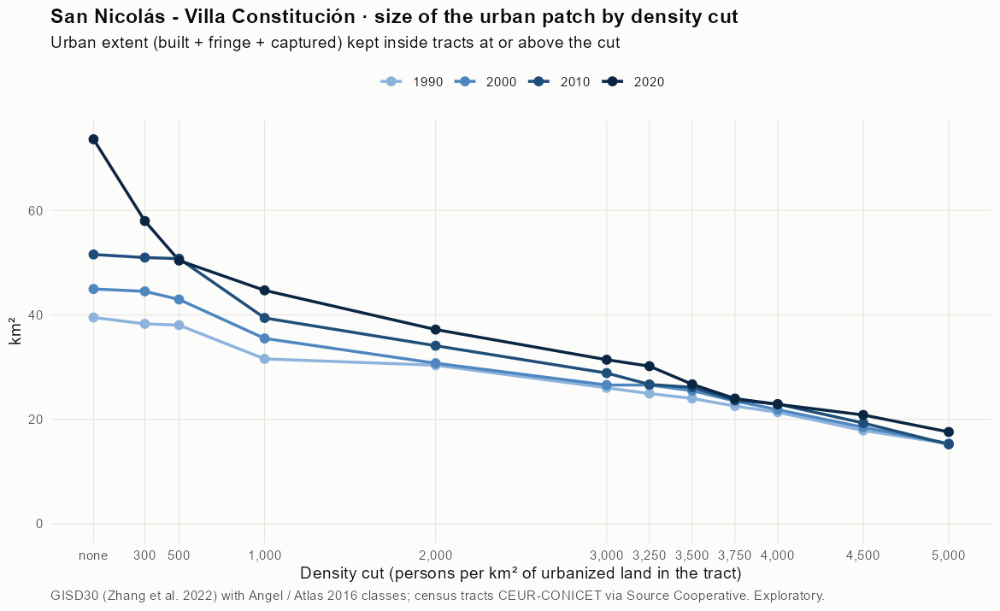

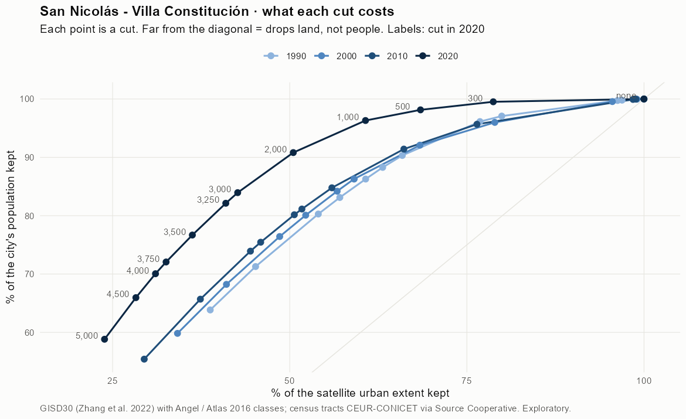

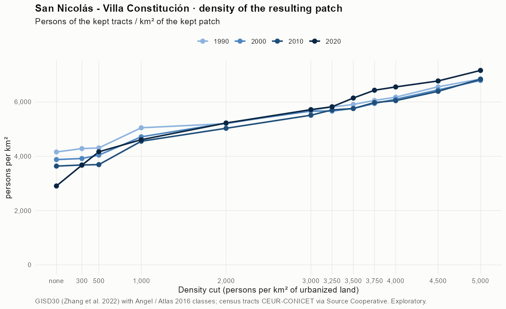

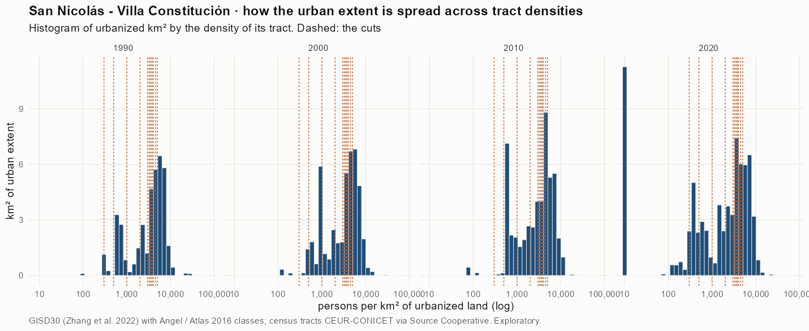

## Growth by cut

| Cut (p/km²) | 1990 km² | 2000 km² | 2010 km² | 2020 km² | 1990-2000 %/yr | 2000-2010 %/yr | 2010-2020 %/yr | 1990-2020 %/yr |
|---|---|---|---|---|---|---|---|---|
| none | 39.5 | 45.0 | 51.6 | 73.6 | 1.30 | 1.38 | 3.63 | 2.10 |
| 300 | 38.3 | 44.5 | 51.0 | 58.0 | 1.52 | 1.37 | 1.30 | 1.39 |
| 500 | 38.0 | 43.0 | 50.8 | 50.4 | 1.23 | 1.69 | -0.07 | 0.94 |
| 1,000 | 31.6 | 35.5 | 39.4 | 44.7 | 1.18 | 1.05 | 1.27 | 1.17 |
| 2,000 | 30.4 | 30.7 | 34.1 | 37.2 | 0.13 | 1.04 | 0.87 | 0.68 |
| 3,000 | 26.0 | 26.6 | 28.9 | 31.4 | 0.20 | 0.83 | 0.85 | 0.63 |
| 3,250 | 24.9 | 26.6 | 26.7 | 30.2 | 0.64 | 0.04 | 1.24 | 0.64 |
| 3,500 | 24.0 | 25.5 | 26.1 | 26.7 | 0.61 | 0.24 | 0.22 | 0.36 |
| 3,750 | 22.5 | 23.5 | 23.7 | 24.0 | 0.41 | 0.08 | 0.13 | 0.21 |
| 4,000 | 21.3 | 21.8 | 22.9 | 22.9 | 0.23 | 0.48 | -0.02 | 0.23 |
| 4,500 | 17.8 | 18.5 | 19.3 | 20.8 | 0.34 | 0.43 | 0.78 | 0.52 |
| 5,000 | 15.3 | 15.4 | 15.2 | 17.6 | 0.03 | -0.11 | 1.47 | 0.46 |

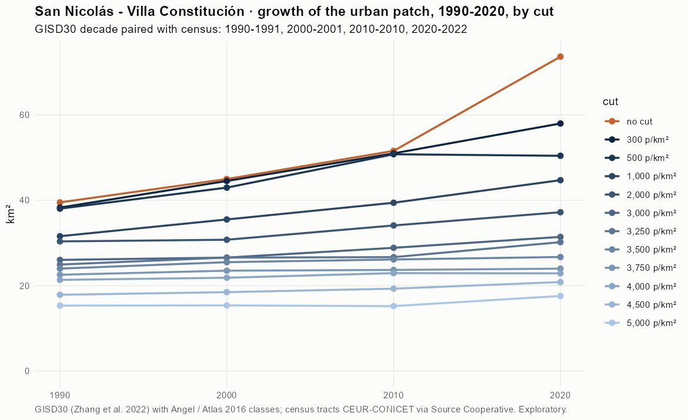

## Dense tracts the satellite barely sees

Tracts with gross density at or above the cut but less than 10 % of their area in the satellite city.

| Cut (p/km²) | 1990 tracts (persons) | 2000 tracts (persons) | 2010 tracts (persons) | 2020 tracts (persons) |
|---|---|---|---|---|
| 300 | 16 (12,772) | 16 (11,265) | 12 (9,777) | 15 (11,531) |
| 500 | 13 (11,685) | 11 (9,569) | 10 (9,291) | 14 (10,929) |
| 1,000 | 12 (10,627) | 10 (8,641) | 7 (7,359) | 12 (10,103) |
| 2,000 | 8 (6,023) | 6 (5,726) | 5 (5,793) | 10 (8,837) |
| 3,000 | 4 (3,686) | 3 (3,699) | 4 (5,061) | 8 (7,426) |
| 3,250 | 4 (3,686) | 3 (3,699) | 3 (4,005) | 6 (5,609) |
| 3,500 | 4 (3,686) | 3 (3,699) | 3 (4,005) | 6 (5,609) |
| 3,750 | 4 (3,686) | 3 (3,699) | 3 (4,005) | 5 (4,177) |
| 4,000 | 2 (1,621) | 3 (3,699) | 3 (4,005) | 4 (3,395) |
| 4,500 | 2 (1,621) | 3 (3,699) | 3 (4,005) | 4 (3,395) |
| 5,000 | 0 (0) | 2 (2,771) | 2 (3,074) | 3 (2,464) |

## Maps

Same frame in the four years: the 2020 city plus 3 km. Blue is kept, orange is dropped; dark is built, light is fringe or captured open space. Black line: the analysis perimeter. On the density maps, tracts outlined in orange have under 10 % of their area in the satellite city.

### 1990

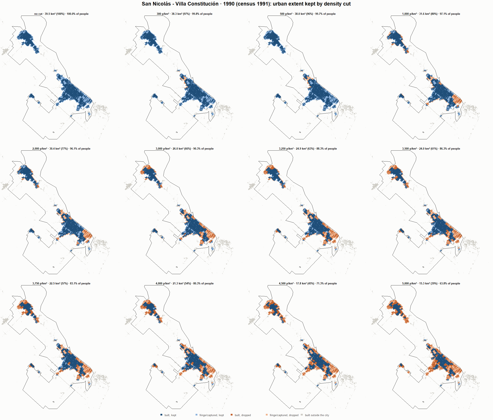

### 2000

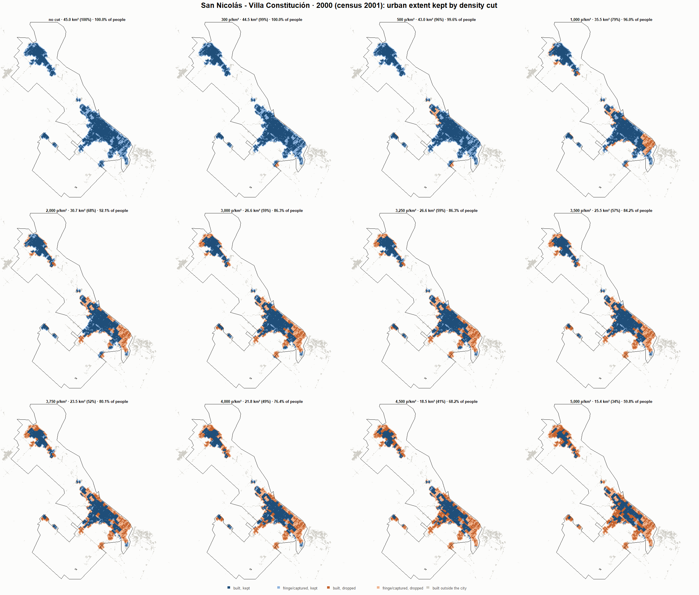

### 2010

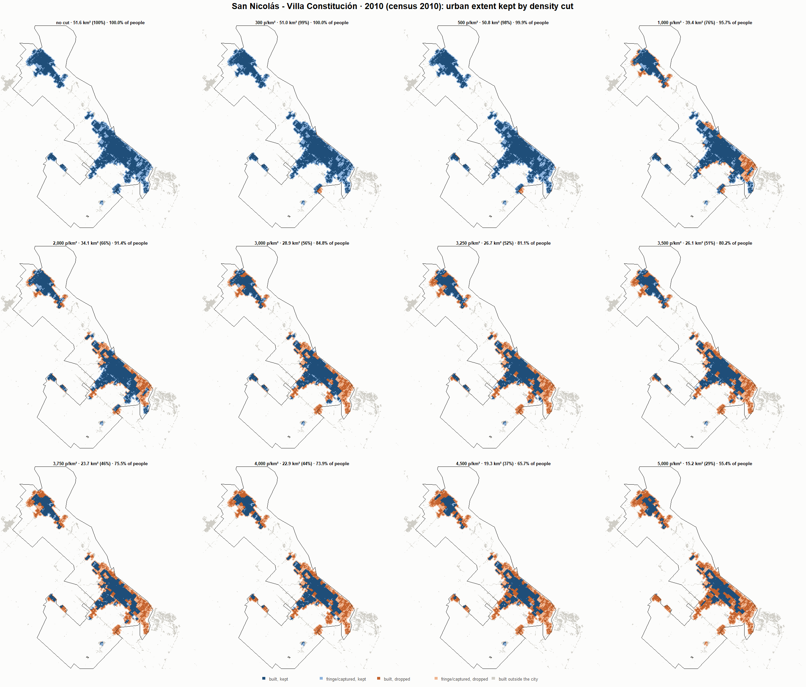

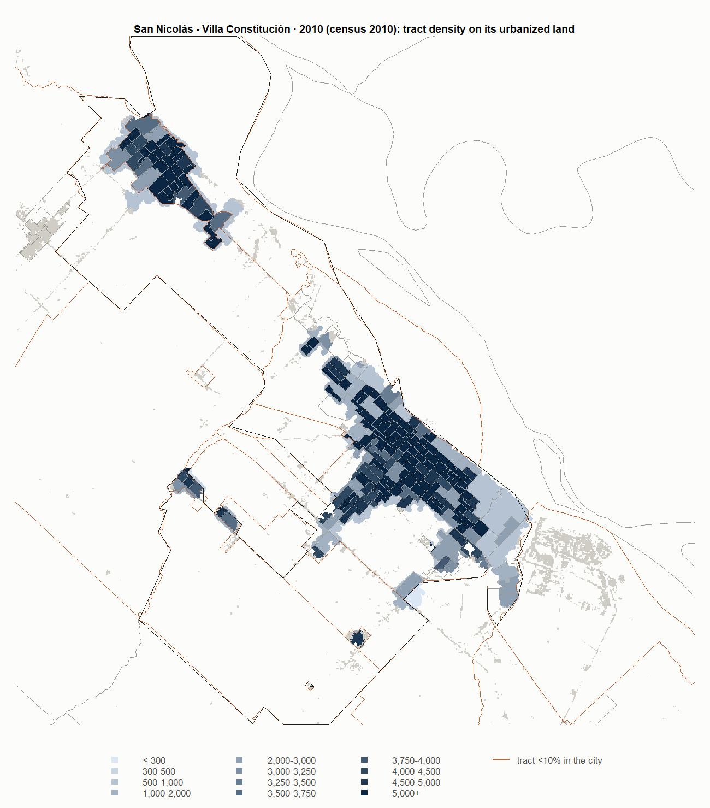

### 2020

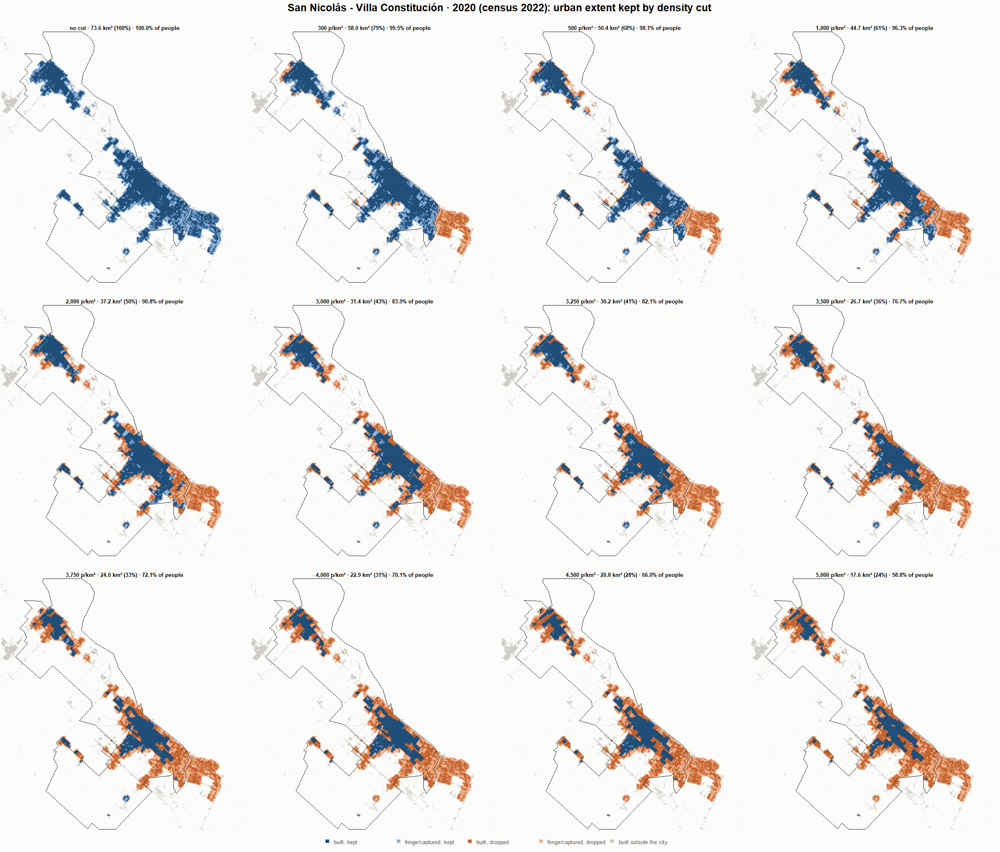

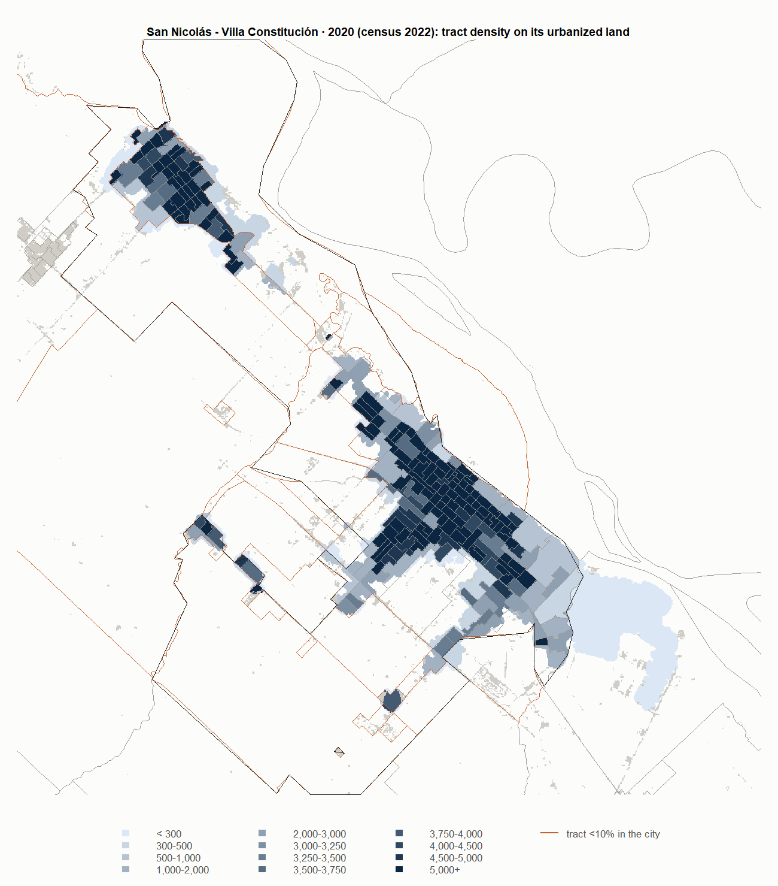

## Reading

- **At 500 p/km²** the patch keeps 96.3 % of the satellite extent in 1990 and 68.5 % in 2020, and 99.7 % / 98.1 % of the persons of the city's tracts.
- **Growth 1990-2020**: 2.10 %/yr with no cut, 0.94 %/yr at 500, 0.46 %/yr at 5,000.
- **2010-2020.** With no cut the extent grows by 22.1 km²; at 500 p/km² by -0.4 km². The gap, 22.4 km², is roughly new extent that landed in tracts below the cut.
- **Tracts mostly outside the city** (under 10 % of their area in it) keep their sliver of city because their residents raise its density: 0.2 km² at 500 p/km² in 2020.

