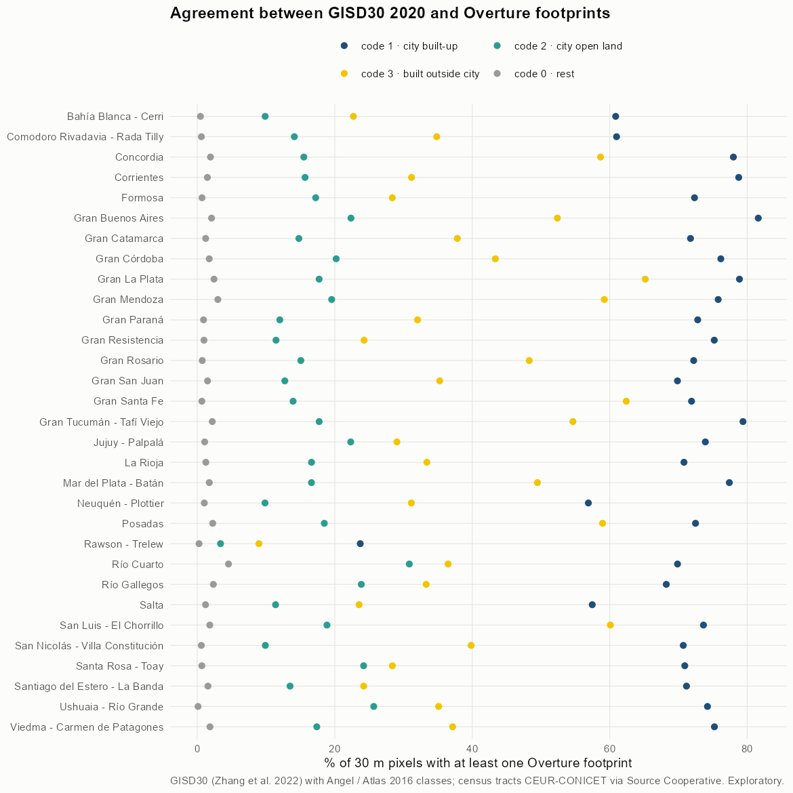
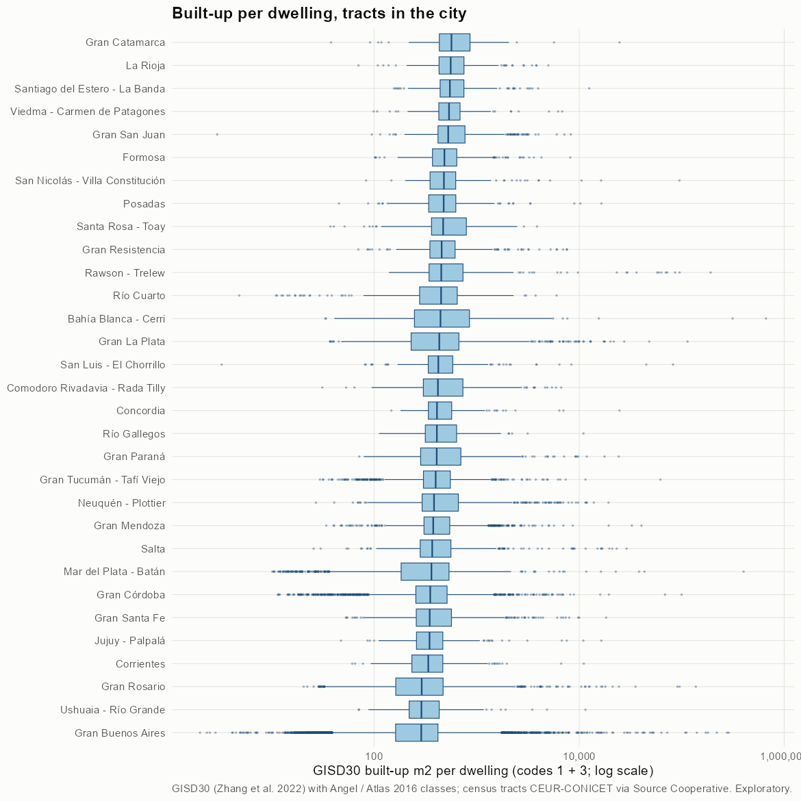
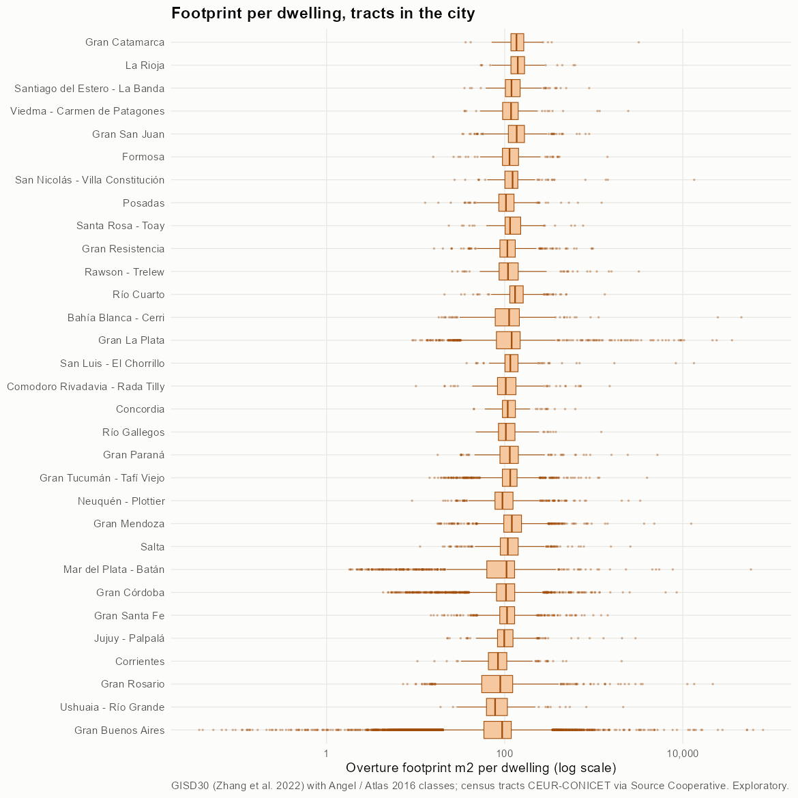
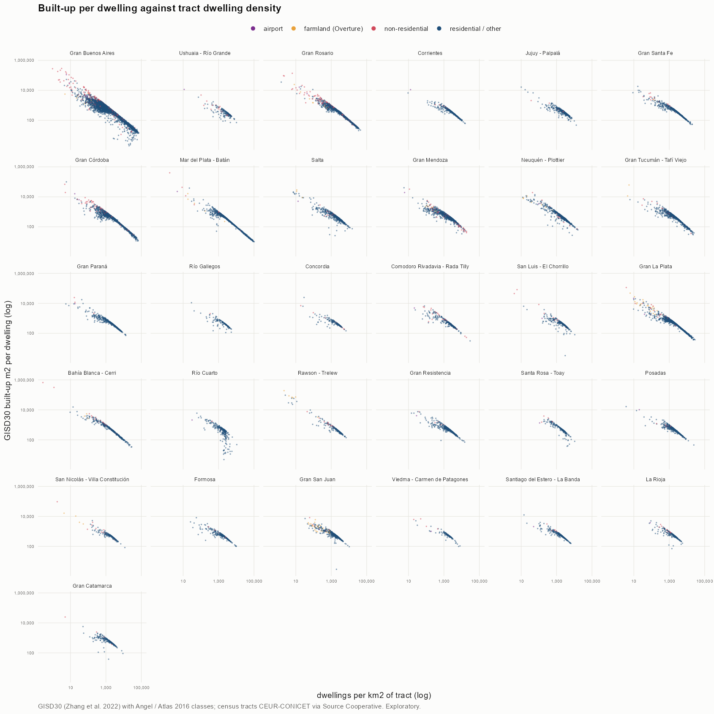
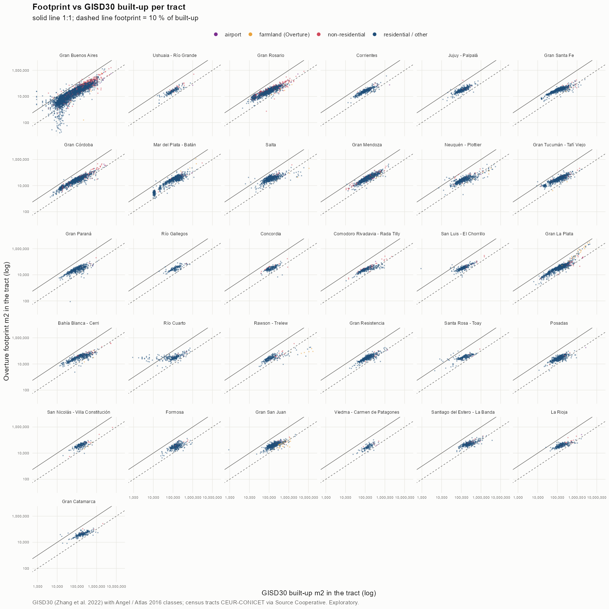
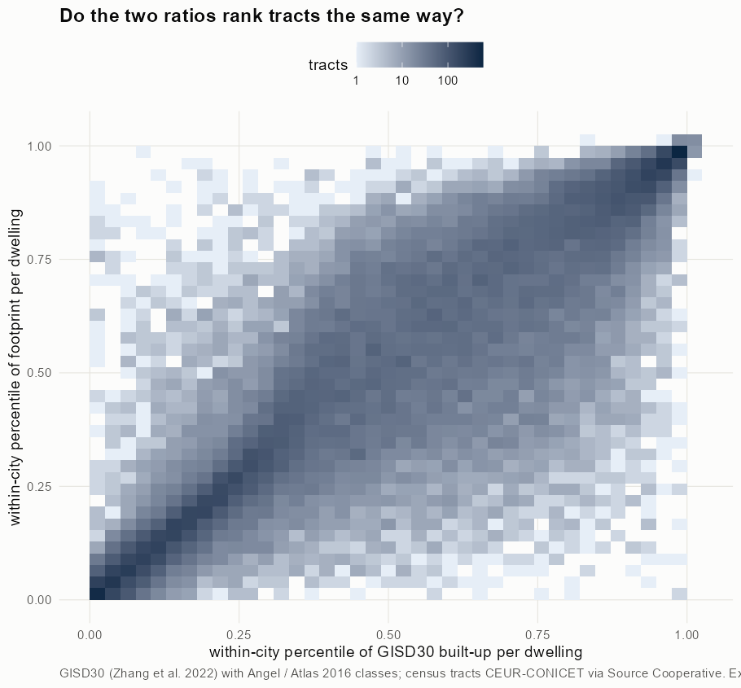
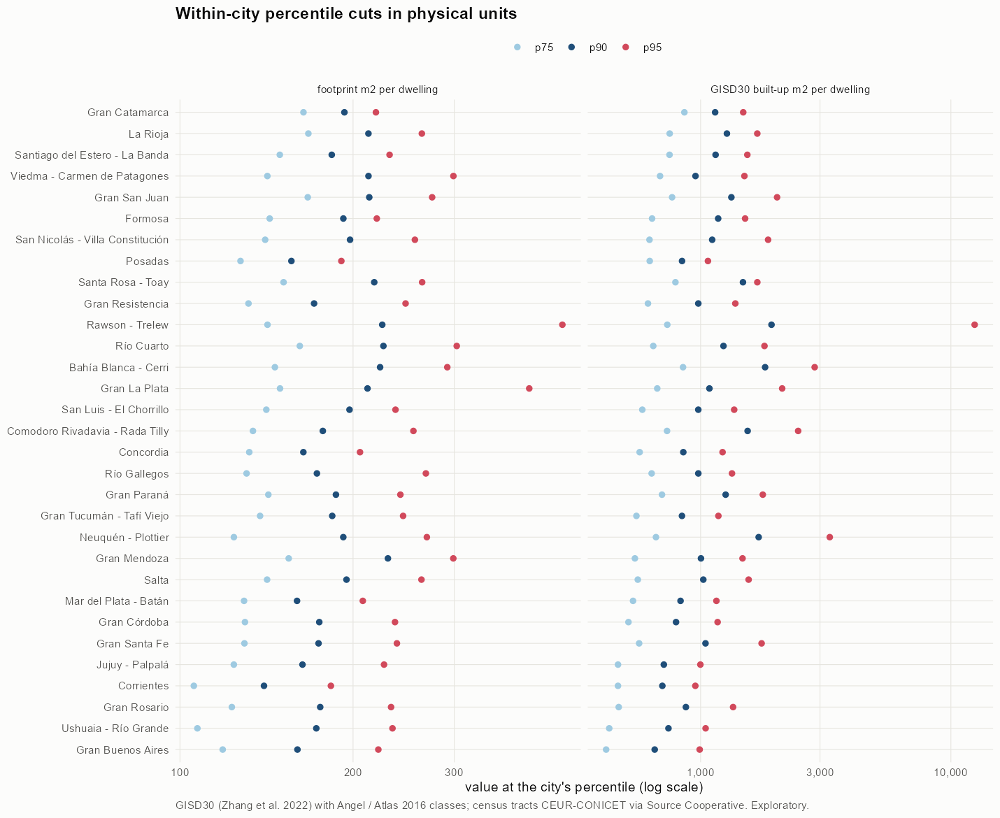
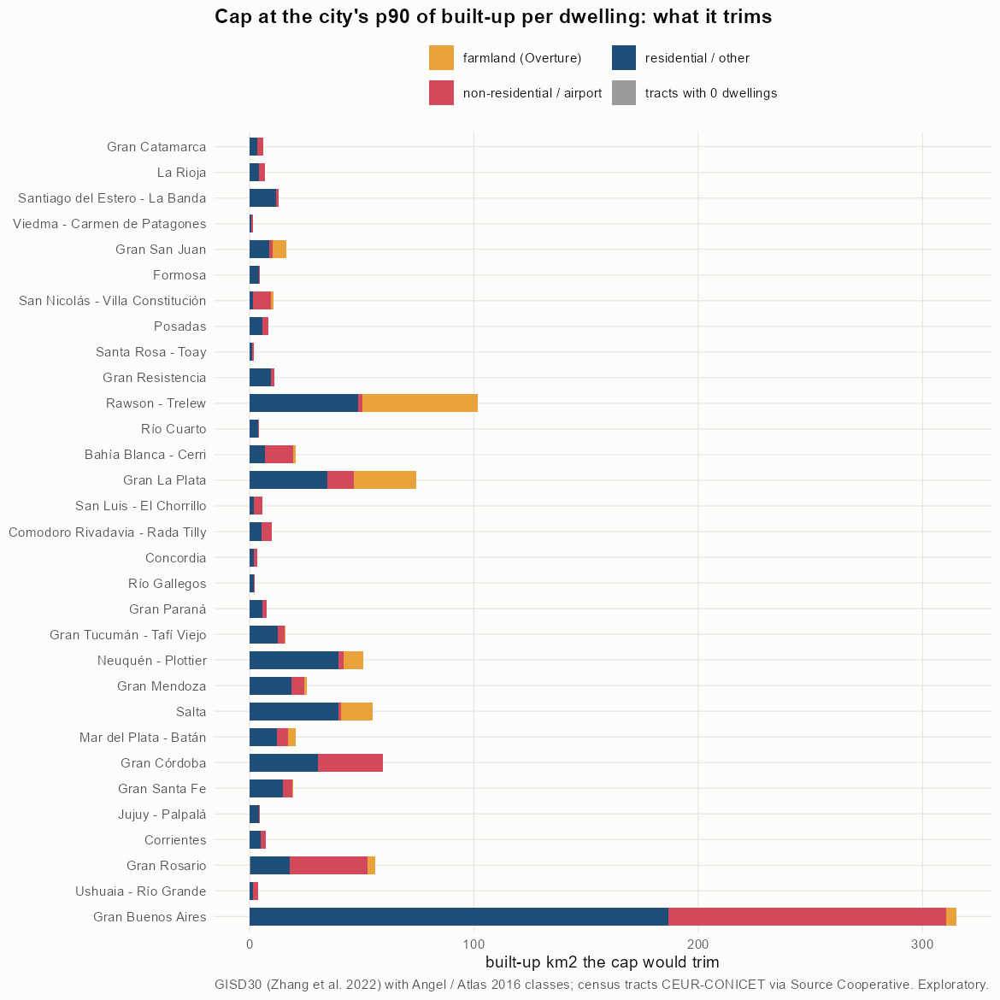

# Overture footprints vs GISD30 2020 built-up and the 2022 census, by tract

Exploratory. No number here is a project figure. Generated by `scripts/22_diagnostico_huellas.R`; numbers in tables are
written by the script. Purpose: inform the dwelling cap (rule 3A): how much built-up per dwelling is plausible, and
whether a within-city percentile cut means similar physical values in every city.

## Method

**Data.**
- GISD30 2020 pixel classes from step 11 (`outputs/densidad/<slug>/code_2020.tif`, UTM, 30 m = 900 m2): 1 city built-up,
  2 city open land, 3 built-up outside the city, 0 rest.
- 2022 census tracts and their table (`radios_2020.*`): persons, households, dwellings.
- Overture Maps buildings (step 20; OpenStreetMap + Google Open Buildings + Microsoft ML footprints), land use and airports.
  These are present-day (2022-2025 imagery and edits), the image is 2020 and the census 2022: a footprint without
  built-up can be new construction, and built-up without footprint can be demolished, missed by the detectors, or
  not a building at all (pavement, bare soil, farmland misread as built).

**Definitions.**
- *Tract in the city*: km2_urb (built + open city land) >= 10 % of the tract area. City statistics use only these; `radios.csv` keeps every tract with the flag `en_ciudad`.
- *Built pixels* = code 1 + code 3 pixels whose centre falls in the tract. *Built m2 per dwelling* = built pixels x 900 / dwellings.
- *Footprint area / count of a tract*: exact planar area (UTM) of the footprints whose centroid falls in the tract
  (looked up on a 10 m grid aligned to the GISD30 pixels, so a centroid within ~5 m of a boundary may go to the neighbour).
- *Footprint coverage of a pixel*: the footprints are rasterized at 10 m (cell centre inside the polygon) and counted per
  30 m pixel (0-9 cells, 100 m2 each). This is an unbiased but noisy estimate of covered area; footprints under 100 m2 can
  miss every cell centre, so a pixel *has a footprint* if any 10 m cell is covered **or** a footprint centroid falls in it.
- *Share of footprint area on built pixels*: covered 10 m cells on code 1 or 3 pixels / all covered cells.
- *Large footprints*: polygons over 10,000 m2 (1 ha). In OpenStreetMap a whole block is sometimes drawn as one building; they are kept in the totals and reported apart.
- *Land use* (Overture, mostly from OpenStreetMap, so mapping completeness varies by city): rasterized at 30 m into
  four groups, later ones overriding earlier ones: green/recreation < farmland < residential < non-residential
  (developed: industrial, commercial, retail, works, brownfield, institutional; education; medical; military; religious;
  cemetery; railway; landfill; quarries; entertainment; stadiums; construction sites) < airport (all airport polygons).
  Land-use polygons over 50 km2 are dropped: they are regional blankets, not parcels (in Salta one OSM `farmland` polygon covers the whole valley). Dropped per city: column `lu_drop` of `acuerdo.csv`.
- *Tract use label*: `airport` if airport land covers >= 10 % of the tract; `non-residential` if >= 25 % of its built pixels lie on non-residential land use; `farmland (Overture)` if >= 25 % lie on mapped farmland; `no built-up` if it has no built pixel; otherwise `residential / other`.
- Percentiles are type 7, within each city, over tracts in the city with dwellings > 0 and built pixels > 0 (footprint
  percentiles also need footprint area > 0).

**Limitations.** Land use is only as good as the OSM mapping: an unmapped factory counts as `residential / other`.
Footprint completeness varies by source and city (see the source columns). The tract lookup of centroids and the
10 m sampling are approximations described above. The census counts dwellings, not lots: second homes, empty
dwellings and non-residential units are part of the denominator as the census reports them.

## Agreement between GISD30 2020 and the footprints, per city

Pixels inside the city's box (where footprints exist). *% with footprint* = pixels with at least one footprint / pixels of that code.
*Footprint on* = share of the sampled footprint area (10 m cells) falling on each code.

| City | code 1 px | % code 1 with fp | code 3 px | % code 3 with fp | % code 2 with fp | % code 0 with fp | fp area km2 (10 m) | fp on 1+3 % | fp on 2 % | fp on 0 % |
|---|---|---|---|---|---|---|---|---|---|---|
| Bahía Blanca - Cerri | 118,978 | 60.9 | 6,772 | 22.7 | 9.9 | 0.5 | 18.7 | 94.6 | 3.9 | 1.6 |
| Comodoro Rivadavia - Rada Tilly | 62,142 | 61.0 | 6,821 | 34.8 | 14.1 | 0.6 | 10.4 | 89.6 | 6.6 | 3.8 |
| Concordia | 34,529 | 78.0 | 24,290 | 58.7 | 15.5 | 1.9 | 11.1 | 91.0 | 2.8 | 6.2 |
| Corrientes | 62,928 | 78.8 | 10,532 | 31.2 | 15.7 | 1.5 | 14.5 | 91.1 | 3.8 | 5.2 |
| Formosa | 57,099 | 72.3 | 11,102 | 28.4 | 17.2 | 0.7 | 12.1 | 91.6 | 4.4 | 4.0 |
| Gran Buenos Aires | 2,156,473 | 81.6 | 244,406 | 52.4 | 22.4 | 2.1 | 593.7 | 92.1 | 4.2 | 3.7 |
| Gran Catamarca | 57,795 | 71.7 | 6,622 | 37.8 | 14.8 | 1.2 | 11.6 | 88.6 | 5.7 | 5.7 |
| Gran Córdoba | 335,598 | 76.2 | 37,750 | 43.4 | 20.2 | 1.7 | 80.6 | 89.2 | 5.7 | 5.1 |
| Gran La Plata | 272,225 | 78.9 | 106,637 | 65.2 | 17.7 | 2.4 | 102.9 | 86.1 | 5.5 | 8.4 |
| Gran Mendoza | 222,576 | 75.8 | 51,795 | 59.2 | 19.6 | 3.0 | 65.5 | 83.1 | 7.9 | 9.0 |
| Gran Paraná | 70,279 | 72.8 | 8,497 | 32.0 | 12.0 | 0.9 | 14.9 | 92.8 | 3.5 | 3.7 |
| Gran Resistencia | 93,772 | 75.2 | 13,202 | 24.3 | 11.5 | 1.0 | 18.5 | 94.5 | 2.7 | 2.8 |
| Gran Rosario | 280,026 | 72.2 | 45,618 | 48.3 | 15.1 | 0.7 | 67.6 | 91.6 | 4.2 | 4.2 |
| Gran San Juan | 144,852 | 69.9 | 37,772 | 35.3 | 12.7 | 1.5 | 31.3 | 87.0 | 5.9 | 7.1 |
| Gran Santa Fe | 122,117 | 71.9 | 86,501 | 62.4 | 13.9 | 0.7 | 39.7 | 92.9 | 3.3 | 3.9 |
| Gran Tucumán - Tafí Viejo | 170,250 | 79.4 | 26,236 | 54.6 | 17.7 | 2.2 | 44.6 | 91.3 | 4.5 | 4.2 |
| Jujuy - Palpalá | 56,555 | 73.9 | 10,427 | 29.0 | 22.3 | 1.1 | 14.9 | 81.3 | 10.0 | 8.7 |
| La Rioja | 60,177 | 70.8 | 4,365 | 33.4 | 16.6 | 1.2 | 11.8 | 90.3 | 5.8 | 3.9 |
| Mar del Plata - Batán | 149,529 | 77.4 | 17,314 | 49.5 | 16.6 | 1.7 | 40.4 | 84.7 | 2.8 | 12.4 |
| Neuquén - Plottier | 163,093 | 56.9 | 47,828 | 31.1 | 9.9 | 1.0 | 26.6 | 89.2 | 5.8 | 5.0 |
| Posadas | 82,711 | 72.5 | 25,011 | 59.0 | 18.5 | 2.3 | 19.8 | 89.4 | 4.4 | 6.2 |
| Rawson - Trelew | 146,678 | 23.7 | 13,995 | 9.0 | 3.4 | 0.3 | 8.9 | 92.0 | 5.5 | 2.5 |
| Río Cuarto | 37,317 | 69.9 | 6,065 | 36.5 | 30.8 | 4.5 | 11.9 | 57.0 | 16.8 | 26.2 |
| Río Gallegos | 25,882 | 68.2 | 2,901 | 33.3 | 23.9 | 2.3 | 5.5 | 81.5 | 8.2 | 10.3 |
| Salta | 160,199 | 57.5 | 44,657 | 23.5 | 11.4 | 1.2 | 30.8 | 86.2 | 8.0 | 5.8 |
| San Luis - El Chorrillo | 47,934 | 73.6 | 5,856 | 60.1 | 18.9 | 1.8 | 12.5 | 81.0 | 7.3 | 11.8 |
| San Nicolás - Villa Constitución | 53,103 | 70.7 | 11,607 | 39.8 | 9.9 | 0.6 | 12.1 | 90.7 | 4.7 | 4.6 |
| Santa Rosa - Toay | 41,442 | 70.9 | 3,051 | 28.4 | 24.2 | 0.7 | 8.0 | 86.5 | 10.3 | 3.1 |
| Santiago del Estero - La Banda | 109,165 | 71.2 | 24,812 | 24.2 | 13.5 | 1.6 | 20.0 | 92.2 | 3.6 | 4.2 |
| Ushuaia - Río Grande | 26,813 | 74.2 | 3,455 | 35.1 | 25.7 | 0.1 | 7.2 | 75.1 | 13.4 | 11.5 |
| Viedma - Carmen de Patagones | 21,165 | 75.2 | 2,175 | 37.1 | 17.4 | 1.9 | 4.5 | 88.1 | 5.0 | 6.9 |

Pixels (any code) of tracts in the city that fall outside the footprint box, where there are no footprint data: 6,875 (all cities).

All cities: 4,055,564 of 5,443,402 code 1 pixels have a footprint (74.5 %); 455,947 of 948,072 code 3 pixels (48.1 %).

Footprint sources and large polygons (all footprints read, whole box):

| City | footprints | OSM | Google | Microsoft | > 1 ha | > 1 ha from OSM | km2 in > 1 ha | % of footprint km2 |
|---|---|---|---|---|---|---|---|---|
| Bahía Blanca - Cerri | 262,907 | 55,500 | 197,236 | 10,171 | 24 | 23 | 0.35 | 1.5 |
| Comodoro Rivadavia - Rada Tilly | 104,813 | 1,935 | 56,316 | 46,562 | 9 | 6 | 0.14 | 1.3 |
| Concordia | 184,052 | 1,802 | 182,250 | 0 | 9 | 2 | 0.19 | 1.2 |
| Corrientes | 214,684 | 7,726 | 144,525 | 62,433 | 17 | 13 | 0.36 | 1.8 |
| Formosa | 132,382 | 50,063 | 56,097 | 26,222 | 9 | 9 | 0.25 | 2.0 |
| Gran Buenos Aires | 5,699,520 | 238,730 | 3,485,317 | 1,975,473 | 1,160 | 720 | 20.52 | 3.0 |
| Gran Catamarca | 156,392 | 2,076 | 152,510 | 1,806 | 8 | 8 | 0.11 | 0.9 |
| Gran Córdoba | 1,123,031 | 84,259 | 825,193 | 213,579 | 94 | 72 | 2.05 | 2.0 |
| Gran La Plata | 944,243 | 33,092 | 541,217 | 369,934 | 365 | 48 | 5.12 | 3.7 |
| Gran Mendoza | 658,787 | 5,547 | 329,598 | 323,642 | 104 | 62 | 1.82 | 2.4 |
| Gran Paraná | 234,699 | 2,323 | 232,376 | 0 | 16 | 15 | 0.29 | 1.6 |
| Gran Resistencia | 302,746 | 3,733 | 189,409 | 109,604 | 26 | 21 | 0.50 | 1.8 |
| Gran Rosario | 622,744 | 48,353 | 374,751 | 199,640 | 98 | 95 | 1.74 | 2.4 |
| Gran San Juan | 481,759 | 282,053 | 199,706 | 0 | 23 | 19 | 0.38 | 1.1 |
| Gran Santa Fe | 630,703 | 5,223 | 625,480 | 0 | 36 | 35 | 0.62 | 1.3 |
| Gran Tucumán - Tafí Viejo | 627,422 | 26,980 | 303,388 | 297,054 | 75 | 42 | 1.47 | 2.4 |
| Jujuy - Palpalá | 165,723 | 6,457 | 94,463 | 64,803 | 30 | 30 | 0.59 | 3.5 |
| La Rioja | 144,730 | 8,460 | 136,270 | 0 | 11 | 8 | 0.18 | 1.4 |
| Mar del Plata - Batán | 434,851 | 8,243 | 426,608 | 0 | 108 | 49 | 2.07 | 4.6 |
| Neuquén - Plottier | 317,218 | 18,215 | 297,221 | 1,782 | 22 | 18 | 0.57 | 1.9 |
| Posadas | 269,338 | 134,471 | 97,972 | 36,895 | 8 | 8 | 0.17 | 0.7 |
| Rawson - Trelew | 90,152 | 1,927 | 55,847 | 32,378 | 14 | 14 | 0.23 | 2.5 |
| Río Cuarto | 143,662 | 2,508 | 141,154 | 0 | 7 | 6 | 0.14 | 1.1 |
| Río Gallegos | 55,092 | 1,586 | 34,469 | 19,037 | 1 | 0 | 0.02 | 0.4 |
| Salta | 360,768 | 20,662 | 251,274 | 88,832 | 39 | 30 | 0.74 | 2.1 |
| San Luis - El Chorrillo | 148,471 | 3,336 | 145,135 | 0 | 7 | 6 | 0.12 | 0.9 |
| San Nicolás - Villa Constitución | 140,428 | 12,118 | 85,310 | 43,000 | 30 | 30 | 0.66 | 4.7 |
| Santa Rosa - Toay | 78,164 | 6,229 | 30,869 | 41,066 | 5 | 4 | 0.09 | 1.1 |
| Santiago del Estero - La Banda | 277,496 | 2,615 | 198,835 | 76,046 | 11 | 11 | 0.31 | 1.4 |
| Ushuaia - Río Grande | 70,910 | 9,540 | 40,052 | 21,318 | 19 | 18 | 0.31 | 4.1 |
| Viedma - Carmen de Patagones | 51,919 | 5,266 | 29,282 | 17,371 | 5 | 4 | 0.08 | 1.7 |

## Per-city summary (tracts in the city)

| City | tracts | tracts 0 dw. | dwellings | built km2 | footprint km2 | built m2 / dw. | footprint m2 / dw. | % built px with fp | % fp on built | built km2 on NR land | built km2 on farmland | NR/airport tracts | their built km2 |
|---|---|---|---|---|---|---|---|---|---|---|---|---|---|
| Bahía Blanca - Cerri | 468 | 0 | 147,155 | 104.5 | 18.2 | 710 | 124 | 62.2 | 95.5 | 12.4 | 1.3 | 19 | 19.1 |
| Comodoro Rivadavia - Rada Tilly | 313 | 0 | 80,810 | 57.1 | 10.0 | 707 | 124 | 61.3 | 91.1 | 7.8 | 0.3 | 33 | 11.0 |
| Concordia | 213 | 0 | 60,656 | 31.5 | 7.1 | 520 | 117 | 77.0 | 95.1 | 2.1 | 0.0 | 16 | 3.3 |
| Corrientes | 447 | 0 | 140,409 | 58.9 | 13.4 | 420 | 95 | 76.9 | 95.1 | 2.1 | 0.5 | 10 | 3.8 |
| Formosa | 310 | 0 | 91,848 | 52.2 | 11.2 | 568 | 122 | 71.5 | 94.4 | 2.1 | 0.0 | 6 | 2.0 |
| Gran Buenos Aires | 15,956 | 0 | 5,815,270 | 1,976.5 | 544.1 | 340 | 94 | 80.9 | 94.6 | 163.4 | 7.1 | 841 | 237.7 |
| Gran Catamarca | 238 | 0 | 74,682 | 54.0 | 11.0 | 724 | 147 | 70.7 | 91.8 | 3.4 | 0.4 | 6 | 3.7 |
| Gran Córdoba | 2,304 | 0 | 681,680 | 306.9 | 75.0 | 450 | 110 | 76.1 | 92.6 | 29.5 | 0.5 | 139 | 47.2 |
| Gran La Plata | 1,203 | 0 | 386,666 | 251.0 | 77.1 | 649 | 199 | 78.0 | 90.7 | 13.2 | 23.4 | 34 | 20.1 |
| Gran Mendoza | 1,350 | 1 | 395,405 | 208.4 | 55.4 | 527 | 140 | 75.0 | 88.7 | 10.8 | 3.0 | 61 | 13.6 |
| Gran Paraná | 502 | 0 | 119,027 | 65.2 | 14.3 | 548 | 120 | 71.9 | 95.4 | 2.7 | 0.0 | 5 | 2.7 |
| Gran Resistencia | 526 | 0 | 150,576 | 86.3 | 17.7 | 573 | 117 | 74.1 | 96.0 | 2.6 | 0.0 | 8 | 3.5 |
| Gran Rosario | 2,082 | 1 | 611,428 | 259.5 | 61.3 | 424 | 100 | 71.4 | 94.6 | 38.5 | 5.6 | 203 | 57.0 |
| Gran San Juan | 614 | 0 | 190,254 | 136.3 | 27.4 | 716 | 144 | 68.1 | 92.1 | 7.7 | 12.9 | 14 | 5.3 |
| Gran Santa Fe | 737 | 0 | 214,525 | 114.0 | 25.0 | 532 | 117 | 70.7 | 93.8 | 5.3 | 0.4 | 17 | 8.0 |
| Gran Tucumán - Tafí Viejo | 1,115 | 0 | 332,512 | 156.0 | 40.0 | 469 | 120 | 79.1 | 94.4 | 5.2 | 0.4 | 20 | 6.0 |
| Jujuy - Palpalá | 393 | 0 | 121,738 | 50.5 | 13.6 | 415 | 112 | 76.2 | 86.8 | 1.8 | 0.4 | 5 | 0.9 |
| La Rioja | 252 | 0 | 75,304 | 54.6 | 11.3 | 725 | 150 | 70.5 | 93.0 | 3.8 | 0.1 | 16 | 7.6 |
| Mar del Plata - Batán | 1,023 | 0 | 343,564 | 137.1 | 33.8 | 399 | 98 | 77.4 | 94.1 | 6.4 | 2.5 | 19 | 7.1 |
| Neuquén - Plottier | 693 | 0 | 200,283 | 162.3 | 23.7 | 810 | 118 | 53.8 | 91.1 | 8.9 | 7.6 | 18 | 5.8 |
| Posadas | 509 | 0 | 140,756 | 76.8 | 15.3 | 546 | 109 | 71.0 | 93.5 | 3.3 | 0.1 | 7 | 4.2 |
| Rawson - Trelew | 237 | 0 | 63,394 | 142.0 | 8.8 | 2,241 | 139 | 22.5 | 92.5 | 4.6 | 47.6 | 11 | 5.2 |
| Río Cuarto | 261 | 0 | 62,122 | 34.0 | 9.1 | 547 | 147 | 70.0 | 70.0 | 0.8 | 0.0 | 4 | 1.1 |
| Río Gallegos | 144 | 0 | 43,899 | 23.0 | 4.9 | 523 | 113 | 70.4 | 88.4 | 0.4 | 0.1 | 1 | 0.5 |
| Salta | 726 | 0 | 225,783 | 155.0 | 28.0 | 687 | 124 | 55.1 | 89.6 | 4.0 | 6.1 | 14 | 4.5 |
| San Luis - El Chorrillo | 279 | 0 | 81,952 | 44.5 | 10.8 | 543 | 132 | 73.4 | 88.9 | 4.2 | 0.0 | 15 | 6.3 |
| San Nicolás - Villa Constitución | 229 | 0 | 75,525 | 48.4 | 10.5 | 641 | 140 | 70.3 | 94.5 | 8.9 | 0.8 | 10 | 10.2 |
| Santa Rosa - Toay | 215 | 0 | 58,853 | 36.1 | 7.6 | 613 | 129 | 73.1 | 89.4 | 1.3 | 0.1 | 5 | 1.9 |
| Santiago del Estero - La Banda | 341 | 0 | 144,114 | 101.9 | 19.0 | 707 | 132 | 69.7 | 94.5 | 3.9 | 0.0 | 12 | 5.5 |
| Ushuaia - Río Grande | 188 | 0 | 60,257 | 24.4 | 6.2 | 404 | 103 | 73.1 | 83.2 | 3.3 | 0.0 | 19 | 5.1 |
| Viedma - Carmen de Patagones | 126 | 0 | 33,655 | 19.5 | 4.2 | 581 | 124 | 74.8 | 93.1 | 1.4 | 0.2 | 6 | 1.7 |

## Distributions per city

Spearman rank correlation per city between tracts' footprint m2 and built m2, and between footprint per dwelling and built per dwelling:

| City | tracts | rho (footprint m2, built m2) | rho (fp / dw., built / dw.) |
|---|---|---|---|
| Bahía Blanca - Cerri | 468 | 0.81 | 0.84 |
| Comodoro Rivadavia - Rada Tilly | 313 | 0.87 | 0.86 |
| Concordia | 213 | 0.67 | 0.59 |
| Corrientes | 447 | 0.88 | 0.83 |
| Formosa | 310 | 0.60 | 0.59 |
| Gran Buenos Aires | 15,910 | 0.91 | 0.90 |
| Gran Catamarca | 238 | 0.74 | 0.65 |
| Gran Córdoba | 2,304 | 0.89 | 0.87 |
| Gran La Plata | 1,203 | 0.91 | 0.91 |
| Gran Mendoza | 1,349 | 0.88 | 0.83 |
| Gran Paraná | 502 | 0.78 | 0.83 |
| Gran Resistencia | 526 | 0.80 | 0.76 |
| Gran Rosario | 2,081 | 0.91 | 0.92 |
| Gran San Juan | 614 | 0.74 | 0.69 |
| Gran Santa Fe | 737 | 0.87 | 0.85 |
| Gran Tucumán - Tafí Viejo | 1,115 | 0.87 | 0.85 |
| Jujuy - Palpalá | 393 | 0.82 | 0.78 |
| La Rioja | 252 | 0.76 | 0.66 |
| Mar del Plata - Batán | 1,023 | 0.86 | 0.86 |
| Neuquén - Plottier | 693 | 0.79 | 0.82 |
| Posadas | 509 | 0.72 | 0.69 |
| Rawson - Trelew | 237 | 0.81 | 0.78 |
| Río Cuarto | 253 | 0.55 | 0.37 |
| Río Gallegos | 144 | 0.79 | 0.73 |
| Salta | 726 | 0.71 | 0.67 |
| San Luis - El Chorrillo | 279 | 0.78 | 0.78 |
| San Nicolás - Villa Constitución | 229 | 0.68 | 0.67 |
| Santa Rosa - Toay | 214 | 0.74 | 0.72 |
| Santiago del Estero - La Banda | 341 | 0.68 | 0.58 |
| Ushuaia - Río Grande | 188 | 0.90 | 0.85 |
| Viedma - Carmen de Patagones | 126 | 0.75 | 0.73 |

## Near-empty tracts: by within-city quartile of dwelling density

Tracts in the city with dwellings > 0 and built-up > 0, split into quartiles of dwellings per km2 of tract *within each city*.
Pooled medians over all cities, and the range of the per-city medians (min-max over the 31 cities). *cov* = built pixels
with a footprint / built pixels; *c* = footprint m2 per built m2 (median).

| quartile | tracts | dwellings | built m2 / dw. (median) | city range | footprint m2 / dw. (median) | city range | cov % | city range | c (median) | NR / airport tracts | farmland tracts |
|---|---|---|---|---|---|---|---|---|---|---|---|
| Q1 (emptiest) | 8,477 | 2,538,312 | 733 | 578 - 1,567 | 151 | 120 - 205 | 59.2 | 12.3 - 69.7 | 0.21 | 850 | 118 |
| Q2 | 8,491 | 2,742,933 | 393 | 344 - 721 | 113 | 91 - 154 | 87.6 | 72.3 - 93.0 | 0.28 | 218 | 3 |
| Q3 | 8,483 | 2,778,234 | 274 | 234 - 508 | 93 | 74 - 139 | 92.9 | 85.4 - 95.0 | 0.34 | 200 | 0 |
| Q4 (densest) | 8,503 | 3,151,318 | 116 | 54 - 384 | 43 | 14 - 117 | 92.1 | 86.7 - 96.9 | 0.35 | 326 | 0 |

Per city and quartile: `cuartiles_densidad.csv`.

## Do percentile cuts mean the same physical value in every city?

Value at each within-city percentile. *b* = GISD30 built-up m2 per dwelling; *f* = footprint m2 per dwelling;
*c* = footprint m2 per built m2 of the tract.

| City | tracts | b p50 | b p75 | b p90 | b p95 | f p50 | f p75 | f p90 | f p95 | c p50 | c p90 |
|---|---|---|---|---|---|---|---|---|---|---|---|
| Bahía Blanca - Cerri | 468 | 444 | 851 | 1,810 | 2,856 | 112 | 146 | 223 | 292 | 0.27 | 0.40 |
| Comodoro Rivadavia - Rada Tilly | 313 | 419 | 734 | 1,541 | 2,454 | 103 | 134 | 177 | 255 | 0.25 | 0.33 |
| Concordia | 213 | 410 | 571 | 853 | 1,224 | 108 | 132 | 164 | 206 | 0.25 | 0.37 |
| Corrientes | 447 | 338 | 468 | 703 | 953 | 84 | 106 | 140 | 183 | 0.26 | 0.35 |
| Formosa | 310 | 485 | 640 | 1,175 | 1,506 | 113 | 143 | 192 | 220 | 0.23 | 0.37 |
| Gran Buenos Aires | 15,927 | 288 | 419 | 656 | 991 | 94 | 119 | 160 | 221 | 0.32 | 0.43 |
| Gran Catamarca | 238 | 568 | 861 | 1,143 | 1,480 | 136 | 164 | 193 | 219 | 0.23 | 0.34 |
| Gran Córdoba | 2,304 | 353 | 515 | 798 | 1,169 | 104 | 130 | 175 | 237 | 0.30 | 0.39 |
| Gran La Plata | 1,203 | 432 | 671 | 1,085 | 2,118 | 120 | 149 | 212 | 405 | 0.29 | 0.41 |
| Gran Mendoza | 1,349 | 377 | 546 | 1,003 | 1,471 | 120 | 155 | 230 | 299 | 0.31 | 0.40 |
| Gran Paraná | 502 | 408 | 701 | 1,259 | 1,772 | 114 | 142 | 187 | 242 | 0.28 | 0.39 |
| Gran Resistencia | 526 | 456 | 616 | 979 | 1,377 | 107 | 132 | 171 | 247 | 0.24 | 0.31 |
| Gran Rosario | 2,081 | 291 | 471 | 873 | 1,348 | 89 | 123 | 175 | 233 | 0.32 | 0.48 |
| Gran San Juan | 614 | 528 | 769 | 1,327 | 2,021 | 137 | 167 | 213 | 275 | 0.24 | 0.35 |
| Gran Santa Fe | 737 | 348 | 568 | 1,046 | 1,753 | 106 | 129 | 174 | 238 | 0.31 | 0.41 |
| Gran Tucumán - Tafí Viejo | 1,115 | 398 | 554 | 842 | 1,178 | 116 | 138 | 184 | 244 | 0.30 | 0.40 |
| Jujuy - Palpalá | 393 | 347 | 468 | 713 | 998 | 99 | 124 | 163 | 226 | 0.28 | 0.40 |
| La Rioja | 252 | 558 | 753 | 1,274 | 1,685 | 140 | 167 | 213 | 263 | 0.25 | 0.37 |
| Mar del Plata - Batán | 1,023 | 362 | 537 | 831 | 1,157 | 105 | 129 | 160 | 208 | 0.28 | 0.39 |
| Neuquén - Plottier | 693 | 384 | 663 | 1,706 | 3,282 | 94 | 124 | 192 | 269 | 0.23 | 0.31 |
| Posadas | 509 | 477 | 626 | 843 | 1,070 | 103 | 127 | 156 | 191 | 0.23 | 0.33 |
| Rawson - Trelew | 237 | 452 | 736 | 1,920 | 12,445 | 109 | 142 | 225 | 462 | 0.22 | 0.33 |
| Río Cuarto | 253 | 450 | 647 | 1,234 | 1,800 | 131 | 162 | 226 | 303 | 0.27 | 1.38 |
| Río Gallegos | 144 | 409 | 637 | 979 | 1,335 | 103 | 131 | 173 | 268 | 0.25 | 0.33 |
| Salta | 726 | 369 | 561 | 1,025 | 1,555 | 109 | 142 | 195 | 263 | 0.28 | 0.46 |
| San Luis - El Chorrillo | 279 | 423 | 585 | 979 | 1,362 | 116 | 141 | 197 | 237 | 0.27 | 0.37 |
| San Nicolás - Villa Constitución | 229 | 480 | 625 | 1,112 | 1,861 | 123 | 141 | 198 | 256 | 0.25 | 0.36 |
| Santa Rosa - Toay | 214 | 471 | 793 | 1,477 | 1,685 | 115 | 151 | 218 | 264 | 0.23 | 0.36 |
| Santiago del Estero - La Banda | 341 | 548 | 751 | 1,148 | 1,537 | 119 | 149 | 184 | 232 | 0.22 | 0.33 |
| Ushuaia - Río Grande | 188 | 289 | 431 | 744 | 1,047 | 78 | 107 | 173 | 234 | 0.27 | 0.37 |
| Viedma - Carmen de Patagones | 126 | 538 | 689 | 954 | 1,496 | 118 | 142 | 213 | 299 | 0.22 | 0.30 |

Spread across the 31 cities of the value at each percentile (cv = sd / mean):

| measure | percentile | min | median | max | max / min | cv |
|---|---|---|---|---|---|---|
| built m2 / dwelling | p50 | 288 | 419 | 568 | 2.0 | 0.18 |
| built m2 / dwelling | p75 | 419 | 626 | 861 | 2.1 | 0.19 |
| built m2 / dwelling | p90 | 656 | 1,025 | 1,920 | 2.9 | 0.29 |
| built m2 / dwelling | p95 | 953 | 1,496 | 12,445 | 13.1 | 1.04 |
| footprint m2 / dwelling | p50 | 78 | 109 | 140 | 1.8 | 0.13 |
| footprint m2 / dwelling | p75 | 106 | 141 | 167 | 1.6 | 0.11 |
| footprint m2 / dwelling | p90 | 140 | 187 | 230 | 1.6 | 0.13 |
| footprint m2 / dwelling | p95 | 183 | 244 | 462 | 2.5 | 0.22 |

## What a cap at the city's percentile would trim

Rule simulated: in each tract in the city, built pixels above *dwellings x the city's pXX of built pixels per dwelling* are
trimmed (tracts with 0 dwellings would lose all their built-up: shown apart). *Without footprint* = the part of the trim
that could come from built pixels with no footprint (min of trim and the tract's built pixels without footprint); *with
footprint* = the rest, which would necessarily remove pixels where a building exists today.

All 31 cities:

| cut | tracts | built km2 | tracts trimmed (dw. > 0) | tracts with 0 dw. and built-up | km2 trimmed | of which in 0-dw. tracts | in NR / airport tracts | in farmland tracts | without footprint | with footprint |
|---|---|---|---|---|---|---|---|---|---|---|
| p75 | 33,994 | 5,028.5 | 8,491 | 2 | 1,444.3 (28.7 %) | 0.3 | 336.2 | 136.3 | 1,010.9 | 433.4 |
| p90 | 33,994 | 5,028.5 | 3,408 | 2 | 940.3 (18.7 %) | 0.3 | 274.1 | 123.0 | 734.1 | 206.1 |
| p95 | 33,994 | 5,028.5 | 1,712 | 2 | 654.5 (13.0 %) | 0.3 | 223.9 | 101.7 | 530.3 | 124.2 |

Per city, cut at p90:

| City | tracts | built km2 | trimmed tracts (dw. > 0) | 0-dw. tracts | km2 trimmed | % of built | in 0-dw. tracts | in NR / airport | in farmland | without fp | with fp |
|---|---|---|---|---|---|---|---|---|---|---|---|
| Bahía Blanca - Cerri | 468 | 104.5 | 47 | 0 | 20.4 | 19.6 | 0.0 | 12.9 | 0.9 | 17.7 | 2.7 |
| Comodoro Rivadavia - Rada Tilly | 313 | 57.1 | 32 | 0 | 9.8 | 17.1 | 0.0 | 4.6 | 0.0 | 8.9 | 0.9 |
| Concordia | 213 | 31.5 | 22 | 0 | 3.4 | 10.6 | 0.0 | 1.4 | 0.0 | 3.0 | 0.3 |
| Corrientes | 447 | 58.9 | 45 | 0 | 7.1 | 12.0 | 0.0 | 2.0 | 0.0 | 6.2 | 0.8 |
| Formosa | 310 | 52.2 | 31 | 0 | 4.4 | 8.5 | 0.0 | 0.2 | 0.0 | 4.4 | 0.1 |
| Gran Buenos Aires | 15,956 | 1,976.5 | 1,593 | 0 | 315.0 | 15.9 | 0.0 | 124.0 | 4.4 | 218.4 | 96.7 |
| Gran Catamarca | 238 | 54.0 | 24 | 0 | 5.9 | 10.9 | 0.0 | 2.4 | 0.0 | 5.4 | 0.6 |
| Gran Córdoba | 2,304 | 306.9 | 231 | 0 | 59.2 | 19.3 | 0.0 | 28.8 | 0.0 | 44.1 | 15.1 |
| Gran La Plata | 1,203 | 251.0 | 121 | 0 | 74.1 | 29.5 | 0.0 | 12.1 | 27.6 | 30.7 | 43.4 |
| Gran Mendoza | 1,350 | 208.4 | 135 | 1 | 25.5 | 12.3 | 0.1 | 5.6 | 1.4 | 21.4 | 4.1 |
| Gran Paraná | 502 | 65.2 | 51 | 0 | 7.6 | 11.6 | 0.0 | 2.1 | 0.0 | 6.4 | 1.1 |
| Gran Resistencia | 526 | 86.3 | 53 | 0 | 11.1 | 12.9 | 0.0 | 1.6 | 0.0 | 9.4 | 1.8 |
| Gran Rosario | 2,082 | 259.5 | 208 | 1 | 55.9 | 21.5 | 0.2 | 34.8 | 3.3 | 44.4 | 11.5 |
| Gran San Juan | 614 | 136.3 | 62 | 0 | 16.3 | 12.0 | 0.0 | 1.4 | 6.1 | 15.7 | 0.6 |
| Gran Santa Fe | 737 | 114.0 | 74 | 0 | 19.5 | 17.1 | 0.0 | 4.3 | 0.4 | 17.8 | 1.8 |
| Gran Tucumán - Tafí Viejo | 1,115 | 156.0 | 112 | 0 | 15.9 | 10.2 | 0.0 | 3.0 | 0.4 | 13.4 | 2.5 |
| Jujuy - Palpalá | 393 | 50.5 | 40 | 0 | 4.5 | 8.9 | 0.0 | 0.2 | 0.0 | 4.0 | 0.5 |
| La Rioja | 252 | 54.6 | 26 | 0 | 6.7 | 12.2 | 0.0 | 2.4 | 0.0 | 6.1 | 0.6 |
| Mar del Plata - Batán | 1,023 | 137.1 | 103 | 0 | 20.4 | 14.9 | 0.0 | 5.1 | 3.4 | 14.6 | 5.7 |
| Neuquén - Plottier | 693 | 162.3 | 70 | 0 | 50.6 | 31.2 | 0.0 | 2.3 | 8.7 | 47.8 | 2.8 |
| Posadas | 509 | 76.8 | 51 | 0 | 8.5 | 11.0 | 0.0 | 2.7 | 0.0 | 8.1 | 0.4 |
| Rawson - Trelew | 237 | 142.0 | 24 | 0 | 101.6 | 71.5 | 0.0 | 1.6 | 51.5 | 98.8 | 2.8 |
| Río Cuarto | 261 | 34.0 | 26 | 0 | 3.9 | 11.6 | 0.0 | 0.3 | 0.0 | 3.6 | 0.3 |
| Río Gallegos | 144 | 23.0 | 15 | 0 | 2.2 | 9.8 | 0.0 | 0.2 | 0.0 | 2.0 | 0.3 |
| Salta | 726 | 155.0 | 73 | 0 | 54.8 | 35.3 | 0.0 | 1.5 | 13.9 | 51.9 | 2.8 |
| San Luis - El Chorrillo | 279 | 44.5 | 28 | 0 | 5.7 | 12.8 | 0.0 | 3.7 | 0.0 | 4.0 | 1.7 |
| San Nicolás - Villa Constitución | 229 | 48.4 | 23 | 0 | 10.4 | 21.5 | 0.0 | 7.8 | 1.1 | 8.1 | 2.3 |
| Santa Rosa - Toay | 215 | 36.1 | 22 | 0 | 1.7 | 4.7 | 0.0 | 0.6 | 0.0 | 1.6 | 0.1 |
| Santiago del Estero - La Banda | 341 | 101.9 | 34 | 0 | 12.9 | 12.7 | 0.0 | 1.2 | 0.0 | 12.3 | 0.6 |
| Ushuaia - Río Grande | 188 | 24.4 | 19 | 0 | 3.8 | 15.7 | 0.0 | 2.4 | 0.0 | 2.9 | 0.9 |
| Viedma - Carmen de Patagones | 126 | 19.5 | 13 | 0 | 1.3 | 6.5 | 0.0 | 0.8 | 0.0 | 1.0 | 0.3 |

## Implications for the dwelling cap

*Written by hand, without numbers: every figure it refers to is in the tables above.*

- **Footprint per dwelling is the stable quantity; GISD30 built-up per dwelling is not.** Across the 31 cities the value at
  each within-city percentile of footprint m2 per dwelling varies little (see the spread table: max / min and cv for
  *footprint m2 / dwelling*). Built-up per dwelling is close across cities at the median but fans out at p90 and explodes at
  p95, driven by a few cities (Rawson - Trelew above all, then Neuquén - Plottier and Bahía Blanca - Cerri). So a percentile
  cut on built-up per dwelling does **not** mean the same physical thing everywhere: in a city whose upper tail is farmland
  misread as built-up, its own p90 is already inflated by the error the cap is meant to remove.
- **The two ratios rank tracts similarly** (Spearman table), so footprints can serve as an independent check of where the
  excess sits, but the ranking agreement is weaker exactly in the cities with the most suspicious built-up (Salta, Río
  Cuarto, Concordia, Formosa, Santiago del Estero).
- **Near-empty tracts carry the excess.** By within-city density quartile, built-up per dwelling rises steeply from the
  densest to the emptiest quartile while footprint per dwelling rises only moderately, and the share of built pixels with
  any footprint falls. The gap between the two is the candidate for trimming.
- **Non-residential built-up is a large part of what a dwelling cap would hit.** In the p90 simulation a substantial share
  of the trimmed area lies in tracts whose built-up is mostly on mapped industrial, commercial, institutional, education,
  health, railway or airport land (Gran Buenos Aires, Gran Rosario, Gran Córdoba and Bahía Blanca - Cerri especially).
  These tracts legitimately have much built-up and few dwellings. Since land use comes from OpenStreetMap, unmapped
  industry is labelled `residential / other`, so the non-residential share is a lower bound.
- **Most of the trim could come from pixels with no footprint.** In every city the larger part of the p90 trim fits within
  the tract's built pixels that have no Overture footprint. Where the trim would have to remove footprint-confirmed
  pixels (La Plata, Buenos Aires, Córdoba, Rosario stand out) the cap is fighting real buildings: industrial and
  logistics areas, country clubs and low-density suburbs with large lots.
- **Agreement GISD30 - footprints is high for city built-up and much lower for built-up outside the city** (code 3),
  consistent with code 3 holding more non-building surfaces (farm tracks, greenhouses, bare soil). Rawson - Trelew is the
  outlier: most of its GISD30 built-up has no footprint and a large part lies on mapped farmland, the case the cap is
  designed for. Río Cuarto is the opposite outlier: a large share of footprint area falls on pixels GISD30 calls
  non-built, so GISD30 2020 seems to *miss* part of the city there (to check on the map before applying any rule).

**Implications for the dwelling cap.**

1. Express the cap in footprint terms or protect footprint-confirmed pixels: trim only built pixels **without** any
   footprint, in tracts above the city's percentile. This keeps the rule free of per-city calibration and makes it
   insensitive to the inflated upper tail of built-up per dwelling.
2. Exempt (or treat separately) tracts dominated by non-residential land use and airports, and never trim pixels on
   mapped non-residential land. Dwellings are the wrong denominator for factories, hospitals, schools, rail yards and
   airports; the census does not count them.
3. Prefer a percentile of *footprint per dwelling* (or of footprint per built m2) over a percentile of built-up per
   dwelling as the trigger: its cuts land on similar physical values in every city, so "above the city's p90" means
   roughly the same thing in Salta and in Buenos Aires.
4. Keep in mind the time mismatch: footprints are present-day, the image is 2020 and the census 2022. A footprint-based
   protection in 2020 may keep a few buildings newer than the image, which errs on the safe side; for earlier years the
   footprint can only say "no building today, so no building then", never the reverse.
5. Before adopting the rule, look at the maps of the cities where the trim is large relative to their built-up
   (Rawson - Trelew, Salta, Neuquén - Plottier, La Plata) and of Río Cuarto, where the problem runs the other way.

## Files

- `radios.csv`: one row per tract and city (all tracts, flag `en_ciudad`), with every measure above.
- `ciudades.csv`, `acuerdo.csv`, `percentiles.csv`, `tope.csv`, `cuartiles_densidad.csv`: the tables of this report.
- `ciudades/`: per-city cache written by the script (`--rehacer` recomputes).

