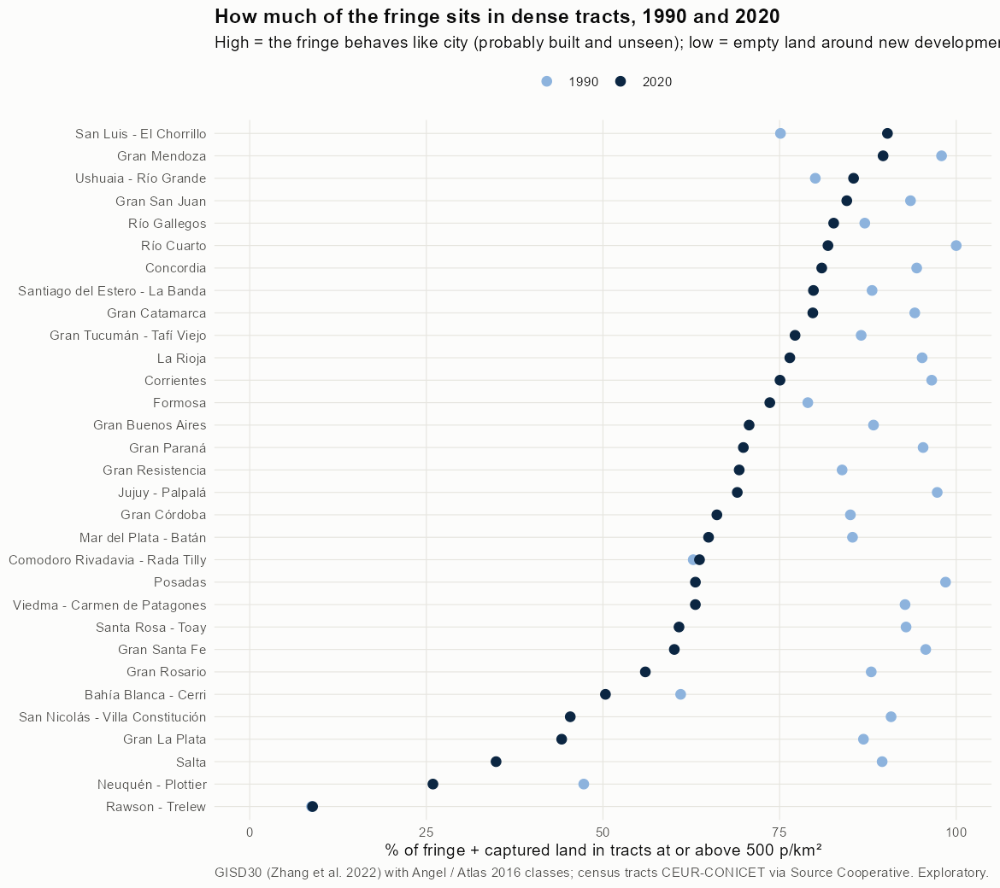
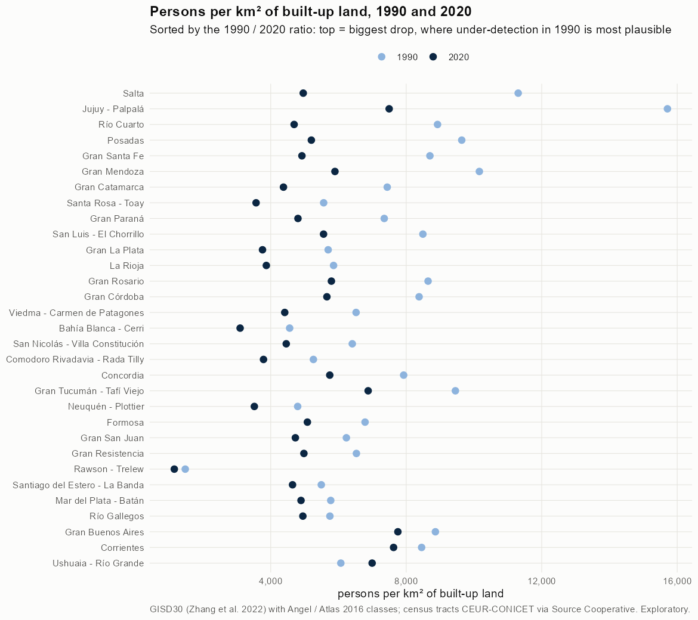

# Test 2 · when does the fringe count as city? All agglomerations

Exploratory. None of these numbers are project figures (they are not in `CIFRAS_CANONICAS.json`). Generated by `Rpipe/scripts/13_prueba_franja.R` from step 11. Run of 2026-11-08. Both tests and how they differ: [METODOS.md](../METODOS.md).

## Method

- **The city**, as in step 04: 8-connected patches of urban + suburban built-up, fringe open space and captured open space that touch the analysis perimeter (with step 04's shared-patch rule).
- **Built-up** (urban + suburban) is always city.
- **Fringe and captured** land join the city only in tracts whose density on urbanized land (persons / km² of built + fringe + captured in the tract) is at or above the cut. If the tract is dense even counting its fringe as urban, that fringe is probably built and unseen.
- **Cuts**: 300, 500, 1,000, 2,000, 3,000, 3,250, 3,500, 3,750, 4,000, 4,500, 5,000 persons/km² (300, 500 and 1,000 are the project's `U_DENS`), plus no cut (the Angel extent) and built-up only.
- **Premise check**: persons per km² of built-up land by year. Higher in 1990 than later is compatible with buildings missed by the older imagery, but also with a denser city that later spread out.
- **Pairs**: GISD30 1990 with the 1991 census, 2000-2001, 2010-2010, 2020-2022. Areas from whole 30 m pixels (step 11).

## All agglomerations at 500 p/km²

| Agglomeration | Persons/km² built 1990 | Persons/km² built 2020 | % fringe added 1990 | % fringe added 2020 | City 2020 km² | Angel 2020 km² | Growth Angel %/yr | Growth at 500 %/yr | Growth built only %/yr |
|---|---|---|---|---|---|---|---|---|---|
| [Bahía Blanca - Cerri](bahia_blanca/REPORTE.md) | 4,559 | 3,097 | 61.0 | 50.4 | 129.6 | 151.8 | 1.72 | 1.68 | 2.01 |
| [Comodoro Rivadavia - Rada Tilly](comodoro_rivadavia/REPORTE.md) | 5,260 | 3,787 | 62.8 | 63.7 | 73.7 | 84.0 | 2.51 | 2.62 | 2.86 |
| [Concordia](concordia/REPORTE.md) | 7,924 | 5,743 | 94.4 | 81.0 | 41.4 | 43.8 | 2.33 | 2.19 | 2.48 |
| [Corrientes](corrientes/REPORTE.md) | 8,455 | 7,627 | 96.5 | 75.1 | 73.8 | 79.4 | 2.05 | 1.84 | 2.04 |
| [Formosa](formosa/REPORTE.md) | 6,785 | 5,083 | 79.0 | 73.6 | 68.2 | 74.3 | 2.82 | 2.76 | 2.87 |
| [Gran Buenos Aires](buenos_aires/REPORTE.md) | 8,862 | 7,754 | 88.3 | 70.7 | 2,365.4 | 2,541.8 | 1.35 | 1.21 | 1.40 |
| [Gran Catamarca](catamarca/REPORTE.md) | 7,439 | 4,377 | 94.1 | 79.7 | 71.8 | 76.8 | 3.56 | 3.41 | 4.02 |
| [Gran Córdoba](cordoba/REPORTE.md) | 8,381 | 5,659 | 85.0 | 66.1 | 384.3 | 426.4 | 2.41 | 2.21 | 2.46 |
| [Gran La Plata](la_plata/REPORTE.md) | 5,696 | 3,758 | 86.9 | 44.2 | 306.3 | 383.9 | 2.75 | 2.13 | 2.56 |
| [Gran Mendoza](mendoza/REPORTE.md) | 10,159 | 5,896 | 97.9 | 89.6 | 315.3 | 328.6 | 2.88 | 2.77 | 3.29 |
| [Gran Paraná](parana/REPORTE.md) | 7,351 | 4,804 | 95.3 | 69.9 | 84.5 | 93.7 | 2.73 | 2.43 | 2.67 |
| [Gran Resistencia](resistencia/REPORTE.md) | 6,530 | 4,980 | 83.8 | 69.3 | 111.1 | 122.9 | 1.84 | 1.70 | 2.04 |
| [Gran Rosario](rosario/REPORTE.md) | 8,645 | 5,792 | 88.0 | 56.0 | 310.1 | 355.7 | 2.23 | 1.87 | 2.16 |
| [Gran San Juan](san_juan/REPORTE.md) | 6,233 | 4,728 | 93.5 | 84.5 | 200.0 | 212.8 | 2.30 | 2.19 | 2.52 |
| [Gran Santa Fe](santa_fe/REPORTE.md) | 8,699 | 4,921 | 95.7 | 60.1 | 148.5 | 174.2 | 3.30 | 2.80 | 2.90 |
| [Gran Tucumán - Tafí Viejo](tucuman/REPORTE.md) | 9,452 | 6,876 | 86.5 | 77.2 | 194.3 | 206.4 | 2.08 | 2.05 | 2.60 |
| [Jujuy - Palpalá](jujuy/REPORTE.md) | 15,712 | 7,497 | 97.3 | 69.0 | 71.9 | 81.4 | 4.22 | 3.84 | 4.94 |
| [La Rioja](la_rioja/REPORTE.md) | 5,855 | 3,871 | 95.2 | 76.4 | 70.2 | 75.1 | 3.19 | 3.02 | 3.80 |
| [Mar del Plata - Batán](mar_del_plata/REPORTE.md) | 5,772 | 4,895 | 85.3 | 64.9 | 160.4 | 174.4 | 1.26 | 1.10 | 1.32 |
| [Neuquén - Plottier](neuquen/REPORTE.md) | 4,796 | 3,517 | 47.3 | 25.9 | 171.2 | 241.1 | 3.24 | 2.81 | 3.14 |
| [Posadas](posadas/REPORTE.md) | 9,639 | 5,200 | 98.5 | 63.1 | 94.1 | 105.6 | 3.25 | 2.88 | 4.24 |
| [Rawson - Trelew](rawson/REPORTE.md) | 1,477 | 1,154 | 8.8 | 8.9 | 140.8 | 231.0 | 1.40 | 1.99 | 2.10 |
| [Río Cuarto](rio_cuarto/REPORTE.md) | 8,925 | 4,691 | 100.0 | 81.8 | 53.5 | 57.9 | 3.00 | 2.72 | 3.74 |
| [Río Gallegos](rio_gallegos/REPORTE.md) | 5,747 | 4,949 | 87.1 | 82.7 | 30.5 | 32.2 | 2.37 | 2.33 | 2.35 |
| [Salta](salta/REPORTE.md) | 11,306 | 4,960 | 89.5 | 34.9 | 181.1 | 249.9 | 5.02 | 4.06 | 5.03 |
| [San Luis - El Chorrillo](san_luis/REPORTE.md) | 8,492 | 5,560 | 75.1 | 90.3 | 61.9 | 64.0 | 3.47 | 3.77 | 4.19 |
| [San Nicolás - Villa Constitución](san_nicolas/REPORTE.md) | 6,408 | 4,458 | 90.8 | 45.4 | 59.5 | 73.6 | 2.10 | 1.49 | 2.12 |
| [Santa Rosa - Toay](santa_rosa/REPORTE.md) | 5,563 | 3,568 | 92.9 | 60.8 | 45.9 | 51.5 | 3.00 | 2.69 | 3.23 |
| [Santiago del Estero - La Banda](santiago_del_estero/REPORTE.md) | 5,493 | 4,644 | 88.1 | 79.8 | 130.2 | 138.2 | 2.28 | 2.20 | 2.35 |
| [Ushuaia - Río Grande](ushuaia/REPORTE.md) | 6,070 | 6,994 | 80.1 | 85.5 | 36.7 | 38.9 | 2.40 | 2.51 | 2.61 |
| [Viedma - Carmen de Patagones](viedma/REPORTE.md) | 6,520 | 4,414 | 92.8 | 63.1 | 23.4 | 26.0 | 2.02 | 1.76 | 2.58 |

## Maps by agglomeration

Each link opens the full map. All maps of an agglomeration share one frame: its 2020 city plus 3 km. Each map has 13 panels: the Angel extent, every cut, and built-up only.

| Agglomeration | 1990 | 2000 | 2010 | 2020 |
|---|---|---|---|---|
| [Bahía Blanca - Cerri](bahia_blanca/REPORTE.md) | [city](bahia_blanca/img/mapa_1990.png) | [city](bahia_blanca/img/mapa_2000.png) | [city](bahia_blanca/img/mapa_2010.png) | [city](bahia_blanca/img/mapa_2020.png) |
| [Comodoro Rivadavia - Rada Tilly](comodoro_rivadavia/REPORTE.md) | [city](comodoro_rivadavia/img/mapa_1990.png) | [city](comodoro_rivadavia/img/mapa_2000.png) | [city](comodoro_rivadavia/img/mapa_2010.png) | [city](comodoro_rivadavia/img/mapa_2020.png) |
| [Concordia](concordia/REPORTE.md) | [city](concordia/img/mapa_1990.png) | [city](concordia/img/mapa_2000.png) | [city](concordia/img/mapa_2010.png) | [city](concordia/img/mapa_2020.png) |
| [Corrientes](corrientes/REPORTE.md) | [city](corrientes/img/mapa_1990.png) | [city](corrientes/img/mapa_2000.png) | [city](corrientes/img/mapa_2010.png) | [city](corrientes/img/mapa_2020.png) |
| [Formosa](formosa/REPORTE.md) | [city](formosa/img/mapa_1990.png) | [city](formosa/img/mapa_2000.png) | [city](formosa/img/mapa_2010.png) | [city](formosa/img/mapa_2020.png) |
| [Gran Buenos Aires](buenos_aires/REPORTE.md) | [city](buenos_aires/img/mapa_1990.png) | [city](buenos_aires/img/mapa_2000.png) | [city](buenos_aires/img/mapa_2010.png) | [city](buenos_aires/img/mapa_2020.png) |
| [Gran Catamarca](catamarca/REPORTE.md) | [city](catamarca/img/mapa_1990.png) | [city](catamarca/img/mapa_2000.png) | [city](catamarca/img/mapa_2010.png) | [city](catamarca/img/mapa_2020.png) |
| [Gran Córdoba](cordoba/REPORTE.md) | [city](cordoba/img/mapa_1990.png) | [city](cordoba/img/mapa_2000.png) | [city](cordoba/img/mapa_2010.png) | [city](cordoba/img/mapa_2020.png) |
| [Gran La Plata](la_plata/REPORTE.md) | [city](la_plata/img/mapa_1990.png) | [city](la_plata/img/mapa_2000.png) | [city](la_plata/img/mapa_2010.png) | [city](la_plata/img/mapa_2020.png) |
| [Gran Mendoza](mendoza/REPORTE.md) | [city](mendoza/img/mapa_1990.png) | [city](mendoza/img/mapa_2000.png) | [city](mendoza/img/mapa_2010.png) | [city](mendoza/img/mapa_2020.png) |
| [Gran Paraná](parana/REPORTE.md) | [city](parana/img/mapa_1990.png) | [city](parana/img/mapa_2000.png) | [city](parana/img/mapa_2010.png) | [city](parana/img/mapa_2020.png) |
| [Gran Resistencia](resistencia/REPORTE.md) | [city](resistencia/img/mapa_1990.png) | [city](resistencia/img/mapa_2000.png) | [city](resistencia/img/mapa_2010.png) | [city](resistencia/img/mapa_2020.png) |
| [Gran Rosario](rosario/REPORTE.md) | [city](rosario/img/mapa_1990.png) | [city](rosario/img/mapa_2000.png) | [city](rosario/img/mapa_2010.png) | [city](rosario/img/mapa_2020.png) |
| [Gran San Juan](san_juan/REPORTE.md) | [city](san_juan/img/mapa_1990.png) | [city](san_juan/img/mapa_2000.png) | [city](san_juan/img/mapa_2010.png) | [city](san_juan/img/mapa_2020.png) |
| [Gran Santa Fe](santa_fe/REPORTE.md) | [city](santa_fe/img/mapa_1990.png) | [city](santa_fe/img/mapa_2000.png) | [city](santa_fe/img/mapa_2010.png) | [city](santa_fe/img/mapa_2020.png) |
| [Gran Tucumán - Tafí Viejo](tucuman/REPORTE.md) | [city](tucuman/img/mapa_1990.png) | [city](tucuman/img/mapa_2000.png) | [city](tucuman/img/mapa_2010.png) | [city](tucuman/img/mapa_2020.png) |
| [Jujuy - Palpalá](jujuy/REPORTE.md) | [city](jujuy/img/mapa_1990.png) | [city](jujuy/img/mapa_2000.png) | [city](jujuy/img/mapa_2010.png) | [city](jujuy/img/mapa_2020.png) |
| [La Rioja](la_rioja/REPORTE.md) | [city](la_rioja/img/mapa_1990.png) | [city](la_rioja/img/mapa_2000.png) | [city](la_rioja/img/mapa_2010.png) | [city](la_rioja/img/mapa_2020.png) |
| [Mar del Plata - Batán](mar_del_plata/REPORTE.md) | [city](mar_del_plata/img/mapa_1990.png) | [city](mar_del_plata/img/mapa_2000.png) | [city](mar_del_plata/img/mapa_2010.png) | [city](mar_del_plata/img/mapa_2020.png) |
| [Neuquén - Plottier](neuquen/REPORTE.md) | [city](neuquen/img/mapa_1990.png) | [city](neuquen/img/mapa_2000.png) | [city](neuquen/img/mapa_2010.png) | [city](neuquen/img/mapa_2020.png) |
| [Posadas](posadas/REPORTE.md) | [city](posadas/img/mapa_1990.png) | [city](posadas/img/mapa_2000.png) | [city](posadas/img/mapa_2010.png) | [city](posadas/img/mapa_2020.png) |
| [Rawson - Trelew](rawson/REPORTE.md) | [city](rawson/img/mapa_1990.png) | [city](rawson/img/mapa_2000.png) | [city](rawson/img/mapa_2010.png) | [city](rawson/img/mapa_2020.png) |
| [Río Cuarto](rio_cuarto/REPORTE.md) | [city](rio_cuarto/img/mapa_1990.png) | [city](rio_cuarto/img/mapa_2000.png) | [city](rio_cuarto/img/mapa_2010.png) | [city](rio_cuarto/img/mapa_2020.png) |
| [Río Gallegos](rio_gallegos/REPORTE.md) | [city](rio_gallegos/img/mapa_1990.png) | [city](rio_gallegos/img/mapa_2000.png) | [city](rio_gallegos/img/mapa_2010.png) | [city](rio_gallegos/img/mapa_2020.png) |
| [Salta](salta/REPORTE.md) | [city](salta/img/mapa_1990.png) | [city](salta/img/mapa_2000.png) | [city](salta/img/mapa_2010.png) | [city](salta/img/mapa_2020.png) |
| [San Luis - El Chorrillo](san_luis/REPORTE.md) | [city](san_luis/img/mapa_1990.png) | [city](san_luis/img/mapa_2000.png) | [city](san_luis/img/mapa_2010.png) | [city](san_luis/img/mapa_2020.png) |
| [San Nicolás - Villa Constitución](san_nicolas/REPORTE.md) | [city](san_nicolas/img/mapa_1990.png) | [city](san_nicolas/img/mapa_2000.png) | [city](san_nicolas/img/mapa_2010.png) | [city](san_nicolas/img/mapa_2020.png) |
| [Santa Rosa - Toay](santa_rosa/REPORTE.md) | [city](santa_rosa/img/mapa_1990.png) | [city](santa_rosa/img/mapa_2000.png) | [city](santa_rosa/img/mapa_2010.png) | [city](santa_rosa/img/mapa_2020.png) |
| [Santiago del Estero - La Banda](santiago_del_estero/REPORTE.md) | [city](santiago_del_estero/img/mapa_1990.png) | [city](santiago_del_estero/img/mapa_2000.png) | [city](santiago_del_estero/img/mapa_2010.png) | [city](santiago_del_estero/img/mapa_2020.png) |
| [Ushuaia - Río Grande](ushuaia/REPORTE.md) | [city](ushuaia/img/mapa_1990.png) | [city](ushuaia/img/mapa_2000.png) | [city](ushuaia/img/mapa_2010.png) | [city](ushuaia/img/mapa_2020.png) |
| [Viedma - Carmen de Patagones](viedma/REPORTE.md) | [city](viedma/img/mapa_1990.png) | [city](viedma/img/mapa_2000.png) | [city](viedma/img/mapa_2010.png) | [city](viedma/img/mapa_2020.png) |

