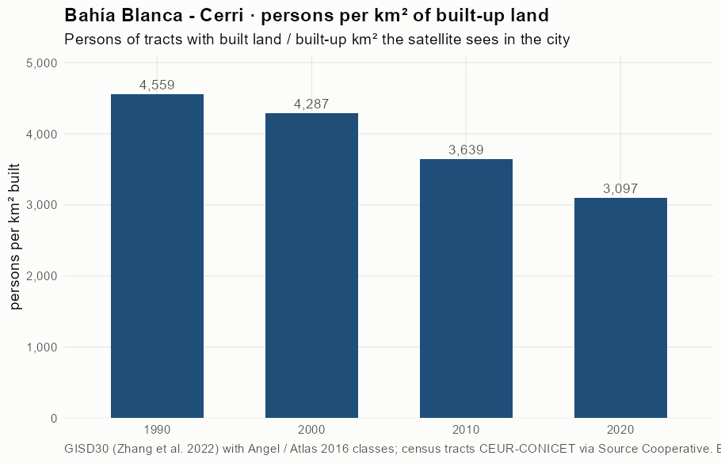
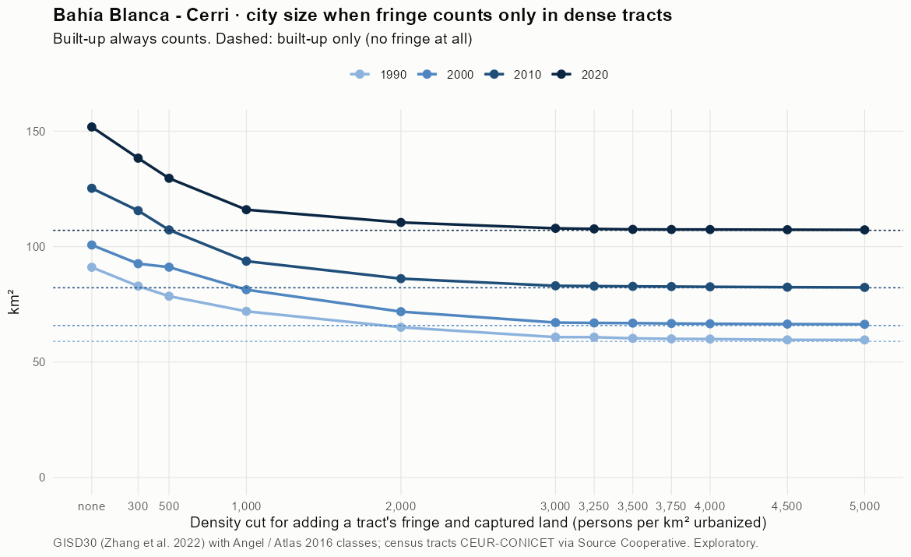
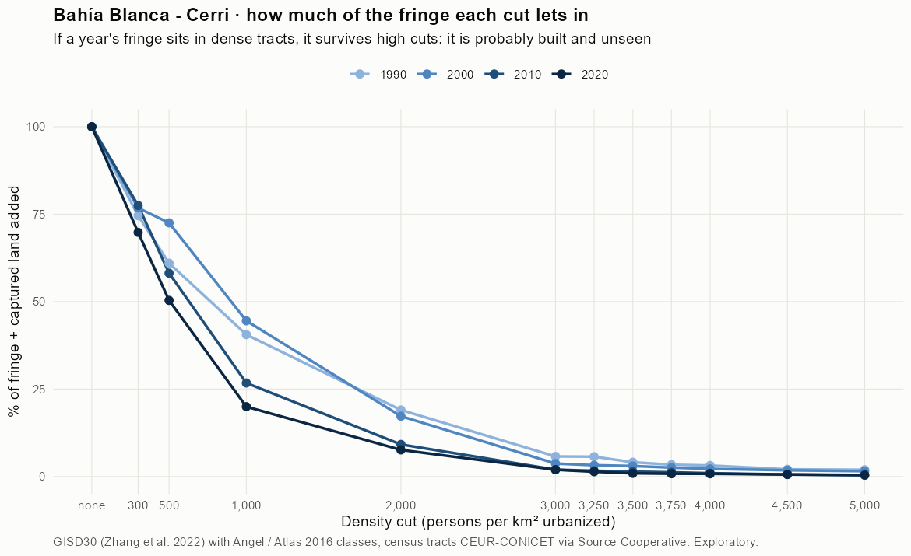
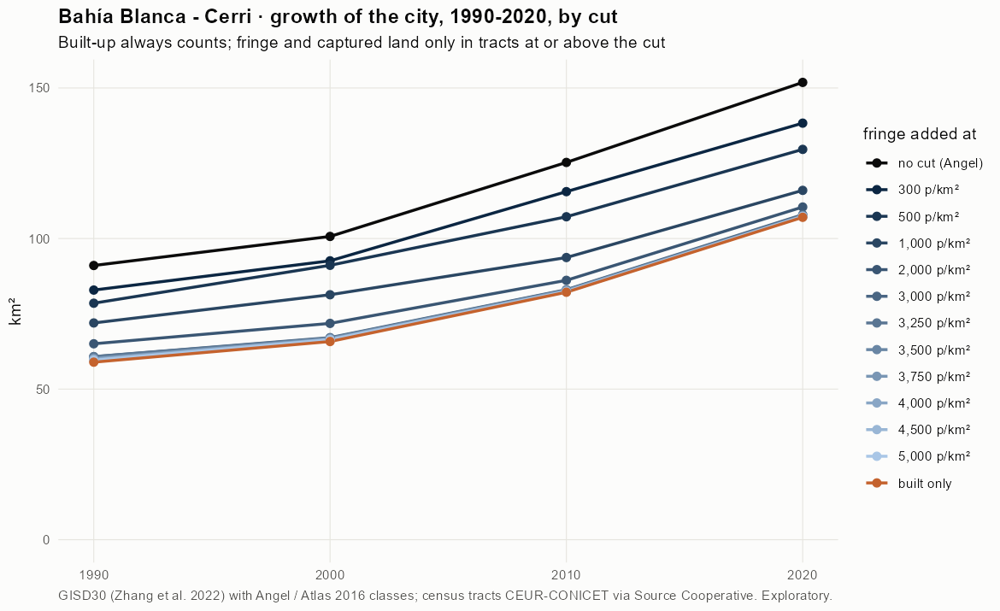
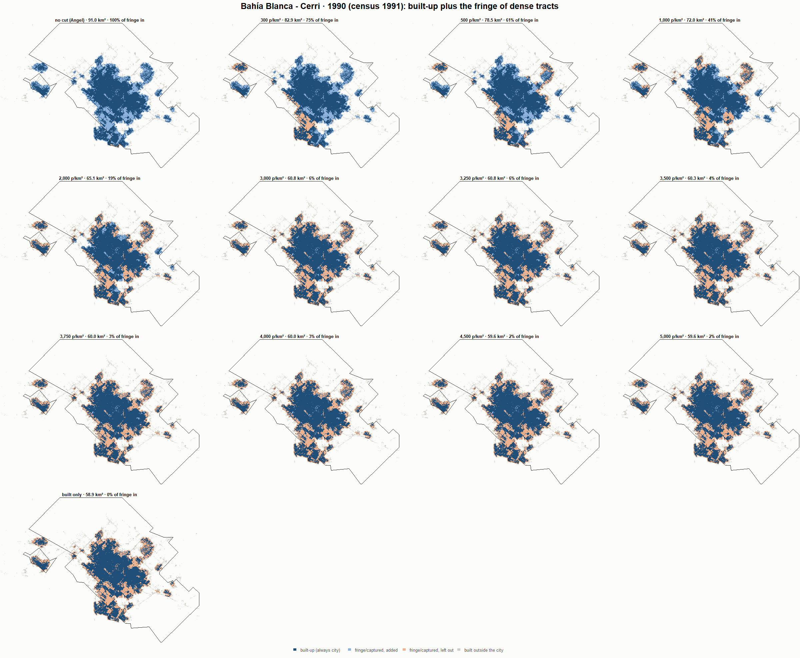
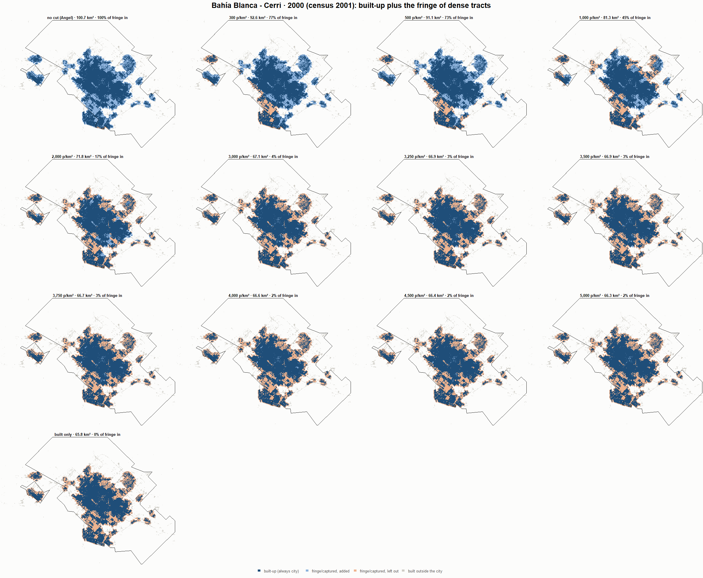
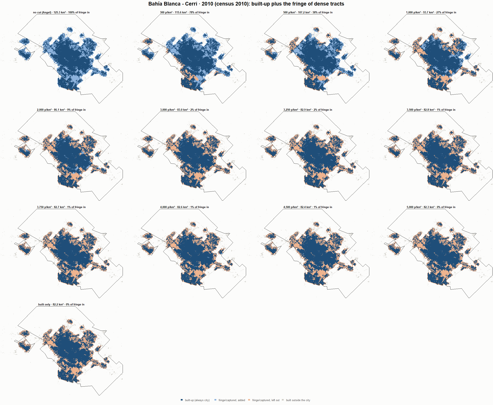
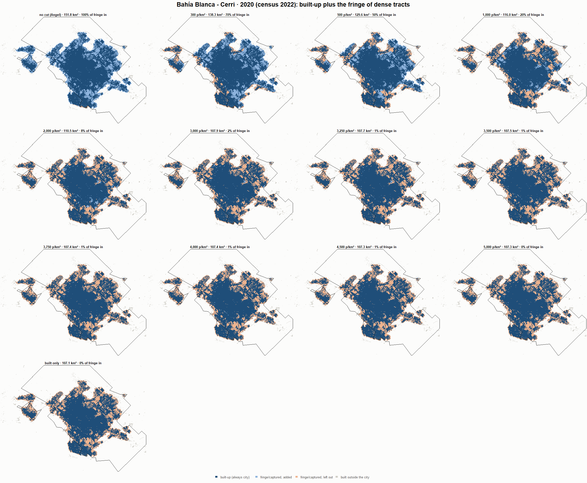

# Bahía Blanca - Cerri · when does the fringe count as city? 1990-2020

Exploratory test 2. None of these numbers are project figures (they are not in `CIFRAS_CANONICAS.json`). Generated by `Rpipe/scripts/13_prueba_franja.R` from the tract tables of step 11. Run of 2026-11-08. [All agglomerations](../REPORTE.md).

**Idea.** Built-up land is always city. Fringe and captured open space join the city **only in dense tracts**, where they are probably built and unseen by the older imagery. No cut gives the full Angel extent; an infinite cut, built-up only. Method in the [index](../REPORTE.md#method).

## Is the early imagery under-detecting?

If the older imagery misses buildings, persons per km² of *built* land should come out higher in the early years.

| Year | Persons (tracts with built land) | Built km² | Persons / km² built | Median tract, persons / km² built | Fringe + captured, % of extent |
|---|---|---|---|---|---|
| 1990 (census 1991) | 268,728 | 58.9 | 4,559 | 3,986 | 35.3 |
| 2000 (census 2001) | 282,100 | 65.8 | 4,287 | 3,908 | 34.7 |
| 2010 (census 2010) | 299,033 | 82.2 | 3,639 | 3,132 | 34.4 |
| 2020 (census 2022) | 331,525 | 107.1 | 3,097 | 2,426 | 29.5 |

## Results

**1990 (census 1991).** Built-up 58.9 km²; fringe + captured 32.1 km²; 269,149 persons in the city's tracts.

| Fringe added at | City km² | Fringe added km² | % of fringe added | Fringe % of city | Tracts adding fringe | Persons / km² city |
|---|---|---|---|---|---|---|
| no cut (Angel) | 91.0 | 32.1 | 100.0 | 35.3 | 137 | 2,956 |
| 300 p/km² | 82.9 | 23.9 | 74.6 | 28.9 | 133 | 3,247 |
| 500 p/km² | 78.5 | 19.6 | 61.0 | 24.9 | 130 | 3,428 |
| 1,000 p/km² | 72.0 | 13.0 | 40.6 | 18.1 | 124 | 3,740 |
| 2,000 p/km² | 65.1 | 6.1 | 19.0 | 9.4 | 109 | 4,137 |
| 3,000 p/km² | 60.8 | 1.8 | 5.7 | 3.0 | 93 | 4,428 |
| 3,250 p/km² | 60.8 | 1.8 | 5.7 | 3.0 | 92 | 4,429 |
| 3,500 p/km² | 60.3 | 1.3 | 4.1 | 2.2 | 87 | 4,467 |
| 3,750 p/km² | 60.0 | 1.1 | 3.4 | 1.8 | 84 | 4,484 |
| 4,000 p/km² | 60.0 | 1.0 | 3.2 | 1.7 | 81 | 4,489 |
| 4,500 p/km² | 59.6 | 0.7 | 2.1 | 1.1 | 73 | 4,516 |
| 5,000 p/km² | 59.6 | 0.6 | 1.9 | 1.0 | 68 | 4,518 |
| built only | 58.9 | 0.0 | 0.0 | 0.0 | 0 | 4,566 |

**2000 (census 2001).** Built-up 65.8 km²; fringe + captured 34.9 km²; 282,100 persons in the city's tracts.

| Fringe added at | City km² | Fringe added km² | % of fringe added | Fringe % of city | Tracts adding fringe | Persons / km² city |
|---|---|---|---|---|---|---|
| no cut (Angel) | 100.7 | 34.9 | 100.0 | 34.7 | 166 | 2,801 |
| 300 p/km² | 92.6 | 26.8 | 76.8 | 28.9 | 163 | 3,046 |
| 500 p/km² | 91.1 | 25.3 | 72.5 | 27.8 | 161 | 3,096 |
| 1,000 p/km² | 81.3 | 15.5 | 44.5 | 19.1 | 151 | 3,468 |
| 2,000 p/km² | 71.8 | 6.0 | 17.3 | 8.4 | 129 | 3,928 |
| 3,000 p/km² | 67.1 | 1.3 | 3.7 | 1.9 | 107 | 4,204 |
| 3,250 p/km² | 66.9 | 1.1 | 3.2 | 1.7 | 101 | 4,215 |
| 3,500 p/km² | 66.9 | 1.1 | 3.0 | 1.6 | 98 | 4,220 |
| 3,750 p/km² | 66.7 | 0.9 | 2.6 | 1.3 | 94 | 4,230 |
| 4,000 p/km² | 66.6 | 0.8 | 2.2 | 1.2 | 89 | 4,238 |
| 4,500 p/km² | 66.4 | 0.6 | 1.8 | 0.9 | 85 | 4,247 |
| 5,000 p/km² | 66.3 | 0.5 | 1.5 | 0.8 | 78 | 4,253 |
| built only | 65.8 | 0.0 | 0.0 | 0.0 | 0 | 4,287 |

**2010 (census 2010).** Built-up 82.2 km²; fringe + captured 43.1 km²; 299,033 persons in the city's tracts.

| Fringe added at | City km² | Fringe added km² | % of fringe added | Fringe % of city | Tracts adding fringe | Persons / km² city |
|---|---|---|---|---|---|---|
| no cut (Angel) | 125.3 | 43.1 | 100.0 | 34.4 | 153 | 2,387 |
| 300 p/km² | 115.6 | 33.4 | 77.5 | 28.9 | 149 | 2,587 |
| 500 p/km² | 107.2 | 25.1 | 58.1 | 23.4 | 143 | 2,789 |
| 1,000 p/km² | 93.7 | 11.5 | 26.7 | 12.3 | 127 | 3,192 |
| 2,000 p/km² | 86.1 | 4.0 | 9.2 | 4.6 | 102 | 3,472 |
| 3,000 p/km² | 83.0 | 0.8 | 2.0 | 1.0 | 72 | 3,602 |
| 3,250 p/km² | 82.9 | 0.7 | 1.7 | 0.9 | 68 | 3,608 |
| 3,500 p/km² | 82.8 | 0.6 | 1.4 | 0.7 | 63 | 3,613 |
| 3,750 p/km² | 82.7 | 0.5 | 1.2 | 0.6 | 58 | 3,616 |
| 4,000 p/km² | 82.6 | 0.4 | 1.0 | 0.5 | 53 | 3,621 |
| 4,500 p/km² | 82.4 | 0.3 | 0.6 | 0.3 | 47 | 3,628 |
| 5,000 p/km² | 82.3 | 0.2 | 0.4 | 0.2 | 40 | 3,632 |
| built only | 82.2 | 0.0 | 0.0 | 0.0 | 0 | 3,639 |

**2020 (census 2022).** Built-up 107.1 km²; fringe + captured 44.8 km²; 331,685 persons in the city's tracts.

| Fringe added at | City km² | Fringe added km² | % of fringe added | Fringe % of city | Tracts adding fringe | Persons / km² city |
|---|---|---|---|---|---|---|
| no cut (Angel) | 151.8 | 44.8 | 100.0 | 29.5 | 205 | 2,184 |
| 300 p/km² | 138.3 | 31.3 | 69.8 | 22.6 | 195 | 2,398 |
| 500 p/km² | 129.6 | 22.6 | 50.4 | 17.4 | 181 | 2,559 |
| 1,000 p/km² | 116.0 | 8.9 | 20.0 | 7.7 | 150 | 2,859 |
| 2,000 p/km² | 110.5 | 3.4 | 7.6 | 3.1 | 114 | 3,003 |
| 3,000 p/km² | 107.9 | 0.9 | 1.9 | 0.8 | 77 | 3,073 |
| 3,250 p/km² | 107.7 | 0.6 | 1.4 | 0.6 | 70 | 3,081 |
| 3,500 p/km² | 107.5 | 0.4 | 0.9 | 0.4 | 64 | 3,087 |
| 3,750 p/km² | 107.4 | 0.4 | 0.8 | 0.3 | 60 | 3,088 |
| 4,000 p/km² | 107.4 | 0.4 | 0.8 | 0.3 | 56 | 3,088 |
| 4,500 p/km² | 107.3 | 0.3 | 0.6 | 0.2 | 45 | 3,091 |
| 5,000 p/km² | 107.3 | 0.2 | 0.4 | 0.2 | 36 | 3,093 |
| built only | 107.1 | 0.0 | 0.0 | 0.0 | 0 | 3,098 |

### Growth by cut

| Fringe added at | 1990 km² | 2000 km² | 2010 km² | 2020 km² | 1990-2000 %/yr | 2000-2010 %/yr | 2010-2020 %/yr | 1990-2020 %/yr |
|---|---|---|---|---|---|---|---|---|
| no cut (Angel) | 91.0 | 100.7 | 125.3 | 151.8 | 1.01 | 2.21 | 1.94 | 1.72 |
| 300 p/km² | 82.9 | 92.6 | 115.6 | 138.3 | 1.11 | 2.24 | 1.81 | 1.72 |
| 500 p/km² | 78.5 | 91.1 | 107.2 | 129.6 | 1.50 | 1.64 | 1.91 | 1.68 |
| 1,000 p/km² | 72.0 | 81.3 | 93.7 | 116.0 | 1.23 | 1.42 | 2.16 | 1.60 |
| 2,000 p/km² | 65.1 | 71.8 | 86.1 | 110.5 | 0.99 | 1.83 | 2.52 | 1.78 |
| 3,000 p/km² | 60.8 | 67.1 | 83.0 | 107.9 | 0.99 | 2.15 | 2.66 | 1.93 |
| 3,250 p/km² | 60.8 | 66.9 | 82.9 | 107.7 | 0.97 | 2.16 | 2.65 | 1.93 |
| 3,500 p/km² | 60.3 | 66.9 | 82.8 | 107.5 | 1.04 | 2.16 | 2.64 | 1.95 |
| 3,750 p/km² | 60.0 | 66.7 | 82.7 | 107.4 | 1.06 | 2.17 | 2.65 | 1.96 |
| 4,000 p/km² | 60.0 | 66.6 | 82.6 | 107.4 | 1.05 | 2.18 | 2.66 | 1.96 |
| 4,500 p/km² | 59.6 | 66.4 | 82.4 | 107.3 | 1.09 | 2.18 | 2.67 | 1.98 |
| 5,000 p/km² | 59.6 | 66.3 | 82.3 | 107.3 | 1.08 | 2.18 | 2.68 | 1.98 |
| built only | 58.9 | 65.8 | 82.2 | 107.1 | 1.11 | 2.25 | 2.68 | 2.01 |

## Maps

Same frame in the four years: the 2020 city plus 3 km. Dark blue is built-up, always city; light blue is fringe or captured land added because its tract is dense; light orange is fringe left out. Black line: the analysis perimeter.

### 1990

### 2000

### 2010

### 2020

## Reading

- **The premise.** Persons per km² of built land: 4,559 in 1990, 4,287 in 2000, 3,639 in 2010, 3,097 in 2020. 1990 is clearly higher than 2010: consistent with built land missed in 1990, though it also fits a denser city that later spread out.
- **At 500 p/km²** the fringe that joins the city is 61.0 % of all fringe in 1990 and 50.4 % in 2020.
- **Growth 1990-2020**: 1.72 %/yr with the full Angel extent, 1.68 %/yr at 500, 2.01 %/yr built-up only.

