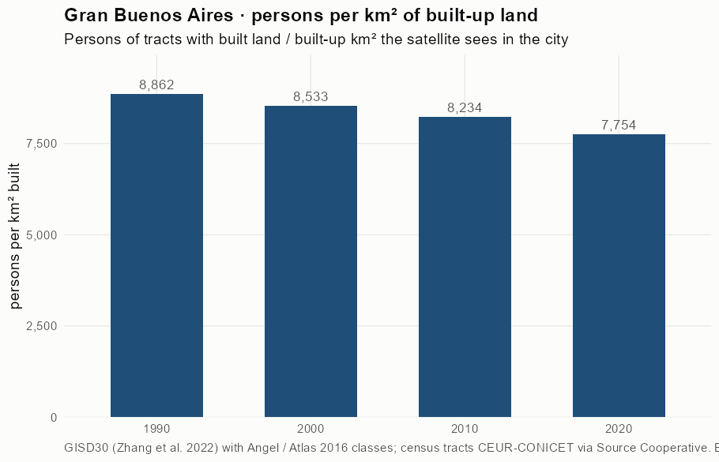
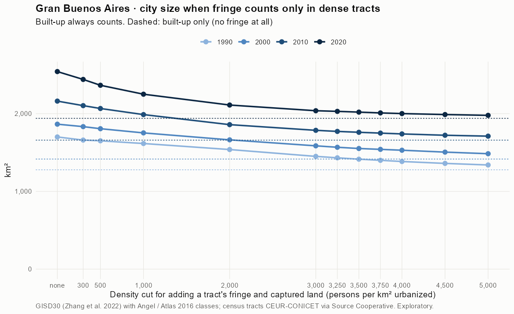
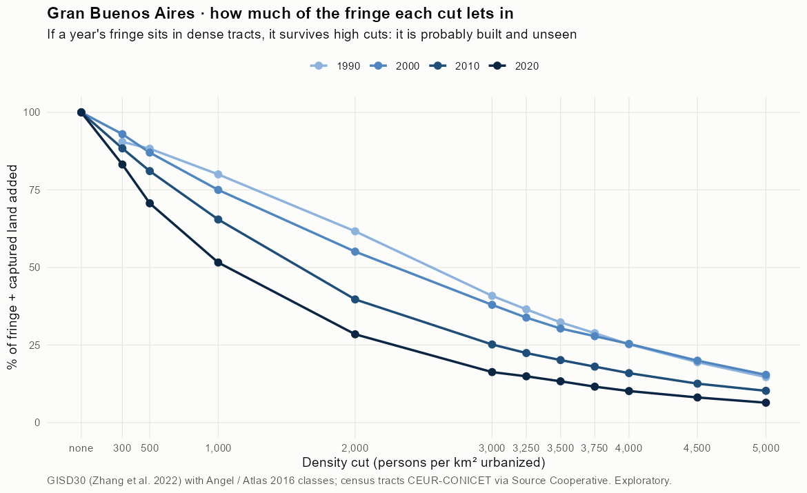
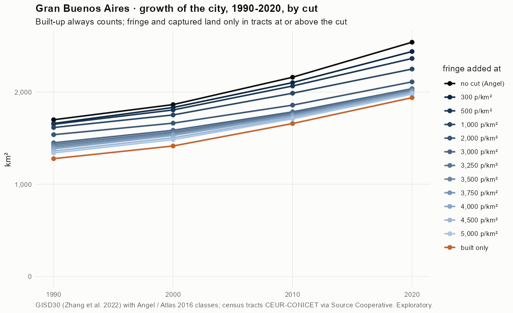
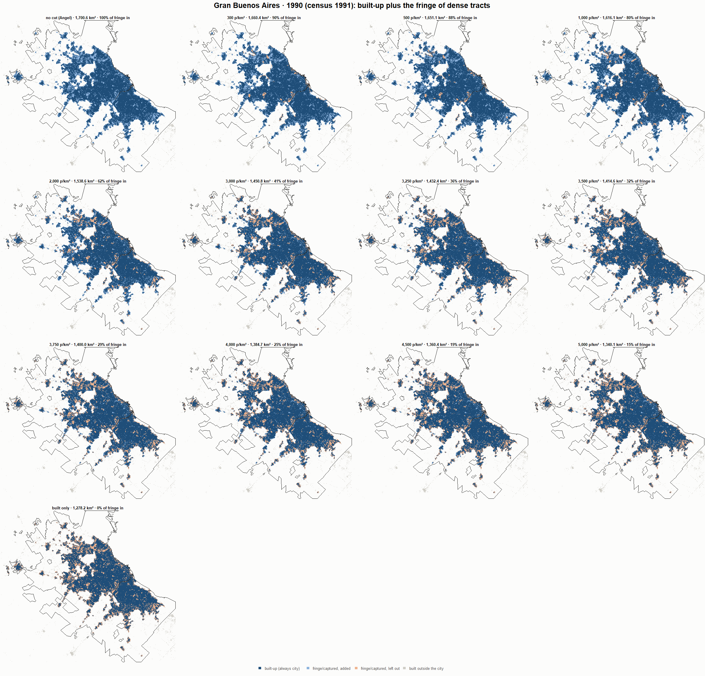
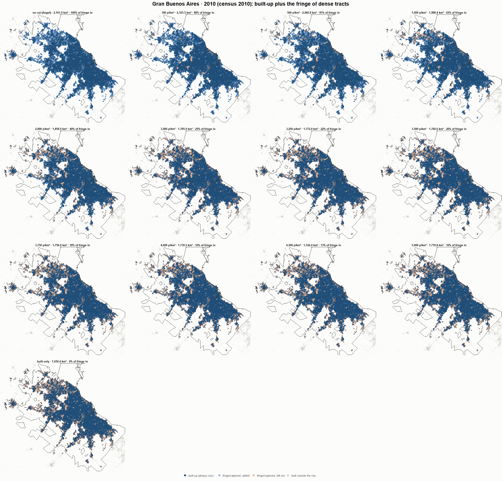
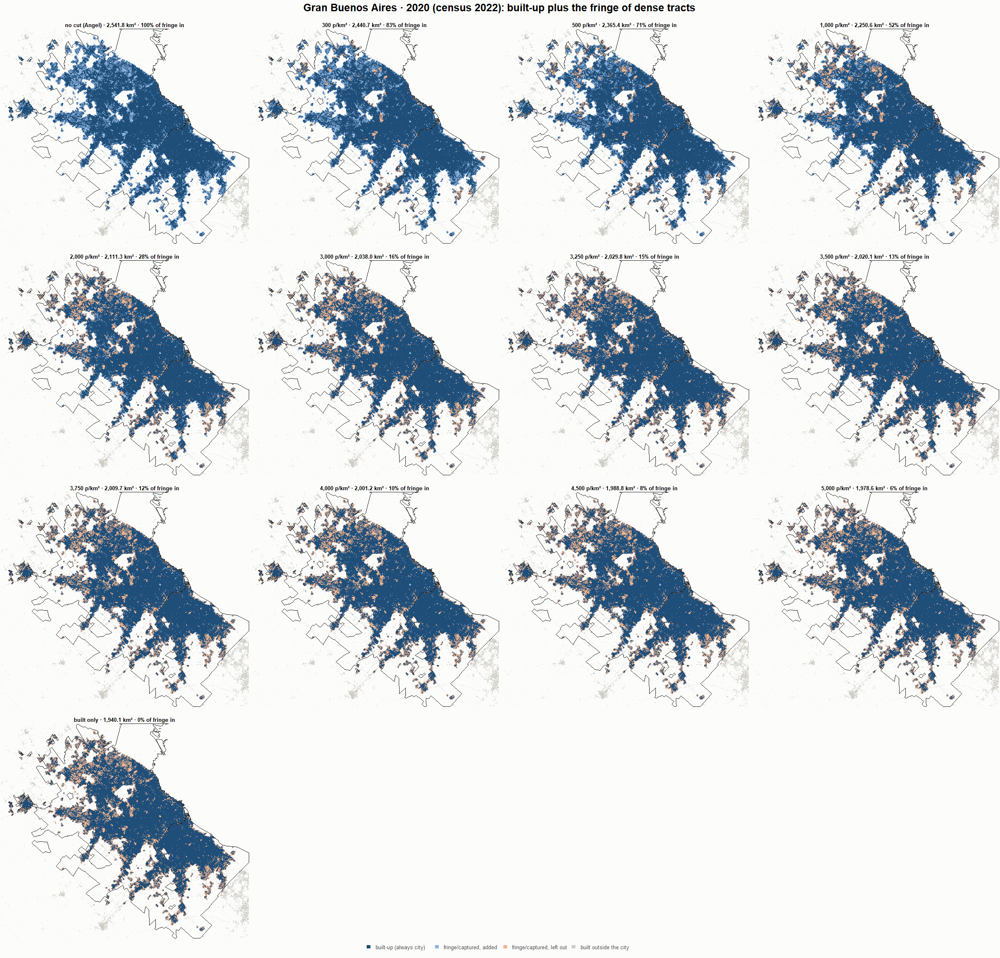

# Gran Buenos Aires · when does the fringe count as city? 1990-2020

Exploratory test 2. None of these numbers are project figures (they are not in `CIFRAS_CANONICAS.json`). Generated by `Rpipe/scripts/13_prueba_franja.R` from the tract tables of step 11. Run of 2026-11-08. [All agglomerations](../REPORTE.md).

**Idea.** Built-up land is always city. Fringe and captured open space join the city **only in dense tracts**, where they are probably built and unseen by the older imagery. No cut gives the full Angel extent; an infinite cut, built-up only. Method in the [index](../REPORTE.md#method).

## Is the early imagery under-detecting?

If the older imagery misses buildings, persons per km² of *built* land should come out higher in the early years.

| Year | Persons (tracts with built land) | Built km² | Persons / km² built | Median tract, persons / km² built | Fringe + captured, % of extent |
|---|---|---|---|---|---|
| 1990 (census 1991) | 11,327,235 | 1,278.2 | 8,862 | 7,470 | 24.8 |
| 2000 (census 2001) | 12,082,389 | 1,415.9 | 8,533 | 7,535 | 24.0 |
| 2010 (census 2010) | 13,663,456 | 1,659.4 | 8,234 | 7,192 | 23.2 |
| 2020 (census 2022) | 15,043,516 | 1,940.1 | 7,754 | 6,723 | 23.6 |

## Results

**1990 (census 1991).** Built-up 1,278.2 km²; fringe + captured 422.4 km²; 11,365,737 persons in the city's tracts.

| Fringe added at | City km² | Fringe added km² | % of fringe added | Fringe % of city | Tracts adding fringe | Persons / km² city |
|---|---|---|---|---|---|---|
| no cut (Angel) | 1,700.6 | 422.4 | 100.0 | 24.8 | 5,352 | 6,683 |
| 300 p/km² | 1,660.4 | 382.2 | 90.5 | 23.0 | 5,296 | 6,845 |
| 500 p/km² | 1,651.1 | 372.9 | 88.3 | 22.6 | 5,278 | 6,884 |
| 1,000 p/km² | 1,616.1 | 337.9 | 80.0 | 20.9 | 5,228 | 7,033 |
| 2,000 p/km² | 1,538.6 | 260.4 | 61.7 | 16.9 | 5,038 | 7,387 |
| 3,000 p/km² | 1,450.8 | 172.5 | 40.9 | 11.9 | 4,711 | 7,834 |
| 3,250 p/km² | 1,432.4 | 154.2 | 36.5 | 10.8 | 4,613 | 7,935 |
| 3,500 p/km² | 1,414.6 | 136.4 | 32.3 | 9.6 | 4,508 | 8,034 |
| 3,750 p/km² | 1,400.0 | 121.8 | 28.8 | 8.7 | 4,404 | 8,119 |
| 4,000 p/km² | 1,384.7 | 106.5 | 25.2 | 7.7 | 4,297 | 8,208 |
| 4,500 p/km² | 1,360.4 | 82.1 | 19.4 | 6.0 | 4,075 | 8,355 |
| 5,000 p/km² | 1,340.1 | 61.9 | 14.7 | 4.6 | 3,816 | 8,481 |
| built only | 1,278.2 | 0.0 | 0.0 | 0.0 | 0 | 8,892 |

**2000 (census 2001).** Built-up 1,415.9 km²; fringe + captured 449.0 km²; 12,129,623 persons in the city's tracts.

| Fringe added at | City km² | Fringe added km² | % of fringe added | Fringe % of city | Tracts adding fringe | Persons / km² city |
|---|---|---|---|---|---|---|
| no cut (Angel) | 1,865.0 | 449.0 | 100.0 | 24.1 | 6,280 | 6,504 |
| 300 p/km² | 1,833.5 | 417.5 | 93.0 | 22.8 | 6,235 | 6,616 |
| 500 p/km² | 1,806.8 | 390.8 | 87.0 | 21.6 | 6,212 | 6,713 |
| 1,000 p/km² | 1,752.7 | 336.8 | 75.0 | 19.2 | 6,130 | 6,920 |
| 2,000 p/km² | 1,663.4 | 247.5 | 55.1 | 14.9 | 5,868 | 7,292 |
| 3,000 p/km² | 1,586.3 | 170.4 | 38.0 | 10.7 | 5,467 | 7,646 |
| 3,250 p/km² | 1,567.9 | 152.0 | 33.8 | 9.7 | 5,332 | 7,736 |
| 3,500 p/km² | 1,552.1 | 136.1 | 30.3 | 8.8 | 5,192 | 7,815 |
| 3,750 p/km² | 1,541.0 | 125.1 | 27.9 | 8.1 | 5,078 | 7,871 |
| 4,000 p/km² | 1,529.8 | 113.9 | 25.4 | 7.4 | 4,946 | 7,929 |
| 4,500 p/km² | 1,505.6 | 89.6 | 20.0 | 6.0 | 4,642 | 8,057 |
| 5,000 p/km² | 1,485.0 | 69.1 | 15.4 | 4.7 | 4,279 | 8,168 |
| built only | 1,415.9 | 0.0 | 0.0 | 0.0 | 0 | 8,567 |

**2010 (census 2010).** Built-up 1,659.4 km²; fringe + captured 502.4 km²; 13,694,807 persons in the city's tracts.

| Fringe added at | City km² | Fringe added km² | % of fringe added | Fringe % of city | Tracts adding fringe | Persons / km² city |
|---|---|---|---|---|---|---|
| no cut (Angel) | 2,161.9 | 502.4 | 100.0 | 23.2 | 5,302 | 6,335 |
| 300 p/km² | 2,103.5 | 444.1 | 88.4 | 21.1 | 5,233 | 6,510 |
| 500 p/km² | 2,066.8 | 407.3 | 81.1 | 19.7 | 5,188 | 6,626 |
| 1,000 p/km² | 1,988.4 | 328.9 | 65.5 | 16.5 | 5,049 | 6,888 |
| 2,000 p/km² | 1,858.9 | 199.5 | 39.7 | 10.7 | 4,634 | 7,367 |
| 3,000 p/km² | 1,785.9 | 126.5 | 25.2 | 7.1 | 4,186 | 7,668 |
| 3,250 p/km² | 1,772.0 | 112.6 | 22.4 | 6.4 | 4,067 | 7,728 |
| 3,500 p/km² | 1,760.6 | 101.2 | 20.1 | 5.7 | 3,938 | 7,778 |
| 3,750 p/km² | 1,750.0 | 90.6 | 18.0 | 5.2 | 3,809 | 7,826 |
| 4,000 p/km² | 1,739.5 | 80.1 | 15.9 | 4.6 | 3,670 | 7,873 |
| 4,500 p/km² | 1,722.4 | 63.0 | 12.5 | 3.7 | 3,389 | 7,951 |
| 5,000 p/km² | 1,710.8 | 51.4 | 10.2 | 3.0 | 3,092 | 8,005 |
| built only | 1,659.4 | 0.0 | 0.0 | 0.0 | 0 | 8,253 |

**2020 (census 2022).** Built-up 1,940.1 km²; fringe + captured 601.8 km²; 15,070,960 persons in the city's tracts.

| Fringe added at | City km² | Fringe added km² | % of fringe added | Fringe % of city | Tracts adding fringe | Persons / km² city |
|---|---|---|---|---|---|---|
| no cut (Angel) | 2,541.8 | 601.8 | 100.0 | 23.7 | 5,783 | 5,929 |
| 300 p/km² | 2,440.7 | 500.6 | 83.2 | 20.5 | 5,665 | 6,175 |
| 500 p/km² | 2,365.4 | 425.4 | 70.7 | 18.0 | 5,555 | 6,371 |
| 1,000 p/km² | 2,250.6 | 310.5 | 51.6 | 13.8 | 5,317 | 6,697 |
| 2,000 p/km² | 2,111.3 | 171.2 | 28.5 | 8.1 | 4,751 | 7,138 |
| 3,000 p/km² | 2,038.0 | 97.9 | 16.3 | 4.8 | 4,214 | 7,395 |
| 3,250 p/km² | 2,029.8 | 89.7 | 14.9 | 4.4 | 4,106 | 7,425 |
| 3,500 p/km² | 2,020.1 | 80.0 | 13.3 | 4.0 | 3,976 | 7,460 |
| 3,750 p/km² | 2,009.7 | 69.7 | 11.6 | 3.5 | 3,845 | 7,499 |
| 4,000 p/km² | 2,001.2 | 61.2 | 10.2 | 3.1 | 3,694 | 7,531 |
| 4,500 p/km² | 1,988.8 | 48.7 | 8.1 | 2.4 | 3,396 | 7,578 |
| 5,000 p/km² | 1,978.6 | 38.5 | 6.4 | 1.9 | 3,092 | 7,617 |
| built only | 1,940.1 | 0.0 | 0.0 | 0.0 | 0 | 7,768 |

### Growth by cut

| Fringe added at | 1990 km² | 2000 km² | 2010 km² | 2020 km² | 1990-2000 %/yr | 2000-2010 %/yr | 2010-2020 %/yr | 1990-2020 %/yr |
|---|---|---|---|---|---|---|---|---|
| no cut (Angel) | 1,700.6 | 1,865.0 | 2,161.9 | 2,541.8 | 0.93 | 1.49 | 1.63 | 1.35 |
| 300 p/km² | 1,660.4 | 1,833.5 | 2,103.5 | 2,440.7 | 1.00 | 1.38 | 1.50 | 1.29 |
| 500 p/km² | 1,651.1 | 1,806.8 | 2,066.8 | 2,365.4 | 0.90 | 1.35 | 1.36 | 1.21 |
| 1,000 p/km² | 1,616.1 | 1,752.7 | 1,988.4 | 2,250.6 | 0.81 | 1.27 | 1.25 | 1.11 |
| 2,000 p/km² | 1,538.6 | 1,663.4 | 1,858.9 | 2,111.3 | 0.78 | 1.12 | 1.28 | 1.06 |
| 3,000 p/km² | 1,450.8 | 1,586.3 | 1,785.9 | 2,038.0 | 0.90 | 1.19 | 1.33 | 1.14 |
| 3,250 p/km² | 1,432.4 | 1,567.9 | 1,772.0 | 2,029.8 | 0.91 | 1.23 | 1.37 | 1.17 |
| 3,500 p/km² | 1,414.6 | 1,552.1 | 1,760.6 | 2,020.1 | 0.93 | 1.27 | 1.38 | 1.19 |
| 3,750 p/km² | 1,400.0 | 1,541.0 | 1,750.0 | 2,009.7 | 0.96 | 1.28 | 1.39 | 1.21 |
| 4,000 p/km² | 1,384.7 | 1,529.8 | 1,739.5 | 2,001.2 | 1.00 | 1.29 | 1.41 | 1.24 |
| 4,500 p/km² | 1,360.4 | 1,505.6 | 1,722.4 | 1,988.8 | 1.02 | 1.35 | 1.45 | 1.27 |
| 5,000 p/km² | 1,340.1 | 1,485.0 | 1,710.8 | 1,978.6 | 1.03 | 1.43 | 1.46 | 1.31 |
| built only | 1,278.2 | 1,415.9 | 1,659.4 | 1,940.1 | 1.03 | 1.60 | 1.57 | 1.40 |

## Maps

Same frame in the four years: the 2020 city plus 3 km. Dark blue is built-up, always city; light blue is fringe or captured land added because its tract is dense; light orange is fringe left out. Black line: the analysis perimeter.

### 1990

### 2000

### 2010

### 2020

## Reading

- **The premise.** Persons per km² of built land: 8,862 in 1990, 8,533 in 2000, 8,234 in 2010, 7,754 in 2020. 1990 is not clearly higher than 2010: the census does not point to much built land missed in 1990.
- **At 500 p/km²** the fringe that joins the city is 88.3 % of all fringe in 1990 and 70.7 % in 2020.
- **Growth 1990-2020**: 1.35 %/yr with the full Angel extent, 1.21 %/yr at 500, 1.40 %/yr built-up only.

