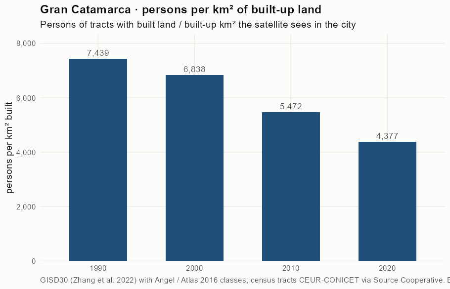
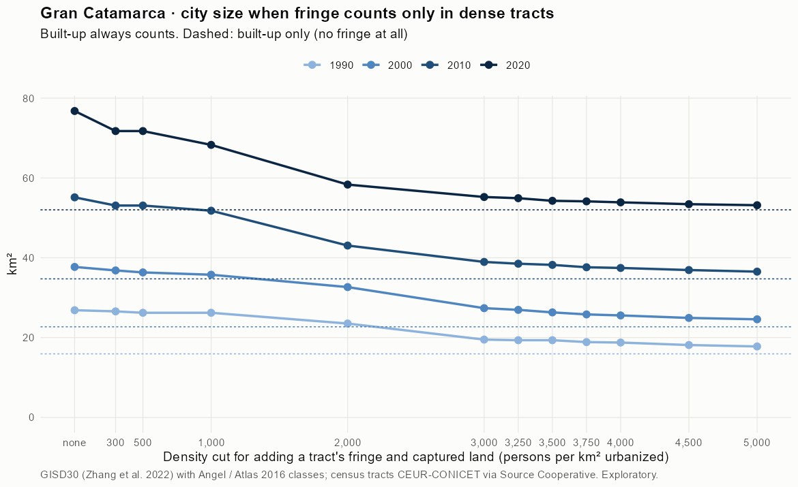
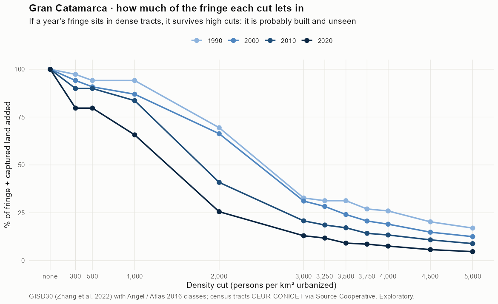
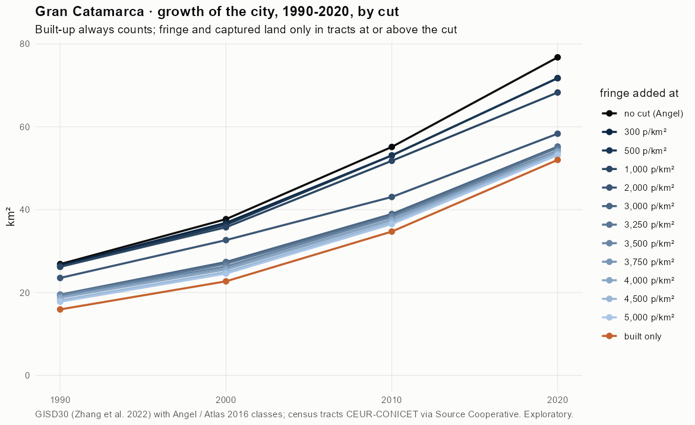
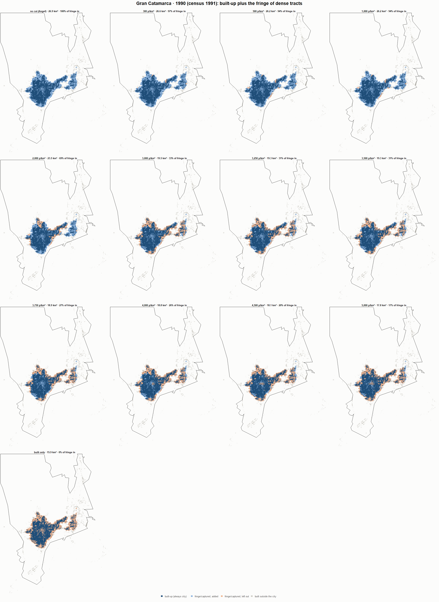
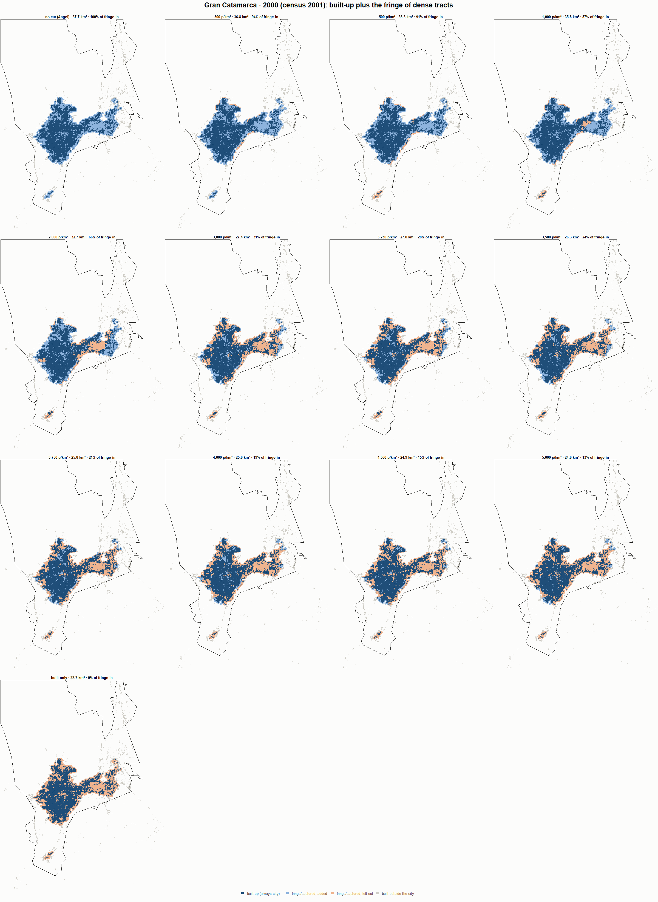
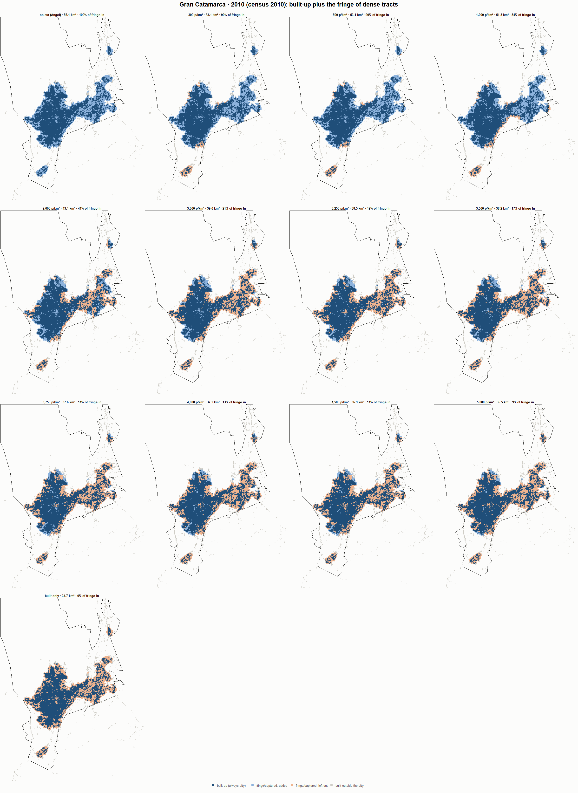
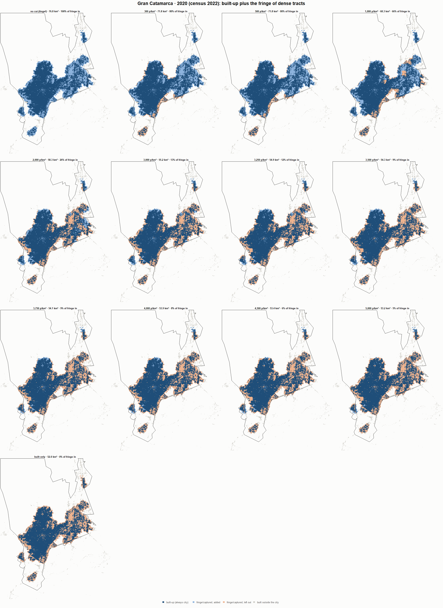

# Gran Catamarca · when does the fringe count as city? 1990-2020

Exploratory test 2. None of these numbers are project figures (they are not in `CIFRAS_CANONICAS.json`). Generated by `Rpipe/scripts/13_prueba_franja.R` from the tract tables of step 11. Run of 2026-11-08. [All agglomerations](../REPORTE.md).

**Idea.** Built-up land is always city. Fringe and captured open space join the city **only in dense tracts**, where they are probably built and unseen by the older imagery. No cut gives the full Angel extent; an infinite cut, built-up only. Method in the [index](../REPORTE.md#method).

## Is the early imagery under-detecting?

If the older imagery misses buildings, persons per km² of *built* land should come out higher in the early years.

| Year | Persons (tracts with built land) | Built km² | Persons / km² built | Median tract, persons / km² built | Fringe + captured, % of extent |
|---|---|---|---|---|---|
| 1990 (census 1991) | 118,462 | 15.9 | 7,439 | 6,718 | 40.7 |
| 2000 (census 2001) | 155,255 | 22.7 | 6,838 | 5,656 | 39.8 |
| 2010 (census 2010) | 189,981 | 34.7 | 5,472 | 4,556 | 37.0 |
| 2020 (census 2022) | 227,647 | 52.0 | 4,377 | 3,850 | 32.3 |

## Results

**1990 (census 1991).** Built-up 15.9 km²; fringe + captured 10.9 km²; 118,462 persons in the city's tracts.

| Fringe added at | City km² | Fringe added km² | % of fringe added | Fringe % of city | Tracts adding fringe | Persons / km² city |
|---|---|---|---|---|---|---|
| no cut (Angel) | 26.9 | 10.9 | 100.0 | 40.7 | 109 | 4,410 |
| 300 p/km² | 26.6 | 10.6 | 97.3 | 40.1 | 106 | 4,458 |
| 500 p/km² | 26.2 | 10.3 | 94.1 | 39.3 | 104 | 4,518 |
| 1,000 p/km² | 26.2 | 10.3 | 94.1 | 39.3 | 104 | 4,518 |
| 2,000 p/km² | 23.5 | 7.6 | 69.5 | 32.3 | 99 | 5,036 |
| 3,000 p/km² | 19.5 | 3.6 | 32.7 | 18.3 | 84 | 6,075 |
| 3,250 p/km² | 19.3 | 3.4 | 31.3 | 17.7 | 82 | 6,123 |
| 3,500 p/km² | 19.3 | 3.4 | 31.3 | 17.7 | 82 | 6,123 |
| 3,750 p/km² | 18.9 | 3.0 | 27.0 | 15.6 | 78 | 6,276 |
| 4,000 p/km² | 18.8 | 2.8 | 25.9 | 15.1 | 77 | 6,314 |
| 4,500 p/km² | 18.1 | 2.2 | 20.2 | 12.2 | 69 | 6,531 |
| 5,000 p/km² | 17.8 | 1.9 | 17.0 | 10.5 | 64 | 6,662 |
| built only | 15.9 | 0.0 | 0.0 | 0.0 | 0 | 7,439 |

**2000 (census 2001).** Built-up 22.7 km²; fringe + captured 15.0 km²; 155,255 persons in the city's tracts.

| Fringe added at | City km² | Fringe added km² | % of fringe added | Fringe % of city | Tracts adding fringe | Persons / km² city |
|---|---|---|---|---|---|---|
| no cut (Angel) | 37.7 | 15.0 | 100.0 | 39.8 | 144 | 4,117 |
| 300 p/km² | 36.8 | 14.1 | 94.1 | 38.3 | 142 | 4,216 |
| 500 p/km² | 36.3 | 13.6 | 90.8 | 37.5 | 141 | 4,273 |
| 1,000 p/km² | 35.8 | 13.0 | 87.0 | 36.5 | 140 | 4,342 |
| 2,000 p/km² | 32.7 | 10.0 | 66.3 | 30.5 | 132 | 4,754 |
| 3,000 p/km² | 27.4 | 4.7 | 31.1 | 17.1 | 107 | 5,671 |
| 3,250 p/km² | 27.0 | 4.2 | 28.3 | 15.8 | 103 | 5,761 |
| 3,500 p/km² | 26.3 | 3.6 | 24.1 | 13.7 | 97 | 5,899 |
| 3,750 p/km² | 25.8 | 3.1 | 20.7 | 12.0 | 94 | 6,015 |
| 4,000 p/km² | 25.6 | 2.9 | 19.0 | 11.2 | 90 | 6,074 |
| 4,500 p/km² | 24.9 | 2.2 | 14.8 | 8.9 | 79 | 6,227 |
| 5,000 p/km² | 24.6 | 1.9 | 12.5 | 7.6 | 74 | 6,316 |
| built only | 22.7 | 0.0 | 0.0 | 0.0 | 0 | 6,838 |

**2010 (census 2010).** Built-up 34.7 km²; fringe + captured 20.4 km²; 190,750 persons in the city's tracts.

| Fringe added at | City km² | Fringe added km² | % of fringe added | Fringe % of city | Tracts adding fringe | Persons / km² city |
|---|---|---|---|---|---|---|
| no cut (Angel) | 55.1 | 20.4 | 100.0 | 37.0 | 163 | 3,459 |
| 300 p/km² | 53.1 | 18.4 | 90.0 | 34.6 | 160 | 3,593 |
| 500 p/km² | 53.1 | 18.4 | 90.0 | 34.6 | 160 | 3,593 |
| 1,000 p/km² | 51.8 | 17.1 | 83.6 | 33.0 | 157 | 3,683 |
| 2,000 p/km² | 43.1 | 8.3 | 40.9 | 19.4 | 132 | 4,429 |
| 3,000 p/km² | 39.0 | 4.2 | 20.8 | 10.9 | 109 | 4,896 |
| 3,250 p/km² | 38.5 | 3.8 | 18.6 | 9.9 | 104 | 4,953 |
| 3,500 p/km² | 38.2 | 3.5 | 17.1 | 9.2 | 98 | 4,991 |
| 3,750 p/km² | 37.6 | 2.9 | 14.2 | 7.7 | 92 | 5,070 |
| 4,000 p/km² | 37.5 | 2.7 | 13.4 | 7.3 | 88 | 5,093 |
| 4,500 p/km² | 36.9 | 2.2 | 10.8 | 6.0 | 74 | 5,165 |
| 5,000 p/km² | 36.5 | 1.8 | 8.9 | 5.0 | 63 | 5,222 |
| built only | 34.7 | 0.0 | 0.0 | 0.0 | 0 | 5,494 |

**2020 (census 2022).** Built-up 52.0 km²; fringe + captured 24.8 km²; 227,647 persons in the city's tracts.

| Fringe added at | City km² | Fringe added km² | % of fringe added | Fringe % of city | Tracts adding fringe | Persons / km² city |
|---|---|---|---|---|---|---|
| no cut (Angel) | 76.8 | 24.8 | 100.0 | 32.3 | 185 | 2,965 |
| 300 p/km² | 71.8 | 19.7 | 79.7 | 27.5 | 180 | 3,173 |
| 500 p/km² | 71.8 | 19.7 | 79.7 | 27.5 | 180 | 3,173 |
| 1,000 p/km² | 68.3 | 16.3 | 65.7 | 23.8 | 174 | 3,334 |
| 2,000 p/km² | 58.3 | 6.3 | 25.5 | 10.8 | 138 | 3,902 |
| 3,000 p/km² | 55.2 | 3.2 | 13.0 | 5.8 | 107 | 4,122 |
| 3,250 p/km² | 54.9 | 2.9 | 11.8 | 5.3 | 102 | 4,144 |
| 3,500 p/km² | 54.3 | 2.3 | 9.1 | 4.2 | 93 | 4,194 |
| 3,750 p/km² | 54.1 | 2.1 | 8.6 | 3.9 | 88 | 4,205 |
| 4,000 p/km² | 53.9 | 1.9 | 7.6 | 3.5 | 82 | 4,224 |
| 4,500 p/km² | 53.4 | 1.4 | 5.7 | 2.7 | 67 | 4,260 |
| 5,000 p/km² | 53.2 | 1.2 | 4.7 | 2.2 | 53 | 4,281 |
| built only | 52.0 | 0.0 | 0.0 | 0.0 | 0 | 4,377 |

### Growth by cut

| Fringe added at | 1990 km² | 2000 km² | 2010 km² | 2020 km² | 1990-2000 %/yr | 2000-2010 %/yr | 2010-2020 %/yr | 1990-2020 %/yr |
|---|---|---|---|---|---|---|---|---|
| no cut (Angel) | 26.9 | 37.7 | 55.1 | 76.8 | 3.45 | 3.87 | 3.37 | 3.56 |
| 300 p/km² | 26.6 | 36.8 | 53.1 | 71.8 | 3.32 | 3.72 | 3.06 | 3.37 |
| 500 p/km² | 26.2 | 36.3 | 53.1 | 71.8 | 3.32 | 3.87 | 3.06 | 3.41 |
| 1,000 p/km² | 26.2 | 35.8 | 51.8 | 68.3 | 3.15 | 3.78 | 2.80 | 3.24 |
| 2,000 p/km² | 23.5 | 32.7 | 43.1 | 58.3 | 3.34 | 2.81 | 3.08 | 3.07 |
| 3,000 p/km² | 19.5 | 27.4 | 39.0 | 55.2 | 3.45 | 3.59 | 3.55 | 3.53 |
| 3,250 p/km² | 19.3 | 27.0 | 38.5 | 54.9 | 3.37 | 3.63 | 3.61 | 3.54 |
| 3,500 p/km² | 19.3 | 26.3 | 38.2 | 54.3 | 3.12 | 3.80 | 3.57 | 3.50 |
| 3,750 p/km² | 18.9 | 25.8 | 37.6 | 54.1 | 3.18 | 3.84 | 3.71 | 3.57 |
| 4,000 p/km² | 18.8 | 25.6 | 37.5 | 53.9 | 3.14 | 3.89 | 3.71 | 3.58 |
| 4,500 p/km² | 18.1 | 24.9 | 36.9 | 53.4 | 3.23 | 4.01 | 3.76 | 3.67 |
| 5,000 p/km² | 17.8 | 24.6 | 36.5 | 53.2 | 3.29 | 4.04 | 3.83 | 3.72 |
| built only | 15.9 | 22.7 | 34.7 | 52.0 | 3.61 | 4.34 | 4.13 | 4.02 |

## Maps

Same frame in the four years: the 2020 city plus 3 km. Dark blue is built-up, always city; light blue is fringe or captured land added because its tract is dense; light orange is fringe left out. Black line: the analysis perimeter.

### 1990

### 2000

### 2010

### 2020

## Reading

- **The premise.** Persons per km² of built land: 7,439 in 1990, 6,838 in 2000, 5,472 in 2010, 4,377 in 2020. 1990 is clearly higher than 2010: consistent with built land missed in 1990, though it also fits a denser city that later spread out.
- **At 500 p/km²** the fringe that joins the city is 94.1 % of all fringe in 1990 and 79.7 % in 2020.
- **Growth 1990-2020**: 3.56 %/yr with the full Angel extent, 3.41 %/yr at 500, 4.02 %/yr built-up only.

