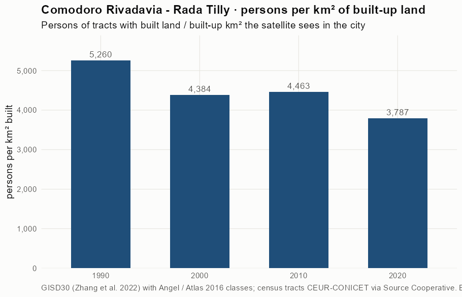
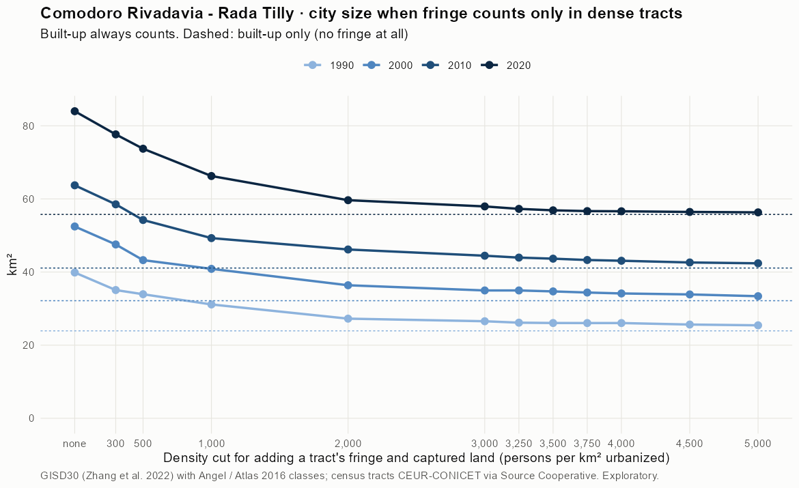
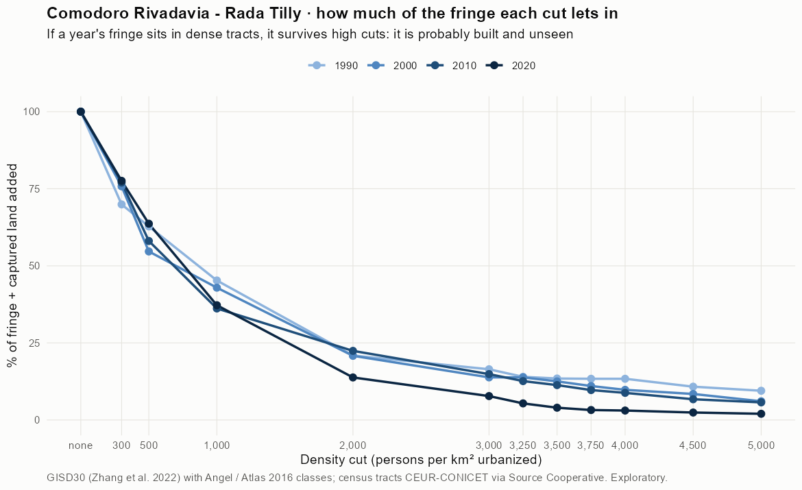
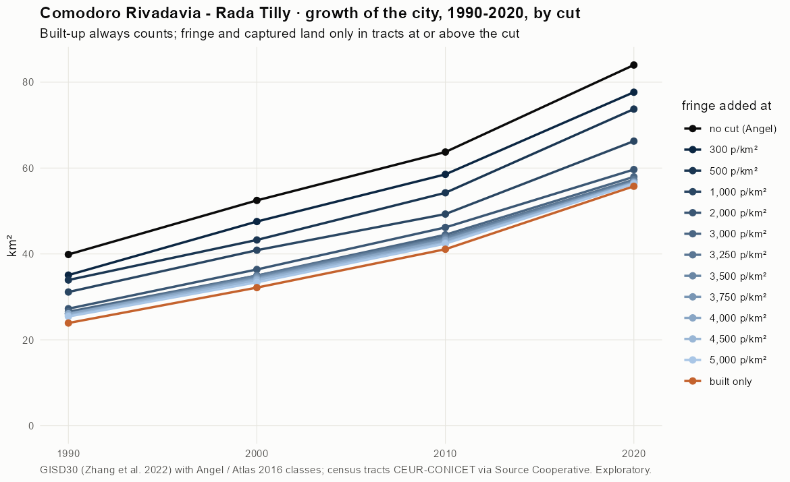
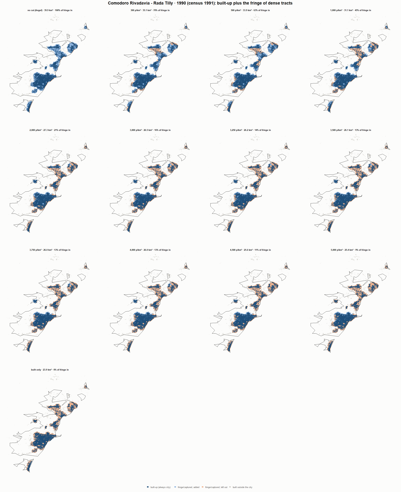
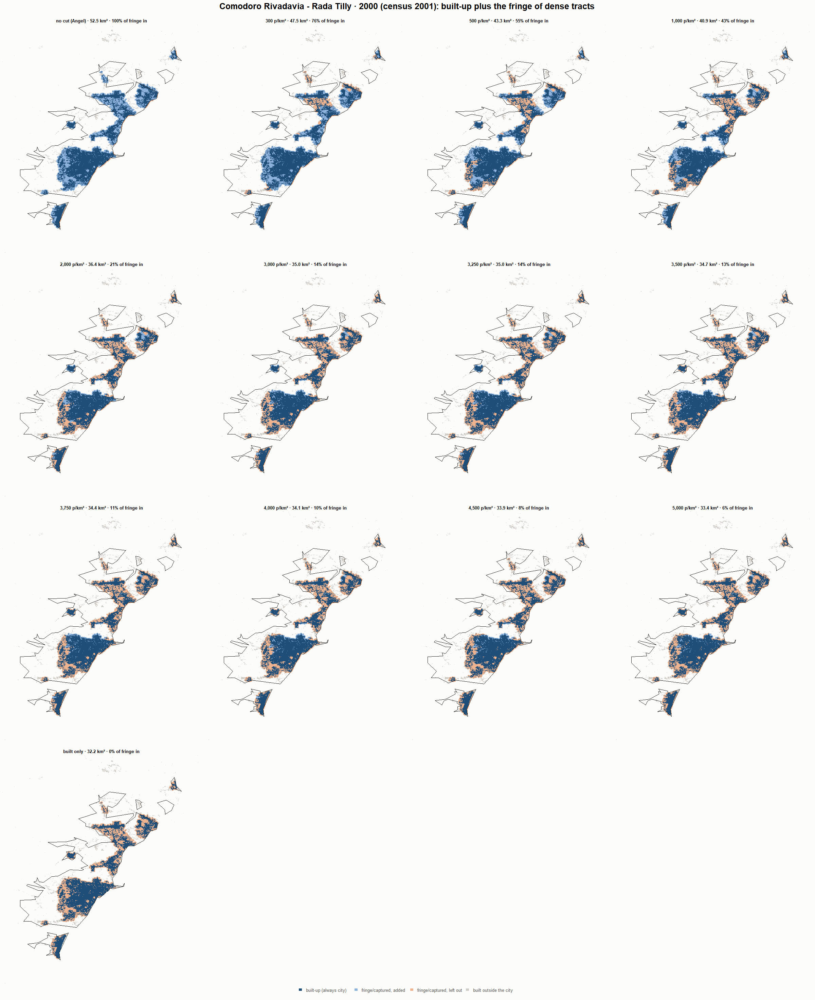
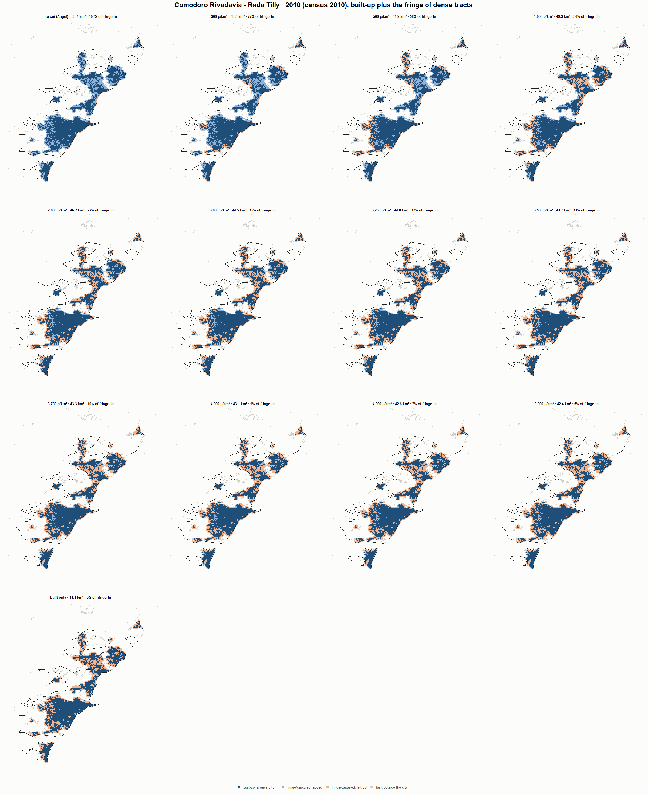
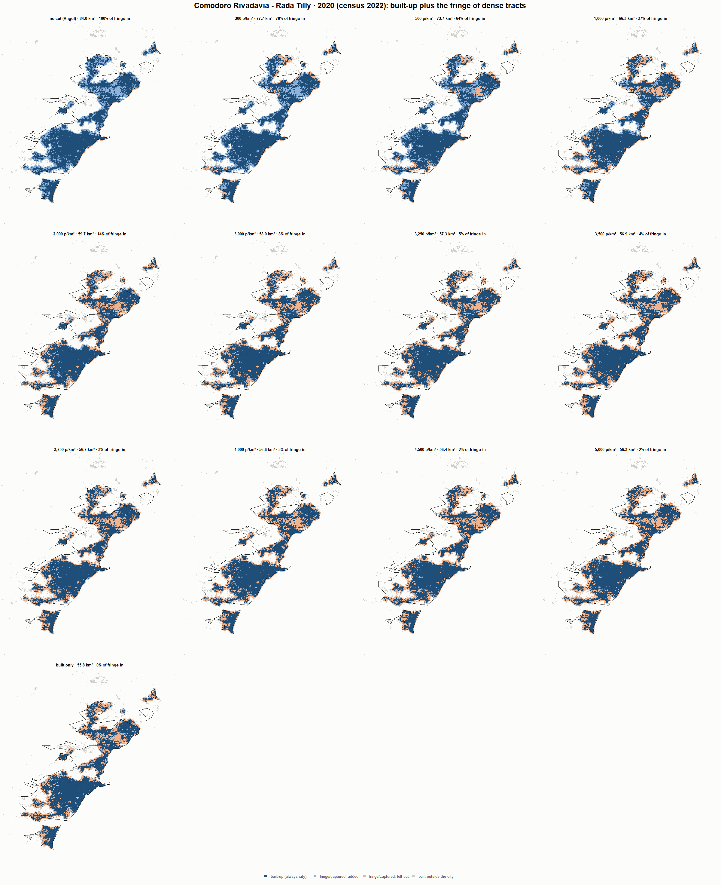

# Comodoro Rivadavia - Rada Tilly · when does the fringe count as city? 1990-2020

Exploratory test 2. None of these numbers are project figures (they are not in `CIFRAS_CANONICAS.json`). Generated by `Rpipe/scripts/13_prueba_franja.R` from the tract tables of step 11. Run of 2026-11-08. [All agglomerations](../REPORTE.md).

**Idea.** Built-up land is always city. Fringe and captured open space join the city **only in dense tracts**, where they are probably built and unseen by the older imagery. No cut gives the full Angel extent; an infinite cut, built-up only. Method in the [index](../REPORTE.md#method).

## Is the early imagery under-detecting?

If the older imagery misses buildings, persons per km² of *built* land should come out higher in the early years.

| Year | Persons (tracts with built land) | Built km² | Persons / km² built | Median tract, persons / km² built | Fringe + captured, % of extent |
|---|---|---|---|---|---|
| 1990 (census 1991) | 125,805 | 23.9 | 5,260 | 3,833 | 40.0 |
| 2000 (census 2001) | 140,999 | 32.2 | 4,384 | 3,333 | 38.7 |
| 2010 (census 2010) | 183,429 | 41.1 | 4,463 | 3,275 | 35.5 |
| 2020 (census 2022) | 211,170 | 55.8 | 3,787 | 2,597 | 33.6 |

## Results

**1990 (census 1991).** Built-up 23.9 km²; fringe + captured 16.0 km²; 125,805 persons in the city's tracts.

| Fringe added at | City km² | Fringe added km² | % of fringe added | Fringe % of city | Tracts adding fringe | Persons / km² city |
|---|---|---|---|---|---|---|
| no cut (Angel) | 39.9 | 16.0 | 100.0 | 40.0 | 108 | 3,155 |
| 300 p/km² | 35.1 | 11.2 | 69.9 | 31.8 | 101 | 3,587 |
| 500 p/km² | 33.9 | 10.0 | 62.8 | 29.5 | 99 | 3,707 |
| 1,000 p/km² | 31.1 | 7.2 | 45.2 | 23.2 | 93 | 4,040 |
| 2,000 p/km² | 27.3 | 3.3 | 20.9 | 12.2 | 78 | 4,616 |
| 3,000 p/km² | 26.5 | 2.6 | 16.5 | 9.9 | 71 | 4,740 |
| 3,250 p/km² | 26.2 | 2.2 | 14.0 | 8.5 | 67 | 4,811 |
| 3,500 p/km² | 26.1 | 2.1 | 13.5 | 8.2 | 66 | 4,827 |
| 3,750 p/km² | 26.0 | 2.1 | 13.4 | 8.2 | 65 | 4,829 |
| 4,000 p/km² | 26.0 | 2.1 | 13.4 | 8.2 | 65 | 4,829 |
| 4,500 p/km² | 25.6 | 1.7 | 10.8 | 6.7 | 63 | 4,906 |
| 5,000 p/km² | 25.4 | 1.5 | 9.5 | 5.9 | 59 | 4,947 |
| built only | 23.9 | 0.0 | 0.0 | 0.0 | 0 | 5,260 |

**2000 (census 2001).** Built-up 32.2 km²; fringe + captured 20.3 km²; 140,999 persons in the city's tracts.

| Fringe added at | City km² | Fringe added km² | % of fringe added | Fringe % of city | Tracts adding fringe | Persons / km² city |
|---|---|---|---|---|---|---|
| no cut (Angel) | 52.5 | 20.3 | 100.0 | 38.7 | 147 | 2,688 |
| 300 p/km² | 47.5 | 15.4 | 75.8 | 32.4 | 142 | 2,965 |
| 500 p/km² | 43.3 | 11.1 | 54.7 | 25.7 | 136 | 3,259 |
| 1,000 p/km² | 40.9 | 8.7 | 42.9 | 21.3 | 129 | 3,450 |
| 2,000 p/km² | 36.4 | 4.2 | 20.8 | 11.6 | 112 | 3,875 |
| 3,000 p/km² | 35.0 | 2.8 | 13.8 | 8.0 | 97 | 4,032 |
| 3,250 p/km² | 35.0 | 2.8 | 13.8 | 8.0 | 97 | 4,032 |
| 3,500 p/km² | 34.7 | 2.5 | 12.5 | 7.3 | 93 | 4,063 |
| 3,750 p/km² | 34.4 | 2.2 | 11.0 | 6.5 | 89 | 4,099 |
| 4,000 p/km² | 34.1 | 2.0 | 9.8 | 5.8 | 87 | 4,129 |
| 4,500 p/km² | 33.9 | 1.7 | 8.4 | 5.1 | 78 | 4,162 |
| 5,000 p/km² | 33.4 | 1.2 | 6.1 | 3.7 | 67 | 4,222 |
| built only | 32.2 | 0.0 | 0.0 | 0.0 | 0 | 4,384 |

**2010 (census 2010).** Built-up 41.1 km²; fringe + captured 22.6 km²; 183,429 persons in the city's tracts.

| Fringe added at | City km² | Fringe added km² | % of fringe added | Fringe % of city | Tracts adding fringe | Persons / km² city |
|---|---|---|---|---|---|---|
| no cut (Angel) | 63.7 | 22.6 | 100.0 | 35.5 | 145 | 2,878 |
| 300 p/km² | 58.5 | 17.4 | 77.0 | 29.8 | 139 | 3,134 |
| 500 p/km² | 54.2 | 13.1 | 58.1 | 24.2 | 133 | 3,382 |
| 1,000 p/km² | 49.3 | 8.2 | 36.2 | 16.6 | 121 | 3,722 |
| 2,000 p/km² | 46.2 | 5.1 | 22.4 | 11.0 | 109 | 3,973 |
| 3,000 p/km² | 44.5 | 3.4 | 14.9 | 7.6 | 94 | 4,125 |
| 3,250 p/km² | 44.0 | 2.9 | 12.6 | 6.5 | 87 | 4,173 |
| 3,500 p/km² | 43.7 | 2.6 | 11.3 | 5.9 | 85 | 4,201 |
| 3,750 p/km² | 43.3 | 2.2 | 9.7 | 5.1 | 82 | 4,237 |
| 4,000 p/km² | 43.1 | 2.0 | 8.8 | 4.6 | 79 | 4,257 |
| 4,500 p/km² | 42.6 | 1.5 | 6.7 | 3.6 | 69 | 4,304 |
| 5,000 p/km² | 42.4 | 1.3 | 5.7 | 3.1 | 65 | 4,327 |
| built only | 41.1 | 0.0 | 0.0 | 0.0 | 0 | 4,463 |

**2020 (census 2022).** Built-up 55.8 km²; fringe + captured 28.2 km²; 211,170 persons in the city's tracts.

| Fringe added at | City km² | Fringe added km² | % of fringe added | Fringe % of city | Tracts adding fringe | Persons / km² city |
|---|---|---|---|---|---|---|
| no cut (Angel) | 84.0 | 28.2 | 100.0 | 33.6 | 187 | 2,514 |
| 300 p/km² | 77.7 | 21.9 | 77.6 | 28.2 | 180 | 2,719 |
| 500 p/km² | 73.7 | 18.0 | 63.7 | 24.4 | 176 | 2,864 |
| 1,000 p/km² | 66.3 | 10.5 | 37.2 | 15.9 | 152 | 3,187 |
| 2,000 p/km² | 59.7 | 3.9 | 13.8 | 6.5 | 121 | 3,540 |
| 3,000 p/km² | 58.0 | 2.2 | 7.8 | 3.8 | 102 | 3,644 |
| 3,250 p/km² | 57.3 | 1.5 | 5.4 | 2.7 | 93 | 3,687 |
| 3,500 p/km² | 56.9 | 1.1 | 4.0 | 2.0 | 84 | 3,712 |
| 3,750 p/km² | 56.7 | 0.9 | 3.2 | 1.6 | 80 | 3,726 |
| 4,000 p/km² | 56.6 | 0.9 | 3.1 | 1.5 | 76 | 3,729 |
| 4,500 p/km² | 56.4 | 0.7 | 2.4 | 1.2 | 68 | 3,741 |
| 5,000 p/km² | 56.3 | 0.6 | 2.0 | 1.0 | 62 | 3,749 |
| built only | 55.8 | 0.0 | 0.0 | 0.0 | 0 | 3,787 |

### Growth by cut

| Fringe added at | 1990 km² | 2000 km² | 2010 km² | 2020 km² | 1990-2000 %/yr | 2000-2010 %/yr | 2010-2020 %/yr | 1990-2020 %/yr |
|---|---|---|---|---|---|---|---|---|
| no cut (Angel) | 39.9 | 52.5 | 63.7 | 84.0 | 2.78 | 1.96 | 2.80 | 2.51 |
| 300 p/km² | 35.1 | 47.5 | 58.5 | 77.7 | 3.09 | 2.10 | 2.87 | 2.68 |
| 500 p/km² | 33.9 | 43.3 | 54.2 | 73.7 | 2.46 | 2.29 | 3.12 | 2.62 |
| 1,000 p/km² | 31.1 | 40.9 | 49.3 | 66.3 | 2.76 | 1.89 | 3.01 | 2.55 |
| 2,000 p/km² | 27.3 | 36.4 | 46.2 | 59.7 | 2.93 | 2.41 | 2.60 | 2.65 |
| 3,000 p/km² | 26.5 | 35.0 | 44.5 | 58.0 | 2.80 | 2.43 | 2.68 | 2.64 |
| 3,250 p/km² | 26.2 | 35.0 | 44.0 | 57.3 | 2.95 | 2.31 | 2.68 | 2.65 |
| 3,500 p/km² | 26.1 | 34.7 | 43.7 | 56.9 | 2.90 | 2.32 | 2.68 | 2.64 |
| 3,750 p/km² | 26.0 | 34.4 | 43.3 | 56.7 | 2.82 | 2.33 | 2.73 | 2.62 |
| 4,000 p/km² | 26.0 | 34.1 | 43.1 | 56.6 | 2.74 | 2.35 | 2.77 | 2.62 |
| 4,500 p/km² | 25.6 | 33.9 | 42.6 | 56.4 | 2.82 | 2.32 | 2.85 | 2.67 |
| 5,000 p/km² | 25.4 | 33.4 | 42.4 | 56.3 | 2.76 | 2.41 | 2.88 | 2.69 |
| built only | 23.9 | 32.2 | 41.1 | 55.8 | 3.01 | 2.48 | 3.10 | 2.86 |

## Maps

Same frame in the four years: the 2020 city plus 3 km. Dark blue is built-up, always city; light blue is fringe or captured land added because its tract is dense; light orange is fringe left out. Black line: the analysis perimeter.

### 1990

### 2000

### 2010

### 2020

## Reading

- **The premise.** Persons per km² of built land: 5,260 in 1990, 4,384 in 2000, 4,463 in 2010, 3,787 in 2020. 1990 is clearly higher than 2010: consistent with built land missed in 1990, though it also fits a denser city that later spread out.
- **At 500 p/km²** the fringe that joins the city is 62.8 % of all fringe in 1990 and 63.7 % in 2020.
- **Growth 1990-2020**: 2.51 %/yr with the full Angel extent, 2.62 %/yr at 500, 2.86 %/yr built-up only.

