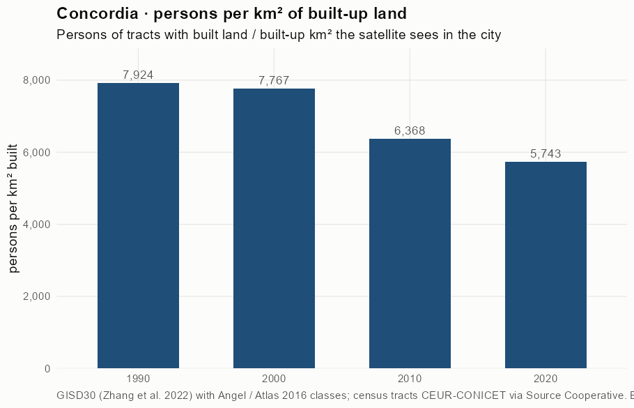
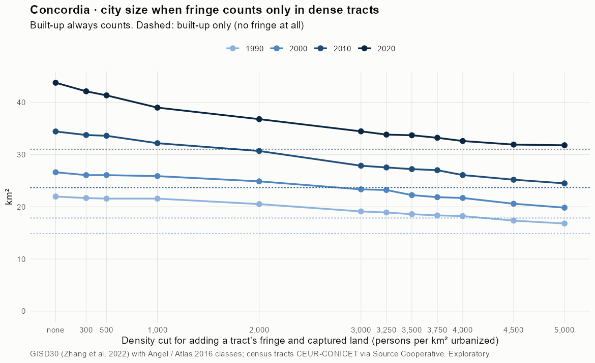
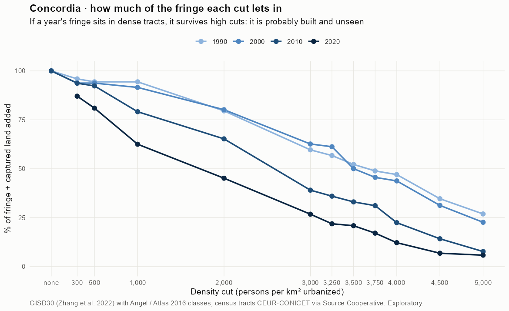
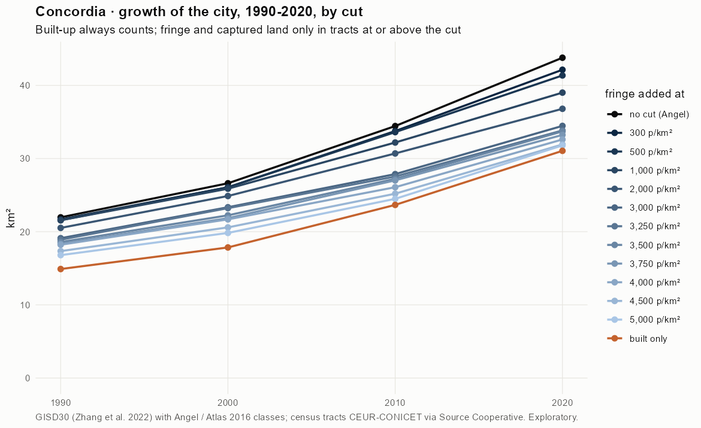
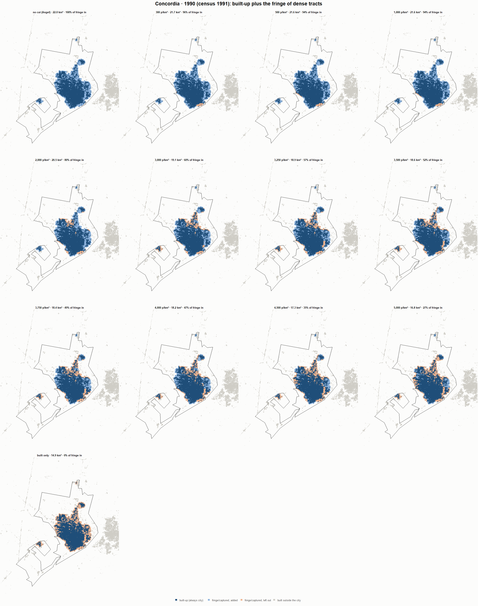
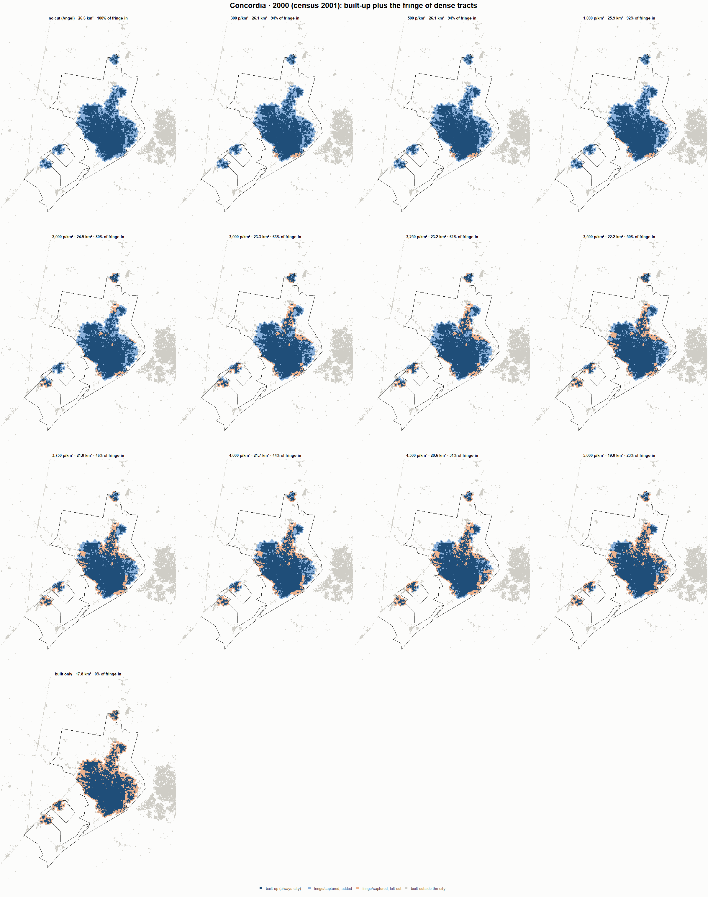
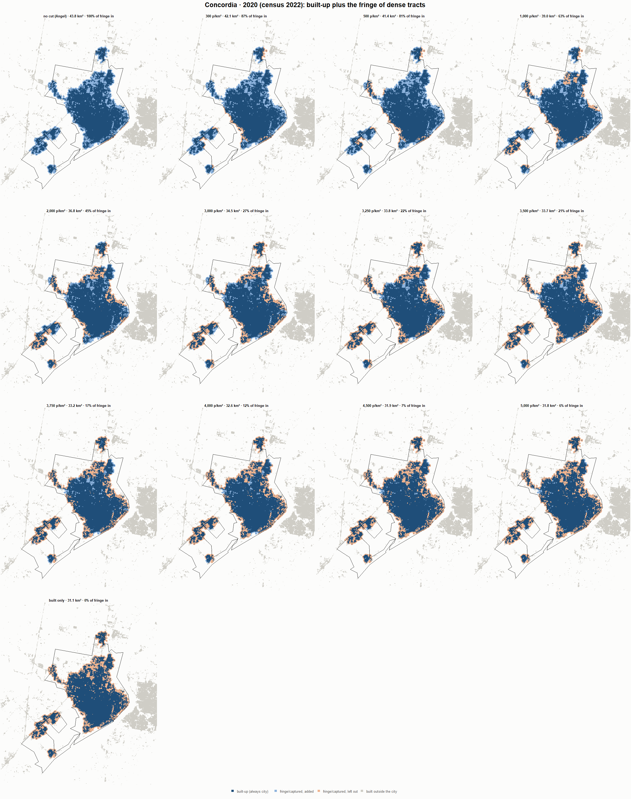

# Concordia · when does the fringe count as city? 1990-2020

Exploratory test 2. None of these numbers are project figures (they are not in `CIFRAS_CANONICAS.json`). Generated by `Rpipe/scripts/13_prueba_franja.R` from the tract tables of step 11. Run of 2026-11-08. [All agglomerations](../REPORTE.md).

**Idea.** Built-up land is always city. Fringe and captured open space join the city **only in dense tracts**, where they are probably built and unseen by the older imagery. No cut gives the full Angel extent; an infinite cut, built-up only. Method in the [index](../REPORTE.md#method).

## Is the early imagery under-detecting?

If the older imagery misses buildings, persons per km² of *built* land should come out higher in the early years.

| Year | Persons (tracts with built land) | Built km² | Persons / km² built | Median tract, persons / km² built | Fringe + captured, % of extent |
|---|---|---|---|---|---|
| 1990 (census 1991) | 118,067 | 14.9 | 7,924 | 7,260 | 32.2 |
| 2000 (census 2001) | 138,630 | 17.8 | 7,767 | 6,916 | 32.9 |
| 2010 (census 2010) | 150,692 | 23.7 | 6,368 | 6,130 | 31.3 |
| 2020 (census 2022) | 178,354 | 31.1 | 5,743 | 5,597 | 29.1 |

## Results

**1990 (census 1991).** Built-up 14.9 km²; fringe + captured 7.1 km²; 118,471 persons in the city's tracts.

| Fringe added at | City km² | Fringe added km² | % of fringe added | Fringe % of city | Tracts adding fringe | Persons / km² city |
|---|---|---|---|---|---|---|
| no cut (Angel) | 22.0 | 7.1 | 100.0 | 32.2 | 91 | 5,394 |
| 300 p/km² | 21.7 | 6.8 | 95.9 | 31.3 | 89 | 5,466 |
| 500 p/km² | 21.6 | 6.7 | 94.4 | 30.9 | 88 | 5,493 |
| 1,000 p/km² | 21.6 | 6.7 | 94.4 | 30.9 | 88 | 5,493 |
| 2,000 p/km² | 20.5 | 5.6 | 79.6 | 27.4 | 81 | 5,774 |
| 3,000 p/km² | 19.1 | 4.2 | 59.6 | 22.0 | 76 | 6,199 |
| 3,250 p/km² | 18.9 | 4.0 | 56.7 | 21.2 | 74 | 6,266 |
| 3,500 p/km² | 18.6 | 3.7 | 52.2 | 19.8 | 71 | 6,374 |
| 3,750 p/km² | 18.4 | 3.5 | 48.9 | 18.8 | 68 | 6,456 |
| 4,000 p/km² | 18.2 | 3.3 | 47.0 | 18.2 | 65 | 6,502 |
| 4,500 p/km² | 17.3 | 2.4 | 34.7 | 14.1 | 56 | 6,829 |
| 5,000 p/km² | 16.8 | 1.9 | 26.9 | 11.3 | 51 | 7,052 |
| built only | 14.9 | 0.0 | 0.0 | 0.0 | 0 | 7,951 |

**2000 (census 2001).** Built-up 17.8 km²; fringe + captured 8.8 km²; 139,174 persons in the city's tracts.

| Fringe added at | City km² | Fringe added km² | % of fringe added | Fringe % of city | Tracts adding fringe | Persons / km² city |
|---|---|---|---|---|---|---|
| no cut (Angel) | 26.6 | 8.8 | 100.0 | 33.0 | 100 | 5,228 |
| 300 p/km² | 26.1 | 8.2 | 93.8 | 31.5 | 96 | 5,338 |
| 500 p/km² | 26.1 | 8.2 | 93.8 | 31.5 | 96 | 5,338 |
| 1,000 p/km² | 25.9 | 8.0 | 91.5 | 31.0 | 94 | 5,378 |
| 2,000 p/km² | 24.9 | 7.0 | 80.2 | 28.3 | 89 | 5,594 |
| 3,000 p/km² | 23.3 | 5.5 | 62.6 | 23.5 | 81 | 5,963 |
| 3,250 p/km² | 23.2 | 5.4 | 61.2 | 23.1 | 80 | 5,994 |
| 3,500 p/km² | 22.2 | 4.4 | 50.0 | 19.7 | 75 | 6,259 |
| 3,750 p/km² | 21.8 | 4.0 | 45.6 | 18.3 | 72 | 6,371 |
| 4,000 p/km² | 21.7 | 3.8 | 43.8 | 17.7 | 68 | 6,417 |
| 4,500 p/km² | 20.6 | 2.7 | 31.3 | 13.3 | 61 | 6,760 |
| 5,000 p/km² | 19.8 | 2.0 | 22.6 | 10.0 | 55 | 7,018 |
| built only | 17.8 | 0.0 | 0.0 | 0.0 | 0 | 7,798 |

**2010 (census 2010).** Built-up 23.7 km²; fringe + captured 10.8 km²; 150,692 persons in the city's tracts.

| Fringe added at | City km² | Fringe added km² | % of fringe added | Fringe % of city | Tracts adding fringe | Persons / km² city |
|---|---|---|---|---|---|---|
| no cut (Angel) | 34.4 | 10.8 | 100.0 | 31.3 | 101 | 4,376 |
| 300 p/km² | 33.8 | 10.1 | 93.7 | 29.9 | 98 | 4,464 |
| 500 p/km² | 33.6 | 9.9 | 92.3 | 29.6 | 97 | 4,483 |
| 1,000 p/km² | 32.2 | 8.5 | 79.1 | 26.5 | 93 | 4,681 |
| 2,000 p/km² | 30.7 | 7.0 | 65.3 | 22.9 | 86 | 4,909 |
| 3,000 p/km² | 27.9 | 4.2 | 39.1 | 15.1 | 72 | 5,407 |
| 3,250 p/km² | 27.5 | 3.9 | 36.0 | 14.1 | 70 | 5,472 |
| 3,500 p/km² | 27.2 | 3.6 | 33.0 | 13.1 | 67 | 5,535 |
| 3,750 p/km² | 27.0 | 3.4 | 31.1 | 12.4 | 65 | 5,578 |
| 4,000 p/km² | 26.1 | 2.4 | 22.4 | 9.3 | 57 | 5,778 |
| 4,500 p/km² | 25.2 | 1.5 | 14.2 | 6.1 | 49 | 5,981 |
| 5,000 p/km² | 24.5 | 0.8 | 7.7 | 3.4 | 40 | 6,153 |
| built only | 23.7 | 0.0 | 0.0 | 0.0 | 0 | 6,368 |

**2020 (census 2022).** Built-up 31.1 km²; fringe + captured 12.7 km²; 178,354 persons in the city's tracts.

| Fringe added at | City km² | Fringe added km² | % of fringe added | Fringe % of city | Tracts adding fringe | Persons / km² city |
|---|---|---|---|---|---|---|
| no cut (Angel) | 43.8 | 12.7 | 100.0 | 29.1 | 133 | 4,074 |
| 300 p/km² | 42.1 | 11.1 | 87.1 | 26.3 | 129 | 4,233 |
| 500 p/km² | 41.4 | 10.3 | 81.0 | 24.9 | 127 | 4,312 |
| 1,000 p/km² | 39.0 | 8.0 | 62.5 | 20.4 | 122 | 4,572 |
| 2,000 p/km² | 36.8 | 5.7 | 45.1 | 15.6 | 111 | 4,846 |
| 3,000 p/km² | 34.5 | 3.4 | 26.8 | 9.9 | 95 | 5,175 |
| 3,250 p/km² | 33.8 | 2.8 | 21.9 | 8.2 | 90 | 5,271 |
| 3,500 p/km² | 33.7 | 2.7 | 20.9 | 7.9 | 89 | 5,290 |
| 3,750 p/km² | 33.2 | 2.2 | 17.1 | 6.5 | 83 | 5,367 |
| 4,000 p/km² | 32.6 | 1.6 | 12.2 | 4.8 | 75 | 5,470 |
| 4,500 p/km² | 31.9 | 0.9 | 6.8 | 2.7 | 61 | 5,587 |
| 5,000 p/km² | 31.8 | 0.7 | 5.8 | 2.3 | 53 | 5,609 |
| built only | 31.1 | 0.0 | 0.0 | 0.0 | 0 | 5,743 |

### Growth by cut

| Fringe added at | 1990 km² | 2000 km² | 2010 km² | 2020 km² | 1990-2000 %/yr | 2000-2010 %/yr | 2010-2020 %/yr | 1990-2020 %/yr |
|---|---|---|---|---|---|---|---|---|
| no cut (Angel) | 22.0 | 26.6 | 34.4 | 43.8 | 1.94 | 2.61 | 2.43 | 2.33 |
| 300 p/km² | 21.7 | 26.1 | 33.8 | 42.1 | 1.86 | 2.62 | 2.24 | 2.24 |
| 500 p/km² | 21.6 | 26.1 | 33.6 | 41.4 | 1.91 | 2.57 | 2.10 | 2.19 |
| 1,000 p/km² | 21.6 | 25.9 | 32.2 | 39.0 | 1.84 | 2.21 | 1.94 | 2.00 |
| 2,000 p/km² | 20.5 | 24.9 | 30.7 | 36.8 | 1.95 | 2.12 | 1.83 | 1.97 |
| 3,000 p/km² | 19.1 | 23.3 | 27.9 | 34.5 | 2.02 | 1.79 | 2.15 | 1.98 |
| 3,250 p/km² | 18.9 | 23.2 | 27.5 | 33.8 | 2.08 | 1.72 | 2.08 | 1.96 |
| 3,500 p/km² | 18.6 | 22.2 | 27.2 | 33.7 | 1.81 | 2.04 | 2.16 | 2.00 |
| 3,750 p/km² | 18.4 | 21.8 | 27.0 | 33.2 | 1.76 | 2.15 | 2.09 | 2.00 |
| 4,000 p/km² | 18.2 | 21.7 | 26.1 | 32.6 | 1.76 | 1.86 | 2.26 | 1.96 |
| 4,500 p/km² | 17.3 | 20.6 | 25.2 | 31.9 | 1.73 | 2.04 | 2.40 | 2.05 |
| 5,000 p/km² | 16.8 | 19.8 | 24.5 | 31.8 | 1.67 | 2.13 | 2.64 | 2.15 |
| built only | 14.9 | 17.8 | 23.7 | 31.1 | 1.82 | 2.86 | 2.76 | 2.48 |

## Maps

Same frame in the four years: the 2020 city plus 3 km. Dark blue is built-up, always city; light blue is fringe or captured land added because its tract is dense; light orange is fringe left out. Black line: the analysis perimeter.

### 1990

### 2000

### 2010

### 2020

## Reading

- **The premise.** Persons per km² of built land: 7,924 in 1990, 7,767 in 2000, 6,368 in 2010, 5,743 in 2020. 1990 is clearly higher than 2010: consistent with built land missed in 1990, though it also fits a denser city that later spread out.
- **At 500 p/km²** the fringe that joins the city is 94.4 % of all fringe in 1990 and 81.0 % in 2020.
- **Growth 1990-2020**: 2.33 %/yr with the full Angel extent, 2.19 %/yr at 500, 2.48 %/yr built-up only.

