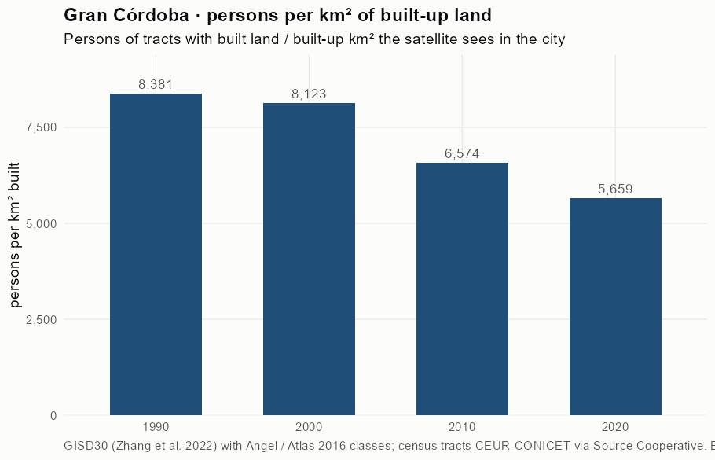
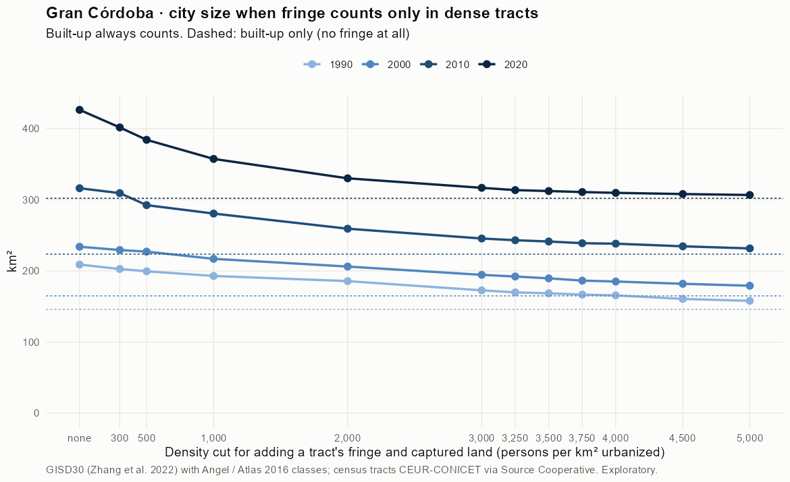
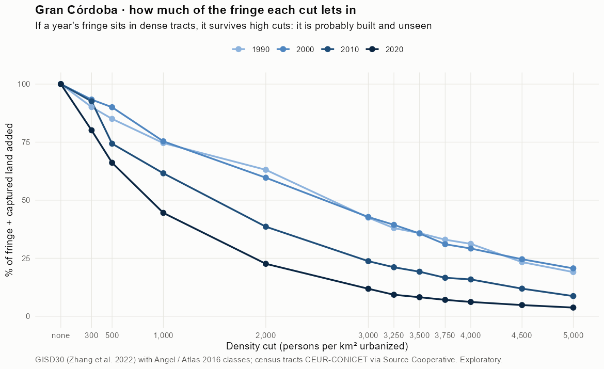
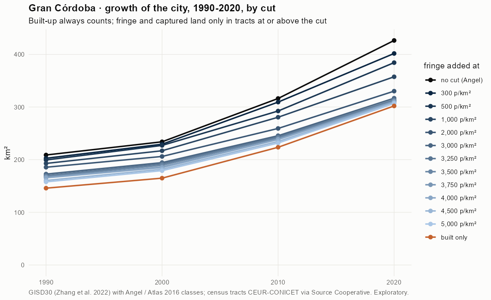
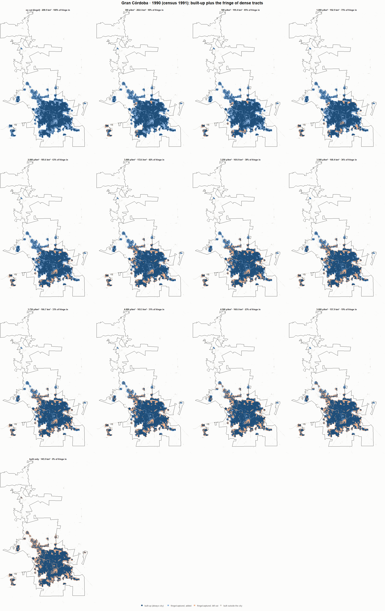
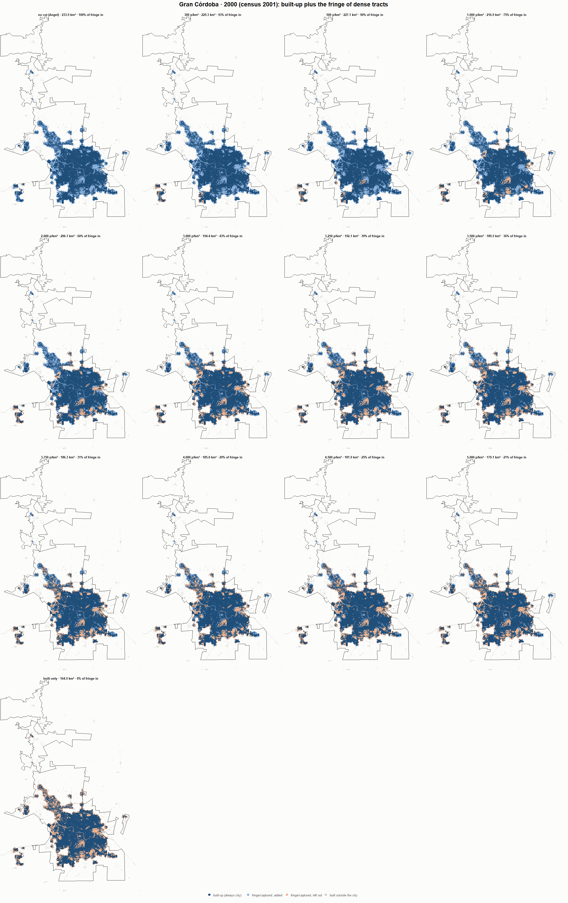
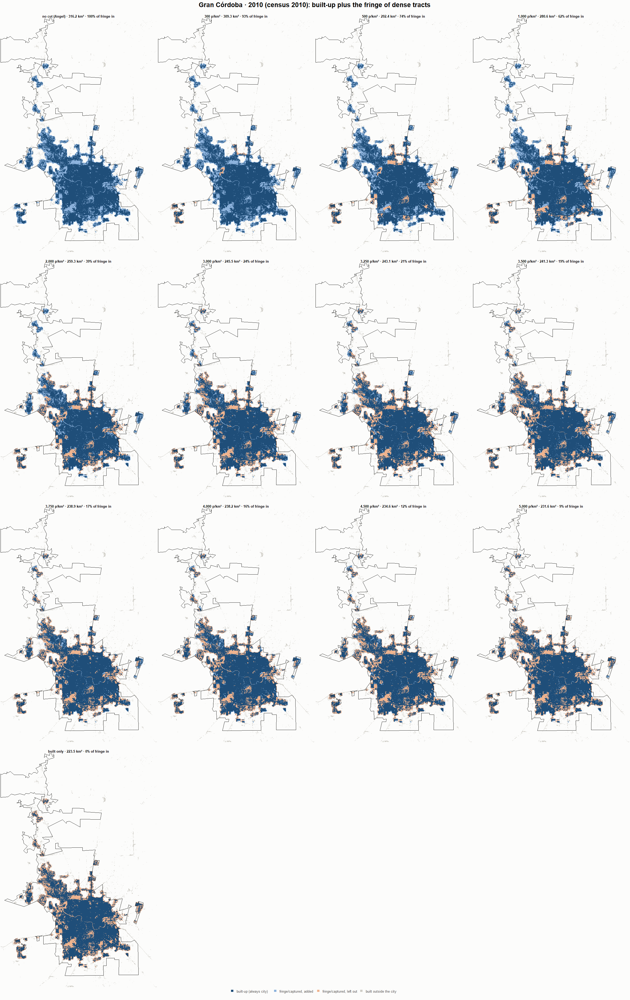
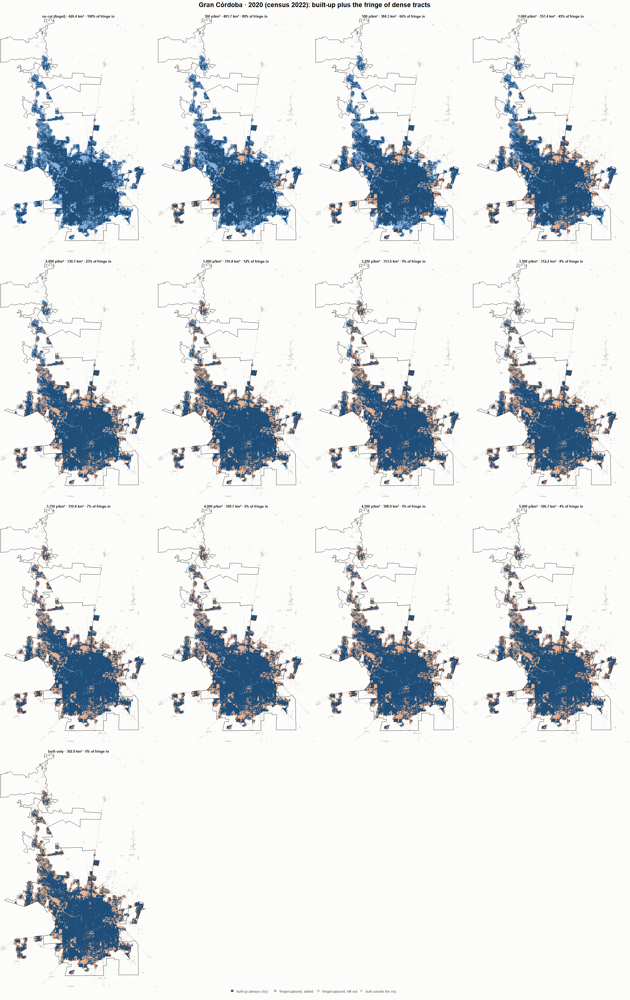

# Gran Córdoba · when does the fringe count as city? 1990-2020

Exploratory test 2. None of these numbers are project figures (they are not in `CIFRAS_CANONICAS.json`). Generated by `Rpipe/scripts/13_prueba_franja.R` from the tract tables of step 11. Run of 2026-11-08. [All agglomerations](../REPORTE.md).

**Idea.** Built-up land is always city. Fringe and captured open space join the city **only in dense tracts**, where they are probably built and unseen by the older imagery. No cut gives the full Angel extent; an infinite cut, built-up only. Method in the [index](../REPORTE.md#method).

## Is the early imagery under-detecting?

If the older imagery misses buildings, persons per km² of *built* land should come out higher in the early years.

| Year | Persons (tracts with built land) | Built km² | Persons / km² built | Median tract, persons / km² built | Fringe + captured, % of extent |
|---|---|---|---|---|---|
| 1990 (census 1991) | 1,222,601 | 145.9 | 8,381 | 7,954 | 30.1 |
| 2000 (census 2001) | 1,339,284 | 164.9 | 8,123 | 7,571 | 29.5 |
| 2010 (census 2010) | 1,469,626 | 223.5 | 6,574 | 6,258 | 29.3 |
| 2020 (census 2022) | 1,709,084 | 302.0 | 5,659 | 5,124 | 29.2 |

## Results

**1990 (census 1991).** Built-up 145.9 km²; fringe + captured 63.0 km²; 1,226,814 persons in the city's tracts.

| Fringe added at | City km² | Fringe added km² | % of fringe added | Fringe % of city | Tracts adding fringe | Persons / km² city |
|---|---|---|---|---|---|---|
| no cut (Angel) | 208.9 | 63.0 | 100.0 | 30.2 | 778 | 5,874 |
| 300 p/km² | 202.6 | 56.8 | 90.1 | 28.0 | 772 | 6,054 |
| 500 p/km² | 199.4 | 53.6 | 85.0 | 26.9 | 769 | 6,151 |
| 1,000 p/km² | 192.9 | 47.0 | 74.6 | 24.4 | 759 | 6,361 |
| 2,000 p/km² | 185.6 | 39.7 | 63.1 | 21.4 | 745 | 6,609 |
| 3,000 p/km² | 172.6 | 26.8 | 42.5 | 15.5 | 699 | 7,106 |
| 3,250 p/km² | 169.8 | 23.9 | 38.0 | 14.1 | 683 | 7,225 |
| 3,500 p/km² | 168.4 | 22.6 | 35.8 | 13.4 | 675 | 7,283 |
| 3,750 p/km² | 166.7 | 20.8 | 33.0 | 12.5 | 660 | 7,361 |
| 4,000 p/km² | 165.5 | 19.6 | 31.2 | 11.9 | 644 | 7,411 |
| 4,500 p/km² | 160.6 | 14.7 | 23.3 | 9.2 | 601 | 7,640 |
| 5,000 p/km² | 157.9 | 12.0 | 19.0 | 7.6 | 566 | 7,771 |
| built only | 145.9 | 0.0 | 0.0 | 0.0 | 0 | 8,410 |

**2000 (census 2001).** Built-up 164.9 km²; fringe + captured 69.1 km²; 1,344,341 persons in the city's tracts.

| Fringe added at | City km² | Fringe added km² | % of fringe added | Fringe % of city | Tracts adding fringe | Persons / km² city |
|---|---|---|---|---|---|---|
| no cut (Angel) | 233.9 | 69.1 | 100.0 | 29.5 | 941 | 5,746 |
| 300 p/km² | 229.3 | 64.5 | 93.3 | 28.1 | 938 | 5,862 |
| 500 p/km² | 227.1 | 62.2 | 90.0 | 27.4 | 935 | 5,920 |
| 1,000 p/km² | 216.9 | 52.0 | 75.4 | 24.0 | 922 | 6,197 |
| 2,000 p/km² | 206.1 | 41.2 | 59.7 | 20.0 | 902 | 6,523 |
| 3,000 p/km² | 194.4 | 29.5 | 42.8 | 15.2 | 849 | 6,915 |
| 3,250 p/km² | 192.1 | 27.2 | 39.4 | 14.2 | 834 | 6,999 |
| 3,500 p/km² | 189.5 | 24.6 | 35.7 | 13.0 | 814 | 7,094 |
| 3,750 p/km² | 186.3 | 21.4 | 31.0 | 11.5 | 787 | 7,215 |
| 4,000 p/km² | 185.0 | 20.2 | 29.2 | 10.9 | 773 | 7,265 |
| 4,500 p/km² | 181.9 | 17.0 | 24.6 | 9.3 | 728 | 7,393 |
| 5,000 p/km² | 179.1 | 14.2 | 20.6 | 8.0 | 685 | 7,505 |
| built only | 164.9 | 0.0 | 0.0 | 0.0 | 0 | 8,153 |

**2010 (census 2010).** Built-up 223.5 km²; fringe + captured 92.7 km²; 1,476,240 persons in the city's tracts.

| Fringe added at | City km² | Fringe added km² | % of fringe added | Fringe % of city | Tracts adding fringe | Persons / km² city |
|---|---|---|---|---|---|---|
| no cut (Angel) | 316.2 | 92.7 | 100.0 | 29.3 | 910 | 4,669 |
| 300 p/km² | 309.3 | 85.8 | 92.6 | 27.7 | 905 | 4,772 |
| 500 p/km² | 292.4 | 68.9 | 74.3 | 23.6 | 890 | 5,048 |
| 1,000 p/km² | 280.6 | 57.1 | 61.6 | 20.3 | 870 | 5,261 |
| 2,000 p/km² | 259.3 | 35.8 | 38.6 | 13.8 | 812 | 5,693 |
| 3,000 p/km² | 245.5 | 22.0 | 23.7 | 9.0 | 714 | 6,013 |
| 3,250 p/km² | 243.1 | 19.6 | 21.1 | 8.0 | 693 | 6,072 |
| 3,500 p/km² | 241.3 | 17.8 | 19.2 | 7.4 | 671 | 6,117 |
| 3,750 p/km² | 238.9 | 15.4 | 16.6 | 6.4 | 643 | 6,179 |
| 4,000 p/km² | 238.2 | 14.7 | 15.9 | 6.2 | 627 | 6,196 |
| 4,500 p/km² | 234.6 | 11.0 | 11.9 | 4.7 | 568 | 6,293 |
| 5,000 p/km² | 231.6 | 8.1 | 8.7 | 3.5 | 510 | 6,374 |
| built only | 223.5 | 0.0 | 0.0 | 0.0 | 0 | 6,604 |

**2020 (census 2022).** Built-up 302.0 km²; fringe + captured 124.4 km²; 1,712,072 persons in the city's tracts.

| Fringe added at | City km² | Fringe added km² | % of fringe added | Fringe % of city | Tracts adding fringe | Persons / km² city |
|---|---|---|---|---|---|---|
| no cut (Angel) | 426.4 | 124.4 | 100.0 | 29.2 | 1,161 | 4,015 |
| 300 p/km² | 401.7 | 99.6 | 80.1 | 24.8 | 1,148 | 4,262 |
| 500 p/km² | 384.3 | 82.2 | 66.1 | 21.4 | 1,131 | 4,455 |
| 1,000 p/km² | 357.4 | 55.4 | 44.5 | 15.5 | 1,078 | 4,790 |
| 2,000 p/km² | 330.1 | 28.1 | 22.6 | 8.5 | 959 | 5,186 |
| 3,000 p/km² | 316.8 | 14.7 | 11.9 | 4.7 | 811 | 5,405 |
| 3,250 p/km² | 313.6 | 11.5 | 9.3 | 3.7 | 773 | 5,460 |
| 3,500 p/km² | 312.2 | 10.2 | 8.2 | 3.3 | 742 | 5,483 |
| 3,750 p/km² | 310.8 | 8.8 | 7.1 | 2.8 | 713 | 5,508 |
| 4,000 p/km² | 309.7 | 7.7 | 6.2 | 2.5 | 686 | 5,528 |
| 4,500 p/km² | 308.0 | 6.0 | 4.8 | 1.9 | 619 | 5,558 |
| 5,000 p/km² | 306.7 | 4.7 | 3.7 | 1.5 | 550 | 5,582 |
| built only | 302.0 | 0.0 | 0.0 | 0.0 | 0 | 5,668 |

### Growth by cut

| Fringe added at | 1990 km² | 2000 km² | 2010 km² | 2020 km² | 1990-2000 %/yr | 2000-2010 %/yr | 2010-2020 %/yr | 1990-2020 %/yr |
|---|---|---|---|---|---|---|---|---|
| no cut (Angel) | 208.9 | 233.9 | 316.2 | 426.4 | 1.14 | 3.06 | 3.03 | 2.41 |
| 300 p/km² | 202.6 | 229.3 | 309.3 | 401.7 | 1.25 | 3.04 | 2.65 | 2.31 |
| 500 p/km² | 199.4 | 227.1 | 292.4 | 384.3 | 1.31 | 2.56 | 2.77 | 2.21 |
| 1,000 p/km² | 192.9 | 216.9 | 280.6 | 357.4 | 1.18 | 2.61 | 2.45 | 2.08 |
| 2,000 p/km² | 185.6 | 206.1 | 259.3 | 330.1 | 1.05 | 2.32 | 2.45 | 1.94 |
| 3,000 p/km² | 172.6 | 194.4 | 245.5 | 316.8 | 1.20 | 2.36 | 2.58 | 2.04 |
| 3,250 p/km² | 169.8 | 192.1 | 243.1 | 313.6 | 1.24 | 2.38 | 2.58 | 2.07 |
| 3,500 p/km² | 168.4 | 189.5 | 241.3 | 312.2 | 1.19 | 2.45 | 2.61 | 2.08 |
| 3,750 p/km² | 166.7 | 186.3 | 238.9 | 310.8 | 1.12 | 2.52 | 2.67 | 2.10 |
| 4,000 p/km² | 165.5 | 185.0 | 238.2 | 309.7 | 1.12 | 2.56 | 2.66 | 2.11 |
| 4,500 p/km² | 160.6 | 181.9 | 234.6 | 308.0 | 1.25 | 2.58 | 2.76 | 2.20 |
| 5,000 p/km² | 157.9 | 179.1 | 231.6 | 306.7 | 1.27 | 2.60 | 2.85 | 2.24 |
| built only | 145.9 | 164.9 | 223.5 | 302.0 | 1.23 | 3.09 | 3.06 | 2.46 |

## Maps

Same frame in the four years: the 2020 city plus 3 km. Dark blue is built-up, always city; light blue is fringe or captured land added because its tract is dense; light orange is fringe left out. Black line: the analysis perimeter.

### 1990

### 2000

### 2010

### 2020

## Reading

- **The premise.** Persons per km² of built land: 8,381 in 1990, 8,123 in 2000, 6,574 in 2010, 5,659 in 2020. 1990 is clearly higher than 2010: consistent with built land missed in 1990, though it also fits a denser city that later spread out.
- **At 500 p/km²** the fringe that joins the city is 85.0 % of all fringe in 1990 and 66.1 % in 2020.
- **Growth 1990-2020**: 2.41 %/yr with the full Angel extent, 2.21 %/yr at 500, 2.46 %/yr built-up only.

