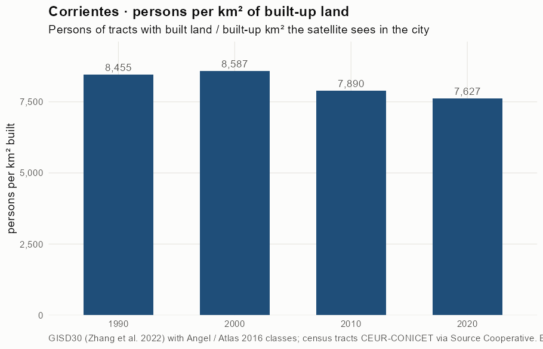
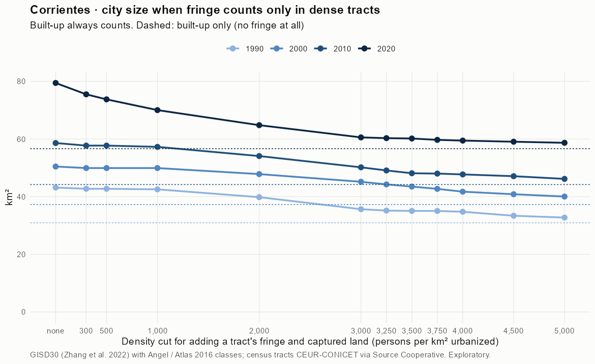
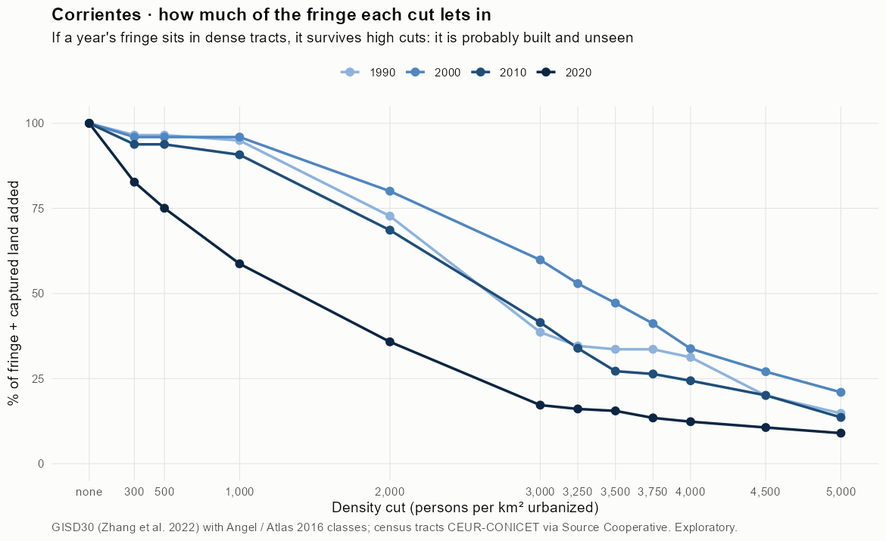
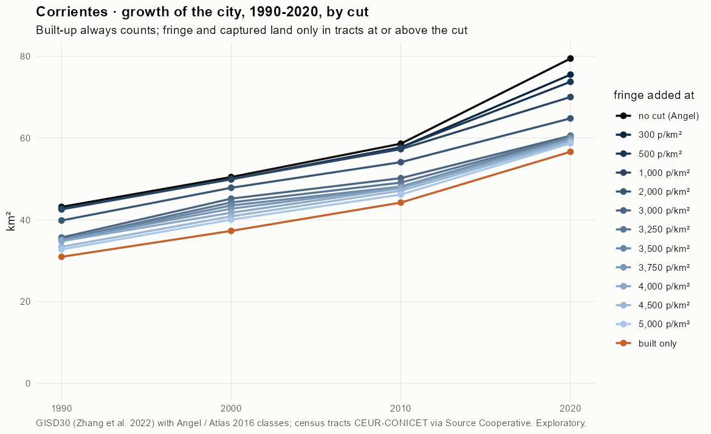
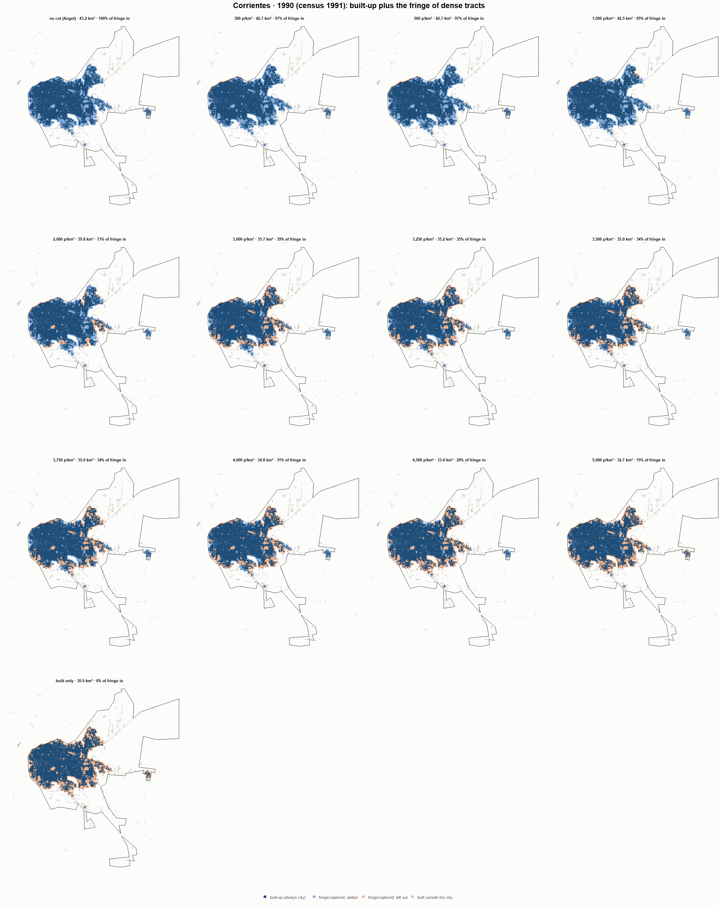
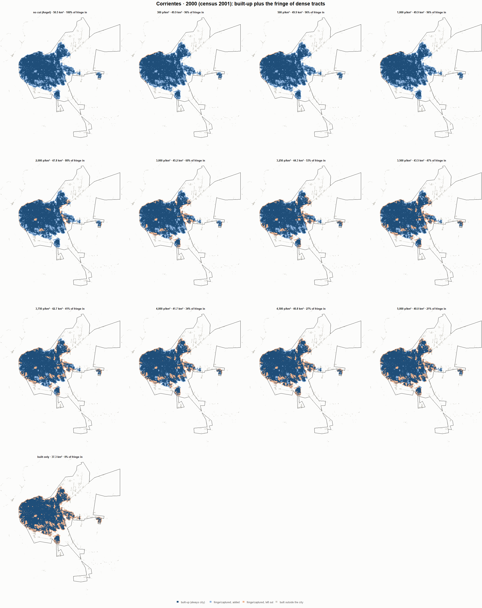
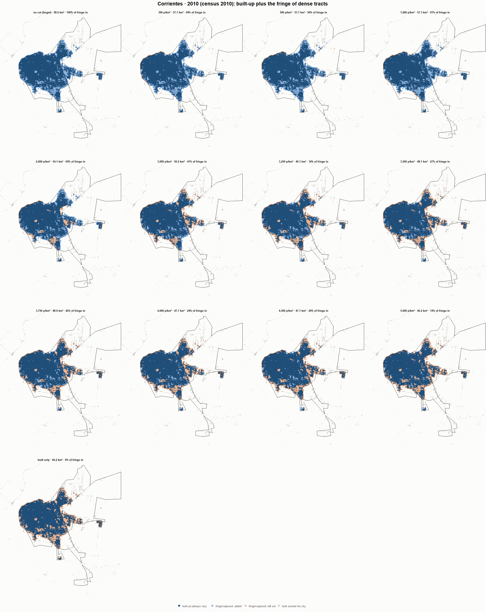
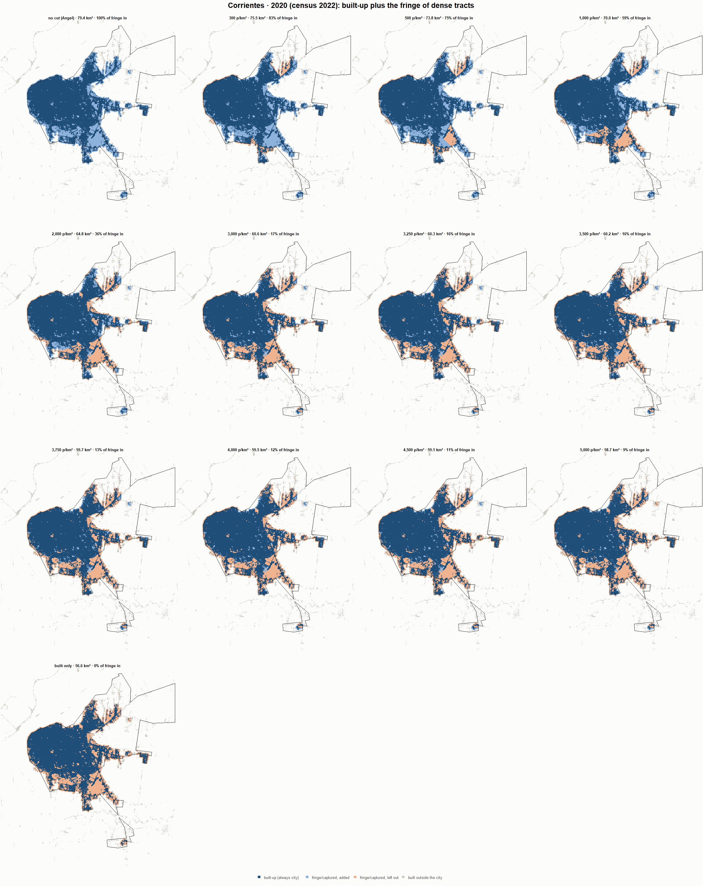

# Corrientes · when does the fringe count as city? 1990-2020

Exploratory test 2. None of these numbers are project figures (they are not in `CIFRAS_CANONICAS.json`). Generated by `Rpipe/scripts/13_prueba_franja.R` from the tract tables of step 11. Run of 2026-11-08. [All agglomerations](../REPORTE.md).

**Idea.** Built-up land is always city. Fringe and captured open space join the city **only in dense tracts**, where they are probably built and unseen by the older imagery. No cut gives the full Angel extent; an infinite cut, built-up only. Method in the [index](../REPORTE.md#method).

## Is the early imagery under-detecting?

If the older imagery misses buildings, persons per km² of *built* land should come out higher in the early years.

| Year | Persons (tracts with built land) | Built km² | Persons / km² built | Median tract, persons / km² built | Fringe + captured, % of extent |
|---|---|---|---|---|---|
| 1990 (census 1991) | 261,609 | 30.9 | 8,455 | 7,924 | 28.3 |
| 2000 (census 2001) | 320,124 | 37.3 | 8,587 | 8,019 | 26.1 |
| 2010 (census 2010) | 348,811 | 44.2 | 7,890 | 7,398 | 24.6 |
| 2020 (census 2022) | 431,952 | 56.6 | 7,627 | 7,440 | 28.7 |

## Results

**1990 (census 1991).** Built-up 30.9 km²; fringe + captured 12.2 km²; 261,716 persons in the city's tracts.

| Fringe added at | City km² | Fringe added km² | % of fringe added | Fringe % of city | Tracts adding fringe | Persons / km² city |
|---|---|---|---|---|---|---|
| no cut (Angel) | 43.2 | 12.2 | 100.0 | 28.3 | 184 | 6,064 |
| 300 p/km² | 42.7 | 11.8 | 96.5 | 27.6 | 182 | 6,124 |
| 500 p/km² | 42.7 | 11.8 | 96.5 | 27.6 | 182 | 6,124 |
| 1,000 p/km² | 42.5 | 11.6 | 95.0 | 27.3 | 181 | 6,152 |
| 2,000 p/km² | 39.8 | 8.9 | 72.7 | 22.3 | 173 | 6,571 |
| 3,000 p/km² | 35.7 | 4.7 | 38.6 | 13.2 | 152 | 7,339 |
| 3,250 p/km² | 35.2 | 4.2 | 34.6 | 12.0 | 149 | 7,442 |
| 3,500 p/km² | 35.0 | 4.1 | 33.6 | 11.7 | 148 | 7,467 |
| 3,750 p/km² | 35.0 | 4.1 | 33.6 | 11.7 | 148 | 7,467 |
| 4,000 p/km² | 34.8 | 3.8 | 31.3 | 11.0 | 144 | 7,529 |
| 4,500 p/km² | 33.4 | 2.4 | 20.0 | 7.3 | 133 | 7,840 |
| 5,000 p/km² | 32.7 | 1.8 | 14.8 | 5.5 | 126 | 7,992 |
| built only | 30.9 | 0.0 | 0.0 | 0.0 | 0 | 8,458 |

**2000 (census 2001).** Built-up 37.3 km²; fringe + captured 13.2 km²; 320,367 persons in the city's tracts.

| Fringe added at | City km² | Fringe added km² | % of fringe added | Fringe % of city | Tracts adding fringe | Persons / km² city |
|---|---|---|---|---|---|---|
| no cut (Angel) | 50.5 | 13.2 | 100.0 | 26.1 | 202 | 6,349 |
| 300 p/km² | 49.9 | 12.6 | 96.0 | 25.3 | 200 | 6,417 |
| 500 p/km² | 49.9 | 12.6 | 96.0 | 25.3 | 200 | 6,417 |
| 1,000 p/km² | 49.9 | 12.6 | 96.0 | 25.3 | 200 | 6,417 |
| 2,000 p/km² | 47.8 | 10.5 | 80.1 | 22.1 | 192 | 6,698 |
| 3,000 p/km² | 45.2 | 7.9 | 59.9 | 17.5 | 180 | 7,093 |
| 3,250 p/km² | 44.3 | 7.0 | 52.9 | 15.8 | 175 | 7,240 |
| 3,500 p/km² | 43.5 | 6.2 | 47.2 | 14.3 | 171 | 7,365 |
| 3,750 p/km² | 42.7 | 5.4 | 41.2 | 12.7 | 166 | 7,502 |
| 4,000 p/km² | 41.7 | 4.5 | 33.8 | 10.7 | 159 | 7,677 |
| 4,500 p/km² | 40.8 | 3.6 | 27.0 | 8.7 | 152 | 7,844 |
| 5,000 p/km² | 40.0 | 2.8 | 21.0 | 6.9 | 141 | 8,000 |
| built only | 37.3 | 0.0 | 0.0 | 0.0 | 0 | 8,594 |

**2010 (census 2010).** Built-up 44.2 km²; fringe + captured 14.4 km²; 349,168 persons in the city's tracts.

| Fringe added at | City km² | Fringe added km² | % of fringe added | Fringe % of city | Tracts adding fringe | Persons / km² city |
|---|---|---|---|---|---|---|
| no cut (Angel) | 58.6 | 14.4 | 100.0 | 24.6 | 173 | 5,958 |
| 300 p/km² | 57.7 | 13.5 | 93.8 | 23.4 | 171 | 6,050 |
| 500 p/km² | 57.7 | 13.5 | 93.8 | 23.4 | 171 | 6,050 |
| 1,000 p/km² | 57.3 | 13.1 | 90.8 | 22.8 | 170 | 6,096 |
| 2,000 p/km² | 54.1 | 9.9 | 68.6 | 18.3 | 161 | 6,456 |
| 3,000 p/km² | 50.2 | 6.0 | 41.5 | 11.9 | 146 | 6,958 |
| 3,250 p/km² | 49.1 | 4.9 | 33.9 | 9.9 | 139 | 7,112 |
| 3,500 p/km² | 48.1 | 3.9 | 27.2 | 8.1 | 133 | 7,256 |
| 3,750 p/km² | 48.0 | 3.8 | 26.4 | 7.9 | 131 | 7,274 |
| 4,000 p/km² | 47.7 | 3.5 | 24.4 | 7.4 | 128 | 7,317 |
| 4,500 p/km² | 47.1 | 2.9 | 20.1 | 6.1 | 121 | 7,413 |
| 5,000 p/km² | 46.2 | 2.0 | 13.6 | 4.2 | 107 | 7,563 |
| built only | 44.2 | 0.0 | 0.0 | 0.0 | 0 | 7,898 |

**2020 (census 2022).** Built-up 56.6 km²; fringe + captured 22.8 km²; 432,455 persons in the city's tracts.

| Fringe added at | City km² | Fringe added km² | % of fringe added | Fringe % of city | Tracts adding fringe | Persons / km² city |
|---|---|---|---|---|---|---|
| no cut (Angel) | 79.4 | 22.8 | 100.0 | 28.7 | 200 | 5,444 |
| 300 p/km² | 75.5 | 18.9 | 82.7 | 25.0 | 196 | 5,728 |
| 500 p/km² | 73.8 | 17.1 | 75.1 | 23.2 | 195 | 5,864 |
| 1,000 p/km² | 70.0 | 13.4 | 58.7 | 19.1 | 190 | 6,175 |
| 2,000 p/km² | 64.8 | 8.2 | 35.8 | 12.6 | 175 | 6,674 |
| 3,000 p/km² | 60.6 | 3.9 | 17.2 | 6.5 | 153 | 7,141 |
| 3,250 p/km² | 60.3 | 3.7 | 16.1 | 6.1 | 150 | 7,171 |
| 3,500 p/km² | 60.2 | 3.5 | 15.5 | 5.9 | 148 | 7,187 |
| 3,750 p/km² | 59.7 | 3.1 | 13.5 | 5.1 | 139 | 7,243 |
| 4,000 p/km² | 59.5 | 2.8 | 12.3 | 4.7 | 134 | 7,274 |
| 4,500 p/km² | 59.1 | 2.4 | 10.6 | 4.1 | 126 | 7,322 |
| 5,000 p/km² | 58.7 | 2.0 | 9.0 | 3.5 | 119 | 7,369 |
| built only | 56.6 | 0.0 | 0.0 | 0.0 | 0 | 7,636 |

### Growth by cut

| Fringe added at | 1990 km² | 2000 km² | 2010 km² | 2020 km² | 1990-2000 %/yr | 2000-2010 %/yr | 2010-2020 %/yr | 1990-2020 %/yr |
|---|---|---|---|---|---|---|---|---|
| no cut (Angel) | 43.2 | 50.5 | 58.6 | 79.4 | 1.57 | 1.51 | 3.09 | 2.05 |
| 300 p/km² | 42.7 | 49.9 | 57.7 | 75.5 | 1.57 | 1.46 | 2.72 | 1.92 |
| 500 p/km² | 42.7 | 49.9 | 57.7 | 73.8 | 1.57 | 1.46 | 2.48 | 1.84 |
| 1,000 p/km² | 42.5 | 49.9 | 57.3 | 70.0 | 1.61 | 1.38 | 2.03 | 1.68 |
| 2,000 p/km² | 39.8 | 47.8 | 54.1 | 64.8 | 1.85 | 1.24 | 1.82 | 1.64 |
| 3,000 p/km² | 35.7 | 45.2 | 50.2 | 60.6 | 2.39 | 1.06 | 1.90 | 1.78 |
| 3,250 p/km² | 35.2 | 44.3 | 49.1 | 60.3 | 2.32 | 1.04 | 2.08 | 1.81 |
| 3,500 p/km² | 35.0 | 43.5 | 48.1 | 60.2 | 2.18 | 1.02 | 2.26 | 1.82 |
| 3,750 p/km² | 35.0 | 42.7 | 48.0 | 59.7 | 2.00 | 1.18 | 2.20 | 1.79 |
| 4,000 p/km² | 34.8 | 41.7 | 47.7 | 59.5 | 1.84 | 1.35 | 2.22 | 1.80 |
| 4,500 p/km² | 33.4 | 40.8 | 47.1 | 59.1 | 2.04 | 1.44 | 2.29 | 1.92 |
| 5,000 p/km² | 32.7 | 40.0 | 46.2 | 58.7 | 2.03 | 1.43 | 2.43 | 1.96 |
| built only | 30.9 | 37.3 | 44.2 | 56.6 | 1.88 | 1.72 | 2.51 | 2.04 |

## Maps

Same frame in the four years: the 2020 city plus 3 km. Dark blue is built-up, always city; light blue is fringe or captured land added because its tract is dense; light orange is fringe left out. Black line: the analysis perimeter.

### 1990

### 2000

### 2010

### 2020

## Reading

- **The premise.** Persons per km² of built land: 8,455 in 1990, 8,587 in 2000, 7,890 in 2010, 7,627 in 2020. 1990 is not clearly higher than 2010: the census does not point to much built land missed in 1990.
- **At 500 p/km²** the fringe that joins the city is 96.5 % of all fringe in 1990 and 75.1 % in 2020.
- **Growth 1990-2020**: 2.05 %/yr with the full Angel extent, 1.84 %/yr at 500, 2.04 %/yr built-up only.

