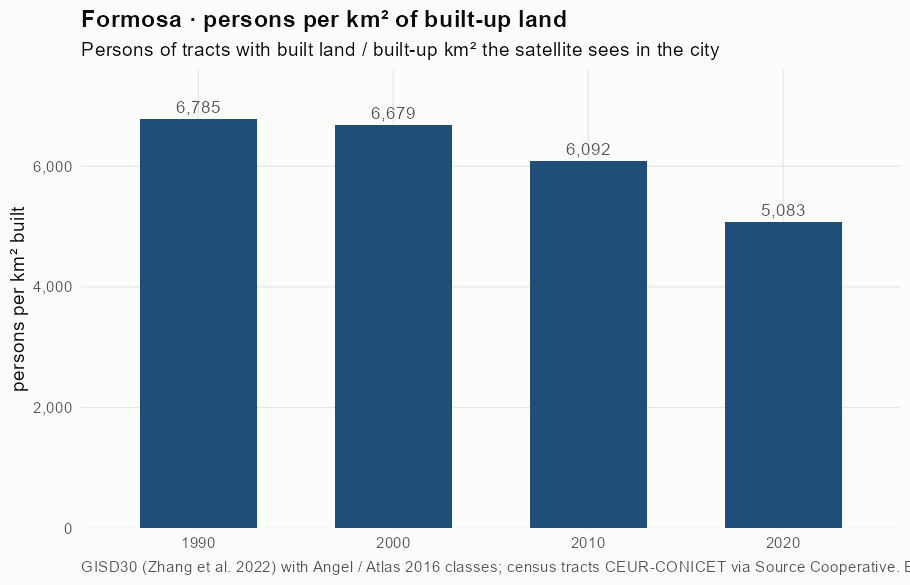
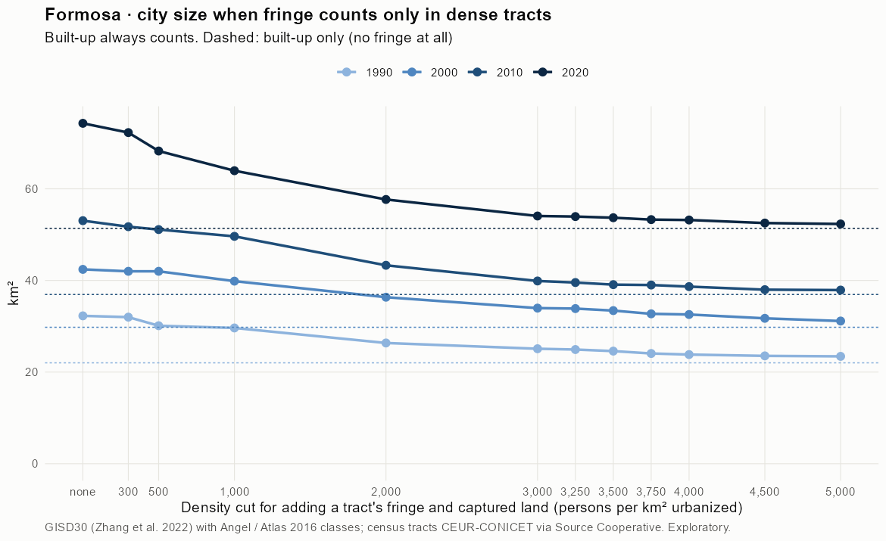
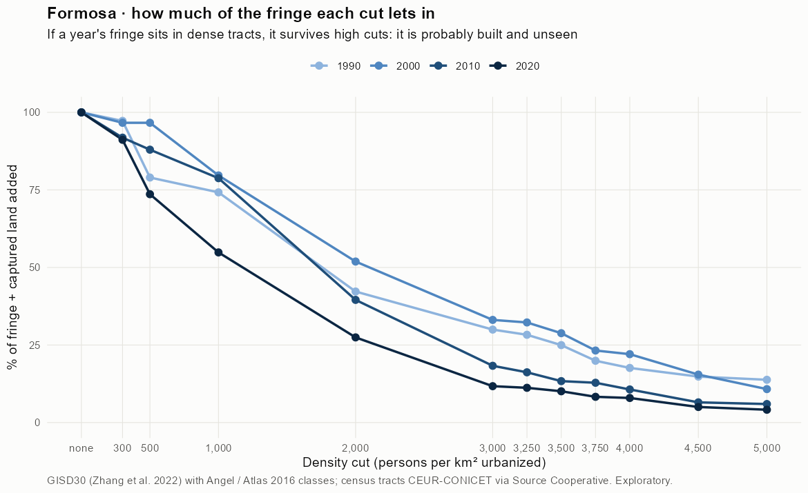
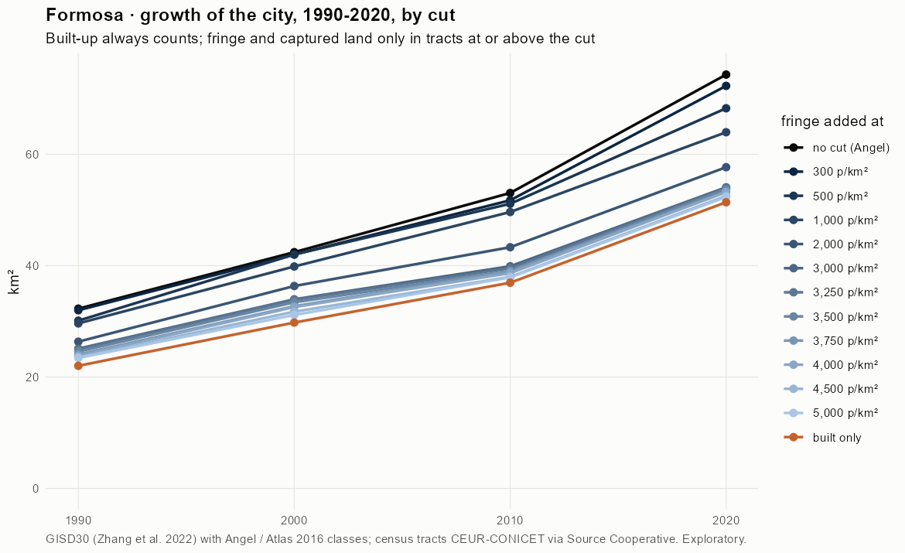
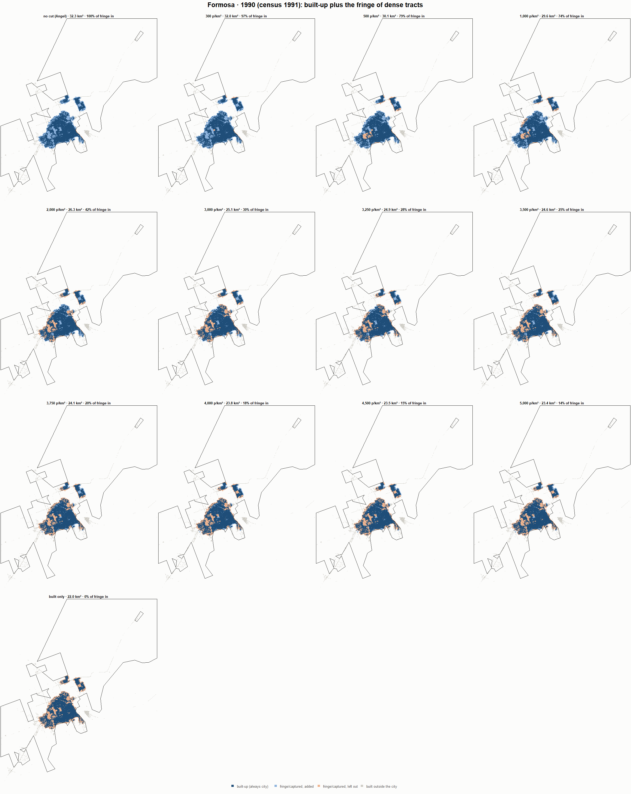
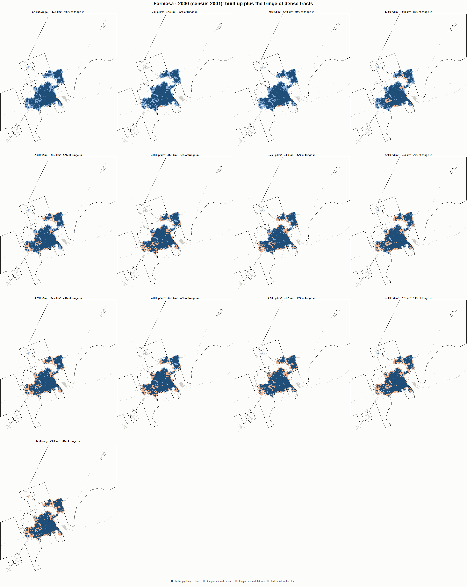
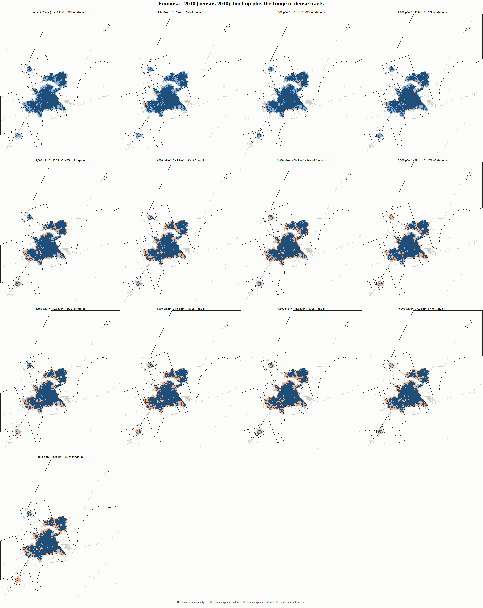
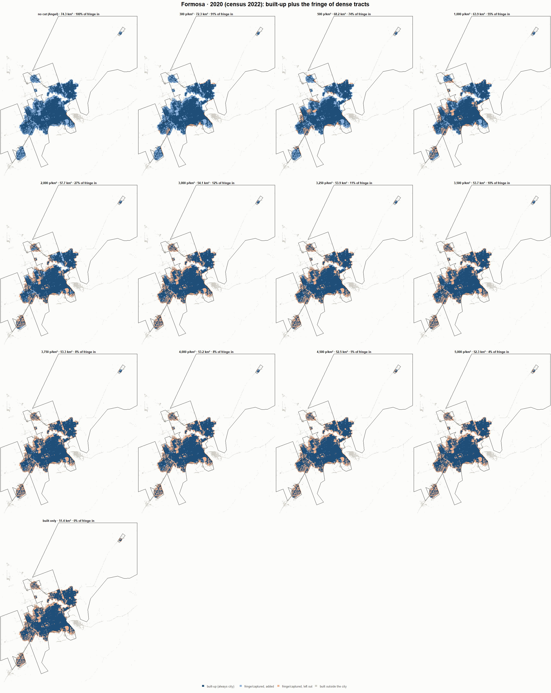

# Formosa · when does the fringe count as city? 1990-2020

Exploratory test 2. None of these numbers are project figures (they are not in `CIFRAS_CANONICAS.json`). Generated by `Rpipe/scripts/13_prueba_franja.R` from the tract tables of step 11. Run of 2026-11-08. [All agglomerations](../REPORTE.md).

**Idea.** Built-up land is always city. Fringe and captured open space join the city **only in dense tracts**, where they are probably built and unseen by the older imagery. No cut gives the full Angel extent; an infinite cut, built-up only. Method in the [index](../REPORTE.md#method).

## Is the early imagery under-detecting?

If the older imagery misses buildings, persons per km² of *built* land should come out higher in the early years.

| Year | Persons (tracts with built land) | Built km² | Persons / km² built | Median tract, persons / km² built | Fringe + captured, % of extent |
|---|---|---|---|---|---|
| 1990 (census 1991) | 149,372 | 22.0 | 6,785 | 5,646 | 31.7 |
| 2000 (census 2001) | 198,870 | 29.8 | 6,679 | 5,708 | 29.7 |
| 2010 (census 2010) | 225,005 | 36.9 | 6,092 | 5,665 | 30.3 |
| 2020 (census 2022) | 261,132 | 51.4 | 5,083 | 4,989 | 30.8 |

## Results

**1990 (census 1991).** Built-up 22.0 km²; fringe + captured 10.3 km²; 149,533 persons in the city's tracts.

| Fringe added at | City km² | Fringe added km² | % of fringe added | Fringe % of city | Tracts adding fringe | Persons / km² city |
|---|---|---|---|---|---|---|
| no cut (Angel) | 32.3 | 10.3 | 100.0 | 31.8 | 106 | 4,633 |
| 300 p/km² | 32.0 | 10.0 | 97.2 | 31.2 | 104 | 4,674 |
| 500 p/km² | 30.1 | 8.1 | 79.0 | 26.9 | 101 | 4,965 |
| 1,000 p/km² | 29.6 | 7.6 | 74.2 | 25.7 | 99 | 5,047 |
| 2,000 p/km² | 26.3 | 4.3 | 42.2 | 16.4 | 89 | 5,675 |
| 3,000 p/km² | 25.1 | 3.1 | 30.0 | 12.3 | 81 | 5,960 |
| 3,250 p/km² | 24.9 | 2.9 | 28.3 | 11.6 | 80 | 6,001 |
| 3,500 p/km² | 24.6 | 2.6 | 25.0 | 10.4 | 79 | 6,084 |
| 3,750 p/km² | 24.1 | 2.0 | 19.9 | 8.5 | 75 | 6,215 |
| 4,000 p/km² | 23.8 | 1.8 | 17.6 | 7.6 | 73 | 6,277 |
| 4,500 p/km² | 23.5 | 1.5 | 14.8 | 6.5 | 70 | 6,354 |
| 5,000 p/km² | 23.4 | 1.4 | 13.8 | 6.0 | 64 | 6,382 |
| built only | 22.0 | 0.0 | 0.0 | 0.0 | 0 | 6,792 |

**2000 (census 2001).** Built-up 29.8 km²; fringe + captured 12.6 km²; 199,484 persons in the city's tracts.

| Fringe added at | City km² | Fringe added km² | % of fringe added | Fringe % of city | Tracts adding fringe | Persons / km² city |
|---|---|---|---|---|---|---|
| no cut (Angel) | 42.4 | 12.6 | 100.0 | 29.8 | 145 | 4,703 |
| 300 p/km² | 42.0 | 12.2 | 96.6 | 29.1 | 143 | 4,751 |
| 500 p/km² | 42.0 | 12.2 | 96.6 | 29.1 | 143 | 4,751 |
| 1,000 p/km² | 39.8 | 10.1 | 79.7 | 25.3 | 139 | 5,006 |
| 2,000 p/km² | 36.3 | 6.6 | 51.9 | 18.1 | 126 | 5,490 |
| 3,000 p/km² | 34.0 | 4.2 | 33.1 | 12.3 | 108 | 5,874 |
| 3,250 p/km² | 33.9 | 4.1 | 32.3 | 12.1 | 105 | 5,892 |
| 3,500 p/km² | 33.4 | 3.6 | 28.8 | 10.9 | 102 | 5,969 |
| 3,750 p/km² | 32.7 | 2.9 | 23.2 | 9.0 | 98 | 6,098 |
| 4,000 p/km² | 32.6 | 2.8 | 22.1 | 8.6 | 96 | 6,126 |
| 4,500 p/km² | 31.7 | 2.0 | 15.5 | 6.2 | 90 | 6,287 |
| 5,000 p/km² | 31.1 | 1.4 | 10.8 | 4.4 | 76 | 6,406 |
| built only | 29.8 | 0.0 | 0.0 | 0.0 | 0 | 6,699 |

**2010 (census 2010).** Built-up 36.9 km²; fringe + captured 16.1 km²; 225,094 persons in the city's tracts.

| Fringe added at | City km² | Fringe added km² | % of fringe added | Fringe % of city | Tracts adding fringe | Persons / km² city |
|---|---|---|---|---|---|---|
| no cut (Angel) | 53.0 | 16.1 | 100.0 | 30.4 | 161 | 4,244 |
| 300 p/km² | 51.7 | 14.8 | 91.8 | 28.6 | 155 | 4,351 |
| 500 p/km² | 51.1 | 14.2 | 88.0 | 27.7 | 154 | 4,405 |
| 1,000 p/km² | 49.6 | 12.7 | 78.8 | 25.6 | 149 | 4,536 |
| 2,000 p/km² | 43.3 | 6.4 | 39.5 | 14.7 | 130 | 5,198 |
| 3,000 p/km² | 39.9 | 2.9 | 18.3 | 7.4 | 110 | 5,644 |
| 3,250 p/km² | 39.5 | 2.6 | 16.2 | 6.6 | 107 | 5,692 |
| 3,500 p/km² | 39.1 | 2.2 | 13.4 | 5.5 | 101 | 5,759 |
| 3,750 p/km² | 39.0 | 2.1 | 12.8 | 5.3 | 99 | 5,772 |
| 4,000 p/km² | 38.7 | 1.7 | 10.7 | 4.4 | 94 | 5,824 |
| 4,500 p/km² | 38.0 | 1.0 | 6.5 | 2.8 | 84 | 5,926 |
| 5,000 p/km² | 37.9 | 1.0 | 6.0 | 2.5 | 78 | 5,940 |
| built only | 36.9 | 0.0 | 0.0 | 0.0 | 0 | 6,095 |

**2020 (census 2022).** Built-up 51.4 km²; fringe + captured 22.9 km²; 261,548 persons in the city's tracts.

| Fringe added at | City km² | Fringe added km² | % of fringe added | Fringe % of city | Tracts adding fringe | Persons / km² city |
|---|---|---|---|---|---|---|
| no cut (Angel) | 74.3 | 22.9 | 100.0 | 30.9 | 222 | 3,520 |
| 300 p/km² | 72.3 | 20.9 | 91.2 | 28.9 | 214 | 3,619 |
| 500 p/km² | 68.2 | 16.9 | 73.6 | 24.7 | 206 | 3,832 |
| 1,000 p/km² | 63.9 | 12.6 | 54.9 | 19.7 | 191 | 4,090 |
| 2,000 p/km² | 57.7 | 6.3 | 27.5 | 10.9 | 161 | 4,535 |
| 3,000 p/km² | 54.1 | 2.7 | 11.7 | 5.0 | 130 | 4,838 |
| 3,250 p/km² | 53.9 | 2.6 | 11.2 | 4.8 | 127 | 4,848 |
| 3,500 p/km² | 53.7 | 2.3 | 10.1 | 4.3 | 125 | 4,872 |
| 3,750 p/km² | 53.3 | 1.9 | 8.3 | 3.6 | 119 | 4,909 |
| 4,000 p/km² | 53.2 | 1.8 | 7.9 | 3.4 | 113 | 4,917 |
| 4,500 p/km² | 52.5 | 1.2 | 5.0 | 2.2 | 95 | 4,979 |
| 5,000 p/km² | 52.3 | 0.9 | 4.1 | 1.8 | 85 | 4,999 |
| built only | 51.4 | 0.0 | 0.0 | 0.0 | 0 | 5,091 |

### Growth by cut

| Fringe added at | 1990 km² | 2000 km² | 2010 km² | 2020 km² | 1990-2000 %/yr | 2000-2010 %/yr | 2010-2020 %/yr | 1990-2020 %/yr |
|---|---|---|---|---|---|---|---|---|
| no cut (Angel) | 32.3 | 42.4 | 53.0 | 74.3 | 2.77 | 2.26 | 3.43 | 2.82 |
| 300 p/km² | 32.0 | 42.0 | 51.7 | 72.3 | 2.76 | 2.11 | 3.40 | 2.75 |
| 500 p/km² | 30.1 | 42.0 | 51.1 | 68.2 | 3.38 | 1.98 | 2.94 | 2.76 |
| 1,000 p/km² | 29.6 | 39.8 | 49.6 | 63.9 | 3.01 | 2.22 | 2.57 | 2.60 |
| 2,000 p/km² | 26.3 | 36.3 | 43.3 | 57.7 | 3.27 | 1.77 | 2.91 | 2.65 |
| 3,000 p/km² | 25.1 | 34.0 | 39.9 | 54.1 | 3.07 | 1.62 | 3.09 | 2.59 |
| 3,250 p/km² | 24.9 | 33.9 | 39.5 | 53.9 | 3.11 | 1.56 | 3.15 | 2.61 |
| 3,500 p/km² | 24.6 | 33.4 | 39.1 | 53.7 | 3.12 | 1.58 | 3.23 | 2.64 |
| 3,750 p/km² | 24.1 | 32.7 | 39.0 | 53.3 | 3.12 | 1.77 | 3.17 | 2.69 |
| 4,000 p/km² | 23.8 | 32.6 | 38.7 | 53.2 | 3.18 | 1.73 | 3.24 | 2.71 |
| 4,500 p/km² | 23.5 | 31.7 | 38.0 | 52.5 | 3.03 | 1.81 | 3.30 | 2.71 |
| 5,000 p/km² | 23.4 | 31.1 | 37.9 | 52.3 | 2.89 | 1.98 | 3.28 | 2.71 |
| built only | 22.0 | 29.8 | 36.9 | 51.4 | 3.07 | 2.18 | 3.36 | 2.87 |

## Maps

Same frame in the four years: the 2020 city plus 3 km. Dark blue is built-up, always city; light blue is fringe or captured land added because its tract is dense; light orange is fringe left out. Black line: the analysis perimeter.

### 1990

### 2000

### 2010

### 2020

## Reading

- **The premise.** Persons per km² of built land: 6,785 in 1990, 6,679 in 2000, 6,092 in 2010, 5,083 in 2020. 1990 is not clearly higher than 2010: the census does not point to much built land missed in 1990.
- **At 500 p/km²** the fringe that joins the city is 79.0 % of all fringe in 1990 and 73.6 % in 2020.
- **Growth 1990-2020**: 2.82 %/yr with the full Angel extent, 2.76 %/yr at 500, 2.87 %/yr built-up only.

