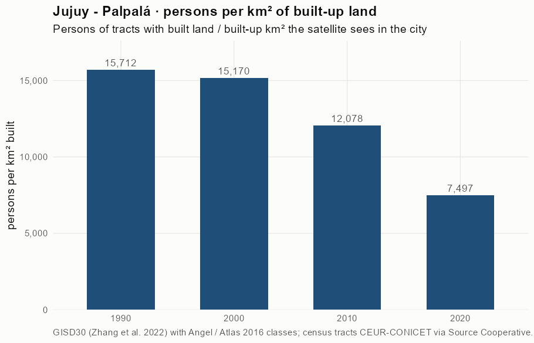
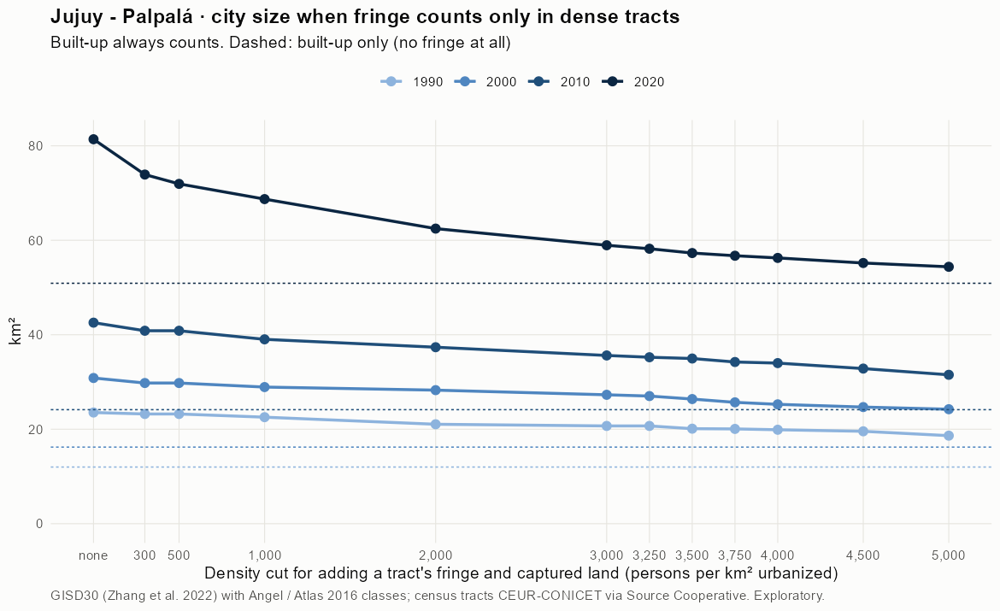
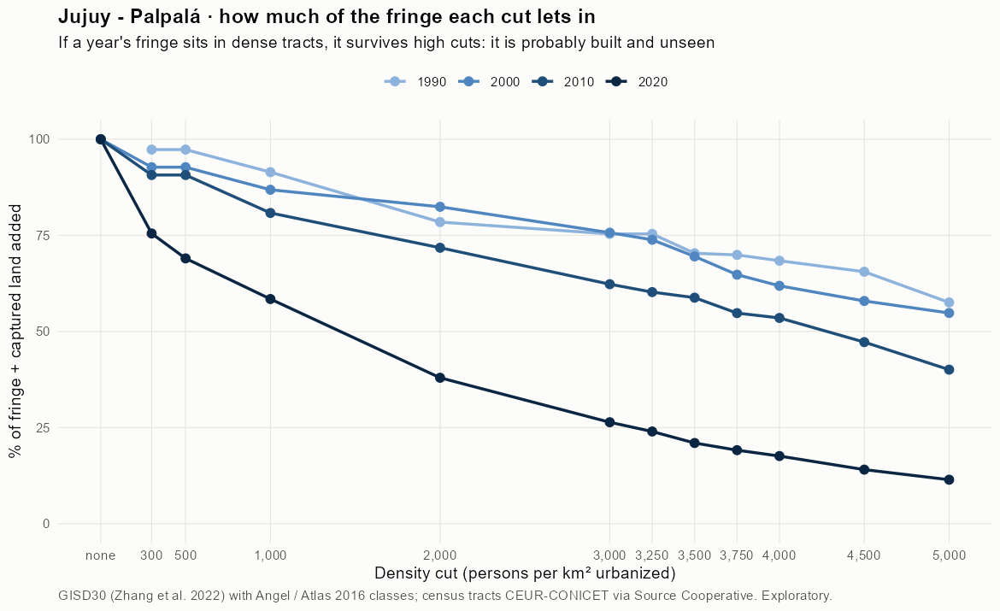
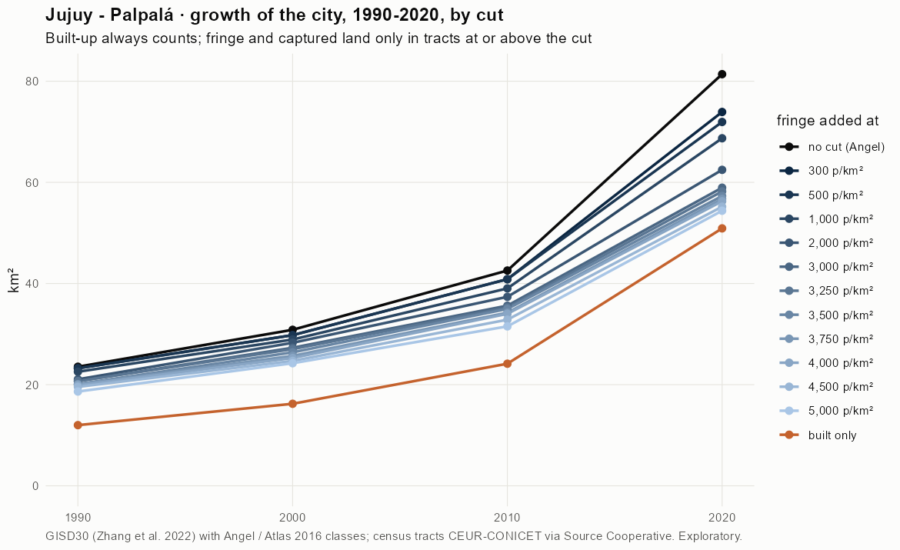
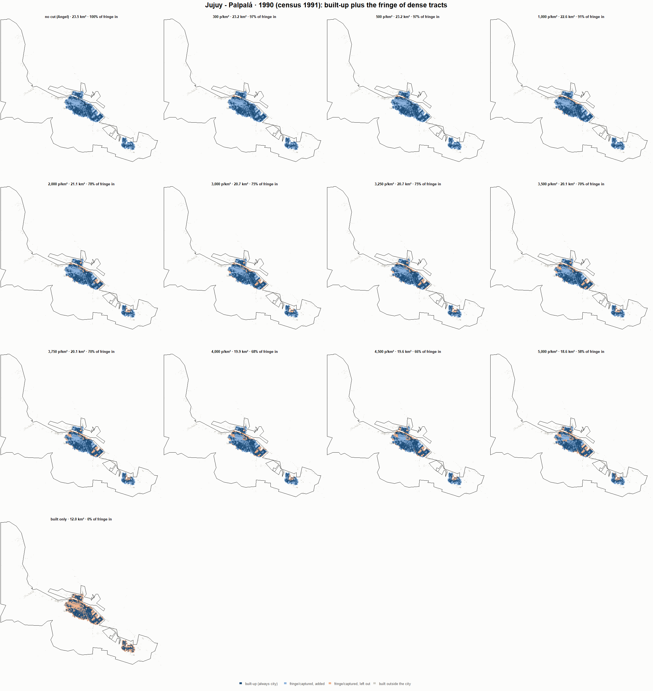
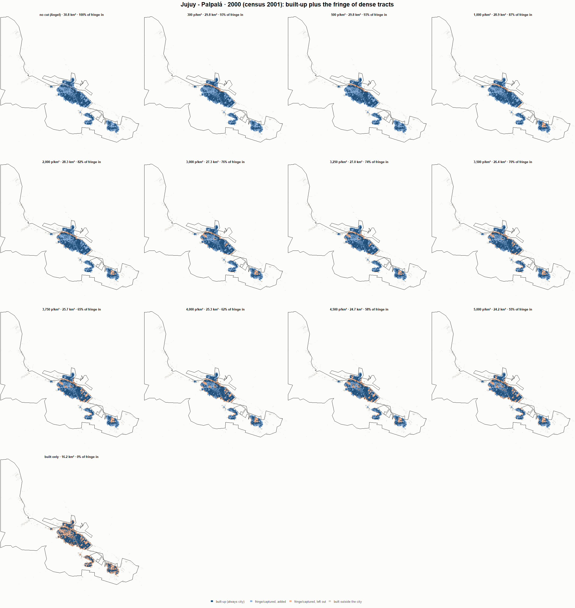
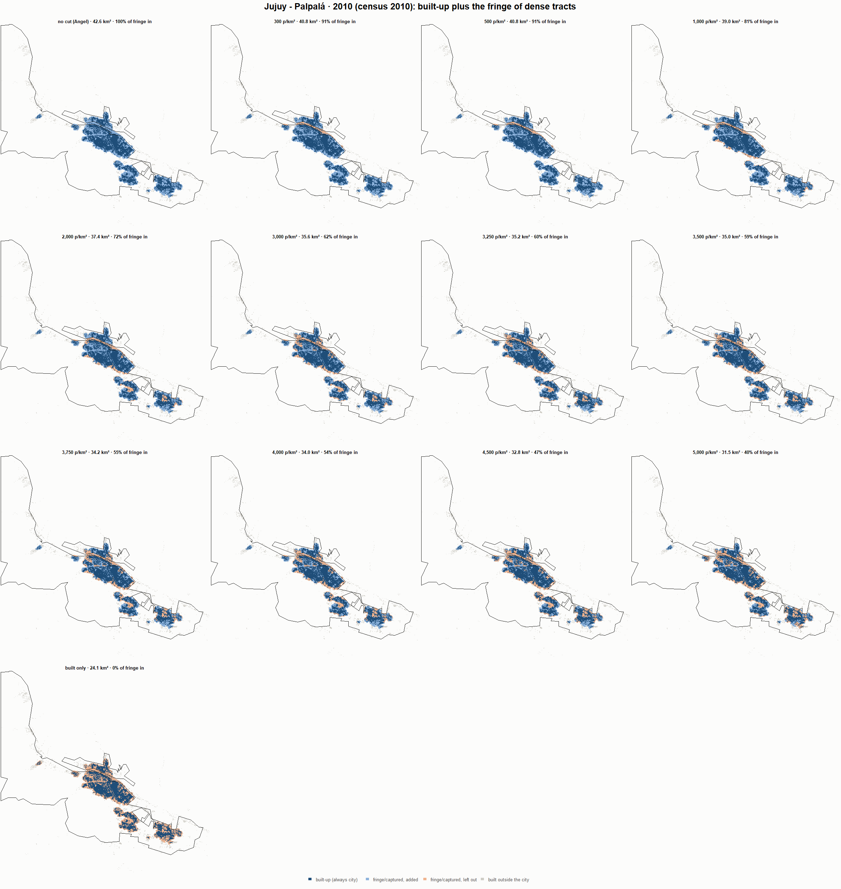
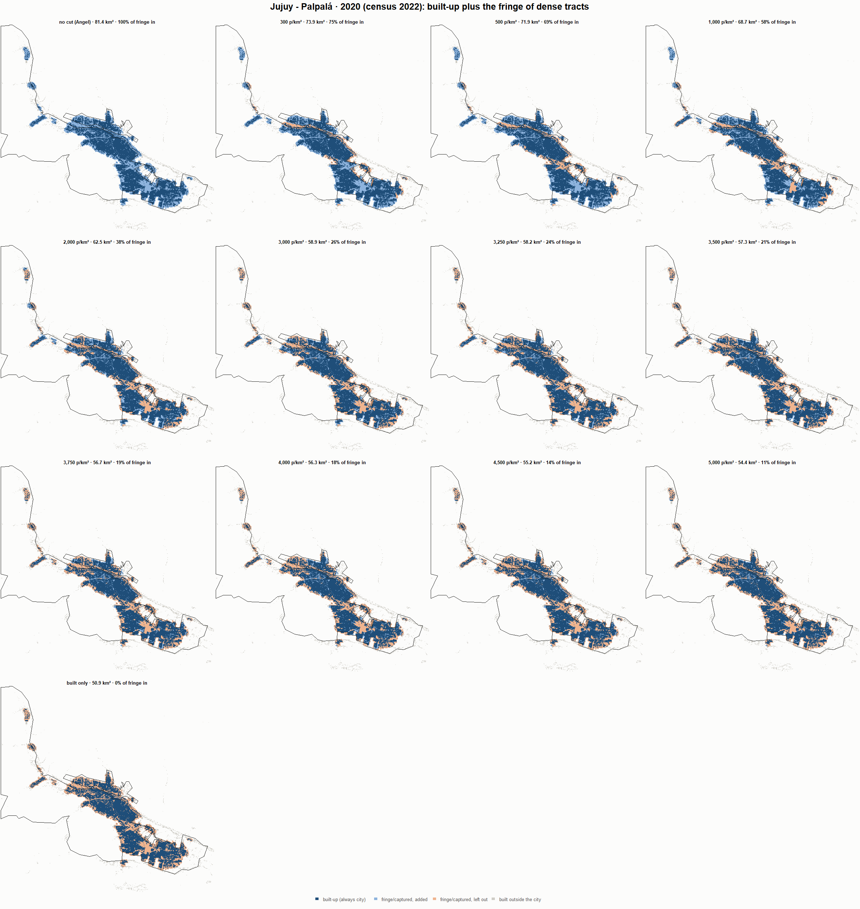

# Jujuy - Palpalá · when does the fringe count as city? 1990-2020

Exploratory test 2. None of these numbers are project figures (they are not in `CIFRAS_CANONICAS.json`). Generated by `Rpipe/scripts/13_prueba_franja.R` from the tract tables of step 11. Run of 2026-11-08. [All agglomerations](../REPORTE.md).

**Idea.** Built-up land is always city. Fringe and captured open space join the city **only in dense tracts**, where they are probably built and unseen by the older imagery. No cut gives the full Angel extent; an infinite cut, built-up only. Method in the [index](../REPORTE.md#method).

## Is the early imagery under-detecting?

If the older imagery misses buildings, persons per km² of *built* land should come out higher in the early years.

| Year | Persons (tracts with built land) | Built km² | Persons / km² built | Median tract, persons / km² built | Fringe + captured, % of extent |
|---|---|---|---|---|---|
| 1990 (census 1991) | 188,467 | 12.0 | 15,712 | 13,843 | 48.6 |
| 2000 (census 2001) | 246,006 | 16.2 | 15,170 | 12,609 | 47.3 |
| 2010 (census 2010) | 291,553 | 24.1 | 12,078 | 10,694 | 43.2 |
| 2020 (census 2022) | 381,585 | 50.9 | 7,497 | 7,407 | 37.5 |

## Results

**1990 (census 1991).** Built-up 12.0 km²; fringe + captured 11.5 km²; 194,575 persons in the city's tracts.

| Fringe added at | City km² | Fringe added km² | % of fringe added | Fringe % of city | Tracts adding fringe | Persons / km² city |
|---|---|---|---|---|---|---|
| no cut (Angel) | 23.5 | 11.5 | 100.0 | 49.0 | 159 | 8,266 |
| 300 p/km² | 23.2 | 11.2 | 97.3 | 48.4 | 158 | 8,376 |
| 500 p/km² | 23.2 | 11.2 | 97.3 | 48.4 | 158 | 8,376 |
| 1,000 p/km² | 22.6 | 10.6 | 91.4 | 46.8 | 156 | 8,628 |
| 2,000 p/km² | 21.1 | 9.1 | 78.5 | 43.0 | 151 | 9,242 |
| 3,000 p/km² | 20.7 | 8.7 | 75.4 | 42.0 | 149 | 9,401 |
| 3,250 p/km² | 20.7 | 8.7 | 75.4 | 42.0 | 149 | 9,401 |
| 3,500 p/km² | 20.1 | 8.1 | 70.3 | 40.4 | 146 | 9,673 |
| 3,750 p/km² | 20.1 | 8.1 | 69.9 | 40.2 | 145 | 9,697 |
| 4,000 p/km² | 19.9 | 7.9 | 68.4 | 39.7 | 144 | 9,782 |
| 4,500 p/km² | 19.6 | 7.6 | 65.5 | 38.7 | 142 | 9,947 |
| 5,000 p/km² | 18.6 | 6.6 | 57.6 | 35.6 | 136 | 10,439 |
| built only | 12.0 | 0.0 | 0.0 | 0.0 | 0 | 16,221 |

**2000 (census 2001).** Built-up 16.2 km²; fringe + captured 14.6 km²; 252,870 persons in the city's tracts.

| Fringe added at | City km² | Fringe added km² | % of fringe added | Fringe % of city | Tracts adding fringe | Persons / km² city |
|---|---|---|---|---|---|---|
| no cut (Angel) | 30.8 | 14.6 | 100.0 | 47.4 | 233 | 8,198 |
| 300 p/km² | 29.8 | 13.6 | 92.7 | 45.6 | 231 | 8,490 |
| 500 p/km² | 29.8 | 13.6 | 92.7 | 45.6 | 231 | 8,490 |
| 1,000 p/km² | 28.9 | 12.7 | 86.9 | 43.9 | 229 | 8,743 |
| 2,000 p/km² | 28.3 | 12.1 | 82.4 | 42.7 | 226 | 8,943 |
| 3,000 p/km² | 27.3 | 11.1 | 75.7 | 40.6 | 221 | 9,266 |
| 3,250 p/km² | 27.0 | 10.8 | 73.9 | 40.0 | 219 | 9,358 |
| 3,500 p/km² | 26.4 | 10.2 | 69.5 | 38.5 | 215 | 9,583 |
| 3,750 p/km² | 25.7 | 9.5 | 64.8 | 36.9 | 210 | 9,842 |
| 4,000 p/km² | 25.3 | 9.1 | 61.9 | 35.8 | 208 | 10,007 |
| 4,500 p/km² | 24.7 | 8.5 | 57.9 | 34.3 | 203 | 10,241 |
| 5,000 p/km² | 24.2 | 8.0 | 54.8 | 33.1 | 199 | 10,434 |
| built only | 16.2 | 0.0 | 0.0 | 0.0 | 0 | 15,594 |

**2010 (census 2010).** Built-up 24.1 km²; fringe + captured 18.4 km²; 295,972 persons in the city's tracts.

| Fringe added at | City km² | Fringe added km² | % of fringe added | Fringe % of city | Tracts adding fringe | Persons / km² city |
|---|---|---|---|---|---|---|
| no cut (Angel) | 42.6 | 18.4 | 100.0 | 43.3 | 259 | 6,954 |
| 300 p/km² | 40.8 | 16.7 | 90.7 | 40.9 | 256 | 7,245 |
| 500 p/km² | 40.8 | 16.7 | 90.7 | 40.9 | 256 | 7,245 |
| 1,000 p/km² | 39.0 | 14.9 | 80.8 | 38.2 | 252 | 7,583 |
| 2,000 p/km² | 37.4 | 13.2 | 71.8 | 35.4 | 246 | 7,921 |
| 3,000 p/km² | 35.6 | 11.5 | 62.3 | 32.2 | 237 | 8,310 |
| 3,250 p/km² | 35.2 | 11.1 | 60.2 | 31.5 | 234 | 8,399 |
| 3,500 p/km² | 35.0 | 10.8 | 58.8 | 31.0 | 233 | 8,463 |
| 3,750 p/km² | 34.2 | 10.1 | 54.8 | 29.5 | 228 | 8,646 |
| 4,000 p/km² | 34.0 | 9.9 | 53.5 | 29.0 | 225 | 8,705 |
| 4,500 p/km² | 32.8 | 8.7 | 47.2 | 26.5 | 214 | 9,012 |
| 5,000 p/km² | 31.5 | 7.4 | 40.1 | 23.4 | 201 | 9,389 |
| built only | 24.1 | 0.0 | 0.0 | 0.0 | 0 | 12,261 |

**2020 (census 2022).** Built-up 50.9 km²; fringe + captured 30.5 km²; 381,611 persons in the city's tracts.

| Fringe added at | City km² | Fringe added km² | % of fringe added | Fringe % of city | Tracts adding fringe | Persons / km² city |
|---|---|---|---|---|---|---|
| no cut (Angel) | 81.4 | 30.5 | 100.0 | 37.5 | 344 | 4,689 |
| 300 p/km² | 73.9 | 23.0 | 75.5 | 31.1 | 335 | 5,163 |
| 500 p/km² | 71.9 | 21.0 | 69.0 | 29.2 | 333 | 5,305 |
| 1,000 p/km² | 68.7 | 17.8 | 58.4 | 25.9 | 328 | 5,553 |
| 2,000 p/km² | 62.5 | 11.6 | 38.0 | 18.5 | 303 | 6,108 |
| 3,000 p/km² | 58.9 | 8.0 | 26.4 | 13.6 | 281 | 6,474 |
| 3,250 p/km² | 58.2 | 7.3 | 24.0 | 12.6 | 272 | 6,556 |
| 3,500 p/km² | 57.3 | 6.4 | 21.0 | 11.2 | 262 | 6,660 |
| 3,750 p/km² | 56.7 | 5.8 | 19.1 | 10.3 | 256 | 6,727 |
| 4,000 p/km² | 56.3 | 5.4 | 17.6 | 9.5 | 250 | 6,782 |
| 4,500 p/km² | 55.2 | 4.3 | 14.1 | 7.8 | 237 | 6,915 |
| 5,000 p/km² | 54.4 | 3.5 | 11.4 | 6.4 | 221 | 7,016 |
| built only | 50.9 | 0.0 | 0.0 | 0.0 | 0 | 7,497 |

### Growth by cut

| Fringe added at | 1990 km² | 2000 km² | 2010 km² | 2020 km² | 1990-2000 %/yr | 2000-2010 %/yr | 2010-2020 %/yr | 1990-2020 %/yr |
|---|---|---|---|---|---|---|---|---|
| no cut (Angel) | 23.5 | 30.8 | 42.6 | 81.4 | 2.74 | 3.27 | 6.70 | 4.22 |
| 300 p/km² | 23.2 | 29.8 | 40.8 | 73.9 | 2.52 | 3.21 | 6.11 | 3.93 |
| 500 p/km² | 23.2 | 29.8 | 40.8 | 71.9 | 2.52 | 3.21 | 5.82 | 3.84 |
| 1,000 p/km² | 22.6 | 28.9 | 39.0 | 68.7 | 2.52 | 3.04 | 5.82 | 3.78 |
| 2,000 p/km² | 21.1 | 28.3 | 37.4 | 62.5 | 2.99 | 2.83 | 5.27 | 3.69 |
| 3,000 p/km² | 20.7 | 27.3 | 35.6 | 58.9 | 2.80 | 2.70 | 5.17 | 3.55 |
| 3,250 p/km² | 20.7 | 27.0 | 35.2 | 58.2 | 2.70 | 2.69 | 5.15 | 3.51 |
| 3,500 p/km² | 20.1 | 26.4 | 35.0 | 57.3 | 2.75 | 2.86 | 5.06 | 3.55 |
| 3,750 p/km² | 20.1 | 25.7 | 34.2 | 56.7 | 2.50 | 2.91 | 5.18 | 3.52 |
| 4,000 p/km² | 19.9 | 25.3 | 34.0 | 56.3 | 2.42 | 3.01 | 5.17 | 3.53 |
| 4,500 p/km² | 19.6 | 24.7 | 32.8 | 55.2 | 2.36 | 2.89 | 5.33 | 3.52 |
| 5,000 p/km² | 18.6 | 24.2 | 31.5 | 54.4 | 2.66 | 2.66 | 5.61 | 3.63 |
| built only | 12.0 | 16.2 | 24.1 | 50.9 | 3.06 | 4.06 | 7.75 | 4.94 |

## Maps

Same frame in the four years: the 2020 city plus 3 km. Dark blue is built-up, always city; light blue is fringe or captured land added because its tract is dense; light orange is fringe left out. Black line: the analysis perimeter.

### 1990

### 2000

### 2010

### 2020

## Reading

- **The premise.** Persons per km² of built land: 15,712 in 1990, 15,170 in 2000, 12,078 in 2010, 7,497 in 2020. 1990 is clearly higher than 2010: consistent with built land missed in 1990, though it also fits a denser city that later spread out.
- **At 500 p/km²** the fringe that joins the city is 97.3 % of all fringe in 1990 and 69.0 % in 2020.
- **Growth 1990-2020**: 4.22 %/yr with the full Angel extent, 3.84 %/yr at 500, 4.94 %/yr built-up only.

