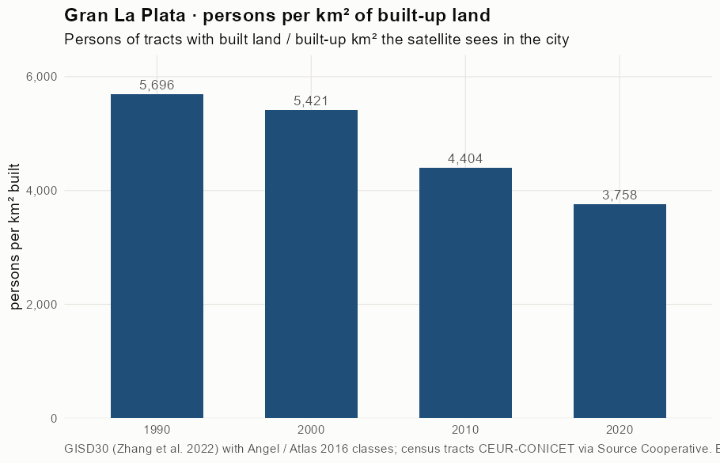
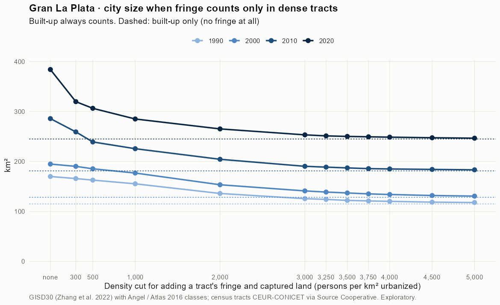
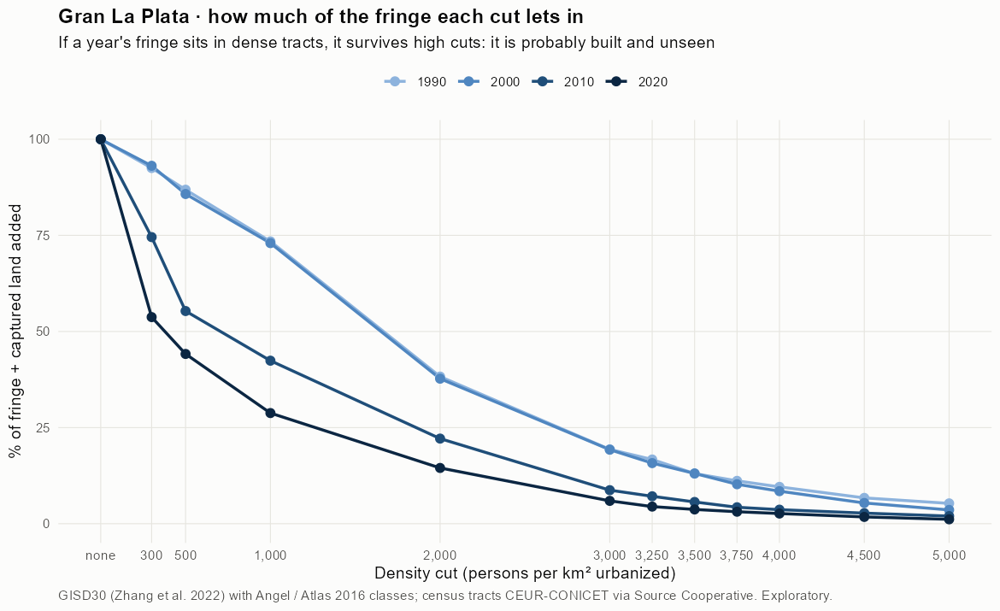
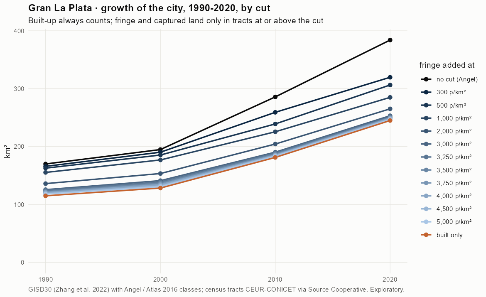
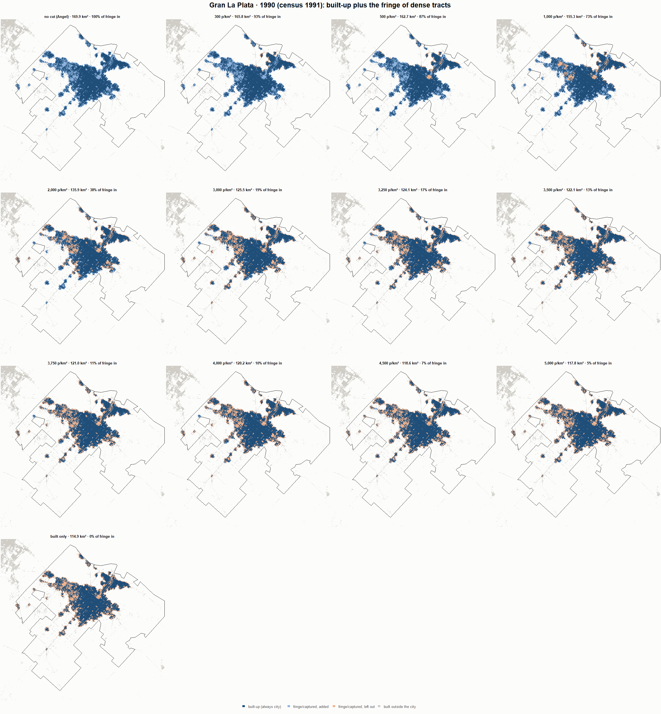
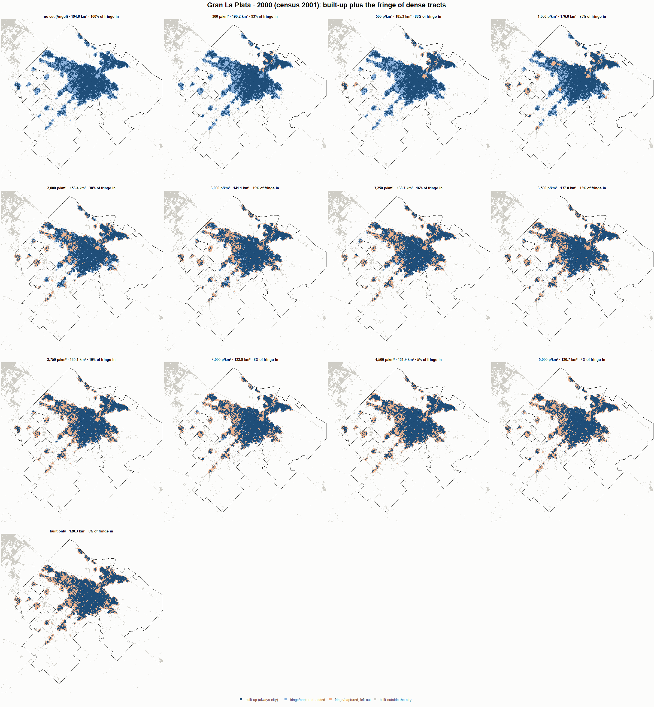
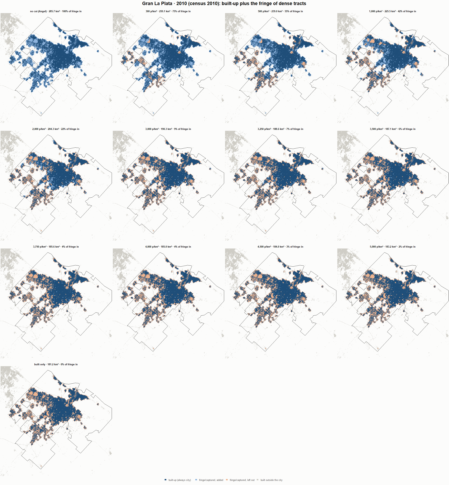
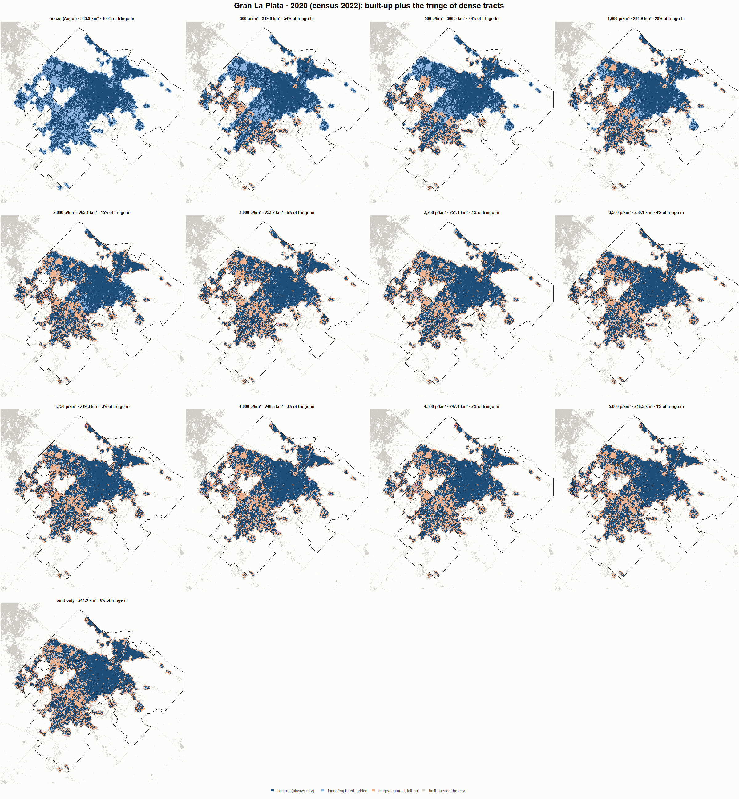

# Gran La Plata · when does the fringe count as city? 1990-2020

Exploratory test 2. None of these numbers are project figures (they are not in `CIFRAS_CANONICAS.json`). Generated by `Rpipe/scripts/13_prueba_franja.R` from the tract tables of step 11. Run of 2026-11-08. [All agglomerations](../REPORTE.md).

**Idea.** Built-up land is always city. Fringe and captured open space join the city **only in dense tracts**, where they are probably built and unseen by the older imagery. No cut gives the full Angel extent; an infinite cut, built-up only. Method in the [index](../REPORTE.md#method).

## Is the early imagery under-detecting?

If the older imagery misses buildings, persons per km² of *built* land should come out higher in the early years.

| Year | Persons (tracts with built land) | Built km² | Persons / km² built | Median tract, persons / km² built | Fringe + captured, % of extent |
|---|---|---|---|---|---|
| 1990 (census 1991) | 654,435 | 114.9 | 5,696 | 5,408 | 32.4 |
| 2000 (census 2001) | 695,365 | 128.3 | 5,421 | 5,338 | 34.1 |
| 2010 (census 2010) | 797,834 | 181.2 | 4,404 | 4,424 | 36.6 |
| 2020 (census 2022) | 920,382 | 244.9 | 3,758 | 3,426 | 36.2 |

## Results

**1990 (census 1991).** Built-up 114.9 km²; fringe + captured 55.0 km²; 655,415 persons in the city's tracts.

| Fringe added at | City km² | Fringe added km² | % of fringe added | Fringe % of city | Tracts adding fringe | Persons / km² city |
|---|---|---|---|---|---|---|
| no cut (Angel) | 169.9 | 55.0 | 100.0 | 32.4 | 414 | 3,858 |
| 300 p/km² | 165.8 | 50.9 | 92.5 | 30.7 | 409 | 3,954 |
| 500 p/km² | 162.7 | 47.8 | 86.9 | 29.4 | 405 | 4,029 |
| 1,000 p/km² | 155.3 | 40.4 | 73.4 | 26.0 | 394 | 4,221 |
| 2,000 p/km² | 135.9 | 21.0 | 38.3 | 15.5 | 342 | 4,821 |
| 3,000 p/km² | 125.5 | 10.6 | 19.3 | 8.5 | 290 | 5,221 |
| 3,250 p/km² | 124.1 | 9.2 | 16.7 | 7.4 | 281 | 5,282 |
| 3,500 p/km² | 122.1 | 7.2 | 13.0 | 5.9 | 263 | 5,369 |
| 3,750 p/km² | 121.0 | 6.1 | 11.1 | 5.1 | 251 | 5,415 |
| 4,000 p/km² | 120.2 | 5.3 | 9.6 | 4.4 | 241 | 5,454 |
| 4,500 p/km² | 118.6 | 3.7 | 6.7 | 3.1 | 215 | 5,527 |
| 5,000 p/km² | 117.8 | 2.9 | 5.3 | 2.5 | 193 | 5,563 |
| built only | 114.9 | 0.0 | 0.0 | 0.0 | 0 | 5,704 |

**2000 (census 2001).** Built-up 128.3 km²; fringe + captured 66.5 km²; 698,842 persons in the city's tracts.

| Fringe added at | City km² | Fringe added km² | % of fringe added | Fringe % of city | Tracts adding fringe | Persons / km² city |
|---|---|---|---|---|---|---|
| no cut (Angel) | 194.8 | 66.5 | 100.0 | 34.1 | 514 | 3,588 |
| 300 p/km² | 190.2 | 61.9 | 93.1 | 32.6 | 509 | 3,675 |
| 500 p/km² | 185.3 | 57.0 | 85.8 | 30.8 | 503 | 3,771 |
| 1,000 p/km² | 176.8 | 48.5 | 73.0 | 27.5 | 493 | 3,953 |
| 2,000 p/km² | 153.4 | 25.1 | 37.7 | 16.4 | 430 | 4,557 |
| 3,000 p/km² | 141.1 | 12.8 | 19.3 | 9.1 | 358 | 4,954 |
| 3,250 p/km² | 138.7 | 10.5 | 15.8 | 7.6 | 341 | 5,037 |
| 3,500 p/km² | 137.0 | 8.7 | 13.1 | 6.3 | 317 | 5,103 |
| 3,750 p/km² | 135.1 | 6.8 | 10.3 | 5.1 | 295 | 5,173 |
| 4,000 p/km² | 133.9 | 5.6 | 8.5 | 4.2 | 278 | 5,219 |
| 4,500 p/km² | 131.9 | 3.6 | 5.4 | 2.7 | 249 | 5,300 |
| 5,000 p/km² | 130.7 | 2.4 | 3.6 | 1.8 | 199 | 5,349 |
| built only | 128.3 | 0.0 | 0.0 | 0.0 | 0 | 5,448 |

**2010 (census 2010).** Built-up 181.2 km²; fringe + captured 104.6 km²; 802,115 persons in the city's tracts.

| Fringe added at | City km² | Fringe added km² | % of fringe added | Fringe % of city | Tracts adding fringe | Persons / km² city |
|---|---|---|---|---|---|---|
| no cut (Angel) | 285.7 | 104.6 | 100.0 | 36.6 | 563 | 2,807 |
| 300 p/km² | 259.1 | 77.9 | 74.5 | 30.1 | 549 | 3,096 |
| 500 p/km² | 239.0 | 57.8 | 55.3 | 24.2 | 533 | 3,356 |
| 1,000 p/km² | 225.5 | 44.3 | 42.4 | 19.7 | 507 | 3,557 |
| 2,000 p/km² | 204.3 | 23.1 | 22.1 | 11.3 | 436 | 3,926 |
| 3,000 p/km² | 190.3 | 9.1 | 8.7 | 4.8 | 337 | 4,215 |
| 3,250 p/km² | 188.6 | 7.5 | 7.1 | 4.0 | 320 | 4,252 |
| 3,500 p/km² | 187.1 | 5.9 | 5.7 | 3.2 | 301 | 4,288 |
| 3,750 p/km² | 185.6 | 4.5 | 4.3 | 2.4 | 278 | 4,321 |
| 4,000 p/km² | 185.0 | 3.8 | 3.7 | 2.1 | 265 | 4,336 |
| 4,500 p/km² | 184.0 | 2.9 | 2.8 | 1.6 | 232 | 4,358 |
| 5,000 p/km² | 183.2 | 2.1 | 2.0 | 1.1 | 204 | 4,377 |
| built only | 181.2 | 0.0 | 0.0 | 0.0 | 0 | 4,428 |

**2020 (census 2022).** Built-up 244.9 km²; fringe + captured 139.0 km²; 922,202 persons in the city's tracts.

| Fringe added at | City km² | Fringe added km² | % of fringe added | Fringe % of city | Tracts adding fringe | Persons / km² city |
|---|---|---|---|---|---|---|
| no cut (Angel) | 383.9 | 139.0 | 100.0 | 36.2 | 677 | 2,402 |
| 300 p/km² | 319.6 | 74.7 | 53.7 | 23.4 | 633 | 2,885 |
| 500 p/km² | 306.3 | 61.4 | 44.2 | 20.0 | 615 | 3,011 |
| 1,000 p/km² | 284.9 | 40.0 | 28.8 | 14.0 | 572 | 3,237 |
| 2,000 p/km² | 265.1 | 20.2 | 14.5 | 7.6 | 483 | 3,479 |
| 3,000 p/km² | 253.2 | 8.3 | 5.9 | 3.3 | 374 | 3,642 |
| 3,250 p/km² | 251.1 | 6.2 | 4.5 | 2.5 | 344 | 3,672 |
| 3,500 p/km² | 250.1 | 5.2 | 3.7 | 2.1 | 324 | 3,687 |
| 3,750 p/km² | 249.3 | 4.3 | 3.1 | 1.7 | 301 | 3,700 |
| 4,000 p/km² | 248.6 | 3.7 | 2.6 | 1.5 | 280 | 3,709 |
| 4,500 p/km² | 247.4 | 2.5 | 1.8 | 1.0 | 245 | 3,728 |
| 5,000 p/km² | 246.5 | 1.6 | 1.1 | 0.6 | 202 | 3,741 |
| built only | 244.9 | 0.0 | 0.0 | 0.0 | 0 | 3,765 |

### Growth by cut

| Fringe added at | 1990 km² | 2000 km² | 2010 km² | 2020 km² | 1990-2000 %/yr | 2000-2010 %/yr | 2010-2020 %/yr | 1990-2020 %/yr |
|---|---|---|---|---|---|---|---|---|
| no cut (Angel) | 169.9 | 194.8 | 285.7 | 383.9 | 1.38 | 3.91 | 3.00 | 2.75 |
| 300 p/km² | 165.8 | 190.2 | 259.1 | 319.6 | 1.38 | 3.14 | 2.12 | 2.21 |
| 500 p/km² | 162.7 | 185.3 | 239.0 | 306.3 | 1.31 | 2.58 | 2.51 | 2.13 |
| 1,000 p/km² | 155.3 | 176.8 | 225.5 | 284.9 | 1.31 | 2.46 | 2.37 | 2.04 |
| 2,000 p/km² | 135.9 | 153.4 | 204.3 | 265.1 | 1.21 | 2.91 | 2.64 | 2.25 |
| 3,000 p/km² | 125.5 | 141.1 | 190.3 | 253.2 | 1.17 | 3.04 | 2.90 | 2.37 |
| 3,250 p/km² | 124.1 | 138.7 | 188.6 | 251.1 | 1.12 | 3.12 | 2.90 | 2.38 |
| 3,500 p/km² | 122.1 | 137.0 | 187.1 | 250.1 | 1.16 | 3.17 | 2.95 | 2.42 |
| 3,750 p/km² | 121.0 | 135.1 | 185.6 | 249.3 | 1.11 | 3.23 | 2.99 | 2.44 |
| 4,000 p/km² | 120.2 | 133.9 | 185.0 | 248.6 | 1.09 | 3.29 | 3.00 | 2.45 |
| 4,500 p/km² | 118.6 | 131.9 | 184.0 | 247.4 | 1.07 | 3.39 | 3.00 | 2.48 |
| 5,000 p/km² | 117.8 | 130.7 | 183.2 | 246.5 | 1.04 | 3.44 | 3.01 | 2.49 |
| built only | 114.9 | 128.3 | 181.2 | 244.9 | 1.11 | 3.51 | 3.06 | 2.56 |

## Maps

Same frame in the four years: the 2020 city plus 3 km. Dark blue is built-up, always city; light blue is fringe or captured land added because its tract is dense; light orange is fringe left out. Black line: the analysis perimeter.

### 1990

### 2000

### 2010

### 2020

## Reading

- **The premise.** Persons per km² of built land: 5,696 in 1990, 5,421 in 2000, 4,404 in 2010, 3,758 in 2020. 1990 is clearly higher than 2010: consistent with built land missed in 1990, though it also fits a denser city that later spread out.
- **At 500 p/km²** the fringe that joins the city is 86.9 % of all fringe in 1990 and 44.2 % in 2020.
- **Growth 1990-2020**: 2.75 %/yr with the full Angel extent, 2.13 %/yr at 500, 2.56 %/yr built-up only.

