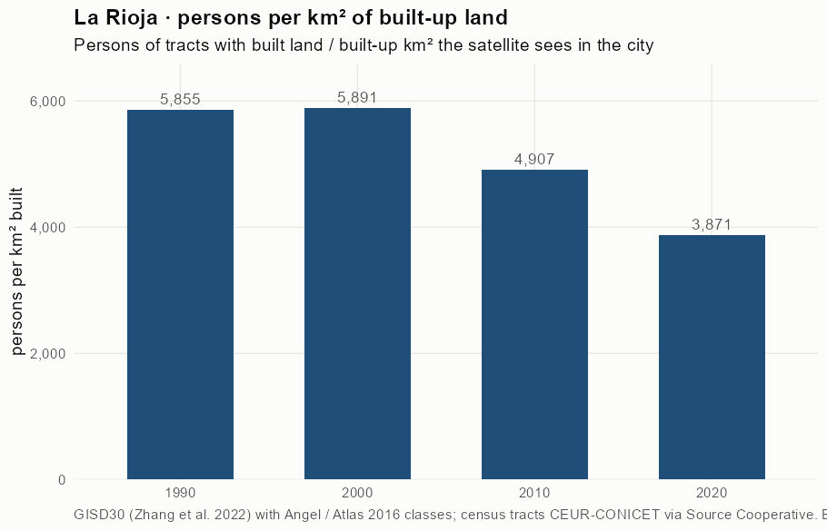
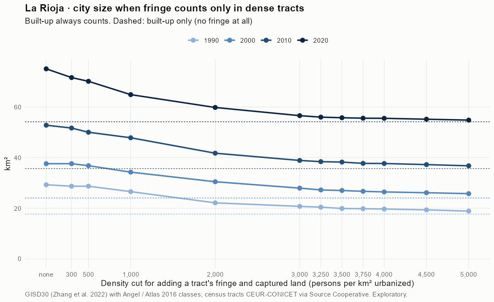
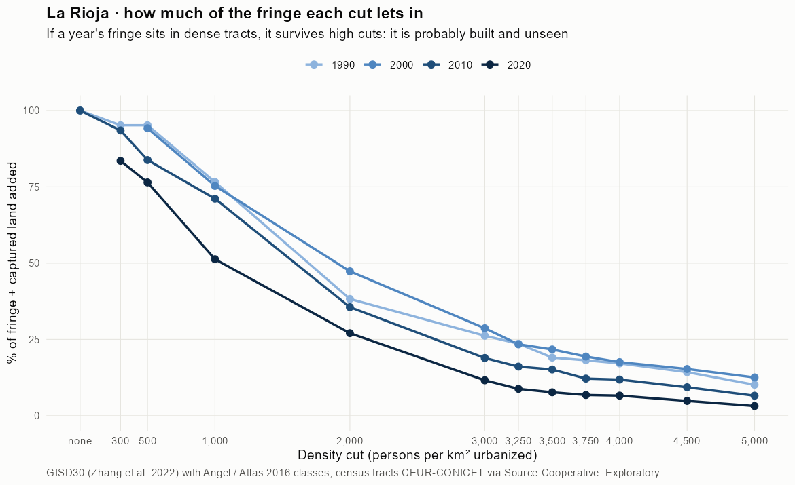
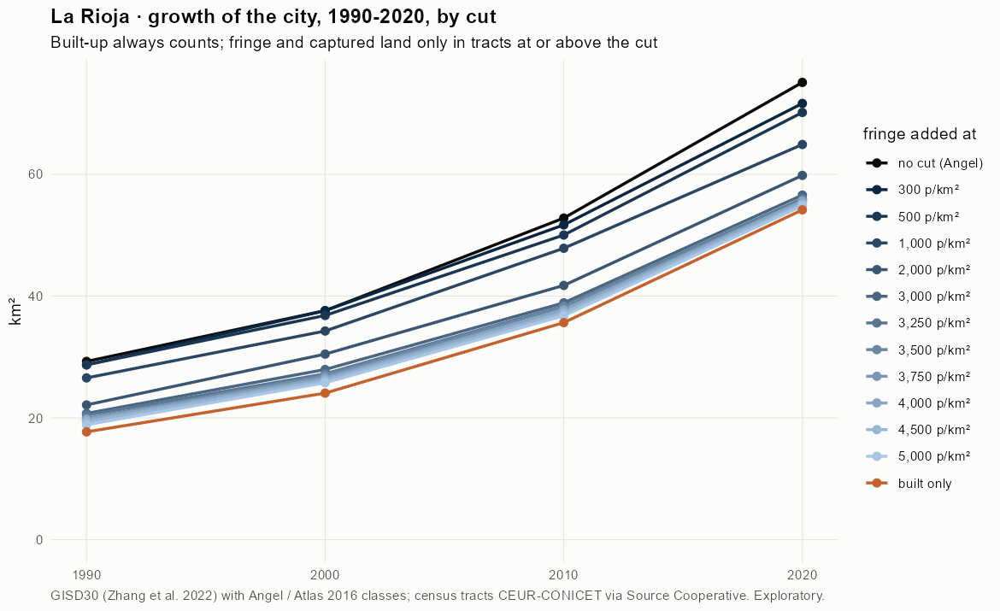
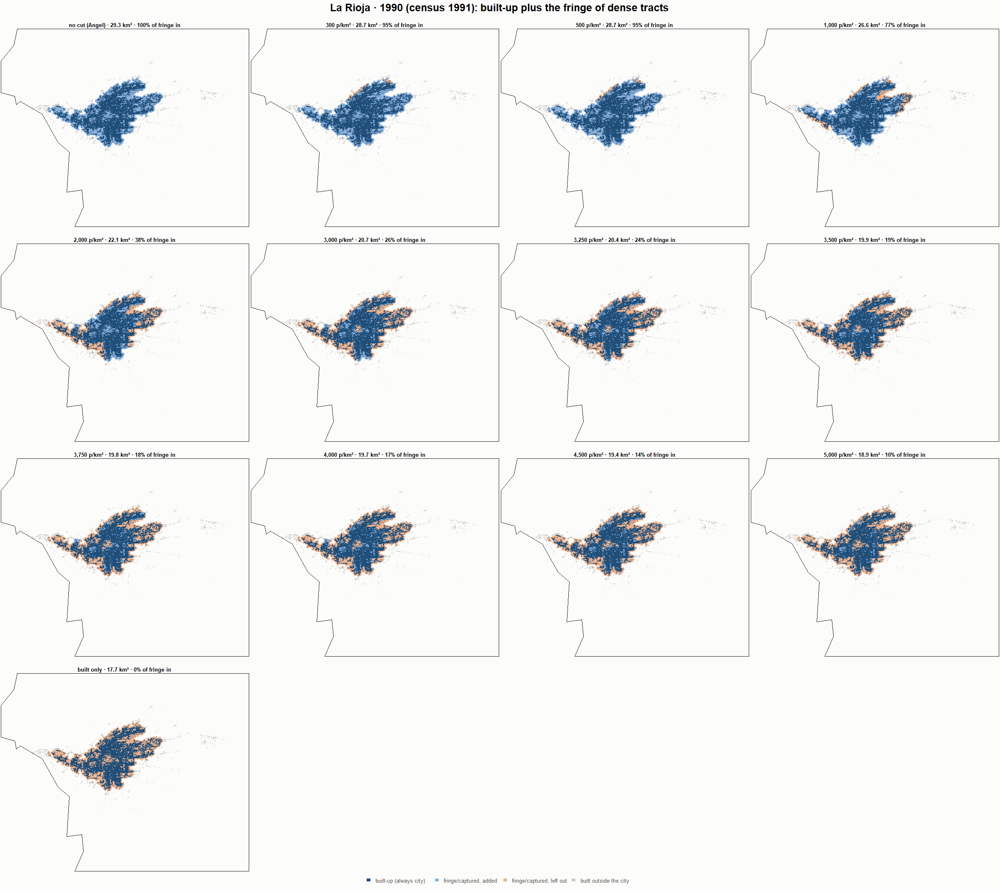
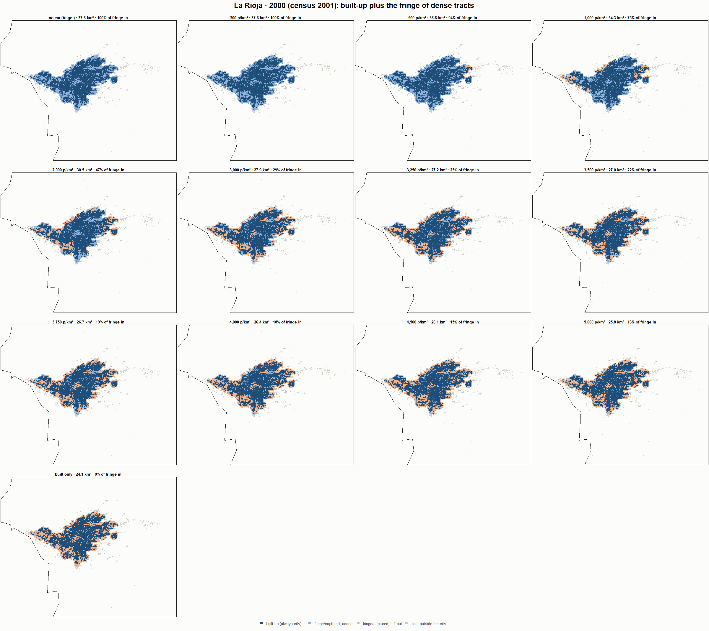
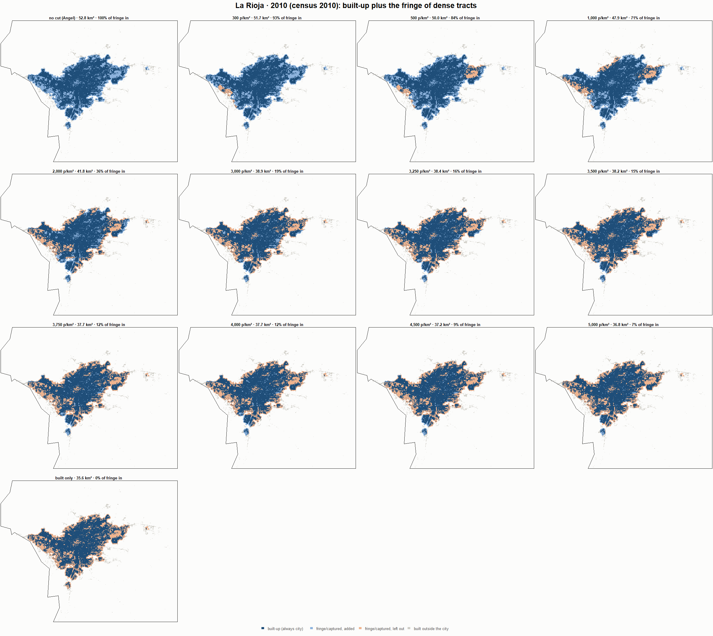
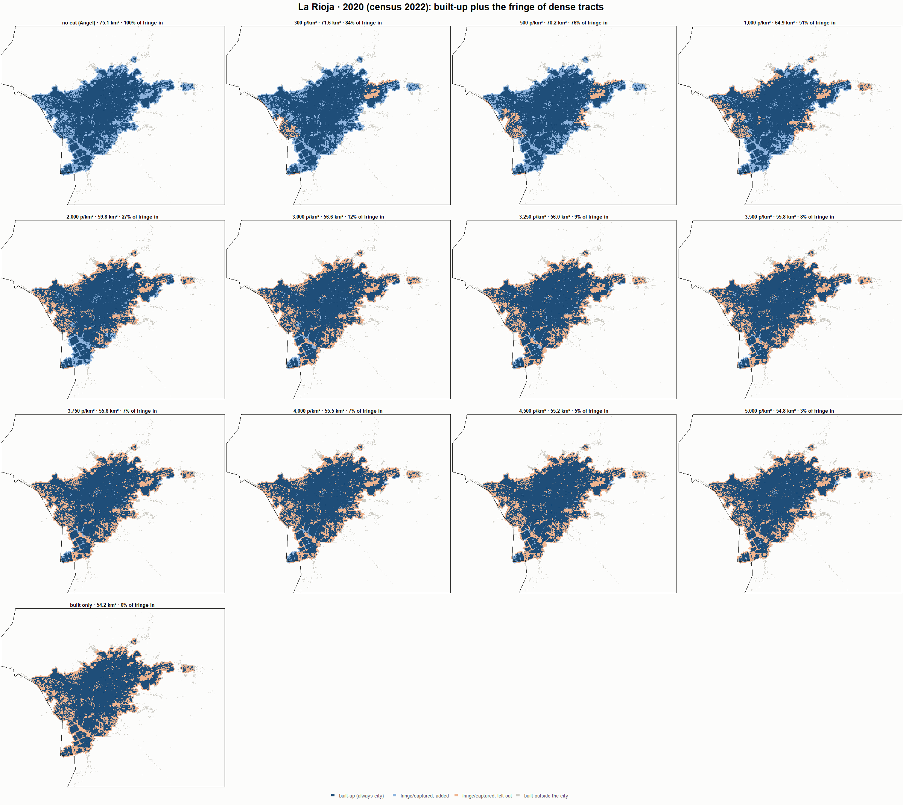

# La Rioja · when does the fringe count as city? 1990-2020

Exploratory test 2. None of these numbers are project figures (they are not in `CIFRAS_CANONICAS.json`). Generated by `Rpipe/scripts/13_prueba_franja.R` from the tract tables of step 11. Run of 2026-11-08. [All agglomerations](../REPORTE.md).

**Idea.** Built-up land is always city. Fringe and captured open space join the city **only in dense tracts**, where they are probably built and unseen by the older imagery. No cut gives the full Angel extent; an infinite cut, built-up only. Method in the [index](../REPORTE.md#method).

## Is the early imagery under-detecting?

If the older imagery misses buildings, persons per km² of *built* land should come out higher in the early years.

| Year | Persons (tracts with built land) | Built km² | Persons / km² built | Median tract, persons / km² built | Fringe + captured, % of extent |
|---|---|---|---|---|---|
| 1990 (census 1991) | 103,674 | 17.7 | 5,855 | 5,688 | 39.5 |
| 2000 (census 2001) | 141,778 | 24.1 | 5,891 | 5,433 | 36.0 |
| 2010 (census 2010) | 174,889 | 35.6 | 4,907 | 4,638 | 32.5 |
| 2020 (census 2022) | 209,625 | 54.2 | 3,871 | 3,622 | 27.9 |

## Results

**1990 (census 1991).** Built-up 17.7 km²; fringe + captured 11.6 km²; 103,674 persons in the city's tracts.

| Fringe added at | City km² | Fringe added km² | % of fringe added | Fringe % of city | Tracts adding fringe | Persons / km² city |
|---|---|---|---|---|---|---|
| no cut (Angel) | 29.3 | 11.6 | 100.0 | 39.5 | 78 | 3,542 |
| 300 p/km² | 28.7 | 11.0 | 95.2 | 38.3 | 77 | 3,611 |
| 500 p/km² | 28.7 | 11.0 | 95.2 | 38.3 | 77 | 3,611 |
| 1,000 p/km² | 26.6 | 8.9 | 76.6 | 33.3 | 74 | 3,903 |
| 2,000 p/km² | 22.1 | 4.4 | 38.3 | 20.0 | 64 | 4,685 |
| 3,000 p/km² | 20.7 | 3.0 | 26.2 | 14.6 | 58 | 5,000 |
| 3,250 p/km² | 20.4 | 2.7 | 23.6 | 13.4 | 57 | 5,074 |
| 3,500 p/km² | 19.9 | 2.2 | 19.1 | 11.1 | 54 | 5,207 |
| 3,750 p/km² | 19.8 | 2.1 | 18.2 | 10.6 | 53 | 5,234 |
| 4,000 p/km² | 19.7 | 2.0 | 17.1 | 10.1 | 52 | 5,266 |
| 4,500 p/km² | 19.4 | 1.7 | 14.3 | 8.5 | 47 | 5,356 |
| 5,000 p/km² | 18.9 | 1.2 | 10.1 | 6.2 | 37 | 5,491 |
| built only | 17.7 | 0.0 | 0.0 | 0.0 | 0 | 5,855 |

**2000 (census 2001).** Built-up 24.1 km²; fringe + captured 13.5 km²; 141,778 persons in the city's tracts.

| Fringe added at | City km² | Fringe added km² | % of fringe added | Fringe % of city | Tracts adding fringe | Persons / km² city |
|---|---|---|---|---|---|---|
| no cut (Angel) | 37.6 | 13.5 | 100.0 | 36.0 | 124 | 3,770 |
| 300 p/km² | 37.6 | 13.5 | 100.0 | 36.0 | 124 | 3,770 |
| 500 p/km² | 36.8 | 12.8 | 94.2 | 34.6 | 123 | 3,851 |
| 1,000 p/km² | 34.3 | 10.2 | 75.3 | 29.8 | 118 | 4,138 |
| 2,000 p/km² | 30.5 | 6.4 | 47.3 | 21.0 | 106 | 4,652 |
| 3,000 p/km² | 27.9 | 3.9 | 28.7 | 13.9 | 93 | 5,073 |
| 3,250 p/km² | 27.2 | 3.2 | 23.4 | 11.6 | 87 | 5,206 |
| 3,500 p/km² | 27.0 | 2.9 | 21.7 | 10.9 | 86 | 5,250 |
| 3,750 p/km² | 26.7 | 2.6 | 19.4 | 9.8 | 82 | 5,312 |
| 4,000 p/km² | 26.4 | 2.4 | 17.6 | 9.0 | 75 | 5,362 |
| 4,500 p/km² | 26.1 | 2.1 | 15.3 | 7.9 | 72 | 5,424 |
| 5,000 p/km² | 25.8 | 1.7 | 12.5 | 6.6 | 63 | 5,503 |
| built only | 24.1 | 0.0 | 0.0 | 0.0 | 0 | 5,891 |

**2010 (census 2010).** Built-up 35.6 km²; fringe + captured 17.2 km²; 174,972 persons in the city's tracts.

| Fringe added at | City km² | Fringe added km² | % of fringe added | Fringe % of city | Tracts adding fringe | Persons / km² city |
|---|---|---|---|---|---|---|
| no cut (Angel) | 52.8 | 17.2 | 100.0 | 32.5 | 133 | 3,313 |
| 300 p/km² | 51.7 | 16.0 | 93.5 | 31.0 | 132 | 3,385 |
| 500 p/km² | 50.0 | 14.4 | 83.8 | 28.7 | 131 | 3,498 |
| 1,000 p/km² | 47.9 | 12.2 | 71.1 | 25.5 | 127 | 3,657 |
| 2,000 p/km² | 41.8 | 6.1 | 35.6 | 14.6 | 112 | 4,191 |
| 3,000 p/km² | 38.9 | 3.2 | 18.9 | 8.3 | 95 | 4,499 |
| 3,250 p/km² | 38.4 | 2.8 | 16.1 | 7.2 | 92 | 4,556 |
| 3,500 p/km² | 38.2 | 2.6 | 15.1 | 6.8 | 88 | 4,575 |
| 3,750 p/km² | 37.7 | 2.1 | 12.2 | 5.5 | 83 | 4,637 |
| 4,000 p/km² | 37.7 | 2.0 | 11.8 | 5.4 | 80 | 4,644 |
| 4,500 p/km² | 37.2 | 1.6 | 9.3 | 4.3 | 69 | 4,698 |
| 5,000 p/km² | 36.8 | 1.1 | 6.5 | 3.1 | 58 | 4,759 |
| built only | 35.6 | 0.0 | 0.0 | 0.0 | 0 | 4,909 |

**2020 (census 2022).** Built-up 54.2 km²; fringe + captured 20.9 km²; 209,625 persons in the city's tracts.

| Fringe added at | City km² | Fringe added km² | % of fringe added | Fringe % of city | Tracts adding fringe | Persons / km² city |
|---|---|---|---|---|---|---|
| no cut (Angel) | 75.1 | 20.9 | 100.0 | 27.9 | 192 | 2,792 |
| 300 p/km² | 71.6 | 17.5 | 83.5 | 24.4 | 189 | 2,926 |
| 500 p/km² | 70.2 | 16.0 | 76.4 | 22.8 | 187 | 2,988 |
| 1,000 p/km² | 64.9 | 10.7 | 51.3 | 16.5 | 177 | 3,230 |
| 2,000 p/km² | 59.8 | 5.7 | 27.0 | 9.5 | 148 | 3,504 |
| 3,000 p/km² | 56.6 | 2.4 | 11.6 | 4.3 | 121 | 3,704 |
| 3,250 p/km² | 56.0 | 1.8 | 8.8 | 3.3 | 111 | 3,743 |
| 3,500 p/km² | 55.8 | 1.6 | 7.7 | 2.9 | 104 | 3,759 |
| 3,750 p/km² | 55.6 | 1.4 | 6.8 | 2.6 | 91 | 3,772 |
| 4,000 p/km² | 55.5 | 1.4 | 6.6 | 2.5 | 86 | 3,775 |
| 4,500 p/km² | 55.2 | 1.0 | 4.8 | 1.8 | 71 | 3,799 |
| 5,000 p/km² | 54.8 | 0.7 | 3.2 | 1.2 | 56 | 3,824 |
| built only | 54.2 | 0.0 | 0.0 | 0.0 | 0 | 3,871 |

### Growth by cut

| Fringe added at | 1990 km² | 2000 km² | 2010 km² | 2020 km² | 1990-2000 %/yr | 2000-2010 %/yr | 2010-2020 %/yr | 1990-2020 %/yr |
|---|---|---|---|---|---|---|---|---|
| no cut (Angel) | 29.3 | 37.6 | 52.8 | 75.1 | 2.54 | 3.45 | 3.58 | 3.19 |
| 300 p/km² | 28.7 | 37.6 | 51.7 | 71.6 | 2.74 | 3.23 | 3.32 | 3.09 |
| 500 p/km² | 28.7 | 36.8 | 50.0 | 70.2 | 2.52 | 3.11 | 3.44 | 3.02 |
| 1,000 p/km² | 26.6 | 34.3 | 47.9 | 64.9 | 2.58 | 3.40 | 3.09 | 3.02 |
| 2,000 p/km² | 22.1 | 30.5 | 41.8 | 59.8 | 3.25 | 3.20 | 3.66 | 3.37 |
| 3,000 p/km² | 20.7 | 27.9 | 38.9 | 56.6 | 3.03 | 3.36 | 3.82 | 3.40 |
| 3,250 p/km² | 20.4 | 27.2 | 38.4 | 56.0 | 2.91 | 3.50 | 3.84 | 3.42 |
| 3,500 p/km² | 19.9 | 27.0 | 38.2 | 55.8 | 3.10 | 3.54 | 3.84 | 3.49 |
| 3,750 p/km² | 19.8 | 26.7 | 37.7 | 55.6 | 3.03 | 3.52 | 3.95 | 3.50 |
| 4,000 p/km² | 19.7 | 26.4 | 37.7 | 55.5 | 2.99 | 3.60 | 3.96 | 3.52 |
| 4,500 p/km² | 19.4 | 26.1 | 37.2 | 55.2 | 3.05 | 3.60 | 4.01 | 3.55 |
| 5,000 p/km² | 18.9 | 25.8 | 36.8 | 54.8 | 3.16 | 3.62 | 4.08 | 3.62 |
| built only | 17.7 | 24.1 | 35.6 | 54.2 | 3.12 | 4.01 | 4.27 | 3.80 |

## Maps

Same frame in the four years: the 2020 city plus 3 km. Dark blue is built-up, always city; light blue is fringe or captured land added because its tract is dense; light orange is fringe left out. Black line: the analysis perimeter.

### 1990

### 2000

### 2010

### 2020

## Reading

- **The premise.** Persons per km² of built land: 5,855 in 1990, 5,891 in 2000, 4,907 in 2010, 3,871 in 2020. 1990 is clearly higher than 2010: consistent with built land missed in 1990, though it also fits a denser city that later spread out.
- **At 500 p/km²** the fringe that joins the city is 95.2 % of all fringe in 1990 and 76.4 % in 2020.
- **Growth 1990-2020**: 3.19 %/yr with the full Angel extent, 3.02 %/yr at 500, 3.80 %/yr built-up only.

